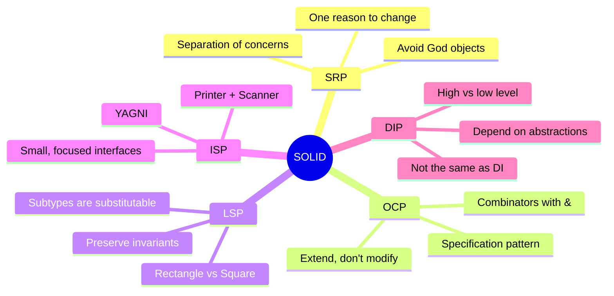
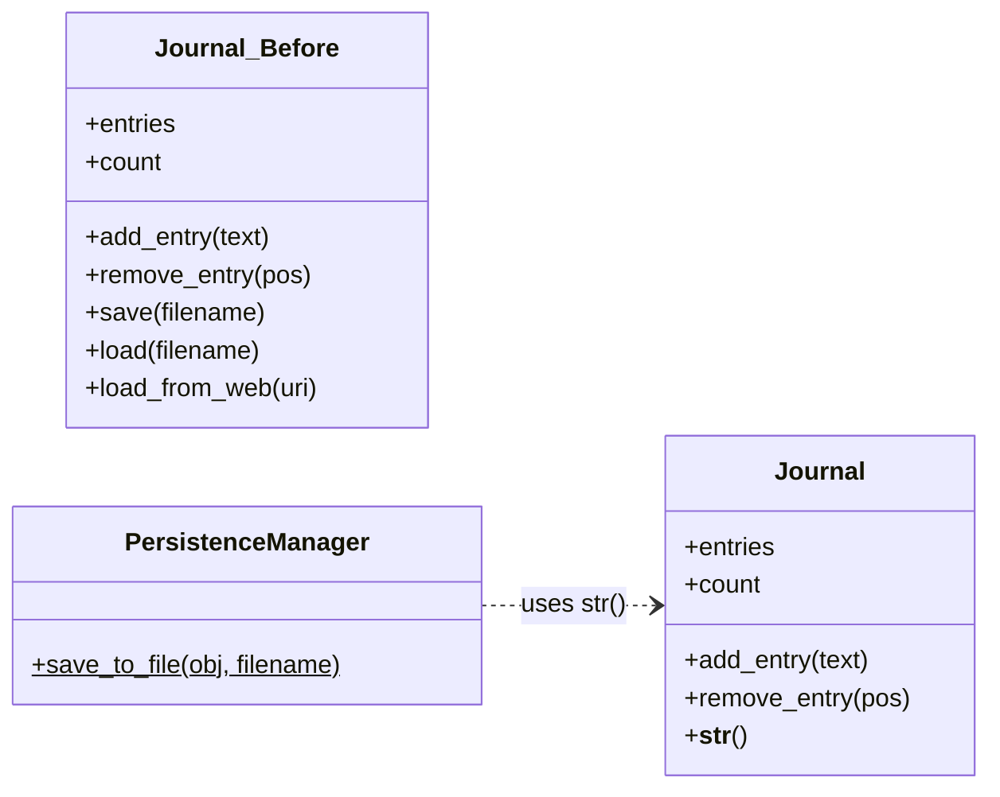
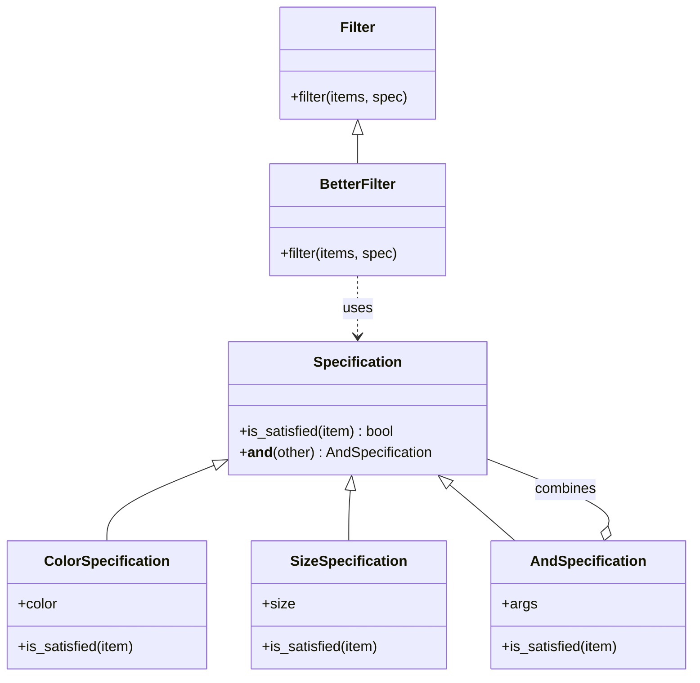
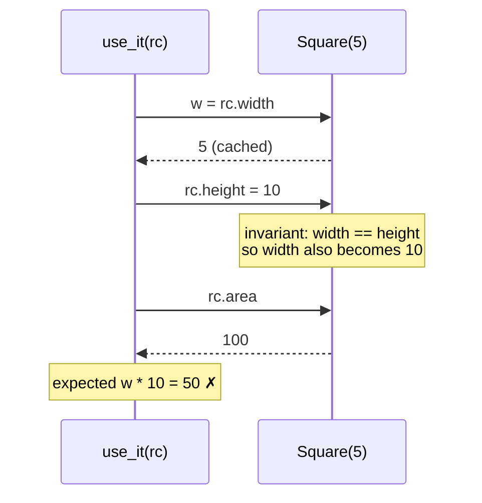
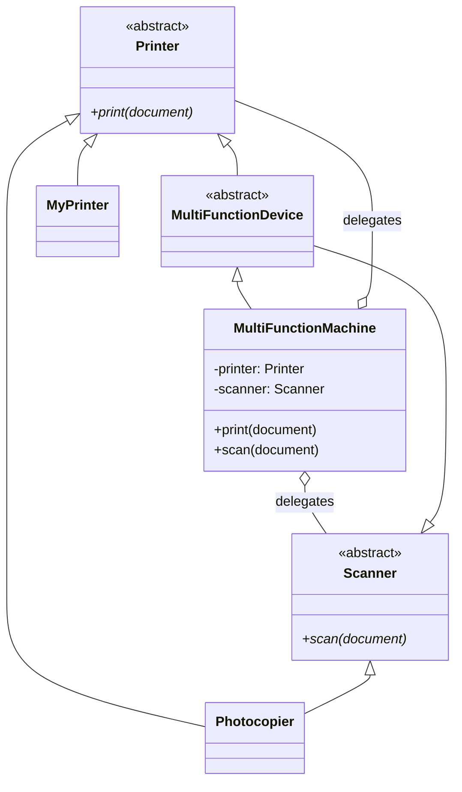
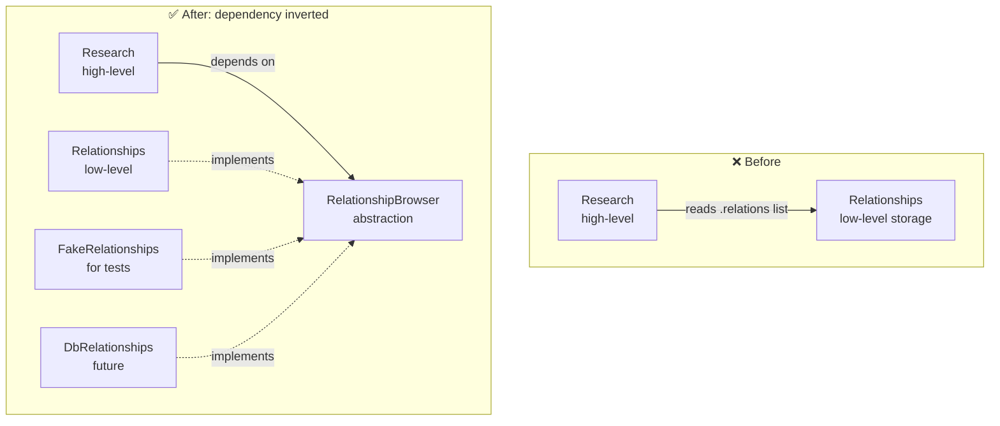
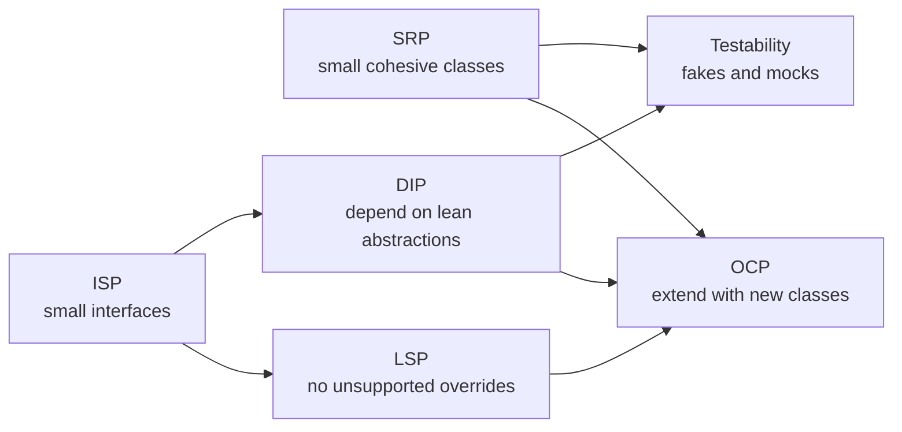
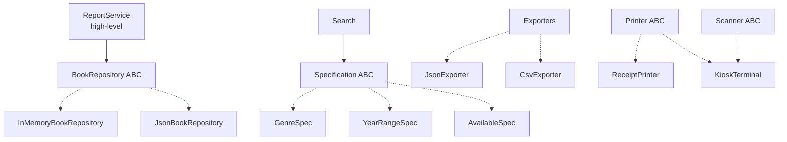

# 🧱 SOLID Design Principles in Python: Complete Study Guide

><i> A complete, interview-ready guide to the five SOLID principles: **S**ingle Responsibility, **O**pen–Closed, **L**iskov Substitution, **I**nterface Segregation and **D**ependency Inversion.</i>

---

## 📑 Table of Contents

1. [Session Overview](#-session-overview)
2. [Learning Objectives](#-learning-objectives)
3. [Detailed Notes](#-detailed-notes)
    1. [Part 1: Why SOLID Matters](#-part-1-why-solid-matters)
    2. [Part 2: Single Responsibility Principle (SRP)](#-part-2-single-responsibility-principle-srp)
    3. [Part 3: Open–Closed Principle (OCP)](#-part-3-openclosed-principle-ocp)
    4. [Part 4: Liskov Substitution Principle (LSP)](#-part-4-liskov-substitution-principle-lsp)
    5. [Part 5: Interface Segregation Principle (ISP)](#-part-5-interface-segregation-principle-isp)
    6. [Part 6: Dependency Inversion Principle (DIP)](#-part-6-dependency-inversion-principle-dip)
    7. [Part 7: How the Principles Work Together](#-part-7-how-the-principles-work-together)
4. [Glossary](#-glossary)
5. [One-Minute Revision](#-one-minute-revision)
6. [Cheat Sheet](#-cheat-sheet)
7. [Interview Questions and Answers](#-interview-questions-and-answers)
8. [Scenario-Based Questions](#-scenario-based-questions)
9. [Hands-on Exercises](#-hands-on-exercises)
10. [Practice Assignment](#-practice-assignment)
11. [Additional Resources](#-additional-resources)
12. [Final Revision Sheet](#-final-revision-sheet)

---

## 🗺 Session Overview

SOLID is a set of five object-oriented design principles, popularised by Robert C. Martin, for keeping code **easy to change, extend, test and reason about**. The lecture teaches each principle with a small, runnable Python example:

| # | Principle | One-line idea | Course example |
|---|-----------|---------------|----------------|
| S | **Single Responsibility** | A class should have one reason to change | `Journal` + `PersistenceManager` |
| O | **Open–Closed** | Open for extension, closed for modification | `ProductFilter` → Specification pattern |
| L | **Liskov Substitution** | A subtype must work wherever its base type works | `Rectangle` vs `Square` |
| I | **Interface Segregation** | Don't force clients to implement methods they don't need | `Machine` → `Printer` + `Scanner` |
| D | **Dependency Inversion** | High-level modules depend on abstractions, not low-level details | `Research` → `RelationshipBrowser` |



> 📌 **About the course code.** Running the five provided `.py` files exposed a few bugs: a missing `@staticmethod`, no-op `Square` setters, shared class-level state, a wrong inverse relationship and abstract methods that aren't enforced. Each part shows the **original course code** first, then a **📎 Beyond the transcript** corrected version.

---

## 🎯 Learning Objectives

By the end of this guide you should be able to:

- [ ] Define each SOLID principle precisely and explain the problem it solves.
- [ ] Spot a **God object** and refactor it by separating concerns (SRP).
- [ ] Explain **state-space explosion** and implement the **Specification** pattern with `&` combinators (OCP).
- [ ] Explain why `Square` extending `Rectangle` breaks substitutability, and give three alternative designs (LSP).
- [ ] Split a "fat" interface into role interfaces, and connect ISP to **YAGNI** (ISP).
- [ ] Distinguish **high-level** from **low-level** modules, and explain why **DIP ≠ dependency injection** (DIP).
- [ ] Use Python's `abc.ABC`, `@abstractmethod`, `typing.Protocol` and duck typing to express abstractions.
- [ ] Use fake implementations to unit-test code that depends on abstractions.
- [ ] Answer beginner-to-advanced SOLID interview questions and reason through design scenarios.

---

## 📘 Detailed Notes

The notes follow the five principles in course order, framed by an introduction and a closing section on how the principles reinforce each other.

### 🧱 Part 1: Why SOLID Matters

#### 🧠 Concept

Design principles are guidelines for arranging classes and modules so that **change is cheap**. Code that already works, is tested and is in production should rarely need to be reopened. New behaviour should be added *beside* it rather than *inside* it.

SOLID gives you five lenses for looking at a design:

```text
                    ┌────────────────────────────┐
                    │   Maintainable OO design   │
                    └─────────────┬──────────────┘
        ┌───────────┬─────────────┼─────────────┬───────────┐
        ▼           ▼             ▼             ▼           ▼
     ┌─────┐     ┌─────┐       ┌─────┐       ┌─────┐     ┌─────┐
     │ SRP │     │ OCP │       │ LSP │       │ ISP │     │ DIP │
     └──┬──┘     └──┬──┘       └──┬──┘       └──┬──┘     └──┬──┘
   cohesion   extensibility  correct       lean        loose
   of a class  w/o editing   inheritance   contracts   coupling
```

#### 💡 Patterns vs Anti-patterns vs Enterprise Patterns

The lecture uses three related terms:

| Term | Meaning | Example from the course |
|------|---------|-------------------------|
| **Design pattern** | A reusable, *good* solution to a recurring design problem | Decorator, Factory Method (mentioned for later) |
| **Anti-pattern** | A common but *bad* solution that keeps showing up | **God object** |
| **Enterprise pattern** | A larger-scale pattern used in business applications. The lecture says these "would need a separate course" | **Specification** |

#### 🐍 Python-specific Notes

Python is **dynamically typed** and uses **duck typing**: if an object has the right methods, it works, whatever its class. The lecture points out that the SOLID examples would mostly "still work" without explicit interfaces, but that declaring them is **"a very friendly thing to do"**, because it documents the contract for the people who use your code.

| Tool | What it gives you |
|------|-------------------|
| Plain base class + `NotImplementedError` | A documented contract, checked only at call time |
| `abc.ABC` + `@abstractmethod` | Prevents creating an instance until every abstract method is implemented |
| `typing.Protocol` | Structural ("static duck") typing, checked by mypy/pyright, with no inheritance needed |

> ⚠️ **Easy to miss:** `@abstractmethod` **does nothing** unless the class's metaclass is `ABCMeta`, usually by inheriting from `abc.ABC`. Several course files decorate methods with `@abstractmethod` on plain classes, so nothing is enforced. We'll fix this in Parts 5 and 6.

#### 🎯 Key Takeaways

- SOLID is about **managing change**: fewer edits to tested code and fewer ripple effects.
- An **anti-pattern** is a common bad solution. The God object is the one SRP prevents.
- In Python, interfaces are optional thanks to duck typing, but **explicit abstractions document intent**.
- `@abstractmethod` only works on classes that inherit from `ABC` (or use `ABCMeta`).

---

### 🧩 Part 2: Single Responsibility Principle (SRP)

#### 📖 Definition

> **A class should have a single primary responsibility, and therefore only one reason to change.** That reason should be related to its primary responsibility.

The lecture treats SRP and **Separation of Concerns (SoC)** as meaning "pretty much the same thing". Strictly, SoC is the broader architectural idea: split a system into parts that each handle one concern. SRP applies it at the class level.

#### ❓ Why It Exists

Without SRP, classes become a **God object**: a "kitchen sink" class that manages data, persistence, formatting, networking and anything else a developer bolted on. The cost shows up when something *cross-cutting* has to change.

> 💡 **Lecture insight:** Imagine every type in your app (`Journal`, `Invoice`, `Note`…) has its own `save`, `load` and `load_from_web`. Now you need to add a check that you're allowed to write to a directory. You have to go into **every single class** and change it. Put persistence in one place, and the change happens once.

#### 💻 Code Example: The Violation (course code)

```python
class Journal:
    def __init__(self):
        self.entries = []
        self.count = 0

    def add_entry(self, text):
        self.entries.append(f"{self.count}: {text}")
        self.count += 1

    def remove_entry(self, pos):
        del self.entries[pos]

    def __str__(self):
        return "\n".join(self.entries)

    # break SRP: persistence is a second responsibility
    def save(self, filename):
        file = open(filename, "w")
        file.write(str(self))
        file.close()

    def load(self, filename):
        pass

    def load_from_web(self, uri):
        pass
```

📝 **What it does:** `Journal` stores numbered entries (its real job), and *also* saves, loads and fetches itself from the web.

🔑 **Key lines:** `save`, `load` and `load_from_web` are a **persistence** concern, unrelated to managing entries.

⚠️ **Edge cases:** `remove_entry` deletes by position but `count` keeps rising, so the numbers can skip (`0, 2, 3`). That's acceptable for a journal, but worth noticing.

#### 💻 Code Example: The Refactor (course code)

```python
class PersistenceManager:
    def save_to_file(journal, filename):      # ⚠️ missing @staticmethod
        file = open(filename, "w")
        file.write(str(journal))
        file.close()


j = Journal()
j.add_entry("I cried today.")
j.add_entry("I ate a bug.")
print(f"Journal entries:\n{j}\n")

p = PersistenceManager()
file = r'c:\temp\journal.txt'
p.save_to_file(j, file)   # 💥 TypeError as written

with open(file) as fh:
    print(fh.read())
```

> 🐞 **Bug in the provided file:** In the lecture the instructor says *"I'll make this a static"*, but the file has no `@staticmethod`. Calling `p.save_to_file(j, file)` on an instance passes `p` as the first argument, so Python raises:
>
> `TypeError: PersistenceManager.save_to_file() takes 2 positional arguments but 3 were given`
>
> The path `c:\temp\journal.txt` is also Windows-only.

#### 📎 Beyond the transcript: Corrected, Idiomatic Version

```python
from pathlib import Path


class Journal:
    """Responsibility: manage journal entries. Nothing else."""

    def __init__(self):
        self.entries: list[str] = []
        self.count = 0

    def add_entry(self, text: str) -> None:
        self.entries.append(f"{self.count}: {text}")
        self.count += 1

    def remove_entry(self, pos: int) -> None:
        del self.entries[pos]

    def __str__(self) -> str:
        return "\n".join(self.entries)


class PersistenceManager:
    """Responsibility: persist objects. One place to change saving rules."""

    @staticmethod
    def save_to_file(obj, filename: str | Path) -> None:
        with open(filename, "w", encoding="utf-8") as fh:   # closes even on error
            fh.write(str(obj))


j = Journal()
j.add_entry("I cried today.")
j.add_entry("I ate a bug.")
print(f"Journal entries:\n{j}\n")

path = Path("journal.txt")
PersistenceManager.save_to_file(j, path)
print(path.read_text(encoding="utf-8"))
```

📝 **What it does:** It prints the entries twice. The first copy comes from `str(j)`. The second comes from writing the journal to disk and reading the file back, which matches what the lecture showed.

```text
Journal entries:
0: I cried today.
1: I ate a bug.

0: I cried today.
1: I ate a bug.
```

🔑 **Key lines:** `@staticmethod` lets you call it on the class or on an instance. `with open(...)` guarantees the file is closed. `save_to_file` accepts *any* object with a `__str__`, so other types can reuse it.

⚠️ **Edge cases:** The directory may not exist, or you may lack permission. That check now lives in **one** place, which is exactly the lecture's argument.

#### 🔄 Before vs After



#### ❌ Common Mistakes

| Mistake | Why it hurts | Fix |
|---------|--------------|-----|
| Reading SRP as "one method per class" | Leads to dozens of tiny, meaningless classes | One *reason to change* (one actor or concern), not one method |
| Putting persistence, logging, validation and formatting in the domain class | Every infrastructure change touches business code | Separate repository, formatter and validator classes |
| Forgetting `@staticmethod` / `@classmethod` | `TypeError` when called on an instance | Decorate, or make it a module-level function |
| Splitting too early | Indirection with no benefit | Split when a *second* reason to change actually appears |

#### 🚀 Best Practices

- **Course:** keep the primary responsibility in the class, and move secondary ones (such as persistence) into their own classes.
- **Industry:** the Repository pattern, presenters and serializers, and service layers are all SRP applied at scale.
- **Heuristic:** if describing the class needs the word "and" ("it manages entries *and* saves to disk *and* downloads…"), it probably has too many responsibilities.

> 💡 **Memory Trick:** A chef cooks, and a waiter serves. If the chef also takes payments, every change to the payment system interrupts the kitchen.

#### 🎯 Key Takeaways

- SRP = **one reason to change**. It is closely related to **separation of concerns**.
- SRP prevents the **God object** anti-pattern.
- Cross-cutting concerns (persistence, logging) belong in their own classes, so you change them **once**.
- The course file is missing `@staticmethod`. Add it, or calling the method on an instance raises a `TypeError`.

---

### 🔓 Part 3: Open–Closed Principle (OCP)

#### 📖 Definition

> **Software entities should be open for extension but closed for modification.** Add new behaviour by writing *new* code (new classes), not by editing code that is already written, tested and in production.

#### ❓ Why It Exists

The lecture describes code "already written, already tested, already put into production, might already be used by other people". Every edit to it risks regressions. OCP pushes variation points into **abstractions**, so that new requirements become new subclasses.

#### 💻 Code Example: The Violation and State-Space Explosion (course code)

```python
from enum import Enum


class Color(Enum):
    RED = 1
    GREEN = 2
    BLUE = 3


class Size(Enum):
    SMALL = 1
    MEDIUM = 2
    LARGE = 3


class Product:
    def __init__(self, name, color, size):
        self.name = name
        self.color = color
        self.size = size


class ProductFilter:
    def filter_by_color(self, products, color):
        for p in products:
            if p.color == color: yield p

    def filter_by_size(self, products, size):
        for p in products:
            if p.size == size: yield p

    def filter_by_size_and_color(self, products, size, color):
        for p in products:
            if p.color == color and p.size == size:
                yield p
```

📝 **What it does:** It adds a new method to `ProductFilter` every time the business asks for a new filter, so the class is **modified** every time.

🔑 **The explosion:** With 3 criteria (color *c*, size *s*, weight *w*) you need `c, s, w, cs, sw, cw, csw` = **7 methods**. In general, *n* criteria need **2ⁿ − 1** combination methods, and that's before you add OR and NOT.

```text
criteria   methods needed (AND only)
   1   →     1
   2   →     3
   3   →     7
   4   →    15
   n   →  2ⁿ − 1      ← "this really does not scale"
```

#### ⚙️ How It Works: The Specification Pattern

The **Specification** pattern is the enterprise pattern used in the lecture. It separates *what* to match from *how* to filter:

- **`Specification`**: decides whether an item satisfies a criterion (`is_satisfied(item)`).
- **`Filter`**: walks over items and keeps those that satisfy a given specification.
- **Combinators** such as `AndSpecification` build complex criteria out of simple ones.



#### 💻 Code Example: The OCP-Compliant Design (course code)

```python
class Specification:
    def is_satisfied(self, item):
        pass

    # and operator makes life easier
    def __and__(self, other):
        return AndSpecification(self, other)


class Filter:
    def filter(self, items, spec):
        pass


class ColorSpecification(Specification):
    def __init__(self, color):
        self.color = color

    def is_satisfied(self, item):
        return item.color == self.color


class SizeSpecification(Specification):
    def __init__(self, size):
        self.size = size

    def is_satisfied(self, item):
        return item.size == self.size


class AndSpecification(Specification):
    def __init__(self, *args):
        self.args = args

    def is_satisfied(self, item):
        return all(map(
            lambda spec: spec.is_satisfied(item), self.args))


class BetterFilter(Filter):
    def filter(self, items, spec):
        for item in items:
            if spec.is_satisfied(item):
                yield item


apple = Product('Apple', Color.GREEN, Size.SMALL)
tree = Product('Tree', Color.GREEN, Size.LARGE)
house = Product('House', Color.BLUE, Size.LARGE)
products = [apple, tree, house]

bf = BetterFilter()

print('Green products (new):')
green = ColorSpecification(Color.GREEN)
for p in bf.filter(products, green):
    print(f' - {p.name} is green')

print('Large products:')
large = SizeSpecification(Size.LARGE)
for p in bf.filter(products, large):
    print(f' - {p.name} is large')

print('Large blue items:')
large_blue = large & ColorSpecification(Color.BLUE)   # same as AndSpecification(large, ...)
for p in bf.filter(products, large_blue):
    print(f' - {p.name} is large and blue')
```

**Output (verified):**

```text
Green products (new):
 - Apple is green
 - Tree is green
Large products:
 - Tree is large
 - House is large
Large blue items:
 - House is large and blue
```

📝 **What it does:** Each criterion is a small class. `BetterFilter` never changes. Adding a weight filter means writing a new `WeightSpecification` and touching **no existing code**.

🔑 **Key lines:**
- `AndSpecification(*args)` accepts **any number** of specs. An earlier, commented-out version in the file took exactly two.
- `all(map(lambda spec: spec.is_satisfied(item), self.args))` short-circuits on the first failure.
- `__and__` overloads the **`&`** operator. As the lecture notes, Python's `and` keyword **can't be overloaded**, so `&` "is good enough".
- `yield` makes `filter` a lazy generator.

⚠️ **Edge cases:**
- `Specification.is_satisfied` returns `None` (falsy) if a subclass forgets to override it, so nothing matches and nothing errors. Make it abstract.
- `a & b & c` builds nested `AndSpecification`s, which is fine but slightly deeper than `AndSpecification(a, b, c)`.
- `&` has higher precedence than `|`, so mixing the two needs parentheses.

#### 🪜 Step-by-Step Execution of `large & ColorSpecification(Color.BLUE)`

```text
large.__and__(blue_spec)
   ↓
AndSpecification(large, blue_spec)
   ↓
BetterFilter.filter(products, and_spec)
   ↓  for each product:
and_spec.is_satisfied(p) → all([large.is_satisfied(p), blue_spec.is_satisfied(p)])
   ↓
apple: SMALL → False (stops early)   tree: GREEN → False   house: LARGE & BLUE → True
   ↓
yield house
```

#### 📎 Beyond the transcript: Abstract Base + OR / NOT Combinators

```python
from abc import ABC, abstractmethod


class Specification(ABC):
    @abstractmethod
    def is_satisfied(self, item) -> bool: ...

    def __and__(self, other): return AndSpecification(self, other)
    def __or__(self, other):  return OrSpecification(self, other)
    def __invert__(self):     return NotSpecification(self)


class AndSpecification(Specification):
    def __init__(self, *specs): self.specs = specs
    def is_satisfied(self, item): return all(s.is_satisfied(item) for s in self.specs)


class OrSpecification(Specification):
    def __init__(self, *specs): self.specs = specs
    def is_satisfied(self, item): return any(s.is_satisfied(item) for s in self.specs)


class NotSpecification(Specification):
    def __init__(self, spec): self.spec = spec
    def is_satisfied(self, item): return not self.spec.is_satisfied(item)


class ColorSpecification(Specification):
    def __init__(self, color): self.color = color
    def is_satisfied(self, item): return item.color == self.color


class SizeSpecification(Specification):
    def __init__(self, size): self.size = size
    def is_satisfied(self, item): return item.size == self.size


# "green OR blue, and NOT small"  →  Tree, House
spec = (ColorSpecification(Color.GREEN) | ColorSpecification(Color.BLUE)) & ~SizeSpecification(Size.SMALL)
print([p.name for p in products if spec.is_satisfied(p)])   # ['Tree', 'House']
```

📝 **What it does:** With three combinators (`&`, `|`, `~`) you can express *any* boolean query over *n* criteria using **n + 3 classes** instead of an exponential number of methods. Inheriting from `ABC` means a specification that forgets `is_satisfied` fails loudly when you create it.

#### 🌍 Real-World Usage

- **E-commerce search filters** (color, size, brand, price range) combined at runtime from UI checkboxes.
- **Business rules**, such as "eligible for discount = loyal customer AND (order > $100 OR promo active)".
- **ORMs:** Django's `Q(a) & Q(b) | ~Q(c)` and SQLAlchemy's `and_` / `or_` use the same combinator idea.
- **Plugin architectures:** new behaviour arrives as new classes registered with an unchanged core.

#### ❌ Common Mistakes

| Mistake | Consequence |
|---------|-------------|
| Adding `if/elif` branches to a working class for each new case | Repeated modification and regression risk, which is exactly what OCP warns about |
| Trying to overload `and` / `or` | Not possible in Python. Use `&`, `\|` and `~` |
| Abstracting everything up front "just in case" | Speculative generality. Apply OCP at variation points you've **actually seen** change |
| Base specification returning `None` silently | Bugs hide. Use `ABC` + `@abstractmethod` |

#### 🎯 Key Takeaways

- OCP = **extend through new code, don't modify tested code**.
- *n* filter criteria in one class lead to **2ⁿ − 1** methods. This is **state-space explosion**.
- The **Specification** pattern separates *criteria* (`is_satisfied`) from *iteration* (`Filter`).
- `__and__` makes `spec1 & spec2` work. The `and` keyword can't be overloaded.
- In the course's summary, OCP is achieved through **inheritance and abstraction** rather than edits.

---

### 🔁 Part 4: Liskov Substitution Principle (LSP)

#### 📖 Definition

> Named after **Barbara Liskov**: **if a function works with a base class, it must keep working correctly when given any of its subclasses.** You should always be able to substitute a subtype for its base type.

More formally: a subtype must honour the base type's **contract**. It can't strengthen preconditions, weaken postconditions or break the base type's invariants.

#### 💻 Code Example: The Classic Violation (course code)

```python
class Rectangle:
    def __init__(self, width, height):
        self._height = height
        self._width = width

    @property
    def area(self):
        return self._width * self._height

    def __str__(self):
        return f'Width: {self.width}, height: {self.height}'

    @property
    def width(self):
        return self._width

    @width.setter
    def width(self, value):
        self._width = value

    @property
    def height(self):
        return self._height

    @height.setter
    def height(self, value):
        self._height = value


class Square(Rectangle):
    def __init__(self, size):
        Rectangle.__init__(self, size, size)

    @Rectangle.width.setter
    def width(self, value):
        _width = _height = value        # 🐞 creates local variables only

    @Rectangle.height.setter
    def height(self, value):
        _width = _height = value        # 🐞 creates local variables only


def use_it(rc):
    w = rc.width
    rc.height = 10          # unpleasant side effect
    expected = int(w * 10)
    print(f'Expected an area of {expected}, got {rc.area}')


rc = Rectangle(2, 3)
use_it(rc)

sq = Square(5)
use_it(sq)
```

📝 **What it does:** `use_it` caches the width, sets the height to 10, and expects `area == width × 10`. That holds for any true rectangle.

🔑 **Key lines:**
- `@Rectangle.width.setter` reuses the parent's property getter but replaces its setter.
- The `Square` setters try to keep **width == height** (the square's invariant).

**What the lecture shows** (with setters that actually assign `self._width = self._height = value`):

```text
Expected an area of 20, got 20
Expected an area of 50, got 100     ← setting height silently changed width too
```

> 🐞 **Bug in the provided file:** `_width = _height = value` assigns two **local variables** and never touches `self`. Run as provided, the setters do **nothing**, and you get:
>
> ```text
> Expected an area of 20, got 20
> Expected an area of 50, got 25
> ```
>
> Both versions violate LSP. With the intended setter, *height* changes *width* behind your back (100). With the buggy one, assigning to `height` is silently ignored (25). Either way, `Square` can't stand in for `Rectangle`.

#### 🧠 Why Square Breaks Substitutability



The base type `Rectangle` carries an **implicit contract**: *"setting height doesn't change width."* `Square` must maintain its own **invariant** (*width == height*). The two can't both hold, so **mathematically a square "is a" rectangle, but behaviourally a mutable `Square` is not a substitutable `Rectangle`.**

> 💡 **Memory Trick:** *"If it looks like a duck and quacks like a duck but needs batteries, you probably have the wrong abstraction."* A subclass that needs special handling in client code fails LSP.

#### 🛠 How to Fix It: Options from the Lecture

The instructor's view: *"there is no need for a `Square` class in the first place."* He offers alternatives:

| Option | Idea | Trade-off |
|--------|------|-----------|
| **No `Square` class** | Just use `Rectangle` | Simplest, with no hierarchy problems |
| **Boolean property** | `rect.is_square` → `width == height` | Square-ness becomes a *query*, not a type |
| **Factory method** | `RectangleFactory.new_square(5)` returns a `Rectangle` | Convenient construction with no broken subtype |
| **Keep `Square`, drop the overriding setters** | Avoid "things like these" setters | Must not change the base type's behaviour |

#### 📎 Beyond the transcript: LSP-Compliant Implementations

```python
class Rectangle:
    def __init__(self, width: float, height: float):
        self.width = width
        self.height = height

    @property
    def area(self) -> float:
        return self.width * self.height

    @property
    def is_square(self) -> bool:            # option: boolean property
        return self.width == self.height

    @staticmethod
    def new_square(size: float) -> "Rectangle":   # option: factory method
        return Rectangle(size, size)


def use_it(rc: Rectangle) -> None:
    w = rc.width
    rc.height = 10
    print(f'Expected an area of {int(w * 10)}, got {rc.area}')


sq = Rectangle.new_square(5)
print(sq.is_square)    # True
use_it(sq)             # Expected an area of 50, got 50  ✅
print(sq.is_square)    # False: it's simply a rectangle now
```

A second design, which is better when shapes don't need to change: make them **immutable** and share only what is truly common.

```python
from abc import ABC, abstractmethod
from dataclasses import dataclass


class Shape(ABC):
    @property
    @abstractmethod
    def area(self) -> float: ...


@dataclass(frozen=True)
class Rect(Shape):
    width: float
    height: float

    @property
    def area(self) -> float:
        return self.width * self.height


@dataclass(frozen=True)
class Sq(Shape):
    side: float

    @property
    def area(self) -> float:
        return self.side ** 2


print([s.area for s in (Rect(2, 3), Sq(5))])   # [6, 25]
```

📝 **Why it works:** Without setters there is no "set height" contract to break. Both types honour the *only* promise `Shape` makes: they have an `area`.

#### 🔍 Deep Dive: LSP Rules of Thumb

| Rule | Subclass **may** | Subclass **must not** |
|------|------------------|-----------------------|
| Preconditions | Accept *more* inputs | Demand *stricter* inputs |
| Postconditions | Promise *more* | Promise *less* |
| Invariants | Add its own, if compatible | Break the base type's invariants |
| Exceptions | Raise subtypes of documented errors | Raise new, unexpected exceptions |
| History | Add new state | Change base state in ways the base never would (the Square setter) |

Signs of an LSP violation in real code:
- `isinstance` checks in client code (`if isinstance(shape, Square): ...`)
- overridden methods that raise `NotImplementedError` (this connects to ISP)
- subclasses that ignore arguments or silently do nothing.

#### 🎯 Key Takeaways

- LSP: **any subclass must work wherever its base class works**, with no surprises.
- `Square(Rectangle)` with linked setters breaks the implicit contract that "height and width are independent".
- Course fix ideas: **no Square class**, an **`is_square` property**, or a **factory method**.
- The course file's setters are no-ops (25 instead of 100). Both behaviours violate LSP.
- `isinstance` checks and "not supported" overrides are warning signs.

---

### ✂ Part 5: Interface Segregation Principle (ISP)

#### 📖 Definition

> **Don't put too much into one interface. Split large interfaces into smaller, focused ones**, so that implementers never have to provide methods they don't need.

In Python, an "interface" is usually an abstract base class or a `Protocol`. The lecture notes that other languages call it something else, for example a *protocol* in Swift.

#### ❓ Why It Exists

A single "fat" interface feels convenient at first, because a multifunction device can implement it all. The problems start with the **simpler** implementers, which are forced to provide methods they can't support.

#### 💻 Code Example: The Fat Interface (course code)

```python
class Machine:
    def print(self, document):
        raise NotImplementedError()

    def fax(self, document):
        raise NotImplementedError()

    def scan(self, document):
        raise NotImplementedError()


# ok if you need a multifunction device
class MultiFunctionPrinter(Machine):
    def print(self, document):
        pass

    def fax(self, document):
        pass

    def scan(self, document):
        pass


class OldFashionedPrinter(Machine):
    def print(self, document):
        # ok - print stuff
        pass

    def fax(self, document):
        pass  # do-nothing

    def scan(self, document):
        """Not supported!"""
        raise NotImplementedError('Printer cannot scan!')


printer = OldFashionedPrinter()
printer.fax(123)   # nothing happens
printer.scan(123)  # oops! NotImplementedError: Printer cannot scan!
```

#### ⚖ The Two Bad Options for an Unsupported Method

| Strategy | What happens | Why it's bad (from the lecture) |
|----------|--------------|---------------------------------|
| **No-op** (`pass`) | `fax()` silently does nothing | Callers see `fax` in the API and reasonably assume it works. *"The client gets a big surprise."* |
| **Raise** `NotImplementedError` | `scan()` crashes | May be fine in a small script, but in a web server it can **crash a transaction or the whole application**. A docstring saying "Not supported!" doesn't help, because the method is still visible in the API |

Both options still **advertise a capability the object doesn't have**. ISP removes the method from the type altogether.

#### ⚙️ How It Works: Segregate into Role Interfaces (course code)

```python
from abc import abstractmethod


class Printer:
    @abstractmethod
    def print(self, document): pass


class Scanner:
    @abstractmethod
    def scan(self, document): pass

# same for Fax, etc.


class MyPrinter(Printer):
    def print(self, document):
        print(document)


class Photocopier(Printer, Scanner):
    def print(self, document):
        print(document)

    def scan(self, document):
        pass  # something meaningful


class MultiFunctionDevice(Printer, Scanner):  # , Fax, etc
    @abstractmethod
    def print(self, document):
        pass

    @abstractmethod
    def scan(self, document):
        pass


class MultiFunctionMachine(MultiFunctionDevice):
    def __init__(self, printer, scanner):
        self.printer = printer
        self.scanner = scanner

    def print(self, document):
        self.printer.print(document)

    def scan(self, document):
        self.scanner.scan(document)
```

📝 **What it does:**
- `MyPrinter` implements **only** `Printer`, so there's no `scan` or `fax` to misuse.
- `Photocopier` *picks* the interfaces it supports through multiple inheritance.
- `MultiFunctionDevice` is a **combined interface** for when you really need both.
- `MultiFunctionMachine` is a **decorator / composite** built from separate printer and scanner objects. It **delegates** each call, which the lecture says "we'll talk about when we come to the decorator pattern".

🔑 **Key point:** `print` as a method name shadows the built-in only inside the class namespace. `print(document)` inside the method body still calls the built-in, because method names aren't looked up as bare names.

> 🐞 **Gotcha in the provided file:** `Printer` and `Scanner` use `@abstractmethod` but **don't inherit from `ABC`**, so it isn't enforced. You can create `Printer()` directly, and a subclass that forgets `print` won't fail until it's called. Inherit from `ABC` to enforce it.



#### 📎 Beyond the transcript: Enforced ABCs and `Protocol`s

```python
from abc import ABC, abstractmethod
from typing import Protocol, runtime_checkable


class Printer(ABC):
    @abstractmethod
    def print(self, document): ...


class Scanner(ABC):
    @abstractmethod
    def scan(self, document): ...


class BrokenPrinter(Printer):
    pass

try:
    BrokenPrinter()
except TypeError as e:
    print(e)   # Can't instantiate abstract class BrokenPrinter ... 'print'


# Structural alternative: no inheritance required
@runtime_checkable
class CanFax(Protocol):
    def fax(self, document) -> None: ...


class FaxMachine:
    def fax(self, document):
        print(f"faxing {document}")


def send(device: CanFax, doc):
    device.fax(doc)

print(isinstance(FaxMachine(), CanFax))   # True
send(FaxMachine(), "invoice.pdf")         # faxing invoice.pdf
```

📝 **What it does:** The ABC version refuses to create an incomplete implementation. The `Protocol` version lets *any* class with a matching `fax` method satisfy the interface, which is duck typing that mypy and pyright can check.

#### 🔗 ISP and YAGNI

The lecture links ISP to **YAGNI** (*You Ain't Gonna Need It*): implementers are "not going to need certain methods implemented", so why force them to write stubs or throw exceptions? Keep interfaces as small as the clients that use them.

#### 🌍 Real-World Usage

- `collections.abc` is ISP in the standard library: `Iterable`, `Sized`, `Container`, `Reversible`… A class implements only the roles it supports.
- **Repositories** split into `Reader` and `Writer` interfaces, so read-only replicas don't need `save()`.
- **Microservice APIs** sized to their clients (backend-for-frontend), instead of one huge API.

#### ❌ Common Mistakes

| Mistake | Fix |
|---------|-----|
| One `IManager` / `Machine` interface with 15 methods | Split by **client need**, one role interface per role |
| Implementing unsupported methods as `pass` | Don't inherit the role at all |
| Splitting into one-method interfaces that are always used together | Group methods that always change and get used together |
| `@abstractmethod` without `ABC` | Inherit from `abc.ABC` |

#### 🎯 Key Takeaways

- ISP: **many small, client-specific interfaces beat one large one**.
- No-op stubs **surprise** callers, and `NotImplementedError` stubs **crash** them. Both mean the interface is too big.
- Combine roles with multiple inheritance (`Photocopier(Printer, Scanner)`) or build composites with **delegation** (`MultiFunctionMachine`).
- ISP relates to **YAGNI**, and ISP violations often cause LSP violations.

---

### 🔌 Part 6: Dependency Inversion Principle (DIP)

#### 📖 Definition

> **High-level modules should not depend directly on low-level modules. Both should depend on abstractions.** (Robert C. Martin's full version adds: *abstractions should not depend on details; details should depend on abstractions.*)

| Term | Meaning in the lecture |
|------|------------------------|
| **High-level module** | Business logic or policy, *using* other functionality (`Research`) |
| **Low-level module** | Closer to the "hardware", such as **storage** or I/O (`Relationships`) |
| **Abstraction** | An abstract class or a class with abstract methods (`RelationshipBrowser`) |

> ⚠️ **Lecture warning:** *"The dependency inversion principle does not directly relate to dependency injection, so please don't confuse the two."* DIP is a **design principle** about which way dependencies point. DI is a **technique** for supplying dependencies. They're often used together, but they aren't the same thing.

#### 💻 Code Example: The Violation (course code, commented out in the file)

```python
from enum import Enum


class Relationship(Enum):
    PARENT = 0
    CHILD = 1
    SIBLING = 2


class Person:
    def __init__(self, name):
        self.name = name


class Relationships:  # low-level: owns the storage
    relations = []

    def add_parent_and_child(self, parent, child):
        self.relations.append((parent, Relationship.PARENT, child))
        self.relations.append((child, Relationship.PARENT, parent))


class Research:
    # dependency on a low-level module directly
    # bad because strongly dependent on e.g. storage type
    def __init__(self, relationships):
        # high-level: find all of john's children
        relations = relationships.relations
        for r in relations:
            if r[0].name == 'John' and r[1] == Relationship.PARENT:
                print(f'John has a child called {r[2].name}.')
```

📝 **The problem:** It produces the right output, but `Research` reaches into `relationships.relations`, the **internal storage** of a low-level module. It also knows the data is a list of 3-tuples indexed by `r[0]`, `r[1]` and `r[2]`. Change the storage to a dictionary or a database and **`Research` breaks**.

> 💡 **Lecture insight:** If the logic depends on how data is stored, put it **inside the low-level module** as a utility method. When storage changes, the search changes with it, in the same place.

#### 💻 Code Example: Depending on an Abstraction (course code)

```python
from abc import abstractmethod


class RelationshipBrowser:
    @abstractmethod
    def find_all_children_of(self, name): pass


class Relationships(RelationshipBrowser):  # low-level
    relations = []

    def add_parent_and_child(self, parent, child):
        self.relations.append((parent, Relationship.PARENT, child))
        self.relations.append((child, Relationship.PARENT, parent))   # 🐞 should be CHILD

    def find_all_children_of(self, name):
        for r in self.relations:
            if r[0].name == name and r[1] == Relationship.PARENT:
                yield r[2].name


class Research:
    def __init__(self, browser):
        for p in browser.find_all_children_of("John"):
            print(f'John has a child called {p}')


parent = Person('John')
child1 = Person('Chris')
child2 = Person('Matt')

relationships = Relationships()
relationships.add_parent_and_child(parent, child1)
relationships.add_parent_and_child(parent, child2)

Research(relationships)
```

**Output (verified):**

```text
John has a child called Chris
John has a child called Matt
```



📝 **Why "inversion"?** Before, the high-level module pointed *down* at a concrete detail. After, both point *at the abstraction*. The low-level module now depends on (implements) an interface that the high-level policy needs, so the dependency arrow is **inverted**.

> 🐞 **Bugs in the provided file:**
> 1. **`relations = []` is a class attribute**, so every `Relationships()` instance shares the same list. Create two instances and they see each other's data. Initialise it in `__init__`.
> 2. **The inverse relation is wrong.** `(child, PARENT, parent)` says the *child is the parent's parent*. The result is `find_all_children_of("Chris")` returning `['John']`. It should be `Relationship.CHILD`.
> 3. **`@abstractmethod` without `ABC`**, so the interface isn't enforced. (The demo output is still correct, because it only asks about John.)

#### 📎 Beyond the transcript: Corrected Version + Fake for Unit Tests

The lecture suggests a **fake implementation** for unit tests: *"you probably don't want to go into a real database"*. Use in-memory data and expose it "in a predictable fashion".

```python
from abc import ABC, abstractmethod
from collections.abc import Iterator
from enum import Enum


class Relationship(Enum):
    PARENT = 0
    CHILD = 1
    SIBLING = 2


class Person:
    def __init__(self, name: str):
        self.name = name


class RelationshipBrowser(ABC):                      # the abstraction
    @abstractmethod
    def find_all_children_of(self, name: str) -> Iterator[str]: ...


class Relationships(RelationshipBrowser):            # low-level detail
    def __init__(self):
        self._relations: list[tuple[Person, Relationship, Person]] = []   # per-instance, private

    def add_parent_and_child(self, parent: Person, child: Person) -> None:
        self._relations.append((parent, Relationship.PARENT, child))
        self._relations.append((child, Relationship.CHILD, parent))      # ✅ correct inverse

    def find_all_children_of(self, name: str) -> Iterator[str]:
        for a, rel, b in self._relations:
            if a.name == name and rel is Relationship.PARENT:
                yield b.name


class Research:                                      # high-level policy
    def __init__(self, browser: RelationshipBrowser):
        self.browser = browser                       # injected (DI used *with* DIP)

    def report(self, name: str) -> list[str]:
        return [f"{name} has a child called {c}" for c in self.browser.find_all_children_of(name)]


class FakeRelationships(RelationshipBrowser):        # test double
    def __init__(self, data: dict[str, list[str]]):
        self.data = data

    def find_all_children_of(self, name):
        yield from self.data.get(name, [])


# production wiring
rels = Relationships()
john, chris, matt = Person("John"), Person("Chris"), Person("Matt")
rels.add_parent_and_child(john, chris)
rels.add_parent_and_child(john, matt)
print("\n".join(Research(rels).report("John")))
print(list(rels.find_all_children_of("Chris")))      # [] ✅ (was ['John'])

# unit test wiring: no database, fully predictable
fake = FakeRelationships({"Ann": ["Bo"]})
assert Research(fake).report("Ann") == ["Ann has a child called Bo"]
print("fake test passed")
```

📝 **What changed:**
- **ABC** enforces the contract.
- **Per-instance** storage, made private with `_relations`.
- The **correct `CHILD` inverse**.
- Tuple unpacking (`for a, rel, b in ...`) instead of the "magic indices" `r[0]`, `r[1]`, `r[2]`, which the lecture called out as an annoyance of tuples.
- `Research` stores the browser and returns data instead of printing in `__init__`, which also applies SRP.

#### 🧪 DIP vs DI vs IoC

| Concept | Kind | Question it answers |
|---------|------|---------------------|
| **Dependency Inversion (DIP)** | Design principle | *Which way* should dependencies point? At abstractions |
| **Dependency Injection (DI)** | Technique | *How* does an object get its collaborators? They're passed in (constructor, setter or parameter) |
| **Inversion of Control (IoC)** | Broader idea | *Who* controls the flow? A framework or container calls your code |

You can do DI without DIP, by injecting a concrete class. You can also follow DIP without a DI framework, as the course does when it passes `relationships` to `Research(...)`.

#### 🐍 Duck Typing and DIP

The lecture points out that if you delete `RelationshipBrowser`, the code **still works**, thanks to duck typing. So why keep it? Because an explicit abstraction:

1. documents what a browser must implement,
2. lets new implementers (`DbRelationships`, `FakeRelationships`) see the contract,
3. enables static type checking (`browser: RelationshipBrowser`).

#### 🎯 Key Takeaways

- DIP: **high-level modules depend on abstractions, not on low-level details** such as storage.
- Never let business logic reach into another module's **internal data structures**.
- DIP makes it easy to swap a list for a database, and real storage for **fakes in unit tests**.
- **DIP ≠ DI.** DIP is the principle and DI is one way to supply the dependency.
- Course file bugs: a shared class-level list, the wrong inverse relationship, and an ABC that isn't enforced.

---

### 🔗 Part 7: How the Principles Work Together

#### 🧠 The Summary from the Lecture

| Principle | The lecture's summary |
|-----------|-----------------------|
| **SRP** | A class should have only one reason to change. Related to *separation of concerns*: different concerns go in different classes so they can be refactored or replaced independently |
| **OCP** | Open for extension, closed for modification. Don't go back into tested classes to extend them. Use OOP and inheritance (the Specification pattern) |
| **LSP** | You should always be able to substitute a subtype for its base type. Violations lead to "rather unpleasant results" |
| **ISP** | Don't put too much into an interface. Split it so implementers don't need stubs or throw not-implemented errors. Related to *YAGNI* |
| **DIP** | Nothing to do with dependency injection. High-level modules shouldn't depend on low-level ones. Use abstractions |

#### 🔄 How They Reinforce Each Other



- **ISP → LSP:** A fat interface forces `NotImplementedError` overrides, and those break substitutability.
- **LSP → OCP:** Extension through subclassing only works if the subclasses are true substitutes.
- **DIP → OCP:** When the high level depends on an abstraction, new implementations plug in without edits.
- **SRP → everything:** Small, focused classes are easier to abstract, substitute and test.

#### ⚖ Applying SOLID Pragmatically

| Over-applying | Under-applying |
|---------------|----------------|
| An interface for every class, and indirection everywhere | God objects and copy-pasted persistence |
| Speculative extension points (YAGNI violated) | `if/elif` chains edited for every new case |
| Dozens of one-method classes | Subclasses that "kind of" work |

> 🚀 **Senior-level heuristic:** Apply SOLID at the **seams that actually change**: storage, external services, business rules, formats. Simple, stable code can stay simple.

#### 🎯 Key Takeaways

- The five principles **support each other**. Breaking one often breaks another.
- SOLID leads naturally to the **design patterns** the course promises next: Decorator, Factory Method and Specification.
- Use judgement: SOLID is a means to **cheap change**, not an end in itself.

---

## 📚 Glossary

| Term | Definition | Why It Matters |
|------|------------|----------------|
| **SOLID** | Acronym for SRP, OCP, LSP, ISP and DIP | Common vocabulary for OO design reviews and interviews |
| **SRP** | A class should have one reason to change | Prevents God objects and limits the ripple effect of changes |
| **Separation of Concerns** | Dividing a system so that each part handles one concern | The architectural parent idea of SRP |
| **God object** | An anti-pattern: one class that does everything | Hard to test, change and understand |
| **Anti-pattern** | A common but harmful solution | Recognising it is the first step to refactoring |
| **OCP** | Open for extension, closed for modification | Protects tested, production code from edits |
| **State-space explosion** | Combinations of criteria growing exponentially (2ⁿ − 1) | Why one-method-per-combination doesn't scale |
| **Specification pattern** | An enterprise pattern: an object that answers `is_satisfied(item)` | Lets you compose filtering and business rules |
| **Combinator** | An object that combines others (`AndSpecification`) | Builds complex behaviour from simple parts |
| **Operator overloading** | Defining `__and__`, `__or__` or `__invert__` | Lets you write `spec1 & spec2` |
| **LSP** | Subtypes must be substitutable for their base types | Keeps polymorphism safe |
| **Invariant** | A condition that must always hold (a square's width == height) | Conflicting invariants cause LSP violations |
| **Contract** | The preconditions, postconditions and invariants of a type | What subclasses must honour |
| **Factory method** | A method that creates and returns objects (`new_square`) | An alternative to a problematic subclass |
| **ISP** | Clients shouldn't depend on methods they don't use | Keeps interfaces lean and honest |
| **Fat interface** | An interface with too many unrelated members (`Machine`) | Forces stubs and exceptions |
| **Role interface** | A small interface for one capability (`Printer`, `Scanner`) | Implementers choose only what they support |
| **YAGNI** | "You Ain't Gonna Need It" | Don't force or build unneeded functionality |
| **Decorator / delegation** | Wrapping objects and forwarding calls (`MultiFunctionMachine`) | Composes capabilities without inheritance bloat |
| **DIP** | High-level and low-level modules both depend on abstractions | Decouples policy from detail |
| **High-level module** | Business logic or policy (`Research`) | Should be stable and independent of storage |
| **Low-level module** | Detail such as storage or I/O (`Relationships`) | Likely to change, so keep it behind an abstraction |
| **Abstraction** | An abstract class or interface (`RelationshipBrowser`) | The stable contract both sides depend on |
| **Dependency Injection** | Passing dependencies in rather than creating them | A technique often used with DIP, but not DIP itself |
| **Duck typing** | "If it has the method, it works" | Why Python code runs without explicit interfaces |
| **`abc.ABC` / `@abstractmethod`** | Python's way to declare and enforce abstract methods | Blocks creating an incomplete implementation |
| **`typing.Protocol`** | Structural interface checked by type checkers | Interfaces without inheritance |
| **Fake** | A simple working test implementation (in-memory) | Fast, predictable unit tests |

---

## 📝 One-Minute Revision

- **S:** One class, one reason to change. Move persistence out of `Journal` into `PersistenceManager`. Avoid **God objects**.
- **O:** Add new classes, don't edit tested ones. `ProductFilter` explodes (**2ⁿ − 1** methods). The **Specification** pattern plus `&` (`__and__`) fixes it.
- **L:** A subclass must work wherever its base works. `Square(Rectangle)` breaks `use_it` (expected 50, got 100). Fix with **no subclass**, an **`is_square`** property, a **factory**, or immutable shapes.
- **I:** Split fat interfaces. `Machine` → `Printer` + `Scanner`. No-op stubs **surprise** callers and `NotImplementedError` stubs **crash** them. Related to **YAGNI**.
- **D:** High-level `Research` depends on the abstraction `RelationshipBrowser`, not on `Relationships.relations`. This allows **fakes for tests**. **DIP ≠ DI.**
- **Python:** `@abstractmethod` needs **`ABC`**. Duck typing works without interfaces, but explicit ones document the contract.

---

## 📄 Cheat Sheet

### 🧾 Principles at a Glance

| | Smell | Refactoring | Python tool |
|---|-------|-------------|-------------|
| **SRP** | "and" in the class description; persistence inside the domain class | Extract a class (manager, repository) | Separate classes, `@staticmethod` |
| **OCP** | `if/elif` or a new method for every new case | Strategy or Specification + combinators | ABC subclasses, `__and__` / `__or__` / `__invert__` |
| **LSP** | `isinstance` checks; overrides that raise or no-op; linked setters | Remove inheritance, factory, immutability | `@dataclass(frozen=True)`, composition |
| **ISP** | `NotImplementedError` / `pass` stubs | Role interfaces, delegation | Multiple ABCs, `Protocol` |
| **DIP** | Business logic touching another module's internals or a DB driver | Introduce an abstraction and inject it | ABC / `Protocol` + constructor injection |

### 🐍 Python Snippets

```python
from abc import ABC, abstractmethod
from typing import Protocol

class Repo(ABC):                      # enforced abstraction
    @abstractmethod
    def get(self, key): ...

class Sized(Protocol):                # structural interface
    def __len__(self) -> int: ...

class Spec(ABC):                      # specification combinators
    @abstractmethod
    def is_satisfied(self, item) -> bool: ...
    def __and__(self, o): return AndSpec(self, o)

class AndSpec(Spec):
    def __init__(self, *s): self.s = s
    def is_satisfied(self, item): return all(x.is_satisfied(item) for x in self.s)

class Util:
    @staticmethod                     # callable on class or instance
    def save(obj, path): ...

class Service:                        # DIP + constructor injection
    def __init__(self, repo: Repo):
        self.repo = repo
```

### ⚠️ Pitfalls from the Course Files

| File | Bug | Fix |
|------|-----|-----|
| `single_responsibility_principle.py` | `save_to_file` has no `@staticmethod`, giving a `TypeError` | Add `@staticmethod` |
| `liskov_substitution_principle.py` | `_width = _height = value` assigns locals (got 25) | `self._width = self._height = value` (demonstrates 100) |
| `interface_segregarion_principle.py` | `@abstractmethod` without `ABC` | `class Printer(ABC)` |
| `dependency_inversion_principle.py` | Class-level `relations = []` is shared state | Initialise in `__init__` |
| `dependency_inversion_principle.py` | Inverse stored as `PARENT` | Use `Relationship.CHILD` |

---

## 🎤 Interview Questions and Answers

### 🟢 Beginner

**❓ Q1. What does SOLID stand for?**

✅ **Answer:** Single Responsibility, Open–Closed, Liskov Substitution, Interface Segregation and Dependency Inversion.

💡 **Explanation:** Five object-oriented design principles, popularised by Robert C. Martin, for writing code that's easy to change, extend and test.

🎯 **Why Interviewers Ask This:** A baseline check of design vocabulary.

➡️ **Possible Follow-up:** Which principle do you find most often violated in real code?

---

**❓ Q2. What is the Single Responsibility Principle?**

✅ **Answer:** A class should have one primary responsibility, and therefore only one reason to change.

💡 **Explanation:** In the course, `Journal` manages entries. Saving and loading are a separate concern, moved to `PersistenceManager`.

🎯 **Why Interviewers Ask This:** SRP underlies clean class design and testability.

➡️ **Possible Follow-up:** Does SRP mean one method per class?

---

**❓ Q3. What is a God object?**

✅ **Answer:** An anti-pattern where one class takes on many unrelated responsibilities, "everything including the kitchen sink".

💡 **Explanation:** God objects are large, tightly coupled and hard to test. Every change risks breaking unrelated features. SRP prevents them.

🎯 **Why Interviewers Ask This:** To check that you can recognise bad design, not just recite principles.

➡️ **Possible Follow-up:** How would you start refactoring a 3,000-line God class safely?

---

**❓ Q4. What does "open for extension, closed for modification" mean?**

✅ **Answer:** Add new behaviour by writing new code (new classes or implementations), rather than editing existing, tested code.

💡 **Explanation:** In the course, new filter criteria become new `Specification` subclasses, and `BetterFilter` never changes.

🎯 **Why Interviewers Ask This:** OCP is central to extensible, low-regression design.

➡️ **Possible Follow-up:** Is it ever acceptable to modify existing code?

---

**❓ Q5. State the Liskov Substitution Principle in simple words.**

✅ **Answer:** If code works with a base class, it must also work correctly with any subclass.

💡 **Explanation:** Subclasses must keep the base class's promises. `Square` breaks `Rectangle`'s promise that width and height are independent.

🎯 **Why Interviewers Ask This:** It tests whether you understand inheritance beyond "is-a".

➡️ **Possible Follow-up:** Give an example of an LSP violation you've seen.

---

**❓ Q6. What is the Interface Segregation Principle?**

✅ **Answer:** Don't force classes to implement methods they don't need. Split large interfaces into smaller, focused ones.

💡 **Explanation:** `Machine` (print, fax, scan) is split into `Printer` and `Scanner`, so an old printer only implements `print`.

🎯 **Why Interviewers Ask This:** Fat interfaces are a common source of fragile code.

➡️ **Possible Follow-up:** How do you decide how small an interface should be?

---

**❓ Q7. What is the Dependency Inversion Principle?**

✅ **Answer:** High-level modules shouldn't depend on low-level modules. Both should depend on abstractions.

💡 **Explanation:** `Research` (high-level) depends on `RelationshipBrowser` (abstraction), not on `Relationships`' internal list.

🎯 **Why Interviewers Ask This:** DIP is key to testable, decoupled architecture.

➡️ **Possible Follow-up:** Is DIP the same as dependency injection?

---

**❓ Q8. What is an anti-pattern?**

✅ **Answer:** A common but counterproductive solution to a recurring problem: the opposite of a design pattern.

💡 **Explanation:** As the lecture puts it, "patterns are good, anti-patterns are bad, but they also show up quite a lot." The God object is an example.

🎯 **Why Interviewers Ask This:** Shows awareness of design trade-offs.

➡️ **Possible Follow-up:** Name another anti-pattern besides the God object.

---

**❓ Q9. Why can't you overload Python's `and` keyword for specifications?**

✅ **Answer:** `and` is a short-circuiting boolean keyword with no magic method. You overload the bitwise `&` with `__and__` instead.

💡 **Explanation:** `and` evaluates truthiness via `__bool__` and returns one of its operands. That's why the course uses `large & ColorSpecification(Color.BLUE)`.

🎯 **Why Interviewers Ask This:** Checks Python data-model knowledge.

➡️ **Possible Follow-up:** Which dunder methods would you implement for OR and NOT?

---

**❓ Q10. What does YAGNI mean and how does it relate to SOLID?**

✅ **Answer:** "You Ain't Gonna Need It": don't build or require functionality until it's needed. It is closely tied to ISP.

💡 **Explanation:** Implementers shouldn't have to write stubs for methods they'll never support. YAGNI also warns against over-abstracting in the name of OCP.

🎯 **Why Interviewers Ask This:** Checks that you balance principles against simplicity.

➡️ **Possible Follow-up:** When does applying SOLID become over-engineering?

---

### 🟡 Intermediate

**❓ Q11. Explain state-space explosion in the `ProductFilter` example.**

✅ **Answer:** With *n* criteria and one method per combination, you need 2ⁿ − 1 methods: 3 criteria (color, size, weight) need 7.

💡 **Explanation:** Every new criterion doubles the combinations and forces edits to `ProductFilter`. The Specification pattern needs only one class per criterion, plus combinators.

🎯 **Why Interviewers Ask This:** Tests whether you can quantify design scalability.

➡️ **Possible Follow-up:** How many classes does the Specification approach need with AND, OR and NOT?

---

**❓ Q12. How does the Specification pattern satisfy OCP?**

✅ **Answer:** Criteria live in separate `Specification` classes and the `Filter` only calls `spec.is_satisfied(item)`, so new criteria are new classes and existing ones never change.

💡 **Explanation:** `AndSpecification(*args)` composes specs with `all(...)`, and `__and__` gives you `&` syntax.

🎯 **Why Interviewers Ask This:** A concrete design pattern answer beats a definition.

➡️ **Possible Follow-up:** Where else have you seen combinable specifications or queries? (Django `Q` objects.)

---

**❓ Q13. Why does `Square(5)` give the "wrong" area in `use_it`?**

✅ **Answer:** `use_it` caches `w = 5` and sets `height = 10`. The square's setter also sets width to 10, so the area is 100, while the caller expected 50.

💡 **Explanation:** The square enforces its invariant (width == height), which breaks the rectangle's implicit contract that setting one side leaves the other alone.

🎯 **Why Interviewers Ask This:** It's the canonical LSP example.

➡️ **Possible Follow-up:** How would you redesign it?

---

**❓ Q14. Give three ways to fix the Rectangle/Square problem.**

✅ **Answer:**
1. Drop the `Square` class.
2. Add an `is_square` property.
3. Use a factory method such as `new_square(size)`.

Also consider immutable shapes with a common `Shape` base.

💡 **Explanation:** The lecture suggests the first three. Immutability removes the setter contract that causes the conflict.

🎯 **Why Interviewers Ask This:** Tests design creativity, not just diagnosis.

➡️ **Possible Follow-up:** Why is immutability especially effective here?

---

**❓ Q15. What's wrong with implementing unsupported methods as `pass`?**

✅ **Answer:** Callers see the method in the API and assume it works. The call silently does nothing, and the caller gets a surprise.

💡 **Explanation:** `OldFashionedPrinter.fax()` returning without faxing is worse than a crash in some ways, because nothing signals the failure.

🎯 **Why Interviewers Ask This:** Silent failures are a classic production hazard.

➡️ **Possible Follow-up:** Is raising `NotImplementedError` any better?

---

**❓ Q16. When is a combined interface like `MultiFunctionDevice` acceptable?**

✅ **Answer:** When clients genuinely need all the capabilities together. Build it *by combining* role interfaces (`Printer`, `Scanner`), not as one monolith.

💡 **Explanation:** `MultiFunctionMachine` implements it by delegating to separate printer and scanner objects, which is decorator-style composition.

🎯 **Why Interviewers Ask This:** Shows that ISP isn't "never combine".

➡️ **Possible Follow-up:** Composition vs multiple inheritance: which would you choose and why?

---

**❓ Q17. Is DIP the same as Dependency Injection?**

✅ **Answer:** No. DIP is a principle about the direction of dependencies (towards abstractions). DI is a technique for supplying dependencies from outside.

💡 **Explanation:** The lecture stresses this: DIP "does not directly relate to dependency injection". You can inject a concrete class (DI without DIP).

🎯 **Why Interviewers Ask This:** A very common confusion.

➡️ **Possible Follow-up:** What is Inversion of Control?

---

**❓ Q18. Why is `Research` reading `relationships.relations` a problem when the output is correct?**

✅ **Answer:** It couples high-level logic to a low-level storage detail: a list of tuples indexed `r[0]`, `r[1]`, `r[2]`. Switching to a dict or database breaks `Research`.

💡 **Explanation:** Correctness today doesn't mean the design can change tomorrow. Search logic belongs next to the storage, behind an abstraction.

🎯 **Why Interviewers Ask This:** Tests whether you value maintainability as well as correctness.

➡️ **Possible Follow-up:** How would you migrate it to a database without touching `Research`?

---

**❓ Q19. Does `@abstractmethod` work on any class in Python?**

✅ **Answer:** No. It's enforced only when the class uses `ABCMeta`, usually by inheriting from `abc.ABC`. On a plain class it's just metadata.

💡 **Explanation:** The course's `Printer`, `Scanner` and `RelationshipBrowser` aren't enforced, so they can be created directly.

🎯 **Why Interviewers Ask This:** A practical Python gotcha.

➡️ **Possible Follow-up:** What error do you get when creating an incomplete ABC subclass?

---

**❓ Q20. How does SRP improve testability?**

✅ **Answer:** You can test `Journal` without touching the file system, and test `PersistenceManager` on its own, possibly with a temp directory.

💡 **Explanation:** Mixing concerns forces tests to set up I/O just to check entry logic.

🎯 **Why Interviewers Ask This:** Connects design principles to everyday engineering.

➡️ **Possible Follow-up:** How would you test `save_to_file` without writing real files?

---

### 🔴 Advanced

**❓ Q21. Define LSP formally in terms of contracts.**

✅ **Answer:** A subtype may not strengthen preconditions, may not weaken postconditions, must preserve the supertype's invariants, and must respect the history constraint (it can't change state in ways the supertype doesn't allow).

💡 **Explanation:** `Square`'s setter breaks the history constraint: setting `height` changes `width`, which a `Rectangle` never does.

🎯 **Why Interviewers Ask This:** Separates senior engineers from those who memorised a slogan.

➡️ **Possible Follow-up:** How does design-by-contract relate to LSP?

---

**❓ Q22. How do ISP violations cause LSP violations?**

✅ **Answer:** A fat interface forces implementers to override unsupported methods with `raise NotImplementedError` or no-ops. Clients that rely on the base contract then break when handed that subtype.

💡 **Explanation:** `OldFashionedPrinter` can't be substituted for a `Machine` in code that calls `scan()`.

🎯 **Why Interviewers Ask This:** Tests a systemic understanding of how the principles connect.

➡️ **Possible Follow-up:** Can you have an LSP violation without an ISP violation? (Yes: Square/Rectangle.)

---

**❓ Q23. In a duck-typed language, why define explicit abstractions for DIP?**

✅ **Answer:** They document the contract, enable static type checking, fail fast through ABC enforcement, and guide new implementers, such as fakes and database backends.

💡 **Explanation:** The lecture notes that the code works without `RelationshipBrowser`, but calls the interface "a very friendly thing to do". `Protocol` provides structural typing without inheritance.

🎯 **Why Interviewers Ask This:** Python-specific design maturity.

➡️ **Possible Follow-up:** ABC or Protocol: when would you choose each?

---

**❓ Q24. What does "inversion" mean in DIP?**

✅ **Answer:** In a naive layered design, high-level policy depends on low-level details. With DIP, the low-level module depends on (implements) an abstraction defined by the high-level module's needs, so the arrow is inverted.

💡 **Explanation:** Ownership matters. The abstraction should belong to the policy layer, not the infrastructure layer.

🎯 **Why Interviewers Ask This:** Tests deep understanding, not repetition.

➡️ **Possible Follow-up:** How does this relate to hexagonal (ports-and-adapters) architecture?

---

**❓ Q25. Can OCP be over-applied? Give an example.**

✅ **Answer:** Yes. Adding extension points, strategies and interfaces for variation that never happens creates speculative generality, which violates YAGNI.

💡 **Explanation:** Apply OCP at seams that have actually changed or are clearly expected to: pricing rules, payment providers, filters.

🎯 **Why Interviewers Ask This:** Senior engineers know when *not* to apply a pattern.

➡️ **Possible Follow-up:** What's the "rule of three" in refactoring?

---

**❓ Q26. How would you extend the Specification pattern to support `OR` and `NOT` with operator syntax?**

✅ **Answer:** Add `OrSpecification` (`any(...)`) and `NotSpecification`, and define `__or__` and `__invert__` on the base class, so you can write `(a | b) & ~c`.

💡 **Explanation:** Three combinators make the system *closed* under boolean algebra: n + 3 classes express any query.

🎯 **Why Interviewers Ask This:** Tests applying the pattern beyond the example.

➡️ **Possible Follow-up:** How would you translate a specification tree into a SQL `WHERE` clause?

---

**❓ Q27. What's the bug with `relations = []` at class level, and why is it dangerous?**

✅ **Answer:** It's a class attribute, so every instance shares one list. `self.relations.append` mutates the shared list, and separate `Relationships` objects (or tests) leak data into each other.

💡 **Explanation:** Mutable class attributes are a classic Python pitfall. Initialise per-instance state in `__init__`.

🎯 **Why Interviewers Ask This:** Shows careful code-reading, and causes flaky tests in real life.

➡️ **Possible Follow-up:** What's the related default-argument pitfall?

---

**❓ Q28. How do SOLID principles show up in hexagonal or clean architecture?**

✅ **Answer:**
- **Ports** are abstractions (DIP and ISP).
- **Adapters** implement them (LSP).
- **Use cases** have single responsibilities (SRP).
- New adapters are added without changing the core (OCP).

💡 **Explanation:** SOLID at the class level scales up to architectural boundaries.

🎯 **Why Interviewers Ask This:** Links class design to system design.

➡️ **Possible Follow-up:** Which direction do dependencies point across the boundary?

---

**❓ Q29. How would you test `Research` without a database?**

✅ **Answer:** Implement `RelationshipBrowser` with an in-memory `FakeRelationships`, inject it into `Research`, and assert on predictable output.

💡 **Explanation:** The lecture explicitly suggests fake relationships for unit tests. DIP makes the swap trivial.

🎯 **Why Interviewers Ask This:** Practical application of DIP.

➡️ **Possible Follow-up:** Fake vs mock vs stub: what's the difference?

---

**❓ Q30. Is inheritance or composition preferable for satisfying ISP and LSP? Justify.**

✅ **Answer:** Prefer composition when behaviours vary independently or invariants conflict. Use inheritance only for true behavioural subtypes.

💡 **Explanation:** `MultiFunctionMachine` composes a printer and a scanner. `Square` is better modelled as a factory product or a separate shape than as a `Rectangle` subclass.

🎯 **Why Interviewers Ask This:** "Favour composition over inheritance" is a core senior-level design judgement.

➡️ **Possible Follow-up:** When is inheritance clearly the right choice?

---

## 🎬 Scenario-Based Questions

### 🎬 Scenario 1: The persistence change that touches 40 files

> **Scenario:** Security requires checking directory permissions before any file write. Your codebase has `save()` methods on 40 domain classes. How do you handle it?

1. 🔎 **Initial investigation:** Grep for `open(` and `save(` and list every domain class doing its own I/O.
2. 📊 **Metrics/logs:** Count the duplicated persistence implementations, and note which have tests and which are on hot paths.
3. 🧩 **Possible causes:** SRP violation: persistence is mixed into domain classes (the `Journal.save` pattern).
4. 🛠 **Debugging approach:** Create a single `PersistenceManager`/repository with `@staticmethod` or instance methods. Migrate the classes one at a time behind tests.
5. ✅ **Resolution:** Add the permission check once, in the persistence layer. Domain classes become pure.
6. 🛡 **Prevention:** Code-review rule: no I/O in domain classes. Lint for `open(` in domain modules.

### 🎬 Scenario 2: The filter class nobody wants to touch

> **Scenario:** `ProductFilter` has 31 `filter_by_*` methods and every sprint adds more. A recent change broke an existing filter. What do you do?

1. 🔎 **Initial investigation:** Map which criteria and combinations exist, and which are actually used.
2. 📊 **Metrics/logs:** Look at bug history on the file and its churn rate, and how test coverage maps to methods.
3. 🧩 **Possible causes:** OCP violation and state-space explosion (5 criteria → 31 methods).
4. 🛠 **Debugging approach:** Introduce `Specification` + `BetterFilter`. Implement each criterion once, plus `&`, `|` and `~` combinators. Keep the old methods as thin wrappers during migration.
5. ✅ **Resolution:** New criteria become new classes. The filter core never changes.
6. 🛡 **Prevention:** Composable query objects for any multi-criteria search, and an architecture decision record documenting the pattern.

### 🎬 Scenario 3: A subclass that crashes the payment flow

> **Scenario:** `PaymentMethod.refund()` is called after a failed order. A new `GiftCard(PaymentMethod)` raises `NotImplementedError` on refunds, causing 500 errors. How do you fix it properly?

1. 🔎 **Initial investigation:** Reproduce the error and find every caller that assumes `refund()` works on all payment methods.
2. 📊 **Metrics/logs:** 500 rate by payment type, and stack traces showing `NotImplementedError`.
3. 🧩 **Possible causes:** An LSP violation (the subtype doesn't honour the base contract) caused by an ISP violation (`refund` sits on a fat interface).
4. 🛠 **Debugging approach:** Split `Refundable` out of `PaymentMethod`. Callers check for the capability (`isinstance(pm, Refundable)`), or use a policy object at a single decision point.
5. ✅ **Resolution:** `GiftCard` no longer advertises `refund`. Refund logic handles non-refundable methods explicitly, for example by issuing store credit.
6. 🛡 **Prevention:** Contract tests that run every subclass through the base-class test suite, which catches LSP breaks automatically.

### 🎬 Scenario 4: Unit tests that need a real database

> **Scenario:** Business-logic tests take 12 minutes and fail randomly because they hit a shared Postgres instance. How do you fix this?

1. 🔎 **Initial investigation:** Identify where services create DB connections or call ORM models directly.
2. 📊 **Metrics/logs:** Test durations, flake rates, and which tests touch the network.
3. 🧩 **Possible causes:** DIP violation (high-level services depend on low-level DB code), plus shared mutable state.
4. 🛠 **Debugging approach:** Define repository abstractions (ABC or Protocol) owned by the service layer, inject them through constructors, and write in-memory fakes, like the lecture's `FakeRelationships`.
5. ✅ **Resolution:** Unit tests run in milliseconds against fakes. A small integration suite tests the real repository.
6. 🛡 **Prevention:** An architecture rule that domain modules can't import the DB driver, enforced with import-linter.

### 🎬 Scenario 5: Shared state leaking between tests

> **Scenario:** Tests pass individually but fail when run together. A repository class seems to "remember" data from previous tests.

1. 🔎 **Initial investigation:** Run the tests in random order (`pytest -p randomly`) and find the order dependency.
2. 📊 **Metrics/logs:** Print `id()` of internal containers across instances to check whether they're the same object.
3. 🧩 **Possible causes:** A mutable **class attribute** (`relations = []`, as in the course's DIP file), a mutable default argument, or a module-level global.
4. 🛠 **Debugging approach:** Move the state into `__init__` and add a test that creates two instances and checks they're isolated.
5. ✅ **Resolution:** Per-instance storage. Fakes are built fresh for each test through fixtures.
6. 🛡 **Prevention:** Lint rules (e.g. Ruff's `RUF012` for mutable class attributes) and code-review awareness.

---

## 🧪 Hands-on Exercises

### 🟢 Easy

1. Fix `single_responsibility_principle.py` so it runs: add `@staticmethod`, use a portable path and use `with open`.
2. Fix the `Square` setters to `self._width = self._height = value` and confirm the output changes from **25** to **100**.
3. Make `Printer` and `Scanner` inherit from `ABC`, then show that creating an empty subclass raises `TypeError`.
4. List three responsibilities a `User` class commonly accumulates, and say which classes you'd move each one to.

### 🟡 Medium

1. Add a `WeightSpecification` to the OCP example **without editing any existing class**, and filter "large AND heavy" products.
2. Implement `OrSpecification`, `NotSpecification`, `__or__` and `__invert__`, then query "(green OR blue) AND NOT small".
3. Fix all three bugs in `dependency_inversion_principle.py`, and add `find_all_parents_of(name)` to the abstraction and the implementation.
4. Write a `FakeRelationships` and a pytest test for `Research` that doesn't touch `Relationships`.

### 🔴 Advanced

1. Write a function that converts a specification tree into a SQL `WHERE` clause (with parameter placeholders), keeping in-memory and SQL evaluation consistent.
2. Design a contract test suite (`RectangleContract`) that any `Rectangle` subtype must pass, and show that it fails for the `Square` subclass.
3. Refactor a `Machine`-style fat interface in a real project (or a made-up `Storage` with `read`, `write`, `delete`, `stream` and `lock`) into role `Protocol`s, and type-check the result with mypy.
4. Add a `DbRelationships` backed by `sqlite3` that implements `RelationshipBrowser`, and show that `Research` needs no changes.

---

## 📦 Practice Assignment

### 🎯 Objective

Build a small **"Library Catalogue"** application that demonstrates all five SOLID principles.

### 📋 Requirements

- Manage books (title, author, genre, year, available).
- Search with composable criteria: genre, author, year range and availability, combined with `&`, `|` and `~`.
- Save the catalogue to JSON **and** to CSV.
- Support devices: `ReceiptPrinter` (print only) and `KioskTerminal` (print + scan barcodes).
- A `ReportService` that lists overdue books without knowing how the data is stored.

### 🏛 Architecture



### ⚙️ Expected Functionality and Principle Mapping

| Feature | Principle |
|---------|-----------|
| `Catalogue` manages books only. Exporters handle files | **SRP** |
| New search criteria are new `Specification` classes | **OCP** |
| Every repository passes the same contract tests | **LSP** |
| `ReceiptPrinter` implements only `Printer` | **ISP** |
| `ReportService(repo: BookRepository)` | **DIP** |

### 💻 Suggested Implementation

```python
from abc import ABC, abstractmethod
from dataclasses import dataclass


@dataclass(frozen=True)
class Book:
    title: str
    author: str
    genre: str
    year: int
    available: bool = True


class Specification(ABC):
    @abstractmethod
    def is_satisfied(self, item) -> bool: ...
    def __and__(self, o): return _And(self, o)
    def __or__(self, o):  return _Or(self, o)
    def __invert__(self): return _Not(self)


class _And(Specification):
    def __init__(self, *s): self.s = s
    def is_satisfied(self, i): return all(x.is_satisfied(i) for x in self.s)


class _Or(Specification):
    def __init__(self, *s): self.s = s
    def is_satisfied(self, i): return any(x.is_satisfied(i) for x in self.s)


class _Not(Specification):
    def __init__(self, s): self.s = s
    def is_satisfied(self, i): return not self.s.is_satisfied(i)


class GenreSpec(Specification):
    def __init__(self, genre): self.genre = genre
    def is_satisfied(self, b): return b.genre == self.genre


class YearRangeSpec(Specification):
    def __init__(self, lo, hi): self.lo, self.hi = lo, hi
    def is_satisfied(self, b): return self.lo <= b.year <= self.hi


class AvailableSpec(Specification):
    def is_satisfied(self, b): return b.available


class BookRepository(ABC):
    @abstractmethod
    def all(self) -> list[Book]: ...


class InMemoryBookRepository(BookRepository):
    def __init__(self, books): self._books = list(books)
    def all(self): return list(self._books)


class SearchService:
    def __init__(self, repo: BookRepository): self.repo = repo
    def find(self, spec: Specification): return [b for b in self.repo.all() if spec.is_satisfied(b)]


repo = InMemoryBookRepository([
    Book("Dune", "Herbert", "sci-fi", 1965),
    Book("Neuromancer", "Gibson", "sci-fi", 1984, available=False),
    Book("Emma", "Austen", "classic", 1815),
])
spec = (GenreSpec("sci-fi") | GenreSpec("classic")) & AvailableSpec() & ~YearRangeSpec(1900, 1950)
print([b.title for b in SearchService(repo).find(spec)])
```

### 📤 Expected Output

```text
['Dune', 'Emma']
```

### 🧗 Challenges

- Keep `SearchService` unchanged when you add `JsonBookRepository`.
- Write one contract test suite that runs against every `BookRepository`.
- Avoid `isinstance` checks anywhere in client code.

### ⭐ Bonus Improvements

- Translate specifications to SQL for a `SqliteBookRepository`.
- Add a `MultiFunctionKiosk` that composes a printer and a scanner through delegation (decorator).
- Type-check the whole project with `mypy --strict`.

---

## 🔗 Additional Resources

| Resource | Type | Why |
|----------|------|-----|
| Robert C. Martin, *Agile Software Development: Principles, Patterns, and Practices* | Book | The original, detailed treatment of SOLID |
| Robert C. Martin, *Clean Architecture* | Book | SOLID applied at the architecture level |
| Barbara Liskov & Jeannette Wing, "A Behavioral Notion of Subtyping" (1994) | Paper | The formal basis of LSP |
| Eric Evans & Martin Fowler, "Specifications" | Paper | The original description of the Specification pattern |
| Martin Fowler, *Refactoring* (2nd ed.) | Book | The mechanics of extracting classes and interfaces |
| [Python docs: `abc`](https://docs.python.org/3/library/abc.html) | Docs | `ABC`, `@abstractmethod` |
| [Python docs: `typing.Protocol`](https://docs.python.org/3/library/typing.html#typing.Protocol) | Docs | Structural interfaces |
| [Python docs: `collections.abc`](https://docs.python.org/3/library/collections.abc.html) | Docs | ISP in the standard library |
| [Python data model: emulating numeric types](https://docs.python.org/3/reference/datamodel.html#emulating-numeric-types) | Docs | `__and__`, `__or__`, `__invert__` |
| Gamma et al., *Design Patterns* (GoF) | Book | Decorator, Factory Method, Strategy |
| [import-linter](https://github.com/seddonym/import-linter) | Tool | Enforces architectural (DIP) boundaries |

---

## 🏁 Final Revision Sheet

### 🧠 Core Concepts

| | Rule | Course example | Fix pattern |
|---|------|----------------|-------------|
| **S** | One reason to change | `Journal.save` → `PersistenceManager` | Extract a class |
| **O** | Extend, don't modify | `ProductFilter` → `Specification` + `BetterFilter` | Specification / Strategy |
| **L** | Subtypes are substitutable | `Square(Rectangle)` breaks `use_it` | No subclass / factory / `is_square` / immutable |
| **I** | Small, focused interfaces | `Machine` → `Printer` + `Scanner` | Role interfaces, delegation |
| **D** | Depend on abstractions | `Research` → `RelationshipBrowser` | ABC/Protocol + injection |

### 💻 Must-Know Code

```text
def __and__(self, other): return AndSpecification(self, other)      # OCP combinator
all(spec.is_satisfied(item) for spec in self.args)                     # AND logic
self._width = self._height = value                                     # the Square setter that breaks LSP
class Printer(ABC): @abstractmethod ...                                # enforced ISP role
def __init__(self, browser: RelationshipBrowser): ...                  # DIP
```

### ❌ Common Mistakes

- Treating SRP as "one method per class".
- Adding methods or `if` branches for every new requirement (OCP).
- Modelling "is-a" from maths instead of behaviour (LSP).
- `pass` or `NotImplementedError` stubs (ISP).
- Business logic touching storage internals; confusing DIP with DI.
- `@abstractmethod` without `ABC`; mutable class attributes.

### 🎤 Interview Points

- n criteria → **2ⁿ − 1** filter methods: **state-space explosion**.
- You can't overload `and`, so use **`&`** through `__and__`.
- Square: **expected 50, got 100**. The invariant conflicts with the base contract.
- No-op stubs **surprise** and raising stubs **crash**. Both mean the interface is too fat.
- **DIP ≠ DI.** Abstractions enable **fakes for unit tests**.
- ISP violations often **cause** LSP violations.

### 📌 Things to Remember

- **S**plit concerns · 
- **O**pen to new classes · 
- **L**et subclasses substitute · 
- **I**nterfaces stay small · 
- **D**epend on abstractions.