# 🏭 Creational Design Patterns in Python: Complete Study Guide

><i> A complete, interview-ready guide to the creational design patterns: **Builder**, **Factory Method**, **Factory**, **Abstract Factory**, **Prototype**, **Singleton** and **Monostate**.</i> 

---

## 📑 Table of Contents

1. [Session Overview](#-session-overview)
2. [Learning Objectives](#-learning-objectives)
3. [Detailed Notes](#-detailed-notes)
    1. [Part 1: Builder](#-part-1-builder)
    2. [Part 2: Factories](#-part-2-factories)
    3. [Part 3: Prototype](#-part-3-prototype)
    4. [Part 4: Singleton](#-part-4-singleton)
4. [Glossary](#-glossary)
5. [One-Minute Revision](#-one-minute-revision)
6. [Cheat Sheet](#-cheat-sheet)
7. [Interview Questions and Answers](#-interview-questions-and-answers)
8. [Scenario-Based Questions](#-scenario-based-questions)
9. [Hands-on Exercises](#-hands-on-exercises)
10. [Practice Assignment](#-practice-assignment)
11. [Additional Resources](#-additional-resources)
12. [Final Revision Sheet](#-final-revision-sheet)

---

## 🗺 Session Overview

Creational patterns deal with **how objects get created**. They are useful whenever plain `ClassName(...)` becomes too long, too unclear, too repetitive or too expensive. The course covers four groups:

| Pattern | Core idea | Course example | Key question it answers |
|---------|-----------|----------------|--------------------------|
| **Builder** | Construct an object **piece by piece**, step by step | `HtmlBuilder`, `PersonBuilder` facets, inherited builders | *"How do I build something that takes many steps?"* |
| **Factory Method / Factory** | Create an object **all at once** through a well-named method or class | `Point.new_polar_point`, `PointFactory` | *"How do I make creation explicit and readable?"* |
| **Abstract Factory** | A **hierarchy of factories** matching a hierarchy of products | `HotDrinkFactory` → `TeaFactory` / `CoffeeFactory` | *"How do I create related families of objects?"* |
| **Prototype** | **Copy** an existing object, then customise it | `copy.deepcopy(john)`, `EmployeeFactory` | *"How do I reuse an existing design?"* |
| **Singleton / Monostate** | Have **one instance** (or one shared state) | allocator, decorator, metaclass, `CEO` / `CFO` | *"How do I make sure something is created only once?"* |

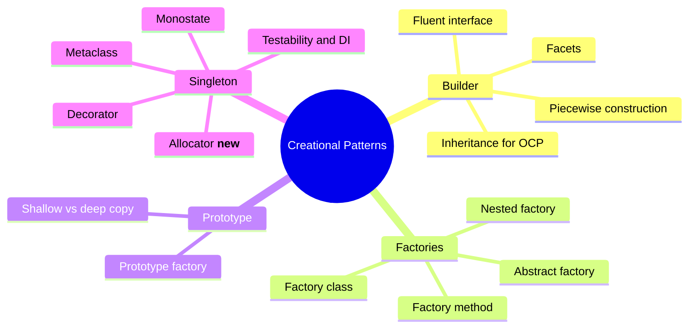

> 📌 **About the course code.** Running all 16 provided files turned up several bugs and gotchas:
> - `HtmlBuilder` shares a root element at class level.
> - `Person.__str__` in the facets file prints the postcode as the job title.
> - The polar → Cartesian formula swaps sin and cos.
> - `HotDrinkMachine` adds duplicate factories every time you create one.
> - `singleton_allocator.py` crashes on a missing `id` attribute.
> - `Monostate` shares one dictionary across all subclasses.
>
> Each part shows the **original course code** first, then a **📎 Beyond the transcript** fix.

### 🧭 What Creational Patterns Solve

#### 🧠 Concept

Most objects are created with a single call to their initialiser, and that's fine. Creational patterns are for the cases where creation gets **complicated**:

```text
                      How complicated is creating the object?
                                      │
      ┌───────────────────┬───────────┴────────┬────────────────────┐
      ▼                   ▼                    ▼                    ▼
 Many steps          One step, but         "Like that one,      "Only ever
 (piecewise)         confusing args        but slightly         one of them"
                     (wholesale)           different"
      │                   │                    │                    │
      ▼                   ▼                    ▼                    ▼
   BUILDER           FACTORY METHOD /      PROTOTYPE            SINGLETON /
                     FACTORY /             (deep copy +         MONOSTATE
                     ABSTRACT FACTORY      customise)
```

| Term from the lectures | Meaning |
|------------------------|---------|
| **Piecewise construction** | Building an object over *several statements* (Builder) |
| **Wholesale creation** | Creating an object in *one statement*, however complex (Factory) |
| **Outsourcing** | Moving creation logic out of the class into a dedicated method or component |

> 💡 **Memory Trick:** **B**uilder = **B**ricks one by one. **F**actory = **F**inished product off the line. **P**rototype = **P**hotocopy and edit. **S**ingleton = **S**ole instance.

#### 🎯 Key Takeaways

- Creational patterns **outsource** complicated creation logic.
- Builder is **piecewise**. Factories are **wholesale**. Prototype is **copy and customise**. Singleton is **once only**.
- Use them when plain initialisers become unreadable, inflexible or wasteful, not by default.

---

## 🎯 Learning Objectives

By the end of this guide you should be able to:

- [ ] Explain the difference between **piecewise** (Builder), **wholesale** (Factory), **copy-based** (Prototype) and **single-instance** (Singleton) creation.
- [ ] Implement a **fluent builder** by returning `self`, and expose it through a static `create()` method.
- [ ] Combine several builders over one object using **facets**, and keep builders open to extension through **inheritance**.
- [ ] Replace overloaded or confusing initialisers with **factory methods**, then group them into a **factory class** (nested or external).
- [ ] Build an **abstract factory** hierarchy, and explain why the abstract base class is optional in Python but still useful.
- [ ] Explain **reference assignment vs shallow copy vs deep copy**, and use `copy.deepcopy` to implement Prototype.
- [ ] Implement Singleton with `__new__`, a **decorator** and a **metaclass**, and explain why the allocator approach re-runs `__init__`.
- [ ] Explain **Monostate**, and why it's considered clumsy.
- [ ] Show why direct Singleton dependencies hurt **unit testing**, and fix this with **dependency injection** and a dummy database.
- [ ] Choose the right creational pattern in an interview or design review.

---

## 📘 Detailed Notes

The notes have one Part per creational pattern, in course order: Builder, Factories, Prototype and Singleton.

### 🧱 Part 1: Builder

The Builder pattern constructs complex objects **piece by piece**. This Part covers the basic and fluent builder, builder facets, and builder inheritance.

#### 🧱 Builder and Fluent Interfaces

##### 📖 Definition

> **Builder** is a separate component that builds up a complex object **step by step**, through an API designed for that purpose.

##### ❓ Why It Exists

The lecture starts without any builder. A paragraph is easy to build by hand:

```python
hello = 'hello'
parts = ['<p>', hello, '</p>']
print(''.join(parts))            # <p>hello</p>
```

An HTML list needs **about five lines in a fixed order**, and nothing stops you forgetting the closing `</li>` or `</ul>`:

```python
words = ['hello', 'world']
parts = ['<ul>']
for w in words:
    parts.append(f'  <li>{w}</li>')
parts.append('</ul>')
print('\n'.join(parts))
```

📝 **The problem:** The construction rules (open a tag, add children, close the tag, indent) live in every caller's head. A builder **encodes those rules once**. It works best on top of an **object-oriented model** of the thing being built.

##### ⚙️ How It Works: An Object Model Plus a Builder

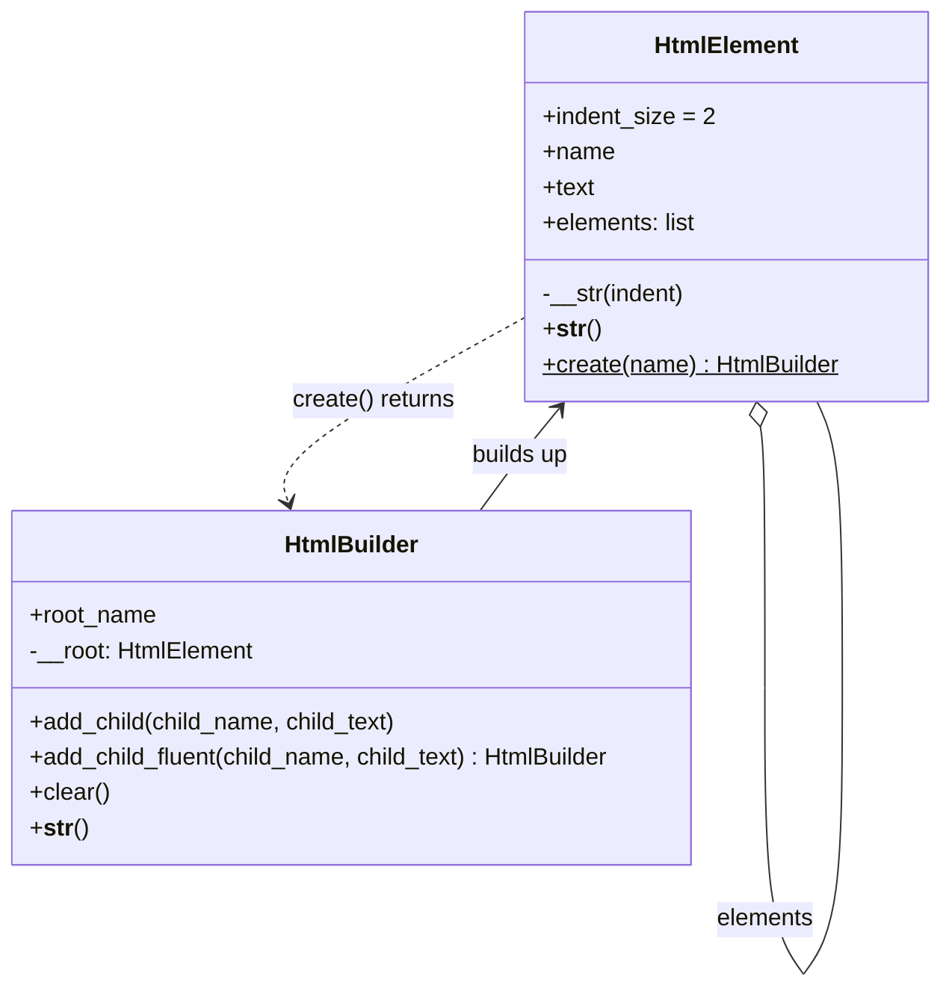

##### 💻 Code Example: HtmlElement and HtmlBuilder (course code)

```python
class HtmlElement:
    indent_size = 2

    def __init__(self, name="", text=""):
        self.name = name
        self.text = text
        self.elements = []

    def __str(self, indent):                       # private recursive helper
        lines = []
        i = ' ' * (indent * self.indent_size)
        lines.append(f'{i}<{self.name}>')

        if self.text:
            i1 = ' ' * ((indent + 1) * self.indent_size)
            lines.append(f'{i1}{self.text}')

        for e in self.elements:
            lines.append(e.__str(indent + 1))       # recursion into children

        lines.append(f'{i}</{self.name}>')
        return '\n'.join(lines)

    def __str__(self):
        return self.__str(0)

    @staticmethod
    def create(name):                               # entry point to the builder
        return HtmlBuilder(name)


class HtmlBuilder:
    __root = HtmlElement()                          # ⚠️ class attribute (see bug note)

    def __init__(self, root_name):
        self.root_name = root_name
        self.__root.name = root_name

    # not fluent
    def add_child(self, child_name, child_text):
        self.__root.elements.append(
            HtmlElement(child_name, child_text)
        )

    # fluent
    def add_child_fluent(self, child_name, child_text):
        self.__root.elements.append(
            HtmlElement(child_name, child_text)
        )
        return self

    def clear(self):
        self.__root = HtmlElement(name=self.root_name)

    def __str__(self):
        return str(self.__root)


# ordinary non-fluent builder
builder = HtmlElement.create('ul')                  # or HtmlBuilder('ul')
builder.add_child('li', 'hello')
builder.add_child('li', 'world')
print('Ordinary builder:')
print(builder)

# fluent builder
builder.clear()
builder.add_child_fluent('li', 'hello') \
       .add_child_fluent('li', 'world')
print('Fluent builder:')
print(builder)
```

**Output (both builders print the same thing):**

```text
<ul>
  <li>
    hello
  </li>
  <li>
    world
  </li>
</ul>
```

🔑 **Key lines:**
- `__str(self, indent)` is a recursive helper. Indentation grows with nesting depth, so "we get the indentation right regardless of how many levels of nesting we have."
- `__root` has **two underscores**, which triggers **name mangling** (`_HtmlBuilder__root`) so that users don't touch it directly. The built object is exposed through `__str__`.
- `return self` is the whole trick behind a **fluent interface**, which lets you chain calls. The lecture calls it "a very small, insignificant trick".
- `HtmlElement.create('ul')` makes the builder **discoverable**: users who find `HtmlElement` learn how to start building.

> 💡 **Lecture insight on OCP:** Isn't `HtmlElement.create` (an element that knows about its builder) a breach of the Open–Closed Principle? "In some way it is." But an element and its builder are naturally entangled, so unless they live in separate parts of the system, that's acceptable.

> 🐞 **Bug in the provided file:** `__root = HtmlElement()` sits at **class level**, so **every `HtmlBuilder` shares one root** until `clear()` gives that instance its own. Verified:
>
> ```python
> a = HtmlBuilder('ul'); a.add_child('li', 'x')
> b = HtmlBuilder('ol')
> print(b)      # <ol><li>x</li></ol>: b contains a's child!
> ```
>
> The fix is to create the root **per instance** in `__init__`, as shown next.

##### 📎 Beyond the transcript: Corrected Builder

```python
class HtmlBuilder:
    def __init__(self, root_name: str):
        self.root_name = root_name
        self.__root = HtmlElement(name=root_name)      # ✅ one root per builder

    def add_child(self, child_name: str, child_text: str) -> "HtmlBuilder":
        self.__root.elements.append(HtmlElement(child_name, child_text))
        return self                                    # always fluent

    def clear(self) -> "HtmlBuilder":
        self.__root = HtmlElement(name=self.root_name)
        return self

    def build(self) -> HtmlElement:                    # explicit result
        return self.__root

    def __str__(self) -> str:
        return str(self.__root)


a = HtmlBuilder('ul').add_child('li', 'x')
b = HtmlBuilder('ol')
print(b)      # <ol>\n</ol>: isolated now ✅
```

##### 🪜 Builder Workflow

```text
create builder (HtmlElement.create / HtmlBuilder(...))
   ↓
call building methods (add_child ... add_child)    ← fluent: chained
   ↓
builder enforces the rules (tags closed, indentation)
   ↓
get the result (str(builder) / builder.build())
```

##### 🧪 Course Exercise: CodeBuilder

The exercise asks for a builder that produces Python class source code:

```python
class Field:
    def __init__(self, name, value):
        self.value = value
        self.name = name

    def __str__(self):
        return 'self.%s = %s' % (self.name, self.value)


class Class:
    def __init__(self, name):
        self.name = name
        self.fields = []

    def __str__(self):
        lines = ['class %s:' % self.name]
        if not self.fields:
            lines.append('  pass')
        else:
            lines.append('  def __init__(self):')
            for f in self.fields:
                lines.append('    %s' % f)
        return '\n'.join(lines)


class CodeBuilder:
    def __init__(self, root_name):
        self.__class = Class(root_name)

    def add_field(self, type, name):          # ⚠️ params are really (name, value)
        self.__class.fields.append(Field(type, name))
        return self

    def __str__(self):
        return self.__class.__str__()


print(CodeBuilder('Person').add_field('name', '""').add_field('age', 0))
```

```text
class Person:
  def __init__(self):
    self.name = ""
    self.age = 0
```

⚠️ **Gotcha:** The parameters are named `type, name` but are actually passed as `(name, value)`. It works, but it's misleading, and `type` shadows the built-in. Rename them to `add_field(self, name, value)`. The provided unit tests pass either way.

##### 🌍 Real-World Usage

- **Query builders:** SQLAlchemy `select(User).where(...).order_by(...)`, and Django `QuerySet` chaining.
- **HTTP request builders** and the **`argparse.ArgumentParser`** configuration API.
- **Test data builders:** `UserBuilder().with_email(...).admin().build()`.
- **Document generators** for HTML, XML, PDF and code.

##### ❌ Common Mistakes

| Mistake | Consequence | Fix |
|---------|-------------|-----|
| Mutable state at class level in the builder | Builders leak into each other | Initialise state in `__init__` |
| Forgetting `return self` in one method | The chain breaks with `AttributeError: 'NoneType'…` | Return `self` from every step |
| Using a builder for a two-field object | Pointless ceremony | Use keyword arguments or a dataclass |
| No clear "finish" step | Callers don't know when the object is valid | Provide `build()`, and validate there |

##### 🎯 Key Takeaways

- Builder = **piecewise construction** through a dedicated component.
- A **fluent interface** comes from returning `self`.
- Expose the builder through its initialiser **or** a static factory such as `HtmlElement.create()`.
- The course `HtmlBuilder` shares its root at class level. Initialise it per instance.

#### 🧩 Builder Facets

##### 🧠 Concept

Some objects are **too complicated for one builder**. A person has an *address* aspect and an *employment* aspect. **Facets** are several **sub-builders**, one per aspect, all working on the **same object**, with a fluent API that lets you **jump between them**.

##### 💻 Code Example: Person with Two Facet Builders (course code)

```python
class Person:
    def __init__(self):
        print('Creating an instance of Person')
        # address
        self.street_address = None
        self.postcode = None
        self.city = None
        # employment info
        self.company_name = None
        self.position = None
        self.annual_income = None

    def __str__(self) -> str:
        return f'Address: {self.street_address}, {self.postcode}, {self.city}\n' +\
            f'Employed at {self.company_name} as a {self.postcode} earning {self.annual_income}'
            #                                       ^^^^^^^^^^^^^ 🐞 should be self.position


class PersonBuilder:  # facade
    def __init__(self, person=None):
        if person is None:
            self.person = Person()        # root builder: start from a blank person
        else:
            self.person = person          # sub-builder: reuse the person being built

    @property
    def lives(self):
        return PersonAddressBuilder(self.person)

    @property
    def works(self):
        return PersonJobBuilder(self.person)

    def build(self):
        return self.person


class PersonJobBuilder(PersonBuilder):
    def __init__(self, person):
        super().__init__(person)

    def at(self, company_name):
        self.person.company_name = company_name
        return self

    def as_a(self, position):
        self.person.position = position
        return self

    def earning(self, annual_income):
        self.person.annual_income = annual_income
        return self


class PersonAddressBuilder(PersonBuilder):
    def __init__(self, person):
        super().__init__(person)

    def at(self, street_address):
        self.person.street_address = street_address
        return self

    def with_postcode(self, postcode):
        self.person.postcode = postcode
        return self

    def in_city(self, city):
        self.person.city = city
        return self


pb = PersonBuilder()
p = pb\
    .lives\
        .at('123 London Road')\
        .in_city('London')\
        .with_postcode('SW12BC')\
    .works\
        .at('Fabrikam')\
        .as_a('Engineer')\
        .earning(123000)\
    .build()
print(p)
```

**Output (as provided, with the bug visible):**

```text
Creating an instance of Person
Address: 123 London Road, SW12BC, London
Employed at Fabrikam as a SW12BC earning 123000
```

🔑 **Key lines:**
- `person=None` in `PersonBuilder.__init__` is **"the trick"**. The root builder creates *one* blank `Person`, and each sub-builder receives the **existing** person (`self.person`), so nothing is duplicated. *"Creating an instance of Person"* is printed **only once**, which proves it.
- `lives` and `works` are **properties**, so `.lives` and `.works` switch facets with no parentheses.
- Both sub-builders **inherit from `PersonBuilder`**, so each one also has `lives`, `works` and `build`. That's what lets you jump from address to job and back.
- `at()` means different things in each facet (street vs company), and the active facet decides which.

> 🐞 **Bug in the provided file:** `__str__` prints `{self.postcode}` where it should print `{self.position}`, giving *"as a SW12BC"*. With the fix, the output reads **"Employed at Fabrikam as a Engineer earning 123000"**.

##### 🔄 How Facet Switching Works

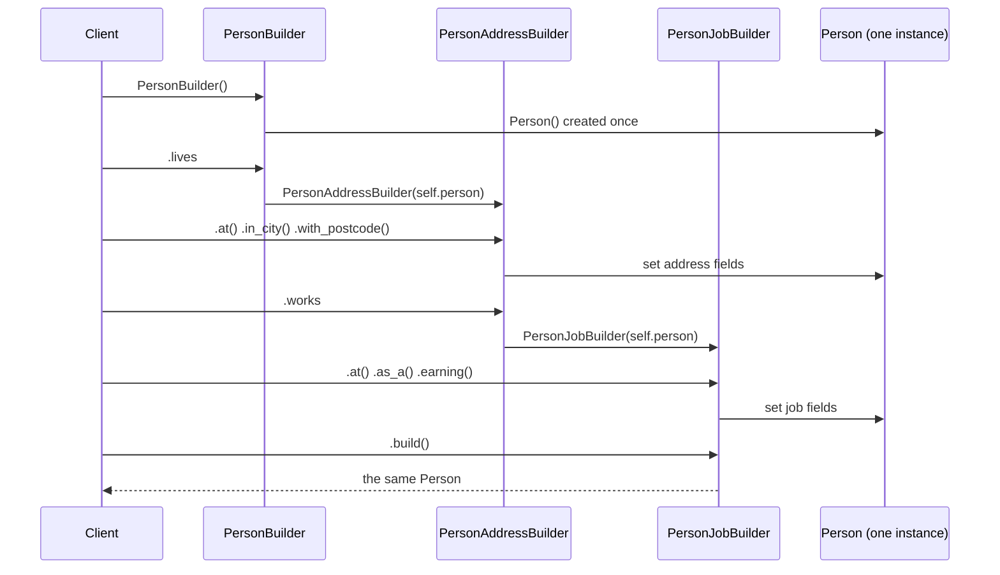

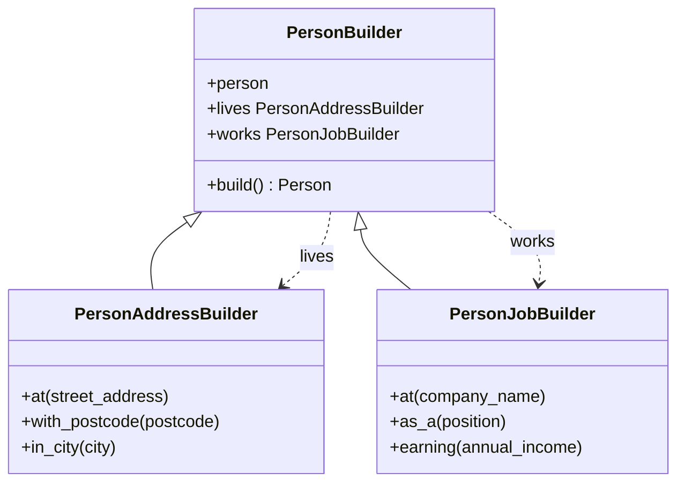

> 📎 **Beyond the transcript:** `PersonBuilder` acts as a **facade**, as the comment in the file says. It gives one entry point to a family of builders. The base class referencing its own subclasses (`lives` and `works`) is a **circular dependency**, which is why the next section looks at an inheritance-based alternative.

##### ⚖ Advantages and Limitations

| ✅ Advantages | ⚠️ Limitations |
|---------------|----------------|
| Splits a big builder into cohesive pieces (SRP) | The base builder must know about every facet, which breaks **OCP** |
| A readable, domain-like DSL | Line continuations (`\`) are fragile. Use parentheses instead |
| One object, no duplication | `build()` can be called on a half-built object without validation |

##### 🎯 Key Takeaways

- **Facets** = several sub-builders over **one** object, all inheriting from a common base builder.
- The `person=None` trick shares the object between builders.
- **Properties** (`lives`, `works`) make switching facets read naturally.
- Downside: adding a new facet means **modifying** the base builder, which violates OCP.

#### 🪜 Builder Inheritance

##### 🧠 Concept

To avoid editing the root builder every time a new facet is added, **build up the builders through inheritance**. Each new builder **extends** the previous one, so existing builders stay **closed for modification and open for extension**.

##### 💻 Code Example: Inherited Builders (course code)

```python
class Person:
    def __init__(self):
        self.name = None
        self.position = None
        self.date_of_birth = None

    def __str__(self):
        return f'{self.name} born on {self.date_of_birth} works as a {self.position}'

    @staticmethod
    def new():
        return PersonBuilder()            # ⚠️ returns the *base* builder (see note)


class PersonBuilder:
    def __init__(self):
        self.person = Person()

    def build(self):
        return self.person


class PersonInfoBuilder(PersonBuilder):
    def called(self, name):
        self.person.name = name
        return self


class PersonJobBuilder(PersonInfoBuilder):
    def works_as_a(self, position):
        self.person.position = position
        return self


class PersonBirthDateBuilder(PersonJobBuilder):
    def born(self, date_of_birth):
        self.person.date_of_birth = date_of_birth
        return self


pb = PersonBirthDateBuilder()
me = pb\
    .called('Dmitri')\
    .works_as_a('quant')\
    .born('1/1/1980')\
    .build()  # this does NOT work in C#/C++/Java/...
print(me)
```

**Output (verified):**

```text
Dmitri born on 1/1/1980 works as a quant
```

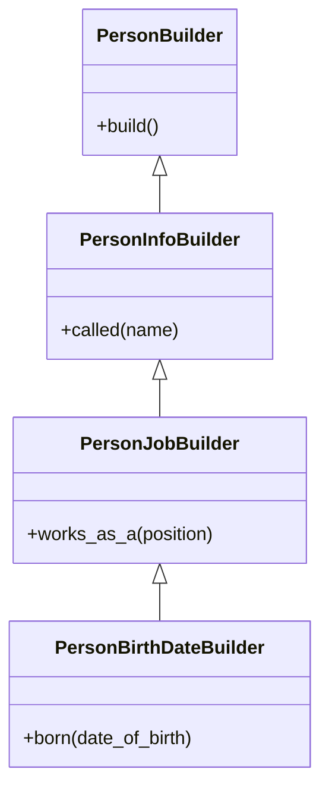

🔑 **Key lines:**
- You instantiate the **most-derived** builder (`PersonBirthDateBuilder`), which has every method in the chain.
- Each method returns `self`, and `self` is the derived instance at runtime, so the chain keeps working.

> 🔍 **Why "this does NOT work in C#/C++/Java" (deep dive):** In statically typed languages, `called()` is declared to return `PersonInfoBuilder`. The compiler then refuses `.works_as_a(...)` on that type, even though the runtime object is more derived. Those languages need **recursive generics** (`class PersonInfoBuilder<SELF extends PersonInfoBuilder<SELF>>`). Python is **dynamically typed**, so `self` is simply the real object. With type hints, use `typing.Self` (Python 3.11+) to tell the checker the same thing.

> ⚠️ **Gotcha:** `Person.new()` returns a plain `PersonBuilder`, which has only `build()`. To make it useful, return the most-derived builder: `return PersonBirthDateBuilder()`.

##### 📎 Beyond the transcript: Type-Hinted with `Self`

```python
from typing import Self   # Python 3.11+


class PersonInfoBuilder(PersonBuilder):
    def called(self, name: str) -> Self:
        self.person.name = name
        return self
```

##### ⚖ Facets vs Inheritance

| | Facets | Inheritance |
|---|-----------------|----------------------|
| Structure | A base builder plus sibling sub-builders | A linear chain of subclasses |
| Switching aspects | Properties (`.lives`, `.works`) | All methods on one object |
| Adding a new aspect | **Modify** the base (add a property) | **Extend**: subclass the last builder ✅ OCP |
| Drawback | Circular dependency between base and facets | A long chain, and you must use the most-derived class |

##### 🎯 Key Takeaways

- Builders can **inherit from builders indefinitely**, which keeps each one closed for modification (**OCP**).
- Use the **most-derived** builder. Python's dynamic typing makes the chained calls work.
- Static languages need recursive generics. In Python, annotate with `typing.Self`.
- The lecture's summary: a builder is a separate component; you can get it through its initialiser or a static function; fluent APIs return `self`; and facets let several builders work in tandem through a base class.

---

### 🏭 Part 2: Factories

Factories handle **wholesale** creation, where the object is made in a single step. This Part covers factory methods, factory classes, and the abstract factory.

#### 🏭 Factory Method

##### 📖 Definition

> A **factory** is any component responsible **solely for the wholesale (not piecewise) creation of objects**. A **factory method** is a method, typically a `@staticmethod`, that creates and returns an object. The lecture's modern definition: *"any method which creates an object."*

##### ❓ Why It Exists: The Limits of `__init__`

The lecture lists the problems with initialisers:

| Problem with `__init__` | Consequence |
|-------------------------|-------------|
| Its name is always `__init__` | You can't give hints about *how* the object is created |
| No overloading in Python | You can't have `__init__(x, y)` **and** `__init__(rho, theta)`. The second definition replaces the first |
| Optional parameters pile up | Ever-growing argument lists with defaults |
| Arguments interact in convoluted ways | Callers need documentation to use it |

> 💡 **Lecture insight:** A massive initialiser is *"kind of like God object, but for initializers"*: one that takes ten arguments and needs a manual.

##### 💻 Code Example: The Problem (course code)

```python
from enum import Enum
from math import *


class CoordinateSystem(Enum):
    CARTESIAN = 1
    POLAR = 2


class Point:
    # def __init__(self, x, y): ...
    # def __init__(self, rho, theta): ...   # redeclaration won't work

    def __init__(self, a, b, system=CoordinateSystem.CARTESIAN):
        if system == CoordinateSystem.CARTESIAN:
            self.x = a
            self.y = b
        elif system == CoordinateSystem.POLAR:
            self.x = a * sin(b)       # 🐞 swapped (see note)
            self.y = a * cos(b)

        # steps to add a new system
        # 1. augment CoordinateSystem
        # 2. change init method

    def __str__(self):
        return f'x: {self.x}, y: {self.y}'
```

📝 **What's wrong:**
1. The parameters must be called `a` and `b`, so their meaning depends on a third argument.
2. Adding a coordinate system means editing **both** the enum and `__init__`, which breaks OCP.
3. Callers have to know that `a` maps to `x` (or to `rho`).

##### 💻 Code Example: Factory Methods (course code)

```python
class Point:
    def __init__(self, x=0, y=0):
        self.x = x
        self.y = y

    def __str__(self):
        return f'x: {self.x}, y: {self.y}'

    @staticmethod
    def new_cartesian_point(x, y):
        return Point(x, y)

    @staticmethod
    def new_polar_point(rho, theta):
        return Point(rho * sin(theta), rho * cos(theta))   # 🐞 swapped


p = Point(2, 3)                       # still allowed: Python has no private __init__
p2 = Point.new_polar_point(1, 2)
print(p, p2)
```

🔑 **Advantages from the lecture:**
- **A good method name**: `new_polar_point` says what it does.
- **Good argument names**: `rho` and `theta` instead of `a` and `b`.
- **Small, focused creators** instead of one giant initialiser.

> 🐞 **Bug in the provided file:** Polar → Cartesian conversion is **x = ρ·cos θ, y = ρ·sin θ**. The course swaps them. (The instructor even says "it could be the other way around… I'm just demonstrating.") Verified: `new_polar_point(1, 0)` gives `x: 0.0, y: 1.0`, but the correct result is `x: 1.0, y: 0.0`.

##### 📎 Beyond the transcript: Idiomatic `@classmethod` Factories

```python
from math import cos, sin, pi, isclose


class Point:
    def __init__(self, x: float = 0.0, y: float = 0.0):
        self.x, self.y = x, y

    def __str__(self):
        return f'x: {self.x:.2f}, y: {self.y:.2f}'

    @classmethod
    def new_cartesian(cls, x: float, y: float) -> "Point":
        return cls(x, y)

    @classmethod
    def new_polar(cls, rho: float, theta: float) -> "Point":
        return cls(rho * cos(theta), rho * sin(theta))      # ✅ correct conversion


p = Point.new_polar(2, pi / 2)
print(p)                                  # x: 0.00, y: 2.00
assert isclose(Point.new_polar(1, 0).x, 1.0)
```

📝 **Why `@classmethod`:** `cls(...)` means subclasses (e.g. `Point3D`) automatically get factories that return **their own type**. This is the pattern used by `datetime.fromtimestamp`, `dict.fromkeys` and `int.from_bytes`.

##### 🎯 Key Takeaways

- A factory method is **any method that creates an object**, usually static or a classmethod.
- It solves Python's lack of `__init__` overloading, and gives **explicit names** for both the method and its arguments.
- `Point(2, 3)` can't be made private. Users can still bypass your factories.
- The course's polar formula swaps sin and cos. Use **x = ρ cos θ, y = ρ sin θ**.

#### 🏢 Factory Classes

##### 🧠 Concept

When a class collects **too many factory methods**, move them into a **separate class**. The lecture describes this as SRP and separation of concerns applied to creation. If you have `Foo`, you get a `FooFactory`.

##### 💻 Code Example: External, Nested and Instance Factories (course code)

```python
class Point:
    def __init__(self, a, b, system=CoordinateSystem.CARTESIAN):
        if system == CoordinateSystem.CARTESIAN:
            self.x = a
            self.y = b
        elif system == CoordinateSystem.POLAR:
            self.x = a * sin(b)
            self.y = a * cos(b)

    def __str__(self):
        return f'x: {self.x}, y: {self.y}'

    class Factory:                          # nested factory class
        @staticmethod
        def new_cartesian_point(x, y):
            return Point(x, y)

    factory = Factory()                     # a single convenience instance


# take out factory methods to a separate class
class PointFactory:
    @staticmethod
    def new_cartesian_point(x, y):
        return Point(x, y)

    @staticmethod
    def new_polar_point(rho, theta):
        return Point(rho * sin(theta), rho * cos(theta))


p1 = Point(2, 3, CoordinateSystem.CARTESIAN)
p2 = PointFactory.new_cartesian_point(1, 2)
p3 = Point.Factory.new_cartesian_point(5, 6)     # factory exposed through the type
p4 = Point.factory.new_cartesian_point(7, 8)     # through an instance attribute
print(p1, p2, p3, p4)
```

**Output (verified):**

```text
x: 2, y: 3 x: 1, y: 2 x: 5, y: 6 x: 7, y: 8
```

##### ⚖ Where to Put the Factory

| Option | How it's used | When to use it |
|--------|---------------|----------------|
| **Factory methods on the class** | `Point.new_polar_point(...)` | A few creation variants |
| **External factory class** | `PointFactory.new_polar_point(...)` | Many variants. Creation is a separate concern |
| **Nested (inner) factory** | `Point.Factory.new_...` | Common in C# and Java, where it can reach a private constructor. In Python it's only for discoverability |
| **Factory instance attribute** | `Point.factory.new_...` | A "singleton of sorts". Handy when methods aren't static |
| **Stateful (non-static) factory** | `PointFactory(bias=0.1).new_polar(...)` | When the factory needs state (the lecture's "wandering geomagnetic pole" bias example) |

##### 🔍 Points from the Lecture

- **Coupling:** If `Point.__init__` changes, every factory method has to change. A workaround is to create a default `Point()` and then assign `p.x` and `p.y`. Either way there's "an intrinsic relationship between the factory and the object".
- **Discoverability:** Users who only see `Point(x, y)` won't know a `PointFactory` exists. Document it, or expose it through the type (`Point.Factory` / `Point.factory`).
- **Terminology:** *"Factory"* can mean **anything that creates objects**, including a **lambda passed as an argument** (`create=lambda: Point(0, 0)`).

##### 📎 Beyond the transcript: A Stateful Factory

```python
from math import cos, sin


class BiasedPointFactory:
    """A non-static factory: needs state, so its methods can't be static."""

    def __init__(self, bias: float = 0.0):
        self.bias = bias

    def new_polar(self, rho: float, theta: float) -> Point:
        return Point(rho * cos(theta + self.bias), rho * sin(theta + self.bias))


normal = BiasedPointFactory()
biased = BiasedPointFactory(bias=0.01)
```

##### 🧪 Course Exercise: PersonFactory with Auto-Incrementing IDs

```python
class Person:
    def __init__(self, id, name):
        self.id = id
        self.name = name


class PersonFactory:
    id = 0                                    # class-level counter

    def create_person(self, name):
        p = Person(PersonFactory.id, name)
        PersonFactory.id += 1
        return p


pf = PersonFactory()
print(pf.create_person('Chris').id, pf.create_person('Sarah').id)   # 0 1
```

⚠️ **Edge cases:** The counter is **global to the class**, so a second `PersonFactory()` keeps counting from where the first stopped. The counter also isn't thread-safe. Use an instance counter or `itertools.count()` with a lock if IDs must be unique per factory or across threads.

##### 🎯 Key Takeaways

- A **factory class** groups factory methods, which applies **SRP** to object creation.
- Factories can be **external**, **nested** or **instance-based**. Nesting is mainly a C#/Java idiom.
- Factories with **state** (bias, configuration, counters) need **instance methods**.
- "Factory" also refers to any callable that produces objects, such as lambdas.

#### 🍵 Abstract Factory

##### 📖 Definition

> **Abstract Factory**: when you have a **hierarchy of types**, provide a **matching hierarchy of factories**, with an **abstract base factory** that defines the creation API.

##### ⚙️ How It Works

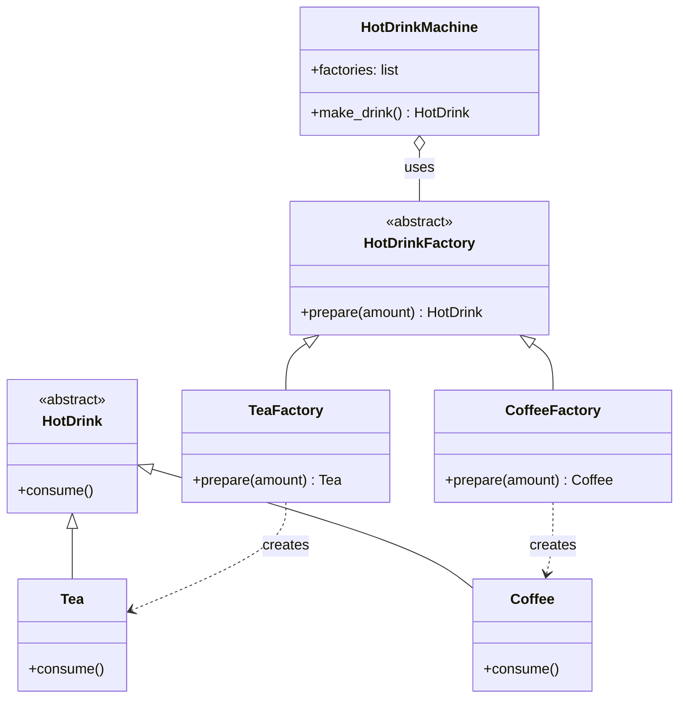

##### 💻 Code Example: Products and Factories (course code)

```python
from abc import ABC
from enum import Enum, auto


class HotDrink(ABC):
    def consume(self):
        pass


class Tea(HotDrink):
    def consume(self):
        print('This tea is nice but I\'d prefer it with milk')


class Coffee(HotDrink):
    def consume(self):
        print('This coffee is delicious')


class HotDrinkFactory(ABC):
    def prepare(self, amount):
        pass


class TeaFactory(HotDrinkFactory):
    def prepare(self, amount):
        print(f'Put in tea bag, boil water, pour {amount}ml, enjoy!')
        return Tea()


class CoffeeFactory(HotDrinkFactory):
    def prepare(self, amount):
        print(f'Grind some beans, boil water, pour {amount}ml, enjoy!')
        return Coffee()


def make_drink(type):                      # simple dispatch: an if/elif on a string
    if type == 'tea':
        return TeaFactory().prepare(200)
    elif type == 'coffee':
        return CoffeeFactory().prepare(50)
    else:
        return None
```

📝 **What it does:** `prepare` is a **factory method** that performs the preparation steps and returns the product. The simple `make_drink(type)` works, but *"the only thing that's not being leveraged here is this idea of having it abstract."*

##### 💻 Code Example: HotDrinkMachine (course code)

```python
class HotDrinkMachine:
    class AvailableDrink(Enum):  # violates OCP
        COFFEE = auto()
        TEA = auto()

    factories = []
    initialized = False

    def __init__(self):
        if not self.initialized:
            self.initialized = True               # 🐞 sets an *instance* attribute
            for d in self.AvailableDrink:
                name = d.name[0] + d.name[1:].lower()      # 'COFFEE' -> 'Coffee'
                factory_name = name + 'Factory'            # 'CoffeeFactory'
                factory_instance = eval(factory_name)()    # ⚠️ eval
                self.factories.append((name, factory_instance))

    def make_drink(self):
        print('Available drinks:')
        for f in self.factories:
            print(f[0])

        s = input(f'Please pick drink (0-{len(self.factories)-1}): ')
        idx = int(s)
        s = input(f'Specify amount: ')
        amount = int(s)
        return self.factories[idx][1].prepare(amount)


hdm = HotDrinkMachine()
drink = hdm.make_drink()      # pick 1, amount 200
drink.consume()
```

**Sample run (verified with input `1`, `200`):**

```text
Available drinks:
Coffee
Tea
Please pick drink (0-1): 1
Specify amount: 200
Put in tea bag, boil water, pour 200ml, enjoy!
This tea is nice but I'd prefer it with milk
```

🔑 **Key lines:**
- `factories` is a list of `(name, factory_instance)` tuples, so `self.factories[idx][1]` is the factory.
- The enum **violates OCP**: a new drink means editing `AvailableDrink`. The lecture accepts this: *"it's better than nothing."*
- `eval(factory_name)()` turns a string into a class by name.

> 🐞 **Bug in the provided file:** `self.initialized = True` creates an **instance** attribute, while the class-level `initialized` stays `False`. Every new `HotDrinkMachine()` initialises again and **appends to the shared class-level `factories` list**. Verified: two machines → **4 factories**, and the menu shows Coffee, Tea, Coffee, Tea. Fix: `HotDrinkMachine.initialized = True` (or `type(self).initialized = True`).

> ⚠️ **Security note:** `eval` on derived strings is fragile and dangerous if any part ever comes from users. Prefer an explicit registry, or discover factories with `HotDrinkFactory.__subclasses__()`.

##### 🐍 Duck Typing and the Abstract Base

The lecture shows that you can **delete `HotDrinkFactory` entirely** and everything still works, because Python's lists aren't typed and the code relies on duck typing. In statically typed languages the abstract base is essential. In Python it's optional, but *"a good idea because it tells you what kind of API you're expected to implement."*

> ⚠️ **Gotcha:** `HotDrink(ABC)` and `HotDrinkFactory(ABC)` have **no `@abstractmethod`**, so nothing is enforced and `HotDrinkFactory()` can be instantiated. Add `@abstractmethod` to `prepare` and `consume`.

##### 📎 Beyond the transcript: OCP-Friendly Registry, No `eval`

```python
from abc import ABC, abstractmethod


class HotDrink(ABC):
    @abstractmethod
    def consume(self) -> None: ...


class HotDrinkFactory(ABC):
    registry: dict[str, type["HotDrinkFactory"]] = {}

    def __init_subclass__(cls, drink_name: str = "", **kw):
        super().__init_subclass__(**kw)
        if drink_name:
            HotDrinkFactory.registry[drink_name] = cls     # self-registration ✅ OCP

    @abstractmethod
    def prepare(self, amount: int) -> HotDrink: ...


class Tea(HotDrink):
    def consume(self): print("This tea is nice but I'd prefer it with milk")


class Coffee(HotDrink):
    def consume(self): print("This coffee is delicious")


class TeaFactory(HotDrinkFactory, drink_name="Tea"):
    def prepare(self, amount):
        print(f"Put in tea bag, boil water, pour {amount}ml, enjoy!")
        return Tea()


class CoffeeFactory(HotDrinkFactory, drink_name="Coffee"):
    def prepare(self, amount):
        print(f"Grind some beans, boil water, pour {amount}ml, enjoy!")
        return Coffee()


class HotDrinkMachine:
    def __init__(self):
        self.factories = [(name, f()) for name, f in HotDrinkFactory.registry.items()]

    def make_drink(self, idx: int, amount: int) -> HotDrink:
        if not 0 <= idx < len(self.factories):
            raise ValueError(f"choose 0-{len(self.factories) - 1}")
        return self.factories[idx][1].prepare(amount)


m = HotDrinkMachine()
print([n for n, _ in m.factories])          # ['Tea', 'Coffee']
m.make_drink(1, 50).consume()
```

📝 **What changed:**
- New drinks **register themselves** through `__init_subclass__`, so the machine never changes (OCP).
- There's no `eval`, and `factories` is per instance, so there's no duplication.
- Input is validated, and I/O is moved out of the factory logic (SRP), which also makes it testable.

##### 🌍 Real-World Usage

- **UI toolkits:** `WindowsWidgetFactory` vs `MacWidgetFactory`, each producing a *family* of buttons, checkboxes and menus.
- **Database drivers:** a dialect factory producing connections, cursors and type converters for Postgres vs SQLite.
- **Cloud SDKs:** a provider factory that creates storage, queue and compute clients for AWS vs GCP.
- **Testing:** a `FakeServicesFactory` that creates matching in-memory doubles.

##### ❌ Common Mistakes

| Mistake | Fix |
|---------|-----|
| Setting `self.flag` when you mean the class flag | `ClassName.flag = ...` |
| `eval` to look up classes | A registry dict or `__subclasses__()` |
| An ABC without `@abstractmethod` | Add the decorators so they're enforced |
| `if/elif` on type strings everywhere | Polymorphic factories plus a registry |

##### 🎯 Key Takeaways

- Abstract Factory = **a hierarchy of factories parallel to a hierarchy of products**.
- `prepare(amount)` is a factory method. The machine chooses the factory at runtime.
- The ABC is **optional in Python** (duck typing) but documents the API.
- Course file bug: `self.initialized` never sets the class flag, so factories are duplicated. Also avoid `eval`.
- The lecture's summary: factory method → factory (any creator, even a lambda; external or nested) → hierarchies of factories for **related objects**.

---

### 🧬 Part 3: Prototype

Prototype creates objects by **copying an existing object and customising the copy**. This Part covers copy semantics, deep copying, and the prototype factory.

#### 🧬 Prototype and Deep Copying

##### 📖 Definition

> A **prototype** is a **partially or fully initialised object that you copy (clone) and then customise**.

##### ❓ Why It Exists

> 💡 **Lecture analogy:** Nobody designs a car or an iPhone from a blank sheet of paper. You **iterate on existing designs**. Prototype does the same in code: take an existing object, **copy** it, **customise** the copy and hand it to the client.

The problem it solves is **duplication**. If you've already built an address once, you shouldn't have to type it out again for every resident.

##### ⚙️ Three Ways to "Copy"

```python
import copy


class Address:
    def __init__(self, street_address, city, country):
        self.country = country
        self.city = city
        self.street_address = street_address

    def __str__(self):
        return f'{self.street_address}, {self.city}, {self.country}'


class Person:
    def __init__(self, name, address):
        self.name = name
        self.address = address

    def __str__(self):
        return f'{self.name} lives at {self.address}'


john = Person("John", Address("123 London Road", "London", "UK"))

# ❌ 1. Reference assignment: jane IS john
# jane = john
# jane.name = "Jane"            → both print "Jane lives at ..."

# ❌ 2. Shallow copy: new Person, but the SAME Address object
# jane = copy.copy(john)
# jane.address.street_address = "124 London Road"   → John moves too!

# ✅ 3. Deep copy: a fully independent clone
jane = copy.deepcopy(john)
jane.name = "Jane"
jane.address.street_address = "124 London Road"
print(john, jane, sep='\n')
```

**Output (verified):**

```text
John lives at 123 London Road, London, UK
Jane lives at 124 London Road, London, UK
```

##### 🔄 What Happens in Memory

```text
REFERENCE  jane = john                SHALLOW  copy.copy(john)            DEEP  copy.deepcopy(john)

 john ─┐                              john ──► Person("John") ─┐          john ──► Person("John") ──► Address(123)
       ├──► Person ──► Address                                 ├─► Address
 jane ─┘                              jane ──► Person("Jane") ─┘          jane ──► Person("Jane") ──► Address(124)

 one object                           two persons, ONE address            fully independent
```

| Operation | New top-level object? | New nested objects? | Lecture result |
|-----------|-----------------------|---------------------|----------------|
| `jane = john` | ❌ | ❌ | Renaming Jane renames John ("Jane printed twice") |
| `Person("Jane", john.address)` | ✅ | ❌ shared address | Jane "moves next door" and so does John |
| `copy.copy(john)` | ✅ | ❌ references copied | Different names, **same address** |
| `copy.deepcopy(john)` | ✅ | ✅ recursive | Fully independent ✅ |

🔑 **Key point:** `deepcopy` "performs a recursive copy of all of the attributes of an object, thereby making a brand-new object that doesn't refer to the original."

##### 🔍 Deep Dive: How `deepcopy` Works (beyond the transcript)

- It keeps a **memo dictionary** (`id → copy`), so **shared references and cycles** are copied once and stay consistent.
- You can customise copying with `__copy__(self)` and `__deepcopy__(self, memo)`. This is useful for skipping caches, DB connections or locks, which often **can't** be deep-copied (`TypeError: cannot pickle '_thread.lock' object`).
- Cost: deep copying large graphs is **O(size of the graph)**. For large immutable parts, share them instead of copying.

```python
import copy


class Document:
    def __init__(self, title, pages, cache=None):
        self.title, self.pages, self.cache = title, pages, cache or {}

    def __deepcopy__(self, memo):
        # copy content, but start each clone with an empty cache
        return Document(copy.deepcopy(self.title, memo), copy.deepcopy(self.pages, memo))


d1 = Document("Spec", [["p1"]], cache={"render": "<html>"})
d2 = copy.deepcopy(d1)
d2.pages[0].append("edit")
print(d1.pages, d2.pages, d2.cache)   # [['p1']] [['p1', 'edit']] {}
```

##### 🧪 Course Exercise: Line.deep_copy

```python
class Point:
    def __init__(self, x=0, y=0):
        self.x = x
        self.y = y


class Line:
    def __init__(self, start=Point(), end=Point()):     # ⚠️ mutable default arguments
        self.start = start
        self.end = end

    def deep_copy(self):
        new_start = Point(self.start.x, self.start.y)
        new_end = Point(self.end.x, self.end.y)
        return Line(new_start, new_end)


line1 = Line(Point(3, 3), Point(10, 10))
line2 = line1.deep_copy()
line1.start.x = line1.end.x = line1.start.y = line1.end.y = 0
print(line2.start.x, line2.end.x)     # 3 10 ✅ unaffected
```

⚠️ **Gotcha:** `start=Point()` is evaluated **once**, when the function is defined. Every `Line()` created without arguments **shares the same two Point objects**. Use `start=None` and then `self.start = start if start is not None else Point()`. (The exercise's tests pass because they always supply points.) `return copy.deepcopy(self)` also works, and it's future-proof when fields are added.

##### 🎯 Key Takeaways

- Prototype = **copy an existing object, then customise it**.
- `=` copies a **reference**. `copy.copy` is **shallow** (nested objects are shared). `copy.deepcopy` is **recursive**.
- Prototype needs **deep copy** whenever objects contain other mutable objects.
- Customise with `__deepcopy__`, and avoid mutable default arguments.

#### 🗂 Prototype Factory

##### 🧠 Concept

When an application has a **fixed set of predefined prototypes**, calling `deepcopy` and customising by hand every time is tedious. Package the prototypes in a **factory** with friendly **factory methods**.

##### 💻 Code Example: EmployeeFactory (course code)

```python
import copy


class Address:
    def __init__(self, street_address, suite, city):
        self.suite = suite
        self.city = city
        self.street_address = street_address

    def __str__(self):
        return f'{self.street_address}, Suite #{self.suite}, {self.city}'


class Employee:
    def __init__(self, name, address):
        self.address = address
        self.name = name

    def __str__(self):
        return f'{self.name} works at {self.address}'


class EmployeeFactory:
    main_office_employee = Employee("", Address("123 East Dr", 0, "London"))
    aux_office_employee = Employee("", Address("123B East Dr", 0, "London"))

    @staticmethod
    def __new_employee(proto, name, suite):          # private helper (name-mangled)
        result = copy.deepcopy(proto)
        result.name = name
        result.address.suite = suite
        return result

    @staticmethod
    def new_main_office_employee(name, suite):
        return EmployeeFactory.__new_employee(
            EmployeeFactory.main_office_employee, name, suite)

    @staticmethod
    def new_aux_office_employee(name, suite):
        return EmployeeFactory.__new_employee(
            EmployeeFactory.aux_office_employee, name, suite)


john = EmployeeFactory.new_main_office_employee("John", 101)
jane = EmployeeFactory.new_aux_office_employee("Jane", 200)
print(john, jane, sep='\n')
```

**Output (verified):**

```text
John works at 123 East Dr, Suite #101, London
Jane works at 123B East Dr, Suite #200, London
```

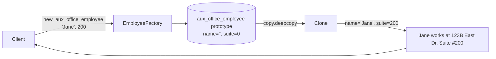

🔑 **Key lines:**
- The prototypes are **partially initialised**: an empty name and suite `0`, because *"we know the building, but we don't know the exact suite number."*
- `__new_employee` uses **double underscores** to signal that it's internal. Clients use the two public methods, unless they're bringing their own prototype.
- Inside the class, `EmployeeFactory.__new_employee` is name-mangled to `EmployeeFactory._EmployeeFactory__new_employee`, so the call works.
- **One line** for the client, instead of deepcopy plus two assignments.

> ⚠️ **Edge case:** The prototypes are **class attributes**. If someone mutates `EmployeeFactory.main_office_employee` directly, every future employee changes. Protect them by convention (`_main_office_employee`), or rebuild them in a function.

##### 📎 Beyond the transcript: A Prototype Registry

```python
import copy


class PrototypeRegistry:
    def __init__(self):
        self._protos = {}

    def register(self, key, proto):
        self._protos[key] = proto

    def clone(self, key, **overrides):
        obj = copy.deepcopy(self._protos[key])
        for attr, value in overrides.items():
            target, _, field = attr.rpartition("__")       # "address__suite" → nested
            setattr(getattr(obj, target) if target else obj, field, value)
        return obj


reg = PrototypeRegistry()
reg.register("main", Employee("", Address("123 East Dr", 0, "London")))
print(reg.clone("main", name="Ann", address__suite=7))  # Ann works at 123 East Dr, Suite #7, London
```

📝 **What it adds:** New prototypes are registered at runtime with no code changes (OCP). The registry is per instance, so tests can use their own.

##### 🎯 Key Takeaways

- A **prototype factory** stores prototypes and exposes **one-line factory methods** that deep-copy and customise them.
- Prototypes can be **partial** templates, finished by the factory.
- Keep the clone-and-customise logic in **one private helper**.
- The lecture's summary: store a prototype → `deepcopy` it on request → customise it (usually inside a factory, which provides "a convenient API").

---

### 🔒 Part 4: Singleton

Singleton ensures a component is **created only once**. This Part covers the implementations, the Monostate variation, and the impact on testability.

#### 🔒 Singleton Implementations

##### 📖 Definition

> A **Singleton** is a component (in Python, a class) that is **instantiated only once**. Everyone who asks for it gets **the same instance**.

> ⚠️ **The lecture's opening:** *"probably the most hated design pattern of them all."* When the Gang of Four met a decade later, they would have kept every pattern *"except maybe the singleton, because its use is almost always a design smell."*

##### ❓ Why It Exists

| Motivation from the lecture | Example |
|-----------------------------|---------|
| An **expensive initialiser** you only want to run once | Loading a database into memory at startup |
| A **stateless component** where more instances add nothing | An object factory full of static methods |
| A **resource that exists only once** | A hardware device or a process-wide registry |

Requirements: **prevent additional copies**, and ideally use **lazy instantiation** (create the instance only when it's first needed, never "preventatively").

##### 💻 Approach 1: Overriding the Allocator `__new__` (course code)

```python
import random


class Database:
    initialized = False

    def __init__(self):
        # self.id = random.randint(1,101)
        # print('Generated an id of ', self.id)
        # print('Loading database from file')
        pass

    _instance = None

    def __new__(cls, *args, **kwargs):
        if not cls._instance:
            cls._instance = super(Database, cls)\
                .__new__(cls, *args, **kwargs)
        return cls._instance


database = Database()

if __name__ == '__main__':
    d1 = Database()
    d2 = Database()
    print(d1.id, d2.id)          # 🐞 AttributeError: id code is commented out
    print(d1 == d2)
    print(database == d1)
```

📝 **What it does:** `__new__` (the allocator) returns the cached `_instance`, so `d1 is d2` is `True`.

> ⚠️ **The flaw the lecture demonstrates:** `__init__` **runs every time** `Database()` is called, straight after `__new__`, even when `__new__` returns an existing object. With the `random.randint` lines uncommented, you see *"Loading database from file"* **twice** with **two different IDs**. Any initialisation is repeated, and it may overwrite state.

> 🐞 **Bug in the provided file:** The `self.id` lines are commented out, but `print(d1.id, d2.id)` is not, so the script crashes with `AttributeError: 'Database' object has no attribute 'id'`. Also, `object.__new__(cls, *args, **kwargs)` raises a `TypeError` if any arguments are passed. Call `super().__new__(cls)` instead.

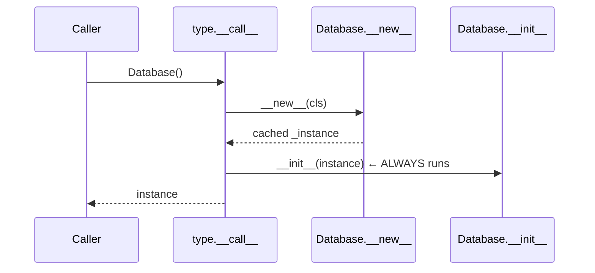

##### 💻 Approach 2: A Decorator (course code)

```python
def singleton(class_):
    instances = {}

    def get_instance(*args, **kwargs):
        if class_ not in instances:
            instances[class_] = class_(*args, **kwargs)
        return instances[class_]

    return get_instance


@singleton
class Database:
    def __init__(self):
        print('Loading database')


d1 = Database()
d2 = Database()
print(d1 == d2)
```

**Output (verified):** `__init__` runs once.

```text
Loading database
True
```

⚠️ **Edge cases (beyond the transcript):** After decoration, `Database` is a **function**, not a class. `isinstance(x, Database)` raises `TypeError`, you can't subclass it, and class attributes or static methods aren't reachable as `Database.x`.

##### 💻 Approach 3: A Metaclass (course code), the Lecture's Favourite

```python
class Singleton(type):
    """ Metaclass that creates a Singleton base type when called. """
    _instances = {}

    def __call__(cls, *args, **kwargs):
        if cls not in cls._instances:
            cls._instances[cls] = super(Singleton, cls)\
                .__call__(*args, **kwargs)
        return cls._instances[cls]


class Database(metaclass=Singleton):
    def __init__(self):
        print('Loading database')


d1 = Database()
d2 = Database()
print(d1 == d2)
```

**Output (verified):**

```text
Loading database
True
```

🔑 **Why it works:** `Database()` calls **`type(Database).__call__`**, which is `Singleton.__call__`. That is the method that normally runs both `__new__` **and** `__init__`. Intercepting it **before** either runs means `__init__` executes only once. `Database` stays a real class, so `isinstance` and subclassing work. (Each subclass gets its own instance, because the dictionary key is `cls`.)

```text
Database()  ──►  Singleton.__call__(Database)
                   │
                   ├─ cached?  yes ──► return it        (no __new__, no __init__)
                   │
                   └─ no ──► type.__call__ → __new__ + __init__ → cache → return
```

##### ⚖ Comparing the Implementations

| Approach | `__init__` once? | Still a class? | Inheritance | Lecture verdict |
|----------|------------------|----------------|-------------|-----------------|
| `__new__` allocator | ❌ runs every call | ✅ | ⚠️ a subclass may get the parent's cached instance | "a halfway approach" |
| Decorator | ✅ | ❌ becomes a function | ❌ | Works well |
| Metaclass | ✅ | ✅ | ✅ one instance per class | **"probably the nicest"** |
| *Module-level instance* (beyond) | ✅ | ✅ | n/a | The most Pythonic: modules are imported once |

##### 📎 Beyond the transcript: Thread-Safe Lazy Metaclass

```python
import threading


class ThreadSafeSingleton(type):
    _instances: dict = {}
    _lock = threading.Lock()

    def __call__(cls, *args, **kwargs):
        if cls not in cls._instances:                 # fast path, no lock
            with cls._lock:
                if cls not in cls._instances:         # double-checked locking
                    cls._instances[cls] = super().__call__(*args, **kwargs)
        return cls._instances[cls]


class Config(metaclass=ThreadSafeSingleton):
    def __init__(self):
        print("Loading config once")


results = []
threads = [threading.Thread(target=lambda: results.append(Config())) for _ in range(8)]
for t in threads: t.start()
for t in threads: t.join()
print(len({id(r) for r in results}))     # 1
```

📝 **Why:** Without the lock, two threads can both see "not created" and build two instances. This is a classic interview follow-up.

##### 🧪 Course Exercise: `is_singleton`

```python
from copy import deepcopy


def is_singleton(factory):
    x = factory()
    y = factory()
    return x is y          # identity, not equality


obj = [1, 2, 3]
print(is_singleton(lambda: obj), is_singleton(lambda: deepcopy(obj)))   # True False
```

🔑 Use **`is`** (identity) rather than `==` (equality): two deep copies of a list are `==` but not `is`. (The course demos use `d1 == d2`, which falls back to identity only because `Database` doesn't define `__eq__`.)

##### 🎯 Key Takeaways

- Singleton = **one instance, shared**. Lazy creation happens on the **first request**.
- Overriding `__new__` returns the same object, **but `__init__` still re-runs**.
- A **decorator** fixes the double `__init__`, but turns the class into a function.
- A **metaclass** `__call__` is the cleanest: `__init__` runs once and it's still a class.
- Check singletons with `is`. Add a lock for thread safety.

#### 🪞 Monostate

##### 📖 Definition

> **Monostate** (sometimes called "Borg"): a variation where **all state lives in one shared (static) dictionary**, but users can **create as many instances as they like**. Every instance's `__dict__` **refers to the same dictionary**.

##### 💻 Code Example: CEO and the Monostate Base (course code)

```python
class CEO:
    __shared_state = {
        'name': 'Steve',
        'age': 55
    }

    def __init__(self):
        self.__dict__ = self.__shared_state      # share the REFERENCE, not a copy

    def __str__(self):
        return f'{self.name} is {self.age} years old'


class Monostate:
    _shared_state = {}

    def __new__(cls, *args, **kwargs):
        obj = super(Monostate, cls).__new__(cls, *args, **kwargs)
        obj.__dict__ = cls._shared_state
        return obj


class CFO(Monostate):
    def __init__(self):
        self.name = ''
        self.money_managed = 0

    def __str__(self):
        return f'{self.name} manages ${self.money_managed}bn'


ceo1 = CEO(); print(ceo1)
ceo1.age = 66
ceo2 = CEO(); ceo2.age = 77
print(ceo1); print(ceo2)
ceo2.name = 'Tim'
ceo3 = CEO(); print(ceo1, ceo2, ceo3)

cfo1 = CFO(); cfo1.name = 'Sheryl'; cfo1.money_managed = 1
print(cfo1)
cfo2 = CFO(); cfo2.name = 'Ruth'; cfo2.money_managed = 10
print(cfo1, cfo2, sep='\n')
```

**Output (verified):**

```text
Steve is 55 years old
Steve is 77 years old
Steve is 77 years old
Tim is 77 years old Tim is 77 years old Tim is 77 years old
Sheryl manages $1bn
Ruth manages $10bn
Ruth manages $10bn
```

🔑 **Key lines:**
- `self.__dict__ = shared_dict` makes every instance **alias the same attribute dictionary**. As the lecture stresses, *"you're not just copying the data, you're copying the reference to the entire dictionary."*
- `Monostate` generalises this through `__new__`, so subclasses get the behaviour for free.
- ⚠️ `CFO.__init__` **resets** `name` and `money_managed` on every `CFO()` call, wiping the shared state. That's why creating `cfo2` would erase Sheryl even before Ruth is assigned.

> 🐞 **Gotcha in the provided file:** `_shared_state = {}` lives on `Monostate` itself, so **every subclass shares the same dictionary**. A `CFO` and a `CTO(Monostate)` would overwrite each other's attributes. Give each subclass its own dictionary, for example in `__init_subclass__`: `cls._shared_state = {}`.

> 💬 **Lecture verdict:** *"This isn't something that I would recommend… It's just too clumsy an approach."* Prefer the decorator or the metaclass.

##### ⚖ Singleton vs Monostate

| | Singleton | Monostate |
|---|-----------|-----------|
| Number of objects | Exactly one | Many |
| Shared | The object | The state (`__dict__`) |
| `a is b` | `True` | `False` |
| Transparency to callers | They must know to get the instance | It looks like a normal class (surprising) |
| Recommended? | Metaclass version, sparingly | Rarely, because it's clumsy |

##### 🎯 Key Takeaways

- Monostate = **many instances, one shared `__dict__`**.
- It works through **reference sharing** of the attribute dictionary.
- An `__init__` that assigns attributes **resets the shared state** on every construction.
- A base-class `_shared_state` is shared by **all** subclasses unless you split it.

#### 🧪 Singleton and Testability

##### 🧠 The Real Problem with Singletons

The pattern itself isn't the problem. **Taking a direct dependency on it** is. Code that calls `Database()` internally is tied to the **live** database, so its tests become **brittle** and possibly **dangerous**, because they may run against production data.

##### 💻 Code Example: A Hard-Wired Singleton Dependency (course code)

```python
import unittest


class Singleton(type):
    _instances = {}

    def __call__(cls, *args, **kwargs):
        if cls not in cls._instances:
            cls._instances[cls] = super(Singleton, cls).__call__(*args, **kwargs)
        return cls._instances[cls]


class Database(metaclass=Singleton):
    def __init__(self):
        self.population = {}
        f = open('capitals.txt', 'r')                 # city / population on alternate lines
        lines = f.readlines()
        for i in range(0, len(lines), 2):
            self.population[lines[i].strip()] = int(lines[i + 1].strip())
        f.close()


class SingletonRecordFinder:
    def total_population(self, cities):
        result = 0
        for c in cities:
            result += Database().population[c]        # ❌ hard-wired to the live DB
        return result


class ConfigurableRecordFinder:
    def __init__(self, db):
        self.db = db                                  # ✅ injected

    def total_population(self, cities):
        result = 0
        for c in cities:
            result += self.db.population[c]
        return result


class DummyDatabase:
    population = {
        'alpha': 1,
        'beta': 2,
        'gamma': 3
    }

    def get_population(self, name):
        return self.population[name]


class SingletonTests(unittest.TestCase):
    def test_is_singleton(self):
        db = Database()
        db2 = Database()
        self.assertEqual(db, db2)

    def test_singleton_total_population(self):
        """ This tests on a live database :( """
        rf = SingletonRecordFinder()
        names = ['Seoul', 'Mexico City']
        tp = rf.total_population(names)
        self.assertEqual(tp, 17500000 + 17400000)     # what if these change?

    ddb = DummyDatabase()

    def test_dependent_total_population(self):
        crf = ConfigurableRecordFinder(self.ddb)
        self.assertEqual(
            crf.total_population(['alpha', 'beta']),
            3
        )
```

📝 **What it shows:**
- `test_singleton_total_population` passes, but it's an **integration test in disguise**. It depends on the real `capitals.txt` (Seoul 17.5M, Mexico City 17.4M). When the data changes, the test breaks.
- `ConfigurableRecordFinder` receives its database through **constructor injection**, so the test passes a `DummyDatabase` with **predictable** values. The lecture calls it *"a vastly superior test because it's not tied up to the singleton in any way."*

> ⚠️ **Notes on the provided file:** `capitals.txt` isn't included in the folder, so the two `Database()` tests fail with `FileNotFoundError` unless you supply it. `DummyDatabase.get_population` is never used, because the finder reads `.population` directly. Pick one interface (preferably a `get_population` method) and use it consistently. Also prefer `with open(...)`.

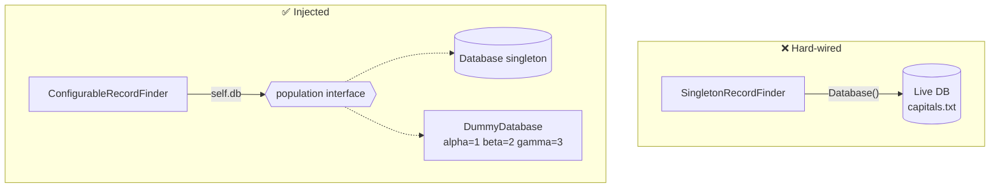

##### 📎 Beyond the transcript: Production Default + Test Override

```python
from typing import Protocol


class PopulationSource(Protocol):
    def get_population(self, name: str) -> int: ...


class RecordFinder:
    def __init__(self, db: PopulationSource | None = None):
        self.db = db if db is not None else Database()    # live by default, injectable for tests

    def total_population(self, cities: list[str]) -> int:
        return sum(self.db.get_population(c) for c in cities)


class DummyDatabase:
    population = {"alpha": 1, "beta": 2, "gamma": 3}

    def get_population(self, name: str) -> int:
        return self.population[name]


assert RecordFinder(DummyDatabase()).total_population(["alpha", "beta"]) == 3
```

##### 🔍 Resetting a Metaclass Singleton Between Tests

```python
import pytest


@pytest.fixture(autouse=True)
def reset_singletons():
    yield
    Singleton._instances.clear()       # each test starts with a fresh instance
```

##### 🎯 Key Takeaways

- The main danger is **taking a direct dependency** on a singleton, which forces tests to hit **live data**.
- Fix it with **dependency injection**: pass the database in, and default to the singleton in production.
- **Dummy or fake** implementations give fast, predictable tests. This is DIP from SOLID in action.
- The lecture's summary: the allocator calls `__init__` repeatedly; the decorator and metaclass don't (the metaclass is "nicest"); all of them are **lazy**; Monostate is a "bizarre variation"; and testability problems are solved with injection.

---

## 📚 Glossary

| Term | Definition | Why It Matters |
|------|------------|----------------|
| **Creational pattern** | A design pattern about how objects are created | Keeps complex creation readable and flexible |
| **Builder** | A separate component that constructs an object step by step | Handles piecewise construction with enforced rules |
| **Piecewise construction** | Building an object over several statements | The situation Builder is for |
| **Fluent interface** | An API whose methods return `self` so calls can be chained | Reads like a DSL: `b.add().add()` |
| **Builder facets** | Several sub-builders over one object, switched through properties | Splits a complex builder by aspect |
| **Facade** | A single entry point over several components (`PersonBuilder`) | Hides complexity from clients |
| **Recursive generics** | The C#/Java technique for typing inherited fluent builders | Not needed in Python. Use `typing.Self` |
| **Factory method** | Any method, usually static or a classmethod, that creates an object | Explicit names, and no `__init__` overloading needed |
| **Factory** | Any component responsible solely for wholesale creation | Separates creation (SRP) |
| **Wholesale creation** | Creating an object in one statement | The situation Factory is for |
| **Nested (inner) factory** | A factory class defined inside the product class | Discoverability. Common in C# and Java |
| **Abstract factory** | A hierarchy of factories matching a hierarchy of products | Creates related families polymorphically |
| **Duck typing** | Using objects by behaviour, not declared type | Why abstract bases are optional in Python |
| **`eval`** | Executes a string as Python code | Fragile and unsafe. Prefer registries |
| **Registry** | A mapping from names to classes or factories | An OCP-friendly replacement for `if/elif` and `eval` |
| **Prototype** | A partially or fully initialised object that is cloned and customised | Reuses existing designs and avoids duplication |
| **Reference assignment** | `b = a`: two names for one object | The mistake that motivates Prototype |
| **Shallow copy** | `copy.copy`: a new outer object with nested references shared | Causes shared-address bugs |
| **Deep copy** | `copy.deepcopy`: a recursive, fully independent copy | Required for Prototype with nested objects |
| **`__deepcopy__`** | A hook to customise deep copying | Skip caches, locks and connections |
| **Prototype factory** | A factory holding prototypes and exposing clone-and-customise methods | One-line creation of common variants |
| **Singleton** | A class instantiated only once, with the instance shared | Expensive or unique resources |
| **Lazy instantiation** | Creating the instance on first use, not at startup | Avoids paying for unused heavy initialisers |
| **Allocator (`__new__`)** | The method that creates the raw object before `__init__` | Overriding it alone still re-runs `__init__` |
| **Metaclass** | The class of a class. Its `__call__` controls instantiation | The cleanest Python Singleton |
| **Monostate (Borg)** | Many instances sharing one `__dict__` | Shared state without one identity. Considered clumsy |
| **Dependency injection** | Passing dependencies in, for example through the constructor | Makes singleton-dependent code testable |
| **Dummy / fake object** | A simple test substitute with predictable data | Fast, stable unit tests |
| **Design smell** | A sign of potentially poor design | The GoF's verdict on most Singleton use |

---

## 📝 One-Minute Revision

- **Builder:** piecewise construction. **Return `self`** for fluency. Expose it with `HtmlElement.create()`. **Facets** (`.lives`, `.works`) share one object through `person=None`. **Builder inheritance** keeps builders closed for modification (OCP).
- **Factory method:** a named creator (`new_polar_point(rho, theta)`), because Python **can't overload `__init__`**. Use `@classmethod` for subclass-friendliness.
- **Factory:** move many factory methods into `PointFactory` (SRP). It can be external, nested or an instance, and stateful when needed. *Any* creator, even a lambda, is a "factory".
- **Abstract factory:** product hierarchy ↔ factory hierarchy (`HotDrinkFactory` → `TeaFactory` / `CoffeeFactory`). The ABC is optional in Python, but it documents the API. The enum breaks OCP, so use a registry.
- **Prototype:** `=` copies a reference, `copy.copy` is shallow, **`copy.deepcopy`** is a true clone. Wrap prototypes in a **factory** (`EmployeeFactory`).
- **Singleton:** `__new__` → `__init__` still re-runs. A **decorator** fixes that but becomes a function. A **metaclass** is the nicest. All are lazy.
- **Monostate:** many objects, one `__dict__`. Clumsy.
- **Testing:** don't hard-wire `Database()`. **Inject** it, and test with a **dummy database**.

---

## 📄 Cheat Sheet

### 🧾 Pattern Quick Reference

| Pattern | Minimal Python shape |
|---------|----------------------|
| Fluent builder | `def add(self, ...): ...; return self` |
| Builder entry point | `@staticmethod def create(name): return Builder(name)` |
| Facet switch | `@property def works(self): return JobBuilder(self.person)` |
| Factory method | `@classmethod def new_polar(cls, rho, theta): return cls(rho*cos(theta), rho*sin(theta))` |
| Factory class | `class PointFactory: @staticmethod def new_cartesian(x, y): ...` |
| Abstract factory | `class HotDrinkFactory(ABC): @abstractmethod def prepare(self, amount): ...` |
| Prototype | `clone = copy.deepcopy(proto); clone.name = ...` |
| Singleton metaclass | `class S(type): def __call__(cls, *a, **k): ...cache...` |
| Monostate | `self.__dict__ = shared_dict` |
| Testable singleton use | `def __init__(self, db=None): self.db = db or Database()` |

### 💻 Must-Know Snippets

```python
import copy
from abc import ABC, abstractmethod


class Singleton(type):
    _instances = {}

    def __call__(cls, *args, **kwargs):
        if cls not in cls._instances:
            cls._instances[cls] = super().__call__(*args, **kwargs)
        return cls._instances[cls]


def singleton(class_):
    instances = {}
    def get_instance(*args, **kwargs):
        if class_ not in instances:
            instances[class_] = class_(*args, **kwargs)
        return instances[class_]
    return get_instance


class Shape(ABC):
    @abstractmethod
    def area(self): ...


proto = {"tags": ["a"]}
clone = copy.deepcopy(proto)      # nested list copied too
```

### 🧭 Choosing the Right Creational Pattern

#### 🔄 Decision Flow

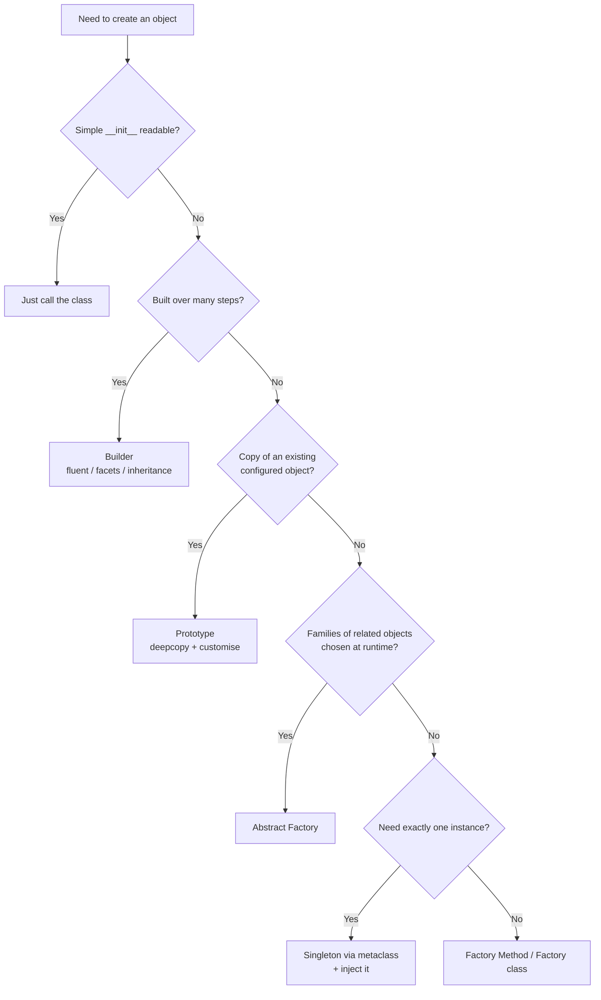

#### ⚖ The Patterns Side by Side

| | Builder | Factory Method | Factory | Abstract Factory | Prototype | Singleton |
|---|---------|----------------|---------|------------------|-----------|-----------|
| Creation style | Piecewise | Wholesale | Wholesale | Wholesale, families | Copy + tweak | Once |
| Typical API | `.add().add().build()` | `Point.new_polar()` | `PointFactory.new_polar()` | `factory.prepare()` | `deepcopy(proto)` | `Database()` |
| SOLID link | SRP, OCP (inheritance) | SRP | SRP | OCP, DIP | DRY | Hurts DIP unless injected |
| Python twist | Dynamic `self` makes inherited fluency work | `@classmethod` | Nested class is optional | ABC optional (duck typing) | `copy` module | Metaclass `__call__` |

#### 🔗 How They Combine (from the course)

- A **factory method** starts a **builder**: `HtmlElement.create('ul')`.
- A **factory** stores and clones **prototypes**: `EmployeeFactory`.
- A **factory instance** can act as a **singleton**: `Point.factory` ("a singleton instance of sorts").
- Factories are good singleton candidates because they're **stateless**.

#### 🎯 Key Takeaways

- Choose by **how** the object comes into being: steps, a name, a family, a copy, or once.
- The patterns compose naturally. Combining them is normal.
- Apply SOLID: keep creation logic separate (SRP), extensible (OCP) and injectable (DIP).

### ⚠️ Pitfalls Found in the Course Files

| File | Issue | Fix |
|------|-------|-----|
| `builder.py` | `__root = HtmlElement()` at class level is shared by all builders | Create it in `__init__` |
| `builder_facets.py` | `__str__` prints `postcode` as the position | `{self.position}` |
| `builder_inheritance.py` | `Person.new()` returns the base builder, which only has `build()` | Return `PersonBirthDateBuilder()` |
| `1. Builder/exercise.py` | `add_field(self, type, name)` is really `(name, value)` | Rename the parameters |
| `factory.py` | Polar uses x = ρ sin θ, y = ρ cos θ | x = ρ cos θ, y = ρ sin θ |
| `abstract_factory.py` | `self.initialized = True` never sets the class flag, so factories duplicate | `HotDrinkMachine.initialized = True` |
| `abstract_factory.py` | `eval(factory_name)`, ABC without `@abstractmethod` | Registry and `@abstractmethod` |
| `3. Prototype/exercise.py` | `Line(start=Point(), end=Point())` mutable defaults | `None` defaults |
| `singleton_allocator.py` | `print(d1.id, ...)` while the `id` code is commented out, so `AttributeError` | Uncomment, or remove the print |
| `monostate.py` | One `_shared_state` for **all** subclasses | Give each subclass its own dictionary |
| `singleton_testing.py` | `capitals.txt` missing. `get_population` unused | Supply the file. Use one interface |

---

## 🎤 Interview Questions and Answers

### 🟢 Beginner

**❓ Q1. What are creational design patterns?**

✅ **Answer:** Patterns that deal with object creation: Builder, Factory Method, Abstract Factory, Prototype and Singleton.

💡 **Explanation:** They outsource complicated, confusing, repetitive or expensive creation logic away from plain initialisers.

🎯 **Why Interviewers Ask This:** A baseline check of pattern vocabulary.

➡️ **Possible Follow-up:** How do they differ from structural and behavioural patterns?

---

**❓ Q2. When should you use the Builder pattern?**

✅ **Answer:** When an object is constructed **piecewise**, over several steps that must follow rules, such as an HTML tree.

💡 **Explanation:** The builder encodes the rules (closing tags, indentation) once, so callers can't get them wrong.

🎯 **Why Interviewers Ask This:** Tests whether you can tell Builder apart from Factory.

➡️ **Possible Follow-up:** When is a builder overkill?

---

**❓ Q3. What is a fluent interface and how do you implement one?**

✅ **Answer:** An API whose methods can be chained. Each method returns `self`.

💡 **Explanation:** `builder.add_child_fluent('li','hello').add_child_fluent('li','world')`.

🎯 **Why Interviewers Ask This:** A common, practical idiom.

➡️ **Possible Follow-up:** What happens if one method forgets to return `self`?

---

**❓ Q4. What is a factory method?**

✅ **Answer:** Any method, typically static or a classmethod, that creates and returns an object.

💡 **Explanation:** `Point.new_polar_point(rho, theta)` is clearer than `Point(a, b, CoordinateSystem.POLAR)`.

🎯 **Why Interviewers Ask This:** One of the most widely used patterns.

➡️ **Possible Follow-up:** Name factory methods in Python's standard library.

---

**❓ Q5. Why can't you just define two `__init__` methods for Cartesian and polar points?**

✅ **Answer:** Python doesn't support method overloading. The second definition replaces the first.

💡 **Explanation:** That's why the course uses factory methods with distinct names.

🎯 **Why Interviewers Ask This:** A Python-specific language fact.

➡️ **Possible Follow-up:** What about `functools.singledispatchmethod`?

---

**❓ Q6. What is the Prototype pattern?**

✅ **Answer:** Creating objects by **copying** an existing (prototype) object and customising the copy.

💡 **Explanation:** Like iterating on an existing car design instead of starting from a blank page.

🎯 **Why Interviewers Ask This:** Tests understanding of copy semantics.

➡️ **Possible Follow-up:** Why does Prototype need a deep copy?

---

**❓ Q7. What's the difference between `copy.copy` and `copy.deepcopy`?**

✅ **Answer:** `copy` is shallow: it makes a new outer object but shares nested objects. `deepcopy` recursively copies everything.

💡 **Explanation:** With a shallow copy, Jane and John end up sharing one `Address`.

🎯 **Why Interviewers Ask This:** A very common source of bugs.

➡️ **Possible Follow-up:** How does `deepcopy` handle cycles?

---

**❓ Q8. What is a Singleton?**

✅ **Answer:** A class that has only one instance, which is shared by everyone who asks for it.

💡 **Explanation:** Motivated by expensive initialisers (loading a database) or resources that exist only once.

🎯 **Why Interviewers Ask This:** Famous and controversial.

➡️ **Possible Follow-up:** Why is it often called an anti-pattern?

---

**❓ Q9. What is lazy instantiation?**

✅ **Answer:** Creating the instance only when it's first requested, not at program start.

💡 **Explanation:** All of the course's singleton implementations check for the instance on first call and create it then.

🎯 **Why Interviewers Ask This:** A performance and design concept.

➡️ **Possible Follow-up:** What are the downsides of laziness? (First-call latency, thread safety.)

---

**❓ Q10. What is a factory, as opposed to a factory method?**

✅ **Answer:** A separate component, usually a class like `PointFactory`, that groups factory methods. More broadly, anything that creates objects, even a lambda.

💡 **Explanation:** Moving creation into its own class applies SRP.

🎯 **Why Interviewers Ask This:** Checks precise terminology.

➡️ **Possible Follow-up:** When would a factory need instance (non-static) methods?

---

### 🟡 Intermediate

**❓ Q11. Explain builder facets and the `person=None` trick.**

✅ **Answer:** Facets are sub-builders (address and job) that inherit from a base `PersonBuilder`. The base creates a blank `Person` only when none is passed in, so sub-builders work on the **same** person.

💡 **Explanation:** The `lives` and `works` properties return a sub-builder initialised with `self.person`. "Creating an instance of Person" prints only once.

🎯 **Why Interviewers Ask This:** Tests deeper builder design.

➡️ **Possible Follow-up:** Which SOLID principle do facets violate?

---

**❓ Q12. How does builder inheritance satisfy OCP?**

✅ **Answer:** Each new building step is added in a **subclass** of the last builder. Existing builders never change.

💡 **Explanation:** `PersonBuilder → PersonInfoBuilder → PersonJobBuilder → PersonBirthDateBuilder`. You use the most-derived one.

🎯 **Why Interviewers Ask This:** Links patterns to SOLID.

➡️ **Possible Follow-up:** Why doesn't this work directly in Java or C#?

---

**❓ Q13. Why does the inherited fluent builder fail in statically typed languages?**

✅ **Answer:** A method declared in `PersonInfoBuilder` returns that static type, so the compiler won't allow methods of derived builders after it in the chain.

💡 **Explanation:** These languages need recursive generics (CRTP-style). In Python, `self` is the runtime object. For type checkers, annotate with `typing.Self`.

🎯 **Why Interviewers Ask This:** Tests cross-language depth.

➡️ **Possible Follow-up:** Write the Java signature using recursive generics.

---

**❓ Q14. What problems does the `Point(a, b, system)` initialiser have?**

✅ **Answer:**
- Meaningless parameter names.
- A mode flag that changes what the arguments mean.
- Adding a coordinate system means modifying the enum **and** `__init__` (OCP violation).

💡 **Explanation:** The lecture calls a giant initialiser "God object, but for initializers".

🎯 **Why Interviewers Ask This:** Spotting API smells.

➡️ **Possible Follow-up:** How do factory methods fix each problem?

---

**❓ Q15. Is the abstract base class necessary for Abstract Factory in Python?**

✅ **Answer:** No. Duck typing means the code works without it. It's still useful to document and enforce the expected API, provided you use `@abstractmethod`.

💡 **Explanation:** The lecture deletes `HotDrinkFactory` and everything still runs. In statically typed languages it's essential.

🎯 **Why Interviewers Ask This:** Python-specific design maturity.

➡️ **Possible Follow-up:** What does `ABC` enforce without `@abstractmethod`? (Nothing.)

---

**❓ Q16. What's wrong with `HotDrinkMachine`'s `AvailableDrink` enum and `eval`?**

✅ **Answer:** The enum violates OCP, because every new drink means editing it. `eval` is fragile, unsafe if any input is untrusted, and hides dependencies.

💡 **Explanation:** Use a registry, with self-registration through `__init_subclass__` or discovery through `__subclasses__()`.

🎯 **Why Interviewers Ask This:** Code review skills.

➡️ **Possible Follow-up:** Implement self-registering factories.

---

**❓ Q17. Why does overriding `__new__` produce a flawed singleton?**

✅ **Answer:** `type.__call__` always runs `__init__` after `__new__`, even when `__new__` returns the cached instance. Initialisation repeats, and may reset state.

💡 **Explanation:** The lecture shows "Loading database" printed twice, with two different random IDs.

🎯 **Why Interviewers Ask This:** Tests knowledge of Python's object model.

➡️ **Possible Follow-up:** How could you guard `__init__`? (An `_initialized` flag.)

---

**❓ Q18. Decorator vs metaclass singleton: what's the difference?**

✅ **Answer:** Both cache instances and run `__init__` once. The decorator replaces the class with a function, which breaks `isinstance`, subclassing and class attributes. The metaclass keeps a real class.

💡 **Explanation:** The lecture rates the metaclass "probably the nicest".

🎯 **Why Interviewers Ask This:** Practical trade-offs.

➡️ **Possible Follow-up:** How does the metaclass give each subclass its own instance?

---

**❓ Q19. What is Monostate?**

✅ **Answer:** Many instances whose `__dict__` all reference one shared dictionary, so they share state but not identity.

💡 **Explanation:** `self.__dict__ = self.__shared_state`. Changing `ceo2.age` changes `ceo1.age`.

🎯 **Why Interviewers Ask This:** A less-known variation that tests depth.

➡️ **Possible Follow-up:** Why is it considered clumsy?

---

**❓ Q20. Why is a prototype factory useful?**

✅ **Answer:** It hides the `deepcopy`-plus-customise steps behind one-line factory methods for a fixed set of prototypes.

💡 **Explanation:** `EmployeeFactory.new_aux_office_employee("Jane", 200)`.

🎯 **Why Interviewers Ask This:** Shows that you combine patterns.

➡️ **Possible Follow-up:** How would you add prototypes at runtime?

---

### 🔴 Advanced

**❓ Q21. Why do singletons hurt testability, and how do you fix that?**

✅ **Answer:** Code that calls `Database()` directly is tied to live data, so tests become slow, brittle and potentially dangerous. Inject the dependency instead, defaulting to the singleton in production.

💡 **Explanation:** `ConfigurableRecordFinder(db)` with a `DummyDatabase` gives predictable tests.

🎯 **Why Interviewers Ask This:** The core of the singleton debate.

➡️ **Possible Follow-up:** How do you reset singletons between tests?

---

**❓ Q22. Make a metaclass singleton thread-safe.**

✅ **Answer:** Guard creation with a `threading.Lock`, using double-checked locking: check, take the lock, check again, then create.

💡 **Explanation:** Without it, two threads can both see "missing" and create two instances.

🎯 **Why Interviewers Ask This:** Concurrency awareness.

➡️ **Possible Follow-up:** Is double-checked locking safe in CPython? Why?

---

**❓ Q23. What's the most Pythonic singleton?**

✅ **Answer:** Often a **module-level instance**. Modules are imported once and cached in `sys.modules`, so `from db import database` always gives the same object.

💡 **Explanation:** The course's allocator file also creates `database = Database()` at module level.

🎯 **Why Interviewers Ask This:** Tests idiomatic Python over a Java-style translation.

➡️ **Possible Follow-up:** What are the downsides? (Eager creation, harder to reset.)

---

**❓ Q24. How does `copy.deepcopy` handle shared references and cycles, and how do you customise it?**

✅ **Answer:** It uses a `memo` dictionary mapping `id → copy`, so each original object is copied once. Define `__deepcopy__(self, memo)` to customise, for example to skip caches or locks.

💡 **Explanation:** Non-copyable members (locks, sockets) raise errors unless you exclude them.

🎯 **Why Interviewers Ask This:** Depth beyond the API.

➡️ **Possible Follow-up:** What does `__reduce_ex__` have to do with copying?

---

**❓ Q25. Explain the `HotDrinkMachine` `initialized` bug.**

✅ **Answer:** `self.initialized = True` creates an instance attribute, so the class attribute stays `False`. Each new machine re-initialises and appends duplicates to the class-level `factories` list.

💡 **Explanation:** Instance writes shadow class attributes, while `self.factories.append` mutates the shared class list. Two machines give 4 entries.

🎯 **Why Interviewers Ask This:** Tests Python attribute lookup.

➡️ **Possible Follow-up:** How would you fix it, and should state be class-level at all?

---

**❓ Q26. Abstract Factory vs Factory Method: what's the structural difference?**

✅ **Answer:** A Factory Method is one creation method, often overridden in subclasses. An Abstract Factory is an object providing a set of creation methods for a **family** of related products, chosen polymorphically.

💡 **Explanation:** Abstract factories are usually *implemented with* factory methods (`prepare`).

🎯 **Why Interviewers Ask This:** A classic GoF distinction.

➡️ **Possible Follow-up:** Give a real example of a product family.

---

**❓ Q27. Builder vs Factory: how do you decide?**

✅ **Answer:** Use a Builder when construction takes **multiple steps** or many optional parts. Use a Factory when creation is a **single step**, but the details or variants need a good name or need hiding.

💡 **Explanation:** The lectures frame this as piecewise vs wholesale.

🎯 **Why Interviewers Ask This:** Pattern selection judgement.

➡️ **Possible Follow-up:** Can a factory return a builder? (Yes: `HtmlElement.create`.)

---

**❓ Q28. Why does `Monostate` with a base-class `_shared_state` cause problems with several subclasses?**

✅ **Answer:** All subclasses alias the same dictionary, so `CFO` and `CTO` instances overwrite each other's attributes.

💡 **Explanation:** Give each subclass its own dictionary through `__init_subclass__`.

🎯 **Why Interviewers Ask This:** Careful reasoning about class-level state.

➡️ **Possible Follow-up:** What does `CFO.__init__` do to the shared state on every construction?

---

**❓ Q29. When is Singleton genuinely appropriate?**

✅ **Answer:** For truly process-wide, stateless or immutable services (configuration, a logger registry, a connection pool), **provided** consumers receive it by injection rather than hard-wiring it.

💡 **Explanation:** The GoF called most uses "a design smell". The problem is hidden global state and coupling.

🎯 **Why Interviewers Ask This:** Nuanced judgement.

➡️ **Possible Follow-up:** How do DI containers manage "singleton scope"?

---

**❓ Q30. How would you design an OCP-compliant abstract factory in Python?**

✅ **Answer:**
- Define abstract products and factories with `ABC` and `@abstractmethod`.
- Auto-register factories via `__init_subclass__`.
- Have the client iterate the registry, with no enums, `eval` or `if/elif`.

💡 **Explanation:** Adding `HotChocolateFactory(drink_name="Hot chocolate")` requires no other changes.

🎯 **Why Interviewers Ask This:** Advanced Python plus design synthesis.

➡️ **Possible Follow-up:** How would plugins in separate packages register? (Entry points.)

---

## 🎬 Scenario-Based Questions

### 🎬 Scenario 1: Builders leaking content into each other

> **Scenario:** Your HTML email generator sometimes includes another customer's list items in an email. It uses an `HtmlBuilder` per request. What happened?

1. 🔎 **Initial investigation:** Reproduce with two builders in one process, and check whether the second contains the first's children.
2. 📊 **Metrics/logs:** Correlate the wrong emails with concurrent requests and long-running worker processes.
3. 🧩 **Possible causes:** Mutable **class-level state** in the builder (`__root = HtmlElement()`), as in the course file.
4. 🛠 **Debugging approach:** Print `id(builder._HtmlBuilder__root)` across instances. If the IDs are equal, the root is shared.
5. ✅ **Resolution:** Create the root in `__init__`, and add a regression test with two builders.
6. 🛡 **Prevention:** A lint rule against mutable class attributes (Ruff `RUF012`), and code-review awareness.

### 🎬 Scenario 2: The vending menu that keeps growing

> **Scenario:** After a few hours, the kiosk shows "Coffee, Tea, Coffee, Tea, Coffee…". Each request creates a `HotDrinkMachine()`.

1. 🔎 **Initial investigation:** Count `HotDrinkMachine.factories` after creating several machines.
2. 📊 **Metrics/logs:** Memory growth over time, and menu length vs request count.
3. 🧩 **Possible causes:** `self.initialized = True` shadows the class flag, while `factories` is a shared class list.
4. 🛠 **Debugging approach:** Check `HotDrinkMachine.initialized` against `machine.__dict__`.
5. ✅ **Resolution:** Make the factories per instance, or set `HotDrinkMachine.initialized = True`. Replace `eval` with a registry.
6. 🛡 **Prevention:** Unit test that creating N machines doesn't change the menu length.

### 🎬 Scenario 3: Cloned orders sharing line items

> **Scenario:** "Duplicate order" copies an order, but editing the copy's items also changes the original order.

1. 🔎 **Initial investigation:** Find the clone code: is it `copy.copy`, `=` or a manual copy?
2. 📊 **Metrics/logs:** Audit logs showing edits to the original order without a user action.
3. 🧩 **Possible causes:** A **shallow copy**, where the line-item list and objects are shared.
4. 🛠 **Debugging approach:** Compare `id(order.items)` and `id(copy.items)`.
5. ✅ **Resolution:** Use `copy.deepcopy`, or `__deepcopy__` to exclude DB handles and caches, and reset the ID and timestamps on the clone.
6. 🛡 **Prevention:** A test that mutating the clone leaves the original unchanged, and a prototype factory method `Order.duplicate()`.

### 🎬 Scenario 4: Tests break whenever production data changes

> **Scenario:** The test suite fails every month when population figures are updated. The code calls `Database()` (a singleton) inside business methods.

1. 🔎 **Initial investigation:** Find the tests touching real data files or databases.
2. 📊 **Metrics/logs:** Test failures correlated with data refreshes, and test duration.
3. 🧩 **Possible causes:** A hard-wired singleton dependency (`SingletonRecordFinder`).
4. 🛠 **Debugging approach:** Introduce constructor injection, `RecordFinder(db=None)`, defaulting to `Database()`.
5. ✅ **Resolution:** Unit tests use a `DummyDatabase` with fixed values. A small integration suite uses real data.
6. 🛡 **Prevention:** Architecture rule: no direct singleton calls inside domain logic. Reset singletons in a fixture.

### 🎬 Scenario 5: Two "singletons" under load

> **Scenario:** Logs occasionally show "Loading config" twice at startup in a multi-threaded server.

1. 🔎 **Initial investigation:** Check the singleton implementation: allocator, decorator or metaclass, and whether it uses a lock.
2. 📊 **Metrics/logs:** Thread IDs on the "Loading" log lines. Does it happen only under concurrent first access?
3. 🧩 **Possible causes:** A race on the first creation, or the `__new__`-based singleton re-running `__init__`.
4. 🛠 **Debugging approach:** Reproduce with 8 threads creating the object at the same time, and count the distinct `id()` values.
5. ✅ **Resolution:** A metaclass with double-checked locking, or eager creation at module import before threads start.
6. 🛡 **Prevention:** A concurrency test in CI, and documenting thread-safety guarantees.

---

## 🧪 Hands-on Exercises

### 🟢 Easy

1. Make `HtmlBuilder` create its root per instance, and prove two builders are isolated.
2. Fix `Person.__str__` in `builder_facets.py`, and make `Person.new()` in `builder_inheritance.py` return the most-derived builder.
3. Correct the polar → Cartesian formula and assert that `new_polar_point(1, 0)` gives `(1, 0)`.
4. Show `=`, `copy.copy` and `copy.deepcopy` behaviour on `Person`/`Address`, printing `id()` values.

### 🟡 Medium

1. Add a `PersonEducationBuilder` facet (`studied_at`, `graduated`) to the facets example, then do it again with the inheritance approach. Compare how many existing classes changed.
2. Rewrite `HotDrinkMachine` with a self-registering factory registry and no `eval`. Add `HotChocolateFactory` without touching the machine.
3. Implement `__deepcopy__` for a class holding a `threading.Lock`, so that clones get a fresh lock.
4. Write pytest tests for `ConfigurableRecordFinder` using a fake, plus a fixture that resets `Singleton._instances`.

### 🔴 Advanced

1. Build a thread-safe metaclass singleton and prove it with a 50-thread test.
2. Fix `Monostate` so each subclass has its own shared state, and doesn't reset it on every `__init__`.
3. Create a type-checked fluent builder hierarchy using `typing.Self`, and confirm mypy accepts the inherited chain.
4. Design a prototype registry whose prototypes are loaded from JSON, with nested overrides (`address__suite=7`).

---

## 📦 Practice Assignment

### 🎯 Objective

Build a **"Report Generator"** that uses every creational pattern from the course.

### 📋 Requirements

- **Builder:** a fluent `ReportBuilder` with `.title()`, `.section()` and `.bullet()` → `build()` returns a `Report`.
- **Factory method:** `Report.from_markdown(text)` and `Report.empty(title)`.
- **Abstract factory:** `HtmlRendererFactory` and `TextRendererFactory`, each producing a matching `HeaderRenderer` and `ListRenderer` family.
- **Prototype:** a `TemplateRegistry` with "weekly" and "incident" report prototypes, cloned with `deepcopy` and customised.
- **Singleton:** a `Settings` class (metaclass) loaded once, **injected** into the generator.

### 🏛 Architecture

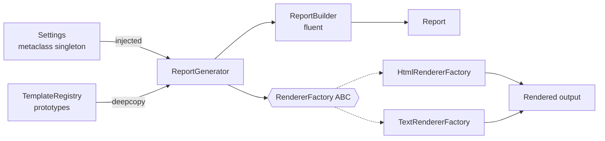

### ⚙️ Expected Functionality

| Feature | Pattern |
|---------|---------|
| Building a report step by step | Builder (fluent) |
| `Report.from_markdown()` | Factory method |
| HTML vs plain-text rendering families | Abstract factory |
| Cloning a weekly template | Prototype (+ factory) |
| A single `Settings` load | Singleton + DI |

### 💻 Suggested Implementation

```python
import copy
from abc import ABC, abstractmethod


class Report:
    def __init__(self, title=""):
        self.title, self.sections = title, []

    @classmethod
    def empty(cls, title):
        return cls(title)


class ReportBuilder:
    def __init__(self, report=None):
        self.report = report or Report()

    def title(self, t):
        self.report.title = t
        return self

    def section(self, name):
        self.report.sections.append((name, []))
        return self

    def bullet(self, text):
        self.report.sections[-1][1].append(text)
        return self

    def build(self):
        return self.report


class RendererFactory(ABC):
    @abstractmethod
    def header(self, text): ...

    @abstractmethod
    def items(self, items): ...

    def render(self, r: Report) -> str:
        out = [self.header(r.title)]
        for name, bullets in r.sections:
            out += [self.header(name), self.items(bullets)]
        return "\n".join(out)


class TextRendererFactory(RendererFactory):
    def header(self, text): return text.upper()
    def items(self, items): return "\n".join(f"- {i}" for i in items)


class HtmlRendererFactory(RendererFactory):
    def header(self, text): return f"<h2>{text}</h2>"
    def items(self, items): return "<ul>" + "".join(f"<li>{i}</li>" for i in items) + "</ul>"


weekly = ReportBuilder().title("Weekly").section("Done").build()      # prototype
r = copy.deepcopy(weekly)
ReportBuilder(r).bullet("Shipped builder module")
print(TextRendererFactory().render(r))
print(weekly.sections)        # prototype untouched
```

### 📤 Expected Output

```text
WEEKLY
DONE
- Shipped builder module
[('Done', [])]
```

### 🧗 Challenges

- Add a `MarkdownRendererFactory` without changing existing classes.
- Make `Settings` injectable, so tests can use `FakeSettings`.
- Make sure editing a cloned report never changes its prototype.

### ⭐ Bonus Improvements

- Thread-safe `Settings`.
- Self-registering renderer factories selected by name.
- `typing.Self` annotations throughout the builder.

---

## 🔗 Additional Resources

| Resource | Type | Why |
|----------|------|-----|
| Gamma, Helm, Johnson & Vlissides, *Design Patterns* (GoF) | Book | The original catalogue of creational patterns |
| Dmitri Nesteruk, *Design Patterns in Python* (course and book) | Course / Book | The source of this course's examples |
| [Python docs: `copy`](https://docs.python.org/3/library/copy.html) | Docs | `copy`, `deepcopy`, `__deepcopy__` |
| [Python docs: `abc`](https://docs.python.org/3/library/abc.html) | Docs | `ABC`, `@abstractmethod` |
| [Python data model: metaclasses](https://docs.python.org/3/reference/datamodel.html#metaclasses) | Docs | `__call__`, `__new__`, `__init_subclass__` |
| [Python docs: `typing.Self`](https://docs.python.org/3/library/typing.html#typing.Self) | Docs | Typing fluent builders |
| [Refactoring.Guru: Creational Patterns](https://refactoring.guru/design-patterns/creational-patterns) | Website | Clear diagrams and comparisons |
| [python-patterns.guide (Brandon Rhodes)](https://python-patterns.guide/) | Website | Pythonic takes, including the Singleton critique |
| [faif/python-patterns](https://github.com/faif/python-patterns) | GitHub | Pattern implementations in Python |
| Mark Seemann, *Dependency Injection Principles, Practices, and Patterns* | Book | Testability and singleton alternatives |

---

## 🏁 Final Revision Sheet

### 🧠 Core Concepts

| Pattern | One-liner | Course example | Remember |
|---------|-----------|----------------|----------|
| **Builder** | Piecewise construction | `HtmlBuilder` | `return self` makes it fluent |
| **Facets** | Several builders, one object | `.lives` / `.works` | The `person=None` trick. Breaks OCP |
| **Builder inheritance** | Extend builders through subclasses | `PersonBirthDateBuilder` | OCP-friendly. Use the most-derived |
| **Factory method** | A named creator | `new_polar_point(rho, theta)` | No `__init__` overloading in Python |
| **Factory** | A class of creators | `PointFactory` | External / nested / instance / stateful |
| **Abstract factory** | Factory hierarchy ↔ product hierarchy | `TeaFactory`, `CoffeeFactory` | ABC optional, but documents the API |
| **Prototype** | Clone and customise | `copy.deepcopy(john)` | Shallow copies share nested objects |
| **Prototype factory** | Stored prototypes plus one-liners | `EmployeeFactory` | Partial prototypes are fine |
| **Singleton** | One instance | Metaclass `Singleton` | `__new__` re-runs `__init__` |
| **Monostate** | One shared `__dict__` | `CEO`, `CFO` | Clumsy |

### 💻 Must-Know Code

```text
return self                                         # fluent builder
@staticmethod / @classmethod def new_x(...)         # factory method
copy.deepcopy(proto)                                # prototype
def __call__(cls, *a, **k): cache in cls._instances # metaclass singleton
self.__dict__ = shared_state                        # monostate
def __init__(self, db=None): self.db = db or Database()   # testable singleton use
```

### ❌ Common Mistakes

- Mutable **class-level** state in builders, machines and monostates.
- Forgetting `return self` in a fluent method.
- `=` or `copy.copy` when you need `deepcopy`. Mutable default arguments.
- Swapping sin and cos in polar conversion.
- `eval` for factory lookup. An ABC without `@abstractmethod`.
- Allocator-only singletons (double `__init__`). Calling singletons directly inside business logic.

### 🎤 Interview Points

- Builder = **piecewise**. Factory = **wholesale**.
- Inherited fluent builders work in Python because of dynamic typing. In Java and C# they need recursive generics.
- The GoF: Singleton is *"almost always a design smell."*
- The **metaclass** singleton is the nicest. A **module-level instance** is the most Pythonic.
- Fix singleton testability with **dependency injection** and dummy objects.

### 📌 Things to Remember

- **B**uild in steps · 
- **F**actory in one shot · 
- **A**bstract factories make families · 
- **P**rototype = deepcopy + tweak · 
- **S**ingleton once, but **inject** it.