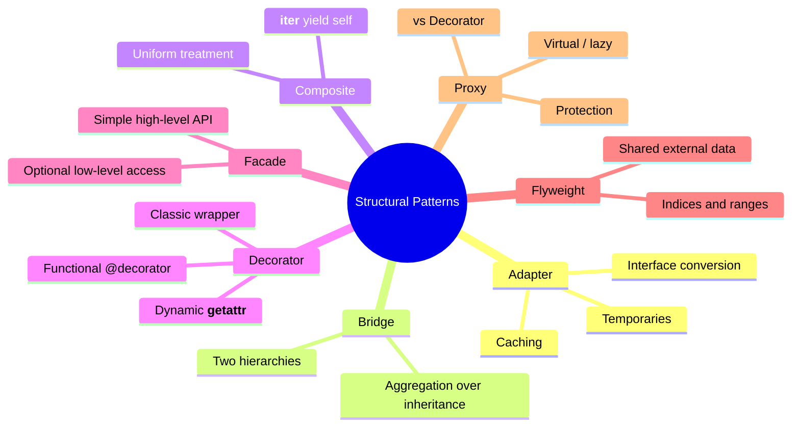
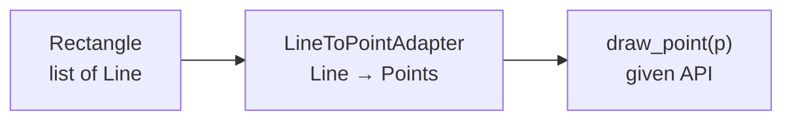
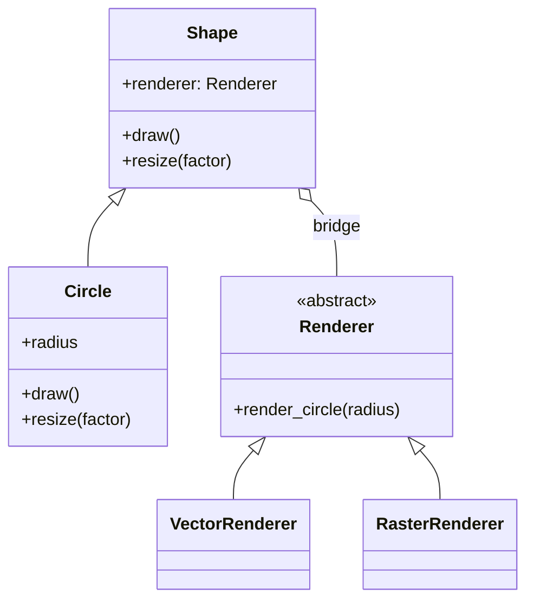
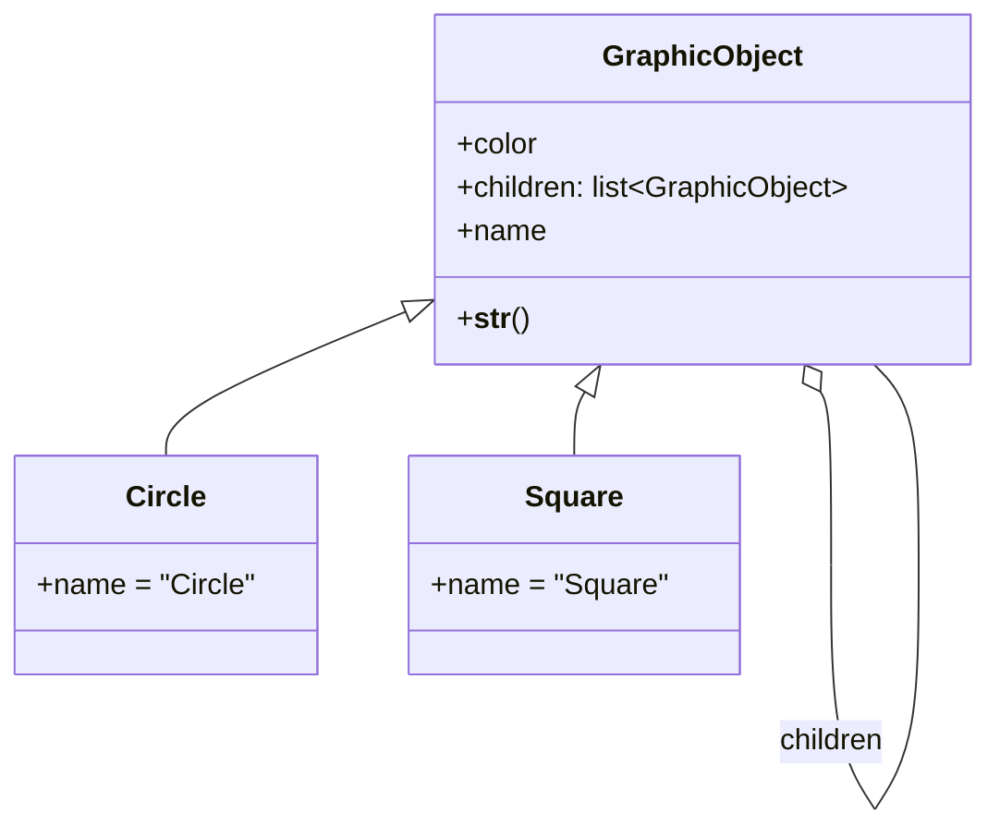
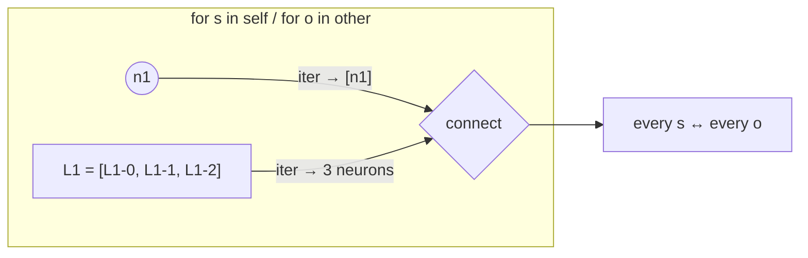
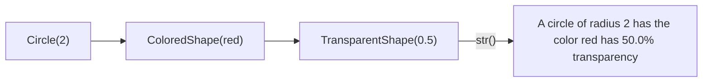
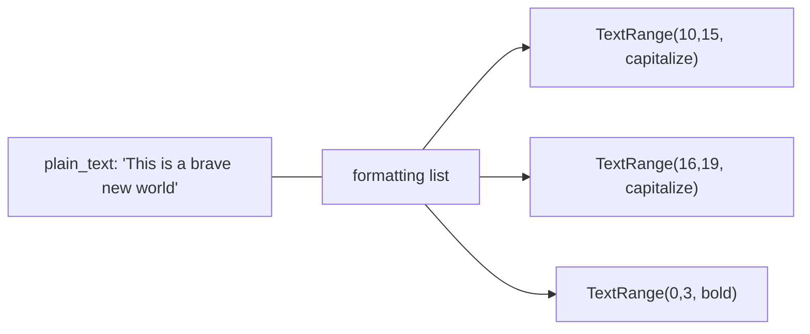
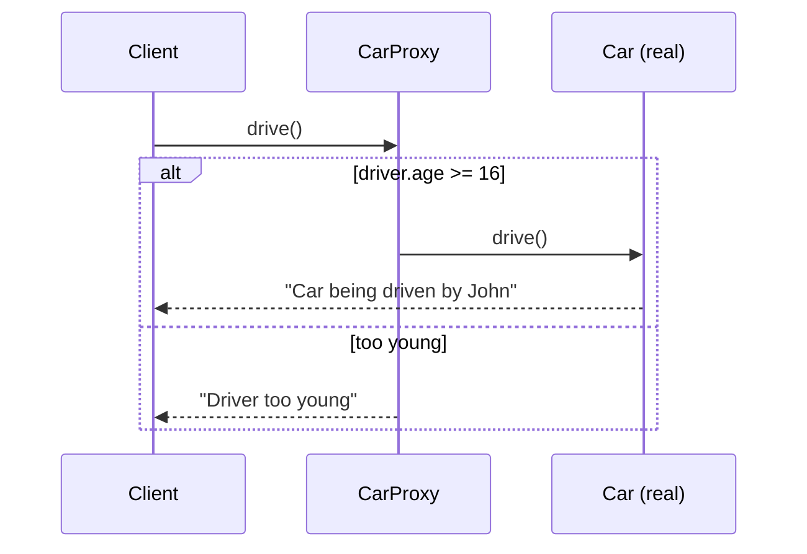
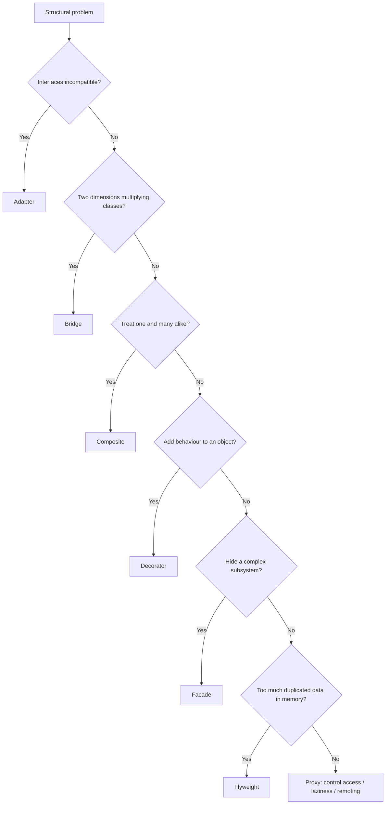
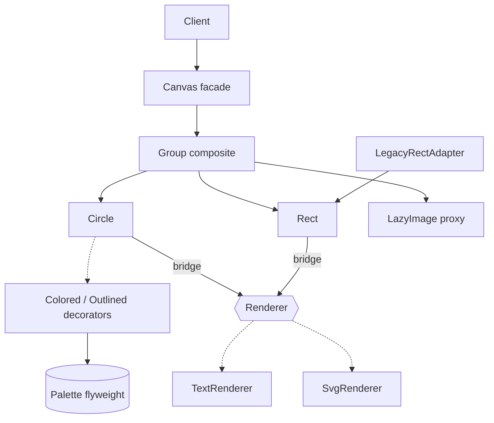

# 🧩 Structural Design Patterns in Python: Complete Study Guide

><i> A complete, interview-ready guide to the seven structural design patterns: **Adapter**, **Bridge**, **Composite**, **Decorator**, **Facade**, **Flyweight** and **Proxy**.</i>

---

## 📑 Table of Contents

1. [Session Overview](#-session-overview)
2. [Learning Objectives](#-learning-objectives)
3. [Detailed Notes](#-detailed-notes)
    1. [Part 1: Adapter](#-part-1-adapter)
    2. [Part 2: Bridge](#-part-2-bridge)
    3. [Part 3: Composite](#-part-3-composite)
    4. [Part 4: Decorator](#-part-4-decorator)
    5. [Part 5: Facade](#-part-5-facade)
    6. [Part 6: Flyweight](#-part-6-flyweight)
    7. [Part 7: Proxy](#-part-7-proxy)
4. [Glossary](#-glossary)
5. [One-Minute Revision](#-one-minute-revision)
6. [Cheat Sheet](#-cheat-sheet)
7. [Interview Questions and Answers](#-interview-questions-and-answers)
8. [Scenario-Based Questions](#-scenario-based-questions)
9. [Hands-on Exercises](#-hands-on-exercises)
10. [Practice Assignment](#-practice-assignment)
11. [Additional Resources](#-additional-resources)
12. [Final Revision Sheet](#-final-revision-sheet)

---

## 🗺 Session Overview

Structural patterns deal with **how classes and objects are composed into larger structures**: wrapping, connecting, grouping, simplifying and sharing objects, while keeping each piece simple and the interfaces clean.

| Pattern | Core idea | Course example | Analogy from the lectures |
|---------|-----------|----------------|---------------------------|
| **Adapter** | Convert the interface you **have** into the one you **need** | `LineToPointAdapter`, with caching | A travel plug adapter |
| **Bridge** | Connect two hierarchies through a **reference** to avoid a Cartesian-product explosion | `Shape` ↔ `Renderer` | Shapes × renderers |
| **Composite** | Treat **single objects and groups uniformly** | `GraphicObject` groups, `Neuron` / `NeuronLayer` | Grouping shapes in a drawing app |
| **Decorator** | **Add behaviour** without modifying or inheriting from the class | `@time_it`, `ColoredShape`, `FileWithLogging` | Wrapping a gift |
| **Facade** | A **simple API** over a complex subsystem | `Console` over `Buffer` + `Viewport` | A house hiding its plumbing and wiring |
| **Flyweight** | **Save memory** by storing shared data externally and referencing it | `User2` name indices, `TextRange` | Millions of "John Smith"s |
| **Proxy** | **Same interface**, different behaviour underneath | `CarProxy` (protection), `LazyBitmap` (virtual) | A gatekeeper or a stand-in |



### 🧭 What Structural Patterns Solve

#### 🧠 Concept

Almost every structural pattern is a **wrapper or a reference** to another object. They differ in the **intent** behind it:

```text
                    One object holds a reference to another ...
                                       │
   ┌───────────┬───────────┬───────────┼───────────┬───────────┬───────────┐
   ▼           ▼           ▼           ▼           ▼           ▼           ▼
 ADAPTER     BRIDGE     COMPOSITE   DECORATOR    FACADE    FLYWEIGHT     PROXY
 change the  connect    treat one   add          simplify  share data    same API,
 interface   two        and many    behaviour    many      to save       control
             hierarchies the same                classes   memory        access
```

| Pattern | Interface the client sees | Number of wrapped objects |
|---------|---------------------------|---------------------------|
| Adapter | **Different** (the target interface) | Usually 1 |
| Decorator | **Enhanced** (original plus extras) | 1 |
| Proxy | **Identical** | 1, possibly not yet created |
| Facade | **New, simplified** | Many |
| Composite | **Identical** for one and many | 0..N children |
| Bridge | The abstraction's own API | 1 implementation |
| Flyweight | Unchanged, but data is shared | Many share one |

> 💡 **Memory Trick:** **A**dapter *alters*, **B**ridge *binds*, **C**omposite *collects*, **D**ecorator *decorates*, **F**acade *fronts*, **F**lyweight *frugal*, **P**roxy *pretends*.

#### 🎯 Key Takeaways

- Structural patterns are about **composition**: references between objects, not deep inheritance.
- Several of them look alike in code (Adapter, Decorator, Proxy). **Tell them apart by intent and by the interface they expose.**
- The **Open–Closed Principle** motivates most of them: add behaviour without editing tested classes.

> 📌 **About the course code.** Running all 20 provided Python files exposed several bugs:
> - `LineToPointAdapter` uses `min` for `bottom`, so vertical lines generate no points.
> - The adapter's `count` never increases.
> - `FileWithLogging.__setattr__` is missing an argument.
> - `time_it` drops the return value and doesn't accept arguments.
> - The facade `Buffer.write` appends after the blank buffer, so `get_char_at(0)` returns a space.
> - `Viewport.append` raises a `TypeError`.
>
> Each part shows the **original course code** first, then a **📎 Beyond the transcript** fix.

---

## 🎯 Learning Objectives

By the end of this guide you should be able to:

- [ ] Build an **adapter** between incompatible interfaces, and use **caching** to avoid regenerating temporary objects.
- [ ] Explain the **Cartesian-product explosion**, and use a **bridge** to connect two hierarchies through aggregation.
- [ ] Implement **composite** structures, and make a scalar object iterable with `__iter__` → `yield self`.
- [ ] Distinguish Python's **functional decorators** from the GoF **decorator** pattern, and build a **dynamic decorator** with `__getattr__`.
- [ ] Design a **facade** that offers a simple API while optionally exposing low-level power-user access.
- [ ] Apply the **flyweight** pattern with shared string tables and **ranges**, and estimate the memory savings.
- [ ] Implement **protection** and **virtual (lazy)** proxies, and explain **Proxy vs Decorator**.
- [ ] Choose between structurally similar patterns by **intent** in interviews and design reviews.

---

## 📘 Detailed Notes

The notes have one Part per structural pattern, in course order.

### 🔌 Part 1: Adapter

The Adapter pattern converts the interface you have into the one you need. This Part covers a basic line-to-point adapter, the problem of temporary objects, and caching.

#### 📖 Definition

> An **adapter** is a construct that adapts an existing interface **X** to conform to a required interface **Y**.

> 💡 **Lecture analogy:** When you travel, you don't rewire every gadget to fit the local socket (voltage, plug type). You use a **travel adapter**. Software is the same: you rarely rewrite a given API. You build an in-between component.

#### ❓ Why It Exists

In the lecture's scenario you're **given** an API that only knows how to draw **points**:

```python
class Point:
    def __init__(self, x, y):
        self.y = y
        self.x = x


def draw_point(p):
    print('.', end='')      # emulates drawing a pixel
```

But **your** application is built from **lines**, and rectangles are lists of lines:

```python
class Line:
    def __init__(self, start, end):
        self.end = end
        self.start = start


class Rectangle(list):
    """ Represented as a list of lines. """

    def __init__(self, x, y, width, height):
        super().__init__()
        self.append(Line(Point(x, y), Point(x + width, y)))
        self.append(Line(Point(x + width, y), Point(x + width, y + height)))
        self.append(Line(Point(x, y), Point(x, y + height)))
        self.append(Line(Point(x, y + height), Point(x + width, y + height)))
```

To draw a rectangle, every line has to become **all the points along it**, not just its two endpoints. That conversion is the adapter's job.



#### 💻 Code Example: The Basic Adapter (course code)

```python
class LineToPointAdapter(list):
    count = 0

    def __init__(self, line):
        self.count += 1                      # 🐞 instance attribute: always 1
        print(f'{self.count}: Generating points for line '
              f'[{line.start.x},{line.start.y}]→'
              f'[{line.end.x},{line.end.y}]')

        left = min(line.start.x, line.end.x)
        right = max(line.start.x, line.end.x)
        top = min(line.start.y, line.end.y)
        bottom = min(line.start.y, line.end.y)    # 🐞 should be max

        if right - left == 0:                     # vertical line
            for y in range(top, bottom):
                self.append(Point(left, y))
        elif line.end.y - line.start.y == 0:      # horizontal line
            for x in range(left, right):
                self.append(Point(x, top))


def draw(rcs):
    print("\n\n--- Drawing some stuff ---\n")
    for rc in rcs:
        for line in rc:
            adapter = LineToPointAdapter(line)    # adapt
            for p in adapter:                     # adapter IS a list of points
                draw_point(p)                     # use the given API


rs = [Rectangle(1, 1, 10, 10), Rectangle(3, 3, 6, 6)]
draw(rs)
draw(rs)       # ⚠️ regenerates every point again
```

📝 **What it does:** For each `Line`, the adapter computes the bounding coordinates and fills itself, since it **is** a `list`, with `Point`s. The drawing loop then calls `draw_point` on each one.

🔑 **Key lines:**
- `class LineToPointAdapter(list)`: the adapter *is* the target representation, a list of points.
- `for p in adapter`: the client code only sees the interface it needs.

> 🐞 **Bugs in the provided file (verified):**
> 1. `bottom = min(...)` should be `max(...)`. As written, `range(top, bottom)` is empty, so **vertical lines produce no points**. Only the top and bottom edges show up as dots.
> 2. `self.count += 1` creates an **instance** attribute, so the log always says `1:`. Use `LineToPointAdapter.count += 1`.

#### ⚠️ The Problem: Too Many Temporaries

Calling `draw(rs)` twice regenerates **the same points again**:

```text
1: Generating points for line [1,1]→[11,1]
..........1: Generating points for line [11,1]→[11,11]
...
(second draw prints "Generating points" for every line again)
```

> 💬 **Lecture insight:** Adapters often create **temporary objects**. Here every call generates point lists that were already generated. *"Why do we have to keep doing it over and over again?"*

#### 💻 Code Example: The Caching Adapter (course code)

```python
class LineToPointAdapter:
    count = 0
    cache = {}                                   # class-level: shared by all adapters

    def __init__(self, line):
        self.h = hash(line)
        if self.h in self.cache:                 # already adapted → nothing to do
            return

        super().__init__()
        self.count += 1
        print(f'{self.count}: Generating points for line ' +
              f'[{line.start.x},{line.start.y}]→[{line.end.x},{line.end.y}]')

        left = min(line.start.x, line.end.x)
        right = max(line.start.x, line.end.x)
        top = min(line.start.y, line.end.y)
        bottom = min(line.start.y, line.end.y)   # 🐞 same bug

        points = []
        if right - left == 0:
            for y in range(top, bottom):
                points.append(Point(left, y))
        elif line.end.y - line.start.y == 0:
            for x in range(left, right):
                points.append(Point(x, top))

        self.cache[self.h] = points

    def __iter__(self):
        return iter(self.cache[self.h])         # iterate the cached points
```

**Verified behaviour:** The first `draw` prints "Generating points…" for each of the 8 lines. The second `draw` prints **only dots**, because every line hits the cache.

🔑 **Key lines:**
- The adapter is **no longer a list**. The data lives in the shared `cache` dictionary, keyed by `hash(line)`.
- `__iter__` returns an iterator over the cached list, so client code (`for p in adapter`) is **unchanged**.

> ⚠️ **Gotcha: default hashing is by identity.** `Line` doesn't define `__hash__` or `__eq__`, so `hash(line)` is based on the object's `id`. The cache only works because the **same `Line` objects** are drawn twice. Two different `Line` objects with identical coordinates miss the cache. Worse, if a `Line` is garbage-collected, a new object can **reuse its id** and get the wrong cached points. The last line of the file, `print(hash(Line(...)))`, hints at this: *"can define your own hashes or use the defaults."*

#### 📎 Beyond the transcript: Value-Based Hashing, Fixed Geometry, Bounded Cache

```python
from dataclasses import dataclass
from functools import lru_cache


@dataclass(frozen=True)          # frozen → hashable by value, immutable
class Point:
    x: int
    y: int


@dataclass(frozen=True)
class Line:
    start: Point
    end: Point


@lru_cache(maxsize=1024)          # bounded, keyed by the line's value
def line_to_points(line: Line) -> tuple[Point, ...]:
    left, right = sorted((line.start.x, line.end.x))
    top, bottom = sorted((line.start.y, line.end.y))      # ✅ max for bottom
    if left == right:
        return tuple(Point(left, y) for y in range(top, bottom + 1))
    if top == bottom:
        return tuple(Point(x, top) for x in range(left, right + 1))
    raise ValueError("only horizontal/vertical lines supported")


class LineToPointAdapter:
    def __init__(self, line: Line):
        self._points = line_to_points(line)

    def __iter__(self):
        return iter(self._points)


a = Line(Point(0, 0), Point(0, 3))
b = Line(Point(0, 0), Point(0, 3))           # different object, same value
print(len(list(LineToPointAdapter(a))))      # 4 (vertical now works)
LineToPointAdapter(b)
print(line_to_points.cache_info().hits)      # 1 → value-based cache hit ✅
```

📝 **What changed:**
- `frozen=True` dataclasses get `__eq__` and `__hash__` **by value**, so equal lines share a cache entry.
- `lru_cache(maxsize=…)` **bounds memory**. The course's dictionary grows forever.
- `sorted` replaces the min/max mistake, and endpoints are included (`+ 1`).
- Returning tuples keeps the cached data **immutable**, so one caller can't corrupt another's points.

#### 🧪 Course Exercise: SquareToRectangleAdapter

```python
class Square:
    def __init__(self, side=0):
        self.side = side


def calculate_area(rc):            # expects .width and .height
    return rc.width * rc.height


class SquareToRectangleAdapter:
    def __init__(self, square):
        self.square = square

    @property
    def width(self):
        return self.square.side

    @property
    def height(self):
        return self.square.side


sq = Square(11)
adapter = SquareToRectangleAdapter(sq)
print(calculate_area(adapter))     # 121
sq.side = 10
print(calculate_area(adapter))     # 100 ← live view, not a copy
```

🔑 **Why properties:** The adapter holds a **reference** and computes `width` and `height` on demand, so it reflects later changes to the square. Copying `side` in `__init__` would go stale. That's the difference between a *view adapter* and a *snapshot adapter*.

#### 🌍 Real-World Usage

- Wrapping a **third-party SDK** (Stripe, S3) behind your own `PaymentGateway` / `Storage` interface.
- **`io.TextIOWrapper`** adapts a binary stream to a text interface. **`csv.DictReader`** adapts rows to dictionaries.
- **ORMs** adapt relational rows to objects. **Logging handlers** adapt log records to files, sockets and syslog.
- Legacy-system integration: an adapter turns old XML/SOAP responses into modern domain objects.

#### ❌ Common Mistakes

| Mistake | Fix |
|---------|-----|
| Regenerating expensive conversions on every call | Cache, keyed by **value** |
| Caching keyed by identity (`id`/default hash) | Define `__eq__` and `__hash__`, or use frozen dataclasses |
| Unbounded caches | `functools.lru_cache(maxsize=…)` or `weakref` |
| Copying data in the adapter (stale view) | Delegate via properties |
| Adapter leaking adaptee types to clients | Expose only the target interface |

#### 🎯 Key Takeaways

- Adapter = **interface X → interface Y**, built as an in-between component that references the adaptee.
- Adapters often create **temporaries**. Cache them to avoid repeated work and memory churn.
- Caches need **value-based hashing** to work reliably, and should be **bounded**.
- The course adapter's `bottom = min(...)` bug means vertical lines generate no points.
- The lecture's summary: determine the API you have and the API you need, build a component that aggregates the adaptee, and optimise away temporaries where necessary.

---

### 🌉 Part 2: Bridge

The Bridge pattern connects components **through abstractions**. It decouples an abstraction hierarchy from an implementation hierarchy.

#### 📖 Definition

> A **bridge** is a mechanism that **decouples an interface (hierarchy) from an implementation (hierarchy)**. The two are connected by a **reference** (aggregation) instead of one big inheritance tree.

#### ❓ Why It Exists: Cartesian-Product Explosion

The lecture's motivating example is a thread scheduler that can be *preemptive* or *cooperative* **and** run on *Windows* or *Unix*. With inheritance alone you need 2 × 2 = **4** classes. In the drawing example, shapes × renderers multiply the same way:

```text
Inheritance only (explodes):                    Bridge (adds):

              Shape                             Shape ───────────► Renderer
   ┌─────────┬──┴──────┬──────────┐              │   (reference)      │
VectorCircle RasterCircle VectorSquare RasterSquare  ├─ Circle         ├─ VectorRenderer
                                                └─ Square         └─ RasterRenderer
   n shapes × m renderers = n·m classes          n + m classes
```

| Shapes × renderers | Inheritance classes | Bridge classes |
|--------------------|---------------------|----------------|
| 2 × 2 | 4 | 4 |
| 3 × 3 | 9 | 6 |
| 5 × 4 | 20 | 9 |

#### 💻 Code Example: Shapes and Renderers (course code)

```python
# Circles and squares
# Each can be rendered in vector or raster form

class Renderer():
    def render_circle(self, radius):
        pass
    # def render_square(self, side): ...


class VectorRenderer(Renderer):
    def render_circle(self, radius):
        print(f'Drawing a circle of radius {radius}')


class RasterRenderer(Renderer):
    def render_circle(self, radius):
        print(f'Drawing pixels for circle of radius {radius}')


class Shape:
    def __init__(self, renderer):
        self.renderer = renderer          # ← THE BRIDGE

    def draw(self): pass
    def resize(self, factor): pass


class Circle(Shape):
    def __init__(self, renderer, radius):
        super().__init__(renderer)
        self.radius = radius

    def draw(self):
        self.renderer.render_circle(self.radius)   # delegate across the bridge

    def resize(self, factor):
        self.radius *= factor


raster = RasterRenderer()
vector = VectorRenderer()
circle = Circle(vector, 5)
circle.draw()
circle.resize(2)
circle.draw()
```

**Output (verified):**

```text
Drawing a circle of radius 5
Drawing a circle of radius 10
```

With `Circle(raster, 5)`: `Drawing pixels for circle of radius 5`, then `... radius 10`.



🔑 **Key lines:**
- `self.renderer = renderer` is the whole pattern: connect two hierarchies with **a parameter, stored as an attribute**.
- Clients get a natural API, `circle.draw()`, rather than calling renderers directly.

#### ⚖ The Trade-off from the Lecture: OCP Isn't Free

The renderer has to know about **every shape** (`render_circle`, `render_square`…). Adding a `Triangle` means:
1. adding `render_triangle` to `Renderer`, **and**
2. implementing it in **every** renderer.

Adding a `GPURenderer` means implementing every `render_*` method. *"This is just the price to pay for the additional flexibility."* You still avoid the n × m class explosion.

> 📎 **Beyond the transcript:** The **Visitor** pattern and **double dispatch** (`shape.accept(renderer)`) are common ways to manage this "every renderer knows every shape" coupling. `functools.singledispatchmethod` can also dispatch `render(shape)` by type.

#### 🧪 Course Exercise: Shapes as Lines or Pixels

```python
from abc import ABC


class Renderer(ABC):
    @property
    def what_to_render_as(self):
        return None


class Shape(ABC):
    def __init__(self, renderer, name):
        self.renderer = renderer
        self.name = name

    def __str__(self):
        return 'Drawing %s as %s' % (self.name, self.renderer.what_to_render_as)


class Triangle(Shape):
    def __init__(self, renderer):
        super().__init__(renderer, 'Triangle')


class Square(Shape):
    def __init__(self, renderer):
        super().__init__(renderer, 'Square')


class RasterRenderer(Renderer):
    @property
    def what_to_render_as(self):
        return 'pixels'


class VectorRenderer(Renderer):
    @property
    def what_to_render_as(self):
        return 'lines'


print(Square(VectorRenderer()), '|', Triangle(RasterRenderer()))
# Drawing Square as lines | Drawing Triangle as pixels
```

📝 **What it replaces:** The commented-out "before" version had `VectorSquare`, `RasterSquare`, `VectorTriangle` and `RasterTriangle`, one class for each combination. The bridge gets this down to 2 shapes plus 2 renderers. Here the renderer exposes a **property** instead of `render_*` methods, so new shapes don't force renderer changes. It's an OCP-friendlier variant of the bridge.

#### 🌍 Real-World Usage

- **Database drivers:** an ORM's query API (the abstraction) bridged to dialects such as Postgres or SQLite (the implementation).
- **GUI toolkits:** widgets bridged to platform back-ends (Windows, macOS, X11).
- **Logging:** `logging.Logger` (abstraction) bridged to `Handler`s (implementation).
- **Notifications:** `Alert` / `Reminder` bridged to `EmailSender` / `SmsSender`.

#### 🎯 Key Takeaways

- Bridge = **connect two hierarchies through a reference** instead of multiplying subclasses.
- It turns **n × m** classes into **n + m**.
- The connection is just an **initialiser parameter** stored as an attribute.
- Cost: the implementation side may still need a method per abstraction type, which is an OCP compromise.
- The lecture's summary: it decouples abstraction from implementation, which you can think of as *"a stronger form of encapsulation."*

---

### 🌳 Part 3: Composite

The Composite pattern lets you **treat individual objects and groups of objects uniformly**. This Part covers grouped shapes, and neural networks where a single neuron behaves like a collection.

#### 📖 Definition

> **Composite** is a mechanism for treating **individual (scalar) objects and compositions of objects** in a uniform manner. If you have an object of type `Foo` and a sequence that yields `Foo`s, both expose the **same API**.

#### ❓ Why It Exists

In a drawing app you can drag **one** shape, or **group** several shapes and drag the group as if it were one shape. Expressions (`1 + (2 * 3)`), file systems (files and folders) and org charts all have the same shape: a **tree** whose leaves and branches share an interface.

```text
              My Drawing (group)
              ├── Red Square         (leaf)
              ├── Yellow Circle      (leaf)
              └── Group              (composite)
                  ├── Blue Circle
                  └── Blue Square
```

#### 💻 Code Example 1: Geometric Shapes (course code)

```python
class GraphicObject:
    def __init__(self, color=None):
        self.color = color
        self.children = []           # non-empty → acts as a group
        self._name = 'Group'

    @property
    def name(self):
        return self._name

    def _print(self, items, depth):                 # recursive helper
        items.append('*' * depth)
        if self.color:
            items.append(self.color)
        items.append(f'{self.name}\n')
        for child in self.children:
            child._print(items, depth + 1)

    def __str__(self):
        items = []
        self._print(items, 0)
        return ''.join(items)


class Circle(GraphicObject):
    @property
    def name(self):
        return 'Circle'


class Square(GraphicObject):
    @property
    def name(self):
        return 'Square'


drawing = GraphicObject()
drawing._name = 'My Drawing'
drawing.children.append(Square('Red'))
drawing.children.append(Circle('Yellow'))

group = GraphicObject()  # no name → 'Group'
group.children.append(Circle('Blue'))
group.children.append(Square('Blue'))
drawing.children.append(group)

print(drawing)
```

**Output (verified):**

```text
My Drawing
*RedSquare
*YellowCircle
*Group
**BlueCircle
**BlueSquare
```

🔑 **Key lines:**
- `GraphicObject` has **dual use**: it's the base class for leaves (`Circle`, `Square`) **and** the container for groups (`children`).
- The `name` property is **overridden** in subclasses, which shows that leaves can customise behaviour.
- `_print` recurses with a **depth**, and asterisks show the nesting level.
- Setting `drawing._name` directly is, as the instructor admits, *"just for illustration purposes"*. In real code, pass the name to `__init__`.



#### 💻 Code Example 2: Neural Networks, a Scalar Masquerading as a Collection (course code)

The goal is **one** `connect_to` that handles all four cases: neuron → neuron, neuron → layer, layer → neuron and layer → layer, instead of four separate methods.

```python
from abc import ABC
from collections.abc import Iterable


class Connectable(Iterable, ABC):
    def connect_to(self, other):
        if self == other:                 # ⚠️ see gotcha below
            return

        for s in self:                    # works for neurons AND layers
            for o in other:
                s.outputs.append(o)
                o.inputs.append(s)


class Neuron(Connectable):
    def __init__(self, name):
        self.name = name
        self.inputs = []
        self.outputs = []

    def __iter__(self):
        yield self                        # ← THE TRICK: a scalar becomes a 1-element collection

    def __str__(self):
        return f'{self.name}, {len(self.inputs)} inputs, {len(self.outputs)} outputs'


class NeuronLayer(list, Connectable):
    def __init__(self, name, count):
        super().__init__()
        self.name = name
        for x in range(0, count):
            self.append(Neuron(f'{name}-{x}'))

    def __str__(self):
        return f'{self.name} with {len(self)} neurons'


neuron1 = Neuron('n1')
neuron2 = Neuron('n2')
layer1 = NeuronLayer('L1', 3)
layer2 = NeuronLayer('L2', 4)

neuron1.connect_to(neuron2)
neuron1.connect_to(layer1)
layer1.connect_to(neuron2)
layer1.connect_to(layer2)

print(neuron1)
print(neuron2)
print(layer1)
print(layer2)
```

**Output (verified):**

```text
n1, 0 inputs, 4 outputs
n2, 4 inputs, 0 outputs
L1 with 3 neurons
L2 with 4 neurons
```

📝 **How the numbers add up:** `n1` connects to `n2` (1 output) plus the 3 neurons of `L1` (3 outputs), giving 4. `n2` receives from `n1` plus the 3 `L1` neurons, giving 4 inputs.

🔑 **The evolution in the lecture:**
1. Start with `Neuron.connect_to`, which only handles neuron → neuron.
2. Write a **free function** `connect_to(self, other)` that iterates both sides. It fails, because a single `Neuron` isn't iterable.
3. Add `__iter__` → `yield self`. Now a neuron iterates as `[itself]`, and everything works.
4. Monkey-patch it onto both classes (`Neuron.connect_to = connect_to`). It works, but it's clumsy.
5. Final step: move it into a **`Connectable(Iterable, ABC)` base class**. `Iterable` requires `__iter__` and makes the composite contract explicit.



> ⚠️ **Gotcha (beyond the transcript):** `if self == other` uses **equality**. For `NeuronLayer`, which subclasses `list`, two different layers with equal contents compare equal. Two **empty** layers are `==` (verified), so `connect_to` would silently skip them. Use **`if self is other`** to compare identity.

> 📌 **Inheritance order matters:** `class NeuronLayer(list, Connectable)` puts `list` first, so the built-in list behaviour (`__iter__`, `__len__`, `append`) is inherited first in the MRO, and `Connectable` adds `connect_to`.

#### 🧪 Course Exercise: Summing a Composite of Values

```python
from abc import ABC
from collections.abc import Iterable


class ValueContainer(Iterable, ABC):
    @property
    def sum(self):
        result = 0
        for c in self:          # each child is itself iterable
            for i in c:
                result += i
        return result


class SingleValue(ValueContainer):
    def __init__(self, value):
        self.value = value

    def __iter__(self):
        yield self.value        # scalar masquerading as a collection


class ManyValues(list, ValueContainer):
    pass


single_value = SingleValue(11)
other_values = ManyValues(); other_values.append(22); other_values.append(33)
all_values = ManyValues(); all_values.append(single_value); all_values.append(other_values)
print(all_values.sum)           # 66
```

⚠️ **Limitation:** `sum` iterates exactly **two levels**. A `ManyValues` containing a *plain int* fails (`'int' object is not iterable`), and deeper nesting isn't summed recursively. A fully recursive version is in the Hands-on Exercises.

#### 🌍 Real-World Usage

- **UI trees:** a widget, and a panel containing widgets, both support `render()` and `layout()`.
- **File systems:** `pathlib` and the `size()` of a file vs a directory.
- **ASTs:** Python's `ast` module, where every node, leaf or branch, is walkable.
- **ML frameworks:** PyTorch's `nn.Module` contains sub-modules, and `.parameters()` recurses uniformly over both.

#### 🎯 Key Takeaways

- Composite = **one interface for a leaf and for a group**.
- In Python, iteration is the natural composite interface. Make a scalar iterable with **`__iter__`: `yield self`**.
- `collections.abc.Iterable` as a base class **documents and requires** `__iter__`.
- Use `is` for identity checks in composites. List subclasses make `==` compare contents.

---

### 🎁 Part 4: Decorator

The Decorator pattern adds behaviour to objects **without modifying their classes or inheriting from them**. This Part covers Python's functional decorators, the classic object-oriented decorator, and dynamic decorators that forward every call.

#### 📖 Definition

> A **decorator** facilitates **adding behaviours to individual objects without modifying their class and without inheriting from it**. It **keeps a reference** to the decorated object and offers extra functionality on top of it.

#### ❓ Why It Exists

| Option | Problem |
|--------|---------|
| Edit the existing class | Breaks **OCP**. It may be a colleague's code, or a library you don't own |
| Add more responsibilities to the class | Breaks **SRP** |
| **Inherit** from it | Fine if possible ("probably the simplest"), but it can't decorate *any* `Shape`, and it's fixed when you write the code |
| **Decorate** it | A separate class that wraps **any** compatible object, at runtime ✅ |

#### 💻 Functional Decorators: Python's Built-in Version (course code)

> 💬 **Lecture insight:** Decorators are built into Python, but the language version is a **functional decorator**: a function that wraps a function. It isn't the class-based GoF pattern from the books. It's *"a good example of how design patterns can creep right into the language design."*

```python
import time


def time_it(func):
    def wrapper():
        start = time.time()
        result = func()
        end = time.time()
        print(f'{func.__name__} took {int((end-start)*1000)}ms')
        # 🐞 forgets to `return result`
    return wrapper


@time_it                         # same as: some_op = time_it(some_op)
def some_op():
    print('Starting op')
    time.sleep(1)
    print('We are done')
    return 123


some_op()
```

**Output (verified):**

```text
Starting op
We are done
some_op took 1000ms
```

🔑 **Key lines:**
- `time_it` is a **function that returns a function**.
- `time_it(some_op)()` is the explicit form. `@time_it` applies it permanently at definition time.

> 🐞 **Bugs in the provided file:**
> 1. The lecture says *"we can also return the result"*, but the file's wrapper **doesn't return it**, so `some_op()` returns `None` instead of `123`.
> 2. `wrapper()` takes **no arguments**, so decorating `def add(a, b)` fails with a `TypeError`.
> 3. There's no `functools.wraps`, so the decorated function's `__name__` becomes `'wrapper'`.

#### 📎 Beyond the transcript: A Correct, General-Purpose Timing Decorator

```python
import functools
import time


def time_it(func):
    @functools.wraps(func)                      # keep __name__, __doc__, etc.
    def wrapper(*args, **kwargs):               # accept any signature
        start = time.perf_counter()             # monotonic, high-resolution
        try:
            return func(*args, **kwargs)        # ✅ return the result
        finally:
            ms = (time.perf_counter() - start) * 1000
            print(f'{func.__name__} took {ms:.0f}ms')
    return wrapper


@time_it
def add(a, b):
    time.sleep(0.1)
    return a + b


print(add(2, 3), add.__name__)      # add took 100ms / 5 add
```

📝 **Why `perf_counter`:** `time.time()` can jump when the system clock changes. `perf_counter` is monotonic and meant for measuring durations. The `finally` makes sure the timing prints even if the function raises.

#### 💻 The Classic (OOP) Decorator (course code)

```python
from abc import ABC


class Shape(ABC):
    def __str__(self):
        return ''


class Circle(Shape):
    def __init__(self, radius=0.0):
        self.radius = radius

    def resize(self, factor):
        self.radius *= factor

    def __str__(self):
        return f'A circle of radius {self.radius}'


class Square(Shape):
    def __init__(self, side):
        self.side = side

    def __str__(self):
        return f'A square with side {self.side}'


class ColoredShape(Shape):
    def __init__(self, shape, color):
        if isinstance(shape, ColoredShape):
            raise Exception('Cannot apply ColoredDecorator twice')
        self.shape = shape
        self.color = color

    def __str__(self):
        return f'{self.shape} has the color {self.color}'


class TransparentShape(Shape):
    def __init__(self, shape, transparency):
        self.shape = shape
        self.transparency = transparency

    def __str__(self):
        return f'{self.shape} has {self.transparency * 100.0}% transparency'


circle = Circle(2)
print(circle)

red_circle = ColoredShape(circle, "red")
print(red_circle)

# red_circle.resize(3)   # ❌ AttributeError: ColoredShape has no resize()

red_half_transparent_circle = TransparentShape(red_circle, 0.5)
print(red_half_transparent_circle)

mixed = ColoredShape(ColoredShape(Circle(3), 'red'), 'blue')   # raises
```

**Output (verified):**

```text
A circle of radius 2
A circle of radius 2 has the color red
A circle of radius 2 has the color red has 50.0% transparency
Exception: Cannot apply ColoredDecorator twice
```

> ⚠️ **About the last line:** The file's comment says *"nothing prevents double application"*, but because of the `isinstance` guard added later in the lecture, running the file now **raises** on `mixed`. Without the guard you'd get *"…has the color red has the color blue"*.



🔑 **Key points from the lecture:**
- `ColoredShape` inherits only from **`Shape`**, not from `Circle` or `Square`, because it has to work with **any** shape.
- Decorators **stack**: `TransparentShape(ColoredShape(Circle))`.
- **The guard is shallow.** `ColoredShape(TransparentShape(ColoredShape(...)))` isn't caught, and the lecture admits this is *"very difficult to catch."*
- **Lost API:** the decorated object doesn't expose `resize()`, because a `ColoredShape` *is a* `Shape`, not a `Circle`.

#### 🧪 Course Exercise: Forwarding `resize` Only When Supported

```python
class ColoredShape:
    def __init__(self, shape, color):
        self.color = color
        self.shape = shape

    def resize(self, factor):
        r = getattr(self.shape, 'resize', None)
        if callable(r):                     # forward only if the wrapped shape supports it
            self.shape.resize(factor)

    def __str__(self):
        return "%s has the color %s" % (self.shape, self.color)
```

📝 The tests check that a decorated `Circle` resizes (5 → 10), and that a decorated `Square` silently ignores `resize` without anyone adding `resize()` to `Square`.

#### 💻 The Dynamic Decorator: Forwarding Everything (course code)

To avoid hand-writing a forwarding method for **every** member of a large API (a file has dozens), forward attribute access dynamically:

```python
class FileWithLogging:
  def __init__(self, file):
    self.file = file

  def writelines(self, strings):          # the ONE enhanced method
    self.file.writelines(strings)
    print(f'wrote {len(strings)} lines')

  def __iter__(self):
    return self.file.__iter__()

  def __next__(self):
    return self.file.__next__()

  def __getattr__(self, item):            # called only when normal lookup FAILS
    return getattr(self.__dict__['file'], item)

  def __setattr__(self, key, value):
    if key == 'file':
      self.__dict__[key] = value
    else:
      setattr(self.__dict__['file'], key)  # 🐞 missing `value`

  def __delattr__(self, item):
    delattr(self.__dict__['file'], item)


file = FileWithLogging(open('hello.txt', 'w'))
file.writelines(['hello', 'world'])       # decorated: prints "wrote 2 lines"
file.write('testing')                     # forwarded via __getattr__
file.close()                              # forwarded via __getattr__
```

**Output (verified):** `wrote 2 lines`, and `hello.txt` contains `helloworldtesting`.

🔑 **Key lines:**
- `__getattr__` runs **only when normal lookup fails**, so `writelines` (defined on the decorator) wins, and everything else (`write`, `close`, `name`…) goes to the file.
- `self.__dict__['file']` is used instead of `self.file` to avoid **infinite recursion** inside the attribute hooks.
- `__setattr__` special-cases `'file'`, so assigning the wrapped object in `__init__` doesn't get forwarded.
- `__iter__` and `__next__` are defined explicitly, because **special (dunder) methods are looked up on the type**, so `__getattr__` never sees them.

> 🐞 **Bug in the provided file:** `setattr(self.__dict__['file'], key)` is missing `value`. Any forwarded assignment raises `TypeError: setattr expected 3 arguments, got 2` (verified). Fix: `setattr(self.__dict__['file'], key, value)`.

> ⚠️ **Cost (from the lecture):** Dynamic forwarding has a **performance penalty** on every forwarded access. In exchange, you get decorators over types with large APIs without writing every method by hand.

#### 📎 Beyond the transcript: A Reusable Forwarding Base, Context-Manager Aware

```python
class Forwarding:
    """Base for dynamic decorators: forwards unknown attributes to self._inner."""

    def __init__(self, inner):
        object.__setattr__(self, '_inner', inner)

    def __getattr__(self, name):
        return getattr(self._inner, name)

    def __setattr__(self, name, value):
        setattr(self._inner, name, value)

    def __enter__(self):
        self._inner.__enter__()
        return self                      # keep the decorator, not the raw file

    def __exit__(self, *exc):
        return self._inner.__exit__(*exc)

    def __iter__(self):
        return iter(self._inner)


class LoggingFile(Forwarding):
    def writelines(self, lines):
        self._inner.writelines(lines)
        print(f'wrote {len(lines)} lines')


with LoggingFile(open('hello.txt', 'w')) as f:
    f.writelines(['hello\n', 'world\n'])     # wrote 2 lines
    f.write('testing\n')                     # forwarded
```

#### ⚖ The Three Kinds of Decorator

| Kind | Wraps | Keeps the original API? | Mechanism |
|------|-------|-------------------------|-----------|
| **Functional** (`@time_it`) | A function | ✅ (with `functools.wraps`) | Closure returning a wrapper |
| **Classic OOP** (`ColoredShape`) | An object | ❌ only the base interface | Composition plus a shared base class |
| **Dynamic** (`FileWithLogging`) | An object | ✅ everything is forwarded | `__getattr__` / `__setattr__` / `__delattr__` |

#### 🌍 Real-World Usage

- **Functional:** `@functools.lru_cache`, `@property`, `@app.route` (Flask), `@pytest.fixture`, retry, auth and logging decorators.
- **Object:** `io.BufferedReader(raw)` adds buffering to a raw stream. `gzip.GzipFile(fileobj=...)` adds compression.
- **Middleware chains** in web frameworks are layered decorators around a request handler.

#### ❌ Common Mistakes

| Mistake | Fix |
|---------|-----|
| Wrapper doesn't return the result | `return func(*args, **kwargs)` |
| Wrapper with a fixed signature | `*args, **kwargs` |
| Losing metadata (`__name__`, `__doc__`) | `@functools.wraps(func)` |
| `self.x` inside `__getattr__` / `__setattr__` | Use `self.__dict__[...]` or `object.__setattr__` to avoid recursion |
| Expecting `__getattr__` to forward dunder methods | Define `__iter__`, `__len__`, `__enter__` and so on explicitly |

#### 🎯 Key Takeaways

- Decorator = **reference + extra behaviour**, without modifying or subclassing the decorated class (**OCP + SRP**).
- Python's `@decorator` is a **functional** decorator, a close cousin of the GoF class-based pattern.
- Classic decorators **stack**, but hide the wrapped object's extra API. Duplicate-application guards are shallow.
- **Dynamic decorators** use `__getattr__` and friends to forward everything, at a small performance cost.
- Course file bugs: `time_it` drops the result and doesn't accept arguments, and `__setattr__` is missing `value`.

---

### 🏠 Part 5: Facade

The Facade pattern exposes **several components through a single, easy-to-use interface**.

#### 📖 Definition

> A **facade** provides a **simple, easy-to-understand API over a large and sophisticated body of code**, for example several classes exposed as one call.

> 💡 **Lecture analogy:** A house has electrical, plumbing, insulation and structural subsystems, but the owner just flips a switch. And the **ç** (cedilla) means it's pronounced *"fa-SAHD"*, not *"fa-KADE"*.

#### ⚙️ How It Works: The Console Example

A text console is more complex than it looks:

```text
            ┌──────────────────────────────────────┐
  client ──►│ Console  (FACADE)                    │
            │   write(text)        ← high-level    │
            │   get_char_at(i)     ← low-level     │
            └──────┬───────────────────────────────┘
                   │ owns
       ┌───────────┴───────────┐
       ▼                       ▼
  ┌───────────┐  views   ┌───────────┐
  │ Viewport  │ ───────► │  Buffer   │   (memory of characters)
  │  offset   │          │ width×ht  │
  └───────────┘          └───────────┘
   (many viewports)       (many buffers)
```

| Component | Role |
|-----------|------|
| **Buffer** | A 1-D or 2-D chunk of memory holding characters |
| **Viewport** | A view into a buffer (with an offset). You may only show the last few lines |
| **Console** | The **facade**: creates a default buffer and viewport, and offers simple methods |

#### 💻 Code Example: Buffer, Viewport and Console (course code)

```python
class Buffer:
  def __init__(self, width=30, height=20):
    self.width = width
    self.height = height
    self.buffer = [' '] * (width*height)

  def __getitem__(self, item):
    return self.buffer.__getitem__(item)

  def write(self, text):
    self.buffer += text                  # 🐞 appends AFTER the 600 blank cells


class Viewport:
  def __init__(self, buffer=Buffer()):   # ⚠️ default evaluated once, shared
    self.buffer = buffer
    self.offset = 0

  def get_char_at(self, index):
    return self.buffer[self.offset+index]

  def append(self, text):
    self.buffer += text                  # 🐞 Buffer has no +=, so TypeError


class Console:
  def __init__(self):
    b = Buffer()
    self.current_viewport = Viewport(b)
    self.buffers = [b]                   # exposed for power users
    self.viewports = [self.current_viewport]

  # high-level
  def write(self, text):
    self.current_viewport.buffer.write(text)

  # low-level
  def get_char_at(self, index):
    return self.current_viewport.get_char_at(index)


c = Console()
c.write('hello')         # one line: buffer + viewport handled for you
ch = c.get_char_at(0)
```

🔑 **Key ideas from the lecture:**
- The **high-level** method `write(text)` hides "current viewport → its buffer → write".
- The **low-level** method `get_char_at` is for power users. `buffers` and `viewports` are **deliberately exposed**.
- *"We're offering two realities"*: a friendly facade **plus** an escape hatch to the subsystems.
- The instructor calls the code "a bit iffy… I'm simulating things", which explains the bugs below.

> 🐞 **Bugs in the provided file (verified):**
> 1. `Buffer.write` does `self.buffer += text`, which **extends the list after the 600 blank cells**. So after `write('hello')`, `get_char_at(0)` returns `' '`, not `'h'` (the buffer length becomes 605).
> 2. `Viewport.append` raises `TypeError: unsupported operand type(s) for +=: 'Buffer' and 'str'`.
> 3. `Viewport(buffer=Buffer())`: a **mutable default argument**, so every default viewport shares one buffer.

#### 📎 Beyond the transcript: A Working Facade

```python
class Buffer:
    def __init__(self, width=30, height=20):
        self.width, self.height = width, height
        self._cells = [' '] * (width * height)
        self._cursor = 0

    def __getitem__(self, index):
        return self._cells[index]

    def write(self, text: str) -> None:
        for ch in text:                                  # overwrite at the cursor
            self._cells[self._cursor % len(self._cells)] = ch
            self._cursor += 1


class Viewport:
    def __init__(self, buffer: Buffer | None = None, offset: int = 0):
        self.buffer = buffer if buffer is not None else Buffer()   # ✅ fresh default
        self.offset = offset

    def get_char_at(self, index: int) -> str:
        return self.buffer[self.offset + index]

    def append(self, text: str) -> None:
        self.buffer.write(text)                          # ✅ delegate to the buffer


class Console:
    """Facade: one-liners for common use, subsystems still reachable."""

    def __init__(self, width=30, height=20):
        b = Buffer(width, height)
        self.current_viewport = Viewport(b)
        self.buffers, self.viewports = [b], [self.current_viewport]

    def write(self, text: str) -> None:                  # high-level
        self.current_viewport.append(text)

    def get_char_at(self, index: int) -> str:            # low-level
        return self.current_viewport.get_char_at(index)


c = Console()
c.write('hello')
print(c.get_char_at(0), c.get_char_at(4))   # h o ✅
```

#### 🧪 Course Exercise: MagicSquareGenerator

```python
from random import randint


class Generator:
    def generate(self, count):
        return [randint(1, 9) for x in range(count)]


class Splitter:
    def split(self, array):           # rows + columns + both diagonals
        result = []
        row_count, col_count = len(array), len(array[0])
        for r in range(row_count):
            result.append([array[r][c] for c in range(col_count)])
        for c in range(col_count):
            result.append([array[r][c] for r in range(row_count)])
        diag1, diag2 = [], []
        for c in range(col_count):
            for r in range(row_count):
                if c == r:
                    diag1.append(array[r][c])
                if c == row_count - r - 1:
                    diag2.append(array[r][c])
        result.append(diag1)
        result.append(diag2)
        return result


class Verifier:
    def verify(self, arrays):         # all sums equal?
        first = sum(arrays[0])
        return all(sum(a) == first for a in arrays[1:])


class MagicSquareGenerator:           # ← the FACADE
    def generate(self, size):
        g, s, v = Generator(), Splitter(), Verifier()
        while True:
            square = [g.generate(size) for _ in range(size)]
            if v.verify(s.split(square)):
                return square


print(MagicSquareGenerator().generate(3))     # e.g. [[5, 5, 5], [5, 5, 5], [5, 5, 5]]
```

📝 **The facade:** The client calls `generate(3)` and never sees `Generator`, `Splitter` or `Verifier`. (The rows, columns and diagonal loops above are condensed from the course file, with the same behaviour.)

⚠️ **Performance note:** This is **random brute force**. The test took about 6 seconds in my run, and it often finds trivial squares (all 5s). A facade can hide an inefficient algorithm. It doesn't fix it.

#### 🌍 Real-World Usage

- `requests.get(url)` hides sessions, adapters, connection pools, TLS and retries.
- `shutil.copytree` / `subprocess.run` hide low-level OS calls.
- `boto3.resource('s3')` vs `boto3.client('s3')`: a high-level facade vs the low-level API.
- A **service layer** facade like `OrderService.place_order()` coordinating inventory, payment and email.

#### 🎯 Key Takeaways

- Facade = **a simple API over a complex subsystem**.
- Optionally **expose the internals** for power users. The lecture calls this *"a typical escalation of policy."*
- The facade owns setup (creating the default buffer and viewport), so clients write one or two lines.
- Course file bugs: `write` appends after the blank cells, `Viewport.append` raises a `TypeError`, and there's a mutable default argument.

---

### 🪶 Part 6: Flyweight

Flyweight is a **space-optimisation** technique: store shared data **externally** and refer to it, instead of duplicating it in every object.

#### 📖 Definition

> **Flyweight** avoids redundancy when storing data. Common, repeating data is kept **externally**, and objects store **references (indices) or ranges** into it.

#### ❓ Why It Exists

| Scenario from the lecture | Naive approach | Flyweight approach |
|---------------------------|----------------|--------------------|
| A massively multiplayer game with millions of users named "John Smith" | Store the full name string per user | Store each unique first or last name **once**, and each user holds two **indices** |
| A text editor applying bold or italic | A formatting flag **per character** | A list of **ranges** (start, end, formatting) |

#### 💻 Code Example 1: User Names (course code)

```python
import random
import string


class User:
    def __init__(self, name):
        self.name = name                 # full string stored per user


class User2:
    strings = []                         # class-level shared store (the flyweight pool)

    def __init__(self, full_name):
        def get_or_add(s):
            if s in self.strings:
                return self.strings.index(s)
            else:
                self.strings.append(s)
                return len(self.strings)-1
        self.names = [get_or_add(x) for x in full_name.split(' ')]   # indices only

    def __str__(self):
        return ' '.join([self.strings[x] for x in self.names])


def random_string():
    chars = string.ascii_lowercase
    return ''.join([random.choice(chars) for x in range(8)])


u2 = User2('Jim Jones')
u3 = User2('Frank Jones')
print(u2.names)          # [0, 1]
print(u3.names)          # [2, 1] ← "Jones" shared
print(User2.strings)     # ['Jim', 'Jones', 'Frank']
```

📝 **The numbers from the lecture:** 100 first names × 100 last names gives **10,000 users**. With `User`, that's 10,000 full-name strings. With `User2`, there are only **200 unique strings** plus two small integers per user.

🔑 **Key lines:**
- `strings` is a **class attribute**, shared by every `User2`. Here, sharing at class level is **intentional**: it's the flyweight pool.
- `__str__` **reconstructs** the full name from the indices.

> ⚠️ **Performance gotcha (beyond the transcript):** `s in self.strings` and `.index(s)` are both **O(n) list scans**. With a large pool, building users becomes O(n²). Use a **dict** from string to index:
>
> ```python
> class User3:
>     _index: dict[str, int] = {}
>     _strings: list[str] = []
>
>     def __init__(self, full_name):
>         self.names = [self._intern(p) for p in full_name.split(' ')]
>
>     @classmethod
>     def _intern(cls, s):
>         if s not in cls._index:                 # O(1)
>             cls._index[s] = len(cls._strings)
>             cls._strings.append(s)
>         return cls._index[s]
>
>     def __str__(self):
>         return ' '.join(self._strings[i] for i in self.names)
> ```
>
> Python also has a built-in string flyweight, **`sys.intern(s)`**, which makes equal strings share one object. The interpreter does this automatically for many identifiers.

#### 💻 Code Example 2: Text Formatting (course code)

```python
class FormattedText:                     # ❌ naive: one bool per character
    def __init__(self, plain_text):
        self.plain_text = plain_text
        self.caps = [False] * len(plain_text)

    def capitalize(self, start, end):
        for i in range(start, end):
            self.caps[i] = True

    def __str__(self):
        result = []
        for i in range(len(self.plain_text)):
            c = self.plain_text[i]
            result.append(c.upper() if self.caps[i] else c)
        return ''.join(result)


class BetterFormattedText:               # ✅ flyweight: list of ranges
    def __init__(self, plain_text):
        self.plain_text = plain_text
        self.formatting = []

    class TextRange:
        def __init__(self, start, end, capitalize=False, bold=False, italic=False):
            self.end = end
            self.bold = bold
            self.capitalize = capitalize
            self.italic = italic
            self.start = start

        def covers(self, position):
            return self.start <= position <= self.end      # inclusive end

    def get_range(self, start, end):
        range = self.TextRange(start, end)                  # ⚠️ shadows built-in range
        self.formatting.append(range)                       # stored internally...
        return range                                        # ...and returned for editing

    def __str__(self):
        result = []
        for i in range(len(self.plain_text)):
            c = self.plain_text[i]
            for r in self.formatting:
                if r.covers(i) and r.capitalize:
                    c = c.upper()
            result.append(c)
        return ''.join(result)


ft = FormattedText('This is a brave new world')
ft.capitalize(10, 15)
print(ft)

bft = BetterFormattedText('This is a brave new world')
bft.get_range(16, 19).capitalize = True
print(bft)
```

**Output (verified):**

```text
This is a BRAVE new world
This is a brave NEW world
```

🔑 **Key lines:**
- Capitalising one word in *War and Peace* with `FormattedText` allocates **millions of booleans**. `BetterFormattedText` stores **one small `TextRange`**.
- `get_range` **returns the flyweight and also stores it**: *"that's the essence of the flyweight pattern"* in this example. The caller then sets options on it (`.capitalize = True`).
- Overlapping ranges combine naturally. Bold and italic ranges that intersect give bold-italic text.

> ⚠️ **Inconsistency:** `FormattedText.capitalize(10, 15)` uses `range(start, end)` (**end-exclusive**), while `TextRange.covers` is **end-inclusive**. `get_range(16, 19)` capitalises indices 16–19, which includes the space after "new". Pick one convention, preferably Python's half-open `[start, end)`. Also avoid naming a variable `range`.



#### 🧪 Course Exercise: Sentence Word Tokens

```python
class Sentence:
    def __init__(self, plain_text):
        self.words = plain_text.split(' ')
        self.tokens = {}                       # only words that have formatting

    def __getitem__(self, item):
        wt = self.WordToken()
        self.tokens[item] = wt
        return self.tokens[item]

    class WordToken:
        def __init__(self, capitalize=False):
            self.capitalize = capitalize

    def __str__(self):
        result = []
        for i in range(len(self.words)):
            w = self.words[i]
            if i in self.tokens and self.tokens[i].capitalize:
                w = w.upper()
            result.append(w)
        return ' '.join(result)


s = Sentence('alpha beta gamma')
s[1].capitalize = True
print(s)            # alpha BETA gamma
```

⚠️ **Edge case:** Every `s[i]` access **replaces** any existing token with a fresh one, so `s[1].capitalize = True; s[1]` wipes the formatting. Use `self.tokens.setdefault(item, self.WordToken())`.

#### 🌍 Real-World Usage

- **String interning** (`sys.intern`), and small-int caching in CPython (-5 to 256).
- **Game engines:** thousands of trees share one mesh and texture. Each instance stores only its position and scale.
- **Rich-text editors** and syntax highlighters store style runs (ranges), not per-character styles.
- **`__slots__`** is a related memory optimisation: it removes the per-instance `__dict__`.
- **Pandas `category` dtype:** a column of repeated strings stored as integer codes plus one category table.

#### 🎯 Key Takeaways

- Flyweight = **store repeating data once, externally, and refer to it** with indices, references or ranges.
- `User2`: 10,000 users, only 200 strings. `TextRange`: one object instead of a boolean per character.
- Return the flyweight **and** store it, so callers can configure it.
- Use dicts (O(1)) for lookups in the pool, and keep range conventions consistent.

---

### 🛡 Part 7: Proxy

A proxy has the **same interface** as the underlying object, but **different behaviour** behind it. This Part covers protection proxies, virtual (lazy) proxies, and the difference between Proxy and Decorator.

#### 📖 Definition

> A **proxy** is a class that acts as an **interface to a particular resource**. That resource may be **remote**, **expensive to construct**, or need **logging, access control or other added functionality**. The client-facing interface stays **unchanged**.

#### ❓ Why It Exists

`foo.bar()` assumes `foo` lives **in the same process**. If `foo` later moves to another process or machine, a **communication proxy** keeps the call site identical while it marshals the arguments behind the scenes.

| Proxy type | What it adds | Course example |
|------------|--------------|----------------|
| **Communication / remote** | Cross-process or network calls | Discussed in the lecture |
| **Protection** | Access control | `CarProxy` (age ≥ 16) |
| **Virtual** | Lazy creation of an expensive object | `LazyBitmap` |
| **Logging** | Records calls | Mentioned |
| *Caching* (beyond the transcript) | Memoises results | |
| *Smart reference* (beyond the transcript) | Reference counting, locking | |

#### 💻 Code Example 1: Protection Proxy (course code)

```python
class Car:
    def __init__(self, driver):
        self.driver = driver

    def drive(self):
        print(f'Car being driven by {self.driver.name}')


class CarProxy:
    def __init__(self, driver):                 # same initialiser signature as Car
        self.driver = driver
        self.car = Car(driver)                  # lecture suggests self._car

    def drive(self):                            # same method, guarded
        if self.driver.age >= 16:
            self.car.drive()
        else:
            print('Driver too young')


class Driver:
    def __init__(self, name, age):
        self.name = name
        self.age = age


car = CarProxy(Driver('John', 12))
car.drive()                 # Driver too young
```

**Output (verified):** `Driver too young`. With `Driver('John', 20)` it prints `Car being driven by John`.

🔑 **Key points from the lecture:**
- Editing `Car.drive` to check the age would **violate OCP**. The proxy adds the rule **from outside**.
- The **only client change** is `Car(...)` → `CarProxy(...)`.
- Naming the inner object `_car` hints that callers should go through the proxy.
- Other uses: *"a proxy that checks that the user has logged in"* before allowing a feature.



#### 💻 Code Example 2: Virtual (Lazy) Proxy (course code)

```python
class Bitmap:
    def __init__(self, filename):
        self.filename = filename
        print(f'Loading image from {filename}')     # expensive, runs even if never drawn

    def draw(self):
        print(f'Drawing image {self.filename}')


class LazyBitmap:
    def __init__(self, filename):
        self.filename = filename
        self.bitmap = None                          # lecture: self._bitmap

    def draw(self):
        if not self.bitmap:                         # create on FIRST use
            self.bitmap = Bitmap(self.filename)
        self.bitmap.draw()


def draw_image(image):
    print('About to draw image')
    image.draw()
    print('Done drawing image')


bmp = LazyBitmap('facepalm.jpg')
draw_image(bmp)
draw_image(bmp)     # lecture: draw twice → loads only once
```

**Output (verified, plus the second call):**

```text
About to draw image
Loading image from facepalm.jpg
Drawing image facepalm.jpg
Done drawing image
About to draw image
Drawing image facepalm.jpg
Done drawing image
```

🔑 **Key points:**
- With a plain `Bitmap`, the image loads **in `__init__`**, even if `draw()` is never called.
- `LazyBitmap` *appears* to be a bitmap, with the same `draw()`, but **defers construction** until the first draw. Later draws reuse it.
- The lecture calls it *"a kind of implementation of lazy over the whole type."*

> 📎 **Beyond the transcript:** `if not self.bitmap` treats any falsy object as "not loaded". Prefer `if self.bitmap is None`. For thread safety, guard the first creation with a lock. `functools.cached_property` is a built-in way to write lazy attributes:
>
> ```python
> from functools import cached_property
>
> class LazyBitmap:
>     def __init__(self, filename):
>         self.filename = filename
>
>     @cached_property
>     def _bitmap(self):
>         return Bitmap(self.filename)       # created on first access, then cached
>
>     def draw(self):
>         self._bitmap.draw()
> ```

#### 🧪 Course Exercise: ResponsiblePerson

```python
class Person:
    def __init__(self, age):
        self.age = age

    def drink(self): return 'drinking'
    def drive(self): return 'driving'
    def drink_and_drive(self): return 'driving while drunk'


class ResponsiblePerson:
    def __init__(self, person):
        self.person = person

    @property
    def age(self):                       # forward age reads and writes to the real person
        return self.person.age

    @age.setter
    def age(self, value):
        self.person.age = value

    def drink(self):
        return self.person.drink() if self.age >= 18 else 'too young'

    def drive(self):
        return self.person.drive() if self.age >= 16 else 'too young'

    def drink_and_drive(self):
        return 'dead'


rp = ResponsiblePerson(Person(10))
print(rp.drive(), rp.drink(), rp.drink_and_drive())   # too young too young dead
rp.age = 20
print(rp.drive(), rp.drink())                         # driving drinking
```

📝 A **protection proxy** with an identical interface. The `age` property forwards to the wrapped person, so updating the proxy updates the real object.

#### ⚖ Proxy vs Decorator (from the lecture)

| | Proxy | Decorator |
|---|-------|-----------|
| Interface | **Identical** to the underlying object | **Enhanced** (adds members) |
| Purpose | Control access, laziness, remoting, logging | **Add functionality** |
| Underlying object | May **not exist yet** (virtual proxy) | Usually passed into the constructor, so it already exists |
| Who creates the real object | Often the proxy itself (`self.car = Car(driver)`) | The client, who hands it in |

> 💡 **Memory Trick:** A **proxy** is a *bouncer*: same door, but it decides who gets in. A **decorator** is *gift wrap*: same gift, with extras added.

#### 📎 Beyond the transcript: A Generic Logging Proxy

```python
class LoggingProxy:
    def __init__(self, target):
        object.__setattr__(self, '_target', target)

    def __getattr__(self, name):
        attr = getattr(self._target, name)
        if callable(attr):
            def wrapper(*args, **kwargs):
                print(f'→ {name}{args}')
                result = attr(*args, **kwargs)
                print(f'← {name} = {result!r}')
                return result
            return wrapper
        return attr


class Calculator:
    def add(self, a, b): return a + b


calc = LoggingProxy(Calculator())
calc.add(2, 3)          # → add(2, 3)   ← add = 5
```

#### 🌍 Real-World Usage

- **Remote proxies:** gRPC/RPC stubs, `xmlrpc.client.ServerProxy`, and `multiprocessing.managers` proxies.
- **Virtual proxies:** ORM **lazy loading** (`user.orders` fetched on first access), image placeholders.
- **Protection proxies:** permission checks around services, API gateways.
- **Python built-ins:** `weakref.proxy`, `types.MappingProxyType` (a read-only view of a dict), and `unittest.mock.Mock` (a stand-in with the same interface).

#### 🎯 Key Takeaways

- Proxy = **same interface, different behaviour**: access control, laziness, remoting, logging.
- Protection proxies add rules **without modifying** the real class (OCP). Clients only swap the type.
- Virtual proxies **defer expensive construction** until first use.
- **Proxy keeps the interface. Decorator enhances it.** A proxy may manage an object that doesn't exist yet.

---

## 📚 Glossary

| Term | Definition | Why It Matters |
|------|------------|----------------|
| **Structural pattern** | A pattern about composing classes and objects into larger structures | Organises references and wrappers cleanly |
| **Adapter** | Converts an existing interface X into a required interface Y | Integrates APIs you can't change |
| **Adaptee** | The object being adapted (`Line`, `Square`) | Its interface stays untouched |
| **Temporary objects** | Data generated only to perform an adaptation (points for a line) | Can waste CPU and memory, so cache it |
| **Cache** | A store of previously computed results, keyed by a hash | Avoids regenerating temporaries |
| **`__hash__` / `__eq__`** | Define value-based hashing and equality | Required for reliable value-keyed caches |
| **Bridge** | Connects an abstraction hierarchy to an implementation hierarchy through a reference | Avoids n × m subclass explosion |
| **Cartesian-product explosion** | One class per combination of two independent dimensions | The problem Bridge solves |
| **Aggregation** | One object holding a reference to another | The mechanism behind Bridge, Decorator and Proxy |
| **Composite** | Treats single objects and groups through one interface | Trees: shapes, UIs, file systems |
| **Leaf / composite node** | A single element vs a container of elements | The two roles in a composite tree |
| **`yield self` trick** | `__iter__` on a scalar that yields itself | Makes a single object iterable like a collection |
| **`collections.abc.Iterable`** | The ABC requiring `__iter__` | Documents the composite contract |
| **Decorator (GoF)** | A wrapper adding behaviour without modifying or subclassing | OCP + SRP for runtime extension |
| **Functional decorator** | A Python `@decorator` function wrapping a function | Timing, caching, auth, logging |
| **`functools.wraps`** | Copies metadata from the wrapped function | Preserves `__name__` and `__doc__` |
| **Dynamic decorator** | Forwards unknown attributes with `__getattr__` and friends | Decorate large APIs without boilerplate |
| **`__getattr__`** | Called only when normal attribute lookup fails | The basis of automatic forwarding |
| **Facade** | A simple API over a complex subsystem | Usability for the common case |
| **Power user / escalation** | Optional access to the low-level internals behind a facade | Flexibility without complexity for everyone |
| **Flyweight** | Shares repeating data externally, referenced by index or range | Big memory savings |
| **Intrinsic / extrinsic state** | Shared (intrinsic) vs per-object (extrinsic) data | The classic flyweight split |
| **String interning** | Storing one copy of each distinct string (`sys.intern`) | Python's built-in flyweight |
| **Text range** | Start, end and formatting flags applied to a span | Replaces per-character flags |
| **Proxy** | Same interface as the real object, with added behaviour | Access control, laziness, remoting |
| **Protection proxy** | A proxy enforcing access rules | `CarProxy` age check |
| **Virtual proxy** | A proxy that creates the real object lazily | `LazyBitmap` |
| **Communication proxy** | A proxy that forwards calls across process or network boundaries | RPC stubs |
| **Lazy loading** | Creating or fetching only on first use | Saves startup time and resources |

---

## 📝 One-Minute Revision

- **Adapter:** you have X and need Y, so build an in-between component (`LineToPointAdapter`). Adapters create **temporaries**, so **cache** them, keyed by a **value** hash.
- **Bridge:** don't make `VectorCircle`, `RasterCircle`… Pass a `Renderer` into `Shape.__init__`. That turns **n × m into n + m**. The renderer still has to know every shape.
- **Composite:** leaves and groups share one API. In Python, make a scalar iterable with **`__iter__`: `yield self`**, then one `connect_to` handles all four neuron/layer cases.
- **Decorator:** add behaviour **without modifying or subclassing**. `@time_it` is functional. `ColoredShape(Circle)` is classic (and hides `resize`). `FileWithLogging` forwards everything with `__getattr__`.
- **Facade:** `Console.write()` hides `Buffer` and `Viewport`, and still exposes the internals to power users.
- **Flyweight:** 10,000 users but only **200 unique strings**. Store indices. Text formatting with **ranges**, not per-character flags.
- **Proxy:** same interface. A **protection** proxy (`CarProxy`) guards access. A **virtual** proxy (`LazyBitmap`) loads lazily. **Proxy keeps** the interface, while a **decorator enhances** it.

---

## 📄 Cheat Sheet

### 🧾 Pattern Quick Reference

| Pattern | Minimal Python shape |
|---------|----------------------|
| Adapter | `class XtoYAdapter: def __init__(self, x): self.x = x` with `@property def y_attr(self): return ...self.x...` |
| Caching adapter | `@lru_cache def convert(value_obj): ...`, with frozen dataclasses for hashing |
| Bridge | `class Shape: def __init__(self, renderer): self.renderer = renderer` |
| Composite (scalar) | `def __iter__(self): yield self` |
| Composite (group) | `class Layer(list, Connectable): ...` |
| Functional decorator | `def deco(f): @wraps(f) def w(*a, **k): return f(*a, **k); return w` |
| Classic decorator | `class Colored(Shape): def __init__(self, shape, color): ...` |
| Dynamic decorator | `def __getattr__(self, n): return getattr(self.__dict__['inner'], n)` |
| Facade | `class Console: def write(self, t): self.current_viewport.append(t)` |
| Flyweight | `cls._index.setdefault(s, len(cls._strings))` with indices per object |
| Protection proxy | `def drive(self): if allowed: self._car.drive() else: deny()` |
| Virtual proxy | `if self._real is None: self._real = Real(...)`, or `@cached_property` |

### ⚖ Telling the Look-Alike Patterns Apart

| Question | Adapter | Decorator | Proxy | Facade |
|----------|---------|-----------|-------|--------|
| Interface exposed | **Different** (target) | **Original + extras** | **Same** | **New, simpler** |
| Wraps | One adaptee | One component | One subject (may be lazy) | Many subsystems |
| Intent | Compatibility | Extension | Control | Simplification |
| Course example | `LineToPointAdapter` | `ColoredShape` | `CarProxy`, `LazyBitmap` | `Console` |

### 🧭 Choosing a Structural Pattern



### ⚠️ Pitfalls Found in the Course Files

| File | Issue | Fix |
|------|-------|-----|
| `Adapter/no_caching.py`, `with_caching.py` | `bottom = min(...)`, so vertical lines get no points | `bottom = max(...)` |
| `Adapter/no_caching.py` | `self.count += 1` is an instance attribute, so the log always says `1:` | `LineToPointAdapter.count += 1` |
| `Adapter/with_caching.py` | Cache keyed by identity hash, unbounded | Value-based `__hash__`, `lru_cache(maxsize)` |
| `Composite/neural_networks.py` | `self == other` compares list contents | `self is other` |
| `Decorator/functional_decorators.py` | Wrapper drops the return value, takes no arguments, has no `wraps` | `return func(*a, **k)`, `@wraps` |
| `Decorator/dynamic_decorator.py` | `setattr(..., key)` is missing `value` | `setattr(file, key, value)` |
| `Decorator/oop_decorator.py` | Comment says "nothing prevents double application", but the guard makes it raise | Update the comment. The guard is shallow |
| `Facade/facade.py` | `Buffer.write` appends after the blank cells, so `get_char_at(0)` is `' '` | Write at a cursor |
| `Facade/facade.py` | `Viewport.append` → `TypeError`. Mutable default `Buffer()` | `self.buffer.write(text)`, `None` default |
| `Flyweight/users.py` | O(n) `in` / `.index()` on a list | A dict index, or `sys.intern` |
| `Flyweight/text_formatting.py` | Inclusive vs exclusive range ends. `range` shadows the built-in | Half-open ranges. Rename the variable |
| `Flyweight/exercise.py` | `__getitem__` replaces existing tokens | `setdefault` |
| `Proxy/virtual_proxy.py` | `if not self.bitmap` (falsy check) | `is None`, or `cached_property` |

---

## 🎤 Interview Questions and Answers

### 🟢 Beginner

**❓ Q1. What are structural design patterns?**

✅ **Answer:** Patterns about composing classes and objects into larger structures: Adapter, Bridge, Composite, Decorator, Facade, Flyweight and Proxy.

💡 **Explanation:** Most of them work by having one object hold a reference to another, each with a different intent.

🎯 **Why Interviewers Ask This:** A baseline check of the GoF categories.

➡️ **Possible Follow-up:** How do they differ from creational and behavioural patterns?

---

**❓ Q2. What does the Adapter pattern do?**

✅ **Answer:** It converts the interface you have into the interface a client needs, without changing either side.

💡 **Explanation:** `LineToPointAdapter` turns a `Line` into the points that `draw_point` needs. It's like a travel plug adapter.

🎯 **Why Interviewers Ask This:** One of the most commonly used patterns.

➡️ **Possible Follow-up:** Give an example from a codebase you've worked on.

---

**❓ Q3. What problem does the Bridge pattern solve?**

✅ **Answer:** The Cartesian-product explosion of classes when two independent dimensions vary, such as shapes × renderers.

💡 **Explanation:** Instead of `VectorCircle`, `RasterCircle` and so on, `Shape` holds a `Renderer` reference, so n + m classes replace n × m.

🎯 **Why Interviewers Ask This:** It tests whether you think "composition over inheritance".

➡️ **Possible Follow-up:** What's the downside of Bridge?

---

**❓ Q4. What is the Composite pattern?**

✅ **Answer:** It treats individual objects and groups of objects through the same interface, forming trees.

💡 **Explanation:** A `GraphicObject` can be a circle or a group of shapes, and both print the same way.

🎯 **Why Interviewers Ask This:** Trees are everywhere: UIs, file systems, ASTs.

➡️ **Possible Follow-up:** How does Python iteration help implement Composite?

---

**❓ Q5. What is the Decorator pattern?**

✅ **Answer:** A wrapper that adds behaviour to an object without modifying its class or inheriting from it.

💡 **Explanation:** `ColoredShape(Circle(2), 'red')` adds colour to any shape.

🎯 **Why Interviewers Ask This:** A core pattern, and confusingly named in Python.

➡️ **Possible Follow-up:** Is Python's `@decorator` the same thing?

---

**❓ Q6. What is a Facade?**

✅ **Answer:** A simple, high-level API over a complex subsystem.

💡 **Explanation:** `Console.write()` hides the buffers and viewports.

🎯 **Why Interviewers Ask This:** API design sense.

➡️ **Possible Follow-up:** Should a facade hide the internals completely?

---

**❓ Q7. What is the Flyweight pattern?**

✅ **Answer:** A memory optimisation where repeated data is stored once, externally, and objects hold references or indices to it.

💡 **Explanation:** 10,000 users built from 200 unique names store only the 200 strings plus indices.

🎯 **Why Interviewers Ask This:** Tests performance awareness.

➡️ **Possible Follow-up:** What Python feature is a built-in flyweight?

---

**❓ Q8. What is a Proxy?**

✅ **Answer:** An object with the same interface as another, which controls or augments access to it: protection, laziness, remoting or logging.

💡 **Explanation:** `CarProxy` refuses drivers under 16. `LazyBitmap` loads the image on first draw.

🎯 **Why Interviewers Ask This:** Very common in frameworks.

➡️ **Possible Follow-up:** Name three kinds of proxy.

---

**❓ Q9. What is a protection proxy?**

✅ **Answer:** A proxy that enforces access-control rules before delegating to the real object.

💡 **Explanation:** It adds the rule without modifying `Car` (OCP). Clients only swap `Car` for `CarProxy`.

🎯 **Why Interviewers Ask This:** Practical security and design.

➡️ **Possible Follow-up:** Where would you put authentication checks in a web app?

---

**❓ Q10. What is a virtual proxy?**

✅ **Answer:** A proxy that creates an expensive object lazily, on first use.

💡 **Explanation:** `LazyBitmap` doesn't load the file until `draw()` is called, and then reuses it.

🎯 **Why Interviewers Ask This:** Lazy loading is a common optimisation.

➡️ **Possible Follow-up:** How do ORMs use lazy loading, and what's the N+1 problem?

---

### 🟡 Intermediate

**❓ Q11. Why does an adapter benefit from caching, and what can go wrong?**

✅ **Answer:** Adapters often generate temporary data (points for lines). Caching avoids regenerating it, but cache keys must be value-based, and the cache must be bounded.

💡 **Explanation:** The course caches by `hash(line)`, which is identity-based by default. Equal lines miss the cache, and recycled ids can return wrong data.

🎯 **Why Interviewers Ask This:** Tests understanding of caching correctness.

➡️ **Possible Follow-up:** How do frozen dataclasses help?

---

**❓ Q12. What's the trade-off of the Bridge pattern regarding OCP?**

✅ **Answer:** Adding a new shape means adding a `render_<shape>` method to every renderer, and adding a renderer means implementing every shape.

💡 **Explanation:** The lecture calls this "the price to pay for the additional flexibility". You still avoid n × m classes.

🎯 **Why Interviewers Ask This:** Shows you understand that patterns have costs.

➡️ **Possible Follow-up:** How could Visitor or `singledispatch` help?

---

**❓ Q13. How do you make a single object behave like a collection in Python?**

✅ **Answer:** Implement `__iter__` to `yield self`.

💡 **Explanation:** This lets one `connect_to` iterate both a `Neuron` and a `NeuronLayer`, covering all four connection combinations.

🎯 **Why Interviewers Ask This:** A Pythonic composite trick.

➡️ **Possible Follow-up:** Why add `collections.abc.Iterable` as a base class?

---

**❓ Q14. What's the difference between Python's `@decorator` and the GoF Decorator?**

✅ **Answer:** Python's is a functional decorator: a function that wraps a function at definition time. The GoF Decorator is an object that wraps another object at runtime to add behaviour.

💡 **Explanation:** `@time_it` vs `ColoredShape(circle, 'red')`. Same spirit, different mechanism.

🎯 **Why Interviewers Ask This:** A frequent source of confusion.

➡️ **Possible Follow-up:** Can a class be used as a function decorator?

---

**❓ Q15. Why use `functools.wraps` in a decorator?**

✅ **Answer:** It copies `__name__`, `__doc__`, `__module__` and `__wrapped__` from the original function to the wrapper.

💡 **Explanation:** Without it, logs, debuggers and introspection show `wrapper`. The course's `time_it` lacks it.

🎯 **Why Interviewers Ask This:** Practical Python hygiene.

➡️ **Possible Follow-up:** What does `__wrapped__` enable?

---

**❓ Q16. A classic decorator hides methods of the wrapped object. How do you fix that?**

✅ **Answer:** Forward selected methods explicitly, as the exercise's `ColoredShape.resize` does, or forward everything dynamically with `__getattr__`.

💡 **Explanation:** `ColoredShape(circle).resize()` fails because a `ColoredShape` is a `Shape`, not a `Circle`.

🎯 **Why Interviewers Ask This:** Tests understanding of the pattern's limits.

➡️ **Possible Follow-up:** What are the costs of dynamic forwarding?

---

**❓ Q17. Why doesn't `__getattr__` forward `__iter__` or `__len__`?**

✅ **Answer:** Python looks up special methods on the type, not the instance, so `__getattr__` is bypassed for implicit dunder calls.

💡 **Explanation:** That's why `FileWithLogging` defines `__iter__` and `__next__` explicitly.

🎯 **Why Interviewers Ask This:** Tests knowledge of the Python data model.

➡️ **Possible Follow-up:** What's the difference between `__getattr__` and `__getattribute__`?

---

**❓ Q18. Should a facade hide the subsystem completely?**

✅ **Answer:** Not necessarily. The lecture recommends a simple facade for most users, plus optional access to the internals for power users.

💡 **Explanation:** `Console` exposes `buffers`, `viewports` and the low-level `get_char_at`.

🎯 **Why Interviewers Ask This:** API design judgement.

➡️ **Possible Follow-up:** How does `boto3` resource vs client illustrate this?

---

**❓ Q19. How much memory does `User2` save, and what's its performance weakness?**

✅ **Answer:** For 100 × 100 users it stores 200 strings instead of 10,000 full names. But lookups use `list.__contains__` and `.index`, which are O(n), so building users can become O(n²).

💡 **Explanation:** Use a dict for O(1) string→index lookups.

🎯 **Why Interviewers Ask This:** Space/time trade-off reasoning.

➡️ **Possible Follow-up:** How does `sys.intern` compare?

---

**❓ Q20. Proxy vs Decorator: what's the difference?**

✅ **Answer:** A proxy keeps the identical interface and controls access, possibly to an object that doesn't exist yet. A decorator enhances the interface with new functionality, and usually receives an existing object.

💡 **Explanation:** `LazyBitmap` creates its `Bitmap` itself. `ColoredShape` is handed a shape and adds a colour.

🎯 **Why Interviewers Ask This:** A classic comparison question.

➡️ **Possible Follow-up:** Where does Adapter fit in this comparison?

---

### 🔴 Advanced

**❓ Q21. Design a cache for `LineToPointAdapter` that's correct and memory-safe.**

✅ **Answer:**
- Make `Point` and `Line` frozen dataclasses (value equality and hashing).
- Memoise the conversion with `functools.lru_cache(maxsize=N)`.
- Return immutable tuples.
- Fix `bottom = max(...)`.

💡 **Explanation:** This avoids identity-key bugs, unbounded growth and shared mutable cached data.

🎯 **Why Interviewers Ask This:** Real-world caching design.

➡️ **Possible Follow-up:** When would `weakref.WeakValueDictionary` be better?

---

**❓ Q22. What's the risk of keying a cache by `hash(obj)` with default hashing?**

✅ **Answer:** The default hash is derived from `id()`. Ids are reused after garbage collection, so a new object can collide with a dead one's cache entry and get wrong data. Equal but distinct objects also never share entries.

💡 **Explanation:** Always key by a value-based hash, or by the object itself with a proper `__eq__` and `__hash__`.

🎯 **Why Interviewers Ask This:** A subtle correctness issue.

➡️ **Possible Follow-up:** What's the contract between `__eq__` and `__hash__`?

---

**❓ Q23. In `FileWithLogging`, why use `self.__dict__['file']` rather than `self.file`?**

✅ **Answer:** Inside `__setattr__` and `__getattr__`, `self.file` can trigger the hook again, causing infinite recursion. In `__init__`, `self.file = file` goes through the overridden `__setattr__`, which special-cases `'file'`.

💡 **Explanation:** Use `self.__dict__` or `object.__setattr__` to reach the instance storage directly.

🎯 **Why Interviewers Ask This:** Deep knowledge of Python attribute mechanics.

➡️ **Possible Follow-up:** Find the bug in the course's `__setattr__`. (It's missing `value`.)

---

**❓ Q24. How would you prevent applying the same decorator twice, at any depth?**

✅ **Answer:** Walk the wrapper chain (`while hasattr(s, 'shape'): s = s.shape`) and check each layer's type, or keep a set of applied decorator types on the chain.

💡 **Explanation:** The course's `isinstance` check only catches the immediate inner wrapper. The lecture notes that deeper nesting is "very difficult to catch".

🎯 **Why Interviewers Ask This:** Tests extending a pattern robustly.

➡️ **Possible Follow-up:** Is preventing duplicates always desirable?

---

**❓ Q25. Explain intrinsic vs extrinsic state in Flyweight.**

✅ **Answer:** Intrinsic state is shared and stored in the flyweight: unique name strings, a tree's mesh. Extrinsic state is per-context and supplied or stored separately: each user's indices, each tree's position.

💡 **Explanation:** In `User2`, the strings are intrinsic and `names` (indices) is extrinsic.

🎯 **Why Interviewers Ask This:** The formal GoF framing.

➡️ **Possible Follow-up:** Why must intrinsic state be immutable?

---

**❓ Q26. How do ranges make text formatting a flyweight, and how do overlapping ranges behave?**

✅ **Answer:** You store a small number of `TextRange(start, end, flags)` objects instead of a flag per character. When rendering, every range covering a position applies, so overlapping bold and italic ranges produce bold-italic text.

💡 **Explanation:** Memory is O(number of ranges), not O(text length). Rendering is O(text × ranges), so use interval trees for many ranges.

🎯 **Why Interviewers Ask This:** Algorithmic depth.

➡️ **Possible Follow-up:** How do real editors store style runs?

---

**❓ Q27. Make a virtual proxy thread-safe.**

✅ **Answer:** Use double-checked locking: if not loaded, acquire a lock, check again, then construct. Alternatively, construct eagerly before the threads start.

💡 **Explanation:** Without a lock, two threads can both load the bitmap. `functools.cached_property` isn't guaranteed to be single-execution under concurrency in Python 3.12+.

🎯 **Why Interviewers Ask This:** Concurrency awareness.

➡️ **Possible Follow-up:** What does the GIL guarantee here?

---

**❓ Q28. How are Adapter, Facade and Proxy different, if all three wrap something?**

✅ **Answer:**
- **Adapter:** changes the interface, for compatibility.
- **Facade:** creates a new, simplified interface over many objects.
- **Proxy:** keeps the same interface, for control.

💡 **Explanation:** Ask what interface the client sees, and how many objects sit behind it.

🎯 **Why Interviewers Ask This:** Precision about intent.

➡️ **Possible Follow-up:** Can one class be both an adapter and a facade?

---

**❓ Q29. How does the Composite pattern show up in ML frameworks?**

✅ **Answer:** PyTorch's `nn.Module` contains sub-modules, and `.parameters()`, `.to(device)` and `.train()` recurse uniformly through leaves and containers.

💡 **Explanation:** It's the same idea as the course's `Neuron` / `NeuronLayer` with `connect_to`: one API for one and many.

🎯 **Why Interviewers Ask This:** Connects patterns to modern tooling.

➡️ **Possible Follow-up:** How would you implement `parameters()` recursively?

---

**❓ Q30. Design a remote (communication) proxy for a service that moved to another process.**

✅ **Answer:** Keep the same class interface, and implement each method (or a generic `__getattr__`) to serialise the arguments, send them over RPC/HTTP, and deserialise the result or raise mapped exceptions.

💡 **Explanation:** That's the lecture's `foo.bar()` motivation: call sites stay unchanged while the behaviour becomes cross-process. Add timeouts, retries and error translation.

🎯 **Why Interviewers Ask This:** System design meets patterns.

➡️ **Possible Follow-up:** What are the dangers of making remote calls look local? (Latency, partial failure.)

---

## 🎬 Scenario-Based Questions

### 🎬 Scenario 1: Rectangles missing their sides

> **Scenario:** Your drawing tool, built on an adapter from lines to points, renders only the top and bottom edges of rectangles.

1. 🔎 **Initial investigation:** Count the points generated per line, and compare horizontal with vertical lines.
2. 📊 **Metrics/logs:** The "Generating points" logs show vertical lines producing 0 points.
3. 🧩 **Possible causes:** A bounds bug: `bottom = min(...)` makes `range(top, bottom)` empty.
4. 🛠 **Debugging approach:** Unit-test `LineToPointAdapter(Line((0,0),(0,3)))` and expect 3–4 points.
5. ✅ **Resolution:** `bottom = max(...)`, and decide whether endpoints are inclusive.
6. 🛡 **Prevention:** Property-based tests (Hypothesis) on adapters, and geometry tests for every orientation.

### 🎬 Scenario 2: The adapter cache that grows forever and sometimes lies

> **Scenario:** Memory climbs steadily in a long-running renderer, and occasionally a shape is drawn with another shape's points.

1. 🔎 **Initial investigation:** Inspect the adapter cache: its size over time, and its key type.
2. 📊 **Metrics/logs:** Memory profiles (`tracemalloc`), and cache hits vs misses.
3. 🧩 **Possible causes:** An unbounded class-level dictionary, keyed by **identity hash**, with ids reused after garbage collection.
4. 🛠 **Debugging approach:** Log the `id(line)` reuse. Reproduce by creating and discarding many lines.
5. ✅ **Resolution:** Value-based keys (frozen dataclasses), `lru_cache(maxsize)`, immutable cached tuples.
6. 🛡 **Prevention:** Cache-design review checklist: key correctness, bounds, eviction, and thread safety.

### 🎬 Scenario 3: A decorator swallowed the return values

> **Scenario:** After adding `@time_it` to several service functions, callers start receiving `None`, and some functions raise `TypeError` about arguments.

1. 🔎 **Initial investigation:** Compare the decorated and undecorated behaviour of one function.
2. 📊 **Metrics/logs:** Stack traces show `wrapper() takes 0 positional arguments`, and logs name functions `wrapper`.
3. 🧩 **Possible causes:** The wrapper doesn't return the result, has a fixed signature, and has no `functools.wraps`.
4. 🛠 **Debugging approach:** Check `func.__wrapped__`, and test with arguments and return values.
5. ✅ **Resolution:** `@wraps(func)`, `def wrapper(*args, **kwargs): return func(*args, **kwargs)`.
6. 🛡 **Prevention:** A shared, tested decorator library, plus a lint rule for missing `wraps`.

### 🎬 Scenario 4: Slow user creation as the player base grows

> **Scenario:** Registering users gets slower and slower. Profiling shows time spent in the name-interning flyweight.

1. 🔎 **Initial investigation:** Profile `User2.__init__` (`cProfile`).
2. 📊 **Metrics/logs:** Time per registration vs the size of the string pool, which grows linearly.
3. 🧩 **Possible causes:** `s in list` and `list.index(s)` are O(n) scans.
4. 🛠 **Debugging approach:** Benchmark the list pool against a dict index with 10⁵ names.
5. ✅ **Resolution:** A dict from string to index (O(1)), or `sys.intern`, and keep the pool immutable.
6. 🛡 **Prevention:** Complexity review for shared pools. Load tests with realistic data sizes.

### 🎬 Scenario 5: Page load blocked by image decoding

> **Scenario:** A gallery page takes 8 seconds to load because every thumbnail's full image is decoded at construction, even off-screen ones.

1. 🔎 **Initial investigation:** Trace the constructor calls. `Bitmap(...)` loads in `__init__`.
2. 📊 **Metrics/logs:** Load time vs image count, and memory spikes at startup.
3. 🧩 **Possible causes:** Eager loading of expensive resources.
4. 🛠 **Debugging approach:** Swap in a `LazyBitmap` virtual proxy with the same `draw()` interface.
5. ✅ **Resolution:** Load on first draw, cache the result, and guard with a lock if multi-threaded.
6. 🛡 **Prevention:** Use proxies or `cached_property` for expensive resources by default. Add performance budgets.

---

## 🧪 Hands-on Exercises

### 🟢 Easy

1. Fix the `bottom = min(...)` bug in both adapter files, and print how many points each rectangle side generates.
2. Add `render_square` to the bridge renderers and implement a `Square` shape.
3. Fix `time_it` to accept arguments, return the result and use `functools.wraps`.
4. Change `LazyBitmap` to use `is None`, then rewrite it using `functools.cached_property`.

### 🟡 Medium

1. Make `Point` and `Line` frozen dataclasses, and show that two equal lines now share one cache entry in the caching adapter.
2. Write a recursive `sum` for the composite exercise that handles plain ints and arbitrary nesting depth.
3. Fix `FileWithLogging.__setattr__`, and add `__enter__`/`__exit__` so it works in a `with` statement.
4. Fix the facade's `Buffer.write` so that `Console().write('hello'); get_char_at(0) == 'h'`, and add a second viewport.

### 🔴 Advanced

1. Implement bold and italic in `BetterFormattedText` with overlapping ranges, rendered as `**`/`_` markdown, using consistent half-open ranges.
2. Build a generic `LoggingProxy` and a `ProtectionProxy(target, allowed_methods)` using `__getattr__`, and test that dunder methods behave correctly.
3. Create a decorator-chain guard that prevents the same decorator type at **any** depth.
4. Measure memory with `tracemalloc` for 100k `User` vs `User2` vs `sys.intern`-based users, and report the results.

---

## 📦 Practice Assignment

### 🎯 Objective

Build a small **"Vector Drawing Toolkit"** that uses all seven structural patterns.

### 📋 Requirements

- **Composite:** shapes (`Circle`, `Rect`) and `Group`s, which can be nested and drawn uniformly.
- **Bridge:** every shape draws through an injected `Renderer` (`TextRenderer`, `SvgRenderer`).
- **Adapter:** import shapes from a "legacy" API that provides `(x1, y1, x2, y2)` tuples.
- **Decorator:** `Colored(shape, color)` and `Outlined(shape, width)`, which stack.
- **Flyweight:** colours are interned in a shared palette, and shapes store a palette index.
- **Proxy:** a `LazyImage` virtual proxy that loads on first draw.
- **Facade:** `Canvas` offers `add_circle()`, `add_rect()` and `render(fmt)`, hiding everything else.

### 🏛 Architecture



### ⚙️ Expected Functionality

| Feature | Pattern |
|---------|---------|
| Nested groups draw recursively | Composite |
| Swap text and SVG output | Bridge |
| Legacy tuples become `Rect`s | Adapter |
| `Colored(Outlined(circle))` | Decorator |
| 1,000 red shapes, one "red" string | Flyweight |
| Image loaded only if drawn | Proxy |
| `Canvas().add_circle(...).render('text')` | Facade |

### 💻 Suggested Implementation

```python
class Palette:                                   # flyweight
    _colors: list[str] = []
    _index: dict[str, int] = {}

    @classmethod
    def ref(cls, color):
        if color not in cls._index:
            cls._index[color] = len(cls._colors)
            cls._colors.append(color)
        return cls._index[color]

    @classmethod
    def name(cls, ref):
        return cls._colors[ref]


class TextRenderer:                              # bridge implementation
    def circle(self, r): return f"circle(r={r})"
    def rect(self, w, h): return f"rect({w}x{h})"


class Shape:
    def __init__(self, renderer): self.renderer = renderer
    def __iter__(self): yield self               # composite-friendly scalar


class Circle(Shape):
    def __init__(self, renderer, r): super().__init__(renderer); self.r = r
    def draw(self): return self.renderer.circle(self.r)


class Rect(Shape):
    def __init__(self, renderer, w, h): super().__init__(renderer); self.w, self.h = w, h
    def draw(self): return self.renderer.rect(self.w, self.h)


class Group(list):                               # composite
    def draw(self): return "[" + ", ".join(s.draw() for s in self) + "]"


class Colored:                                   # decorator
    def __init__(self, shape, color): self.shape, self.c = shape, Palette.ref(color)
    def draw(self): return f"{self.shape.draw()} in {Palette.name(self.c)}"


class LegacyRectAdapter:                         # adapter
    @staticmethod
    def from_tuple(renderer, t):
        x1, y1, x2, y2 = t
        return Rect(renderer, abs(x2 - x1), abs(y2 - y1))


class Canvas:                                    # facade
    def __init__(self):
        self.r, self.root = TextRenderer(), Group()

    def add_circle(self, r, color=None):
        s = Circle(self.r, r)
        self.root.append(Colored(s, color) if color else s)
        return self

    def add_legacy_rect(self, t):
        self.root.append(LegacyRectAdapter.from_tuple(self.r, t))
        return self

    def render(self):
        return self.root.draw()


print(Canvas().add_circle(5, "red").add_legacy_rect((0, 0, 4, 2)).add_circle(1, "red").render())
print(Palette._colors)
```

### 📤 Expected Output

```text
[circle(r=5) in red, rect(4x2), circle(r=1) in red]
['red']
```

### 🧗 Challenges

- Add `SvgRenderer` without changing any shape (the bridge).
- Make the decorators forward `resize()` dynamically.
- Add the `LazyImage` proxy, and prove it isn't loaded when it isn't drawn.

### ⭐ Bonus Improvements

- Nested groups with indentation, as in the course's `GraphicObject`.
- A value-based `lru_cache` for the adapter's conversions.
- A protection proxy that blocks edits on a "locked" layer.

---

## 🔗 Additional Resources

| Resource | Type | Why |
|----------|------|-----|
| Gamma, Helm, Johnson & Vlissides, *Design Patterns* (GoF) | Book | The original structural pattern catalogue |
| Dmitri Nesteruk, *Design Patterns in Python* (course and book) | Course / Book | The source of these examples |
| [Python data model](https://docs.python.org/3/reference/datamodel.html) | Docs | `__getattr__`, `__iter__`, special method lookup |
| [functools: `wraps`, `lru_cache`, `cached_property`](https://docs.python.org/3/library/functools.html) | Docs | Decorators, caching, lazy properties |
| [collections.abc](https://docs.python.org/3/library/collections.abc.html) | Docs | `Iterable` and other composite contracts |
| [dataclasses](https://docs.python.org/3/library/dataclasses.html) | Docs | Frozen, hashable value objects |
| [weakref](https://docs.python.org/3/library/weakref.html) | Docs | `weakref.proxy`, weak-value caches |
| [Refactoring.Guru: Structural Patterns](https://refactoring.guru/design-patterns/structural-patterns) | Website | Diagrams and comparisons |
| [python-patterns.guide (Brandon Rhodes)](https://python-patterns.guide/) | Website | Pythonic takes on Decorator, Flyweight and Composite |
| [faif/python-patterns](https://github.com/faif/python-patterns) | GitHub | Python implementations |

---

## 🏁 Final Revision Sheet

### 🧠 Core Concepts

| Pattern | One-liner | Course example | Remember |
|---------|-----------|----------------|----------|
| **Adapter** | X → Y interface | `LineToPointAdapter` | Cache temporaries by **value** |
| **Bridge** | Two hierarchies joined by a reference | `Shape(renderer)` | n × m → n + m. The renderer knows all shapes |
| **Composite** | One API for one and many | `GraphicObject`, `Neuron`/`NeuronLayer` | `__iter__: yield self` |
| **Decorator** | Add behaviour, don't modify or subclass | `@time_it`, `ColoredShape`, `FileWithLogging` | Functional vs OOP vs dynamic |
| **Facade** | Simple API over complexity | `Console` | Expose the internals for power users |
| **Flyweight** | Share repeated data | `User2`, `TextRange` | Indices and ranges |
| **Proxy** | Same API, controlled behaviour | `CarProxy`, `LazyBitmap` | Proxy keeps the interface. Decorator enhances it |

### 💻 Must-Know Code

```text
def __iter__(self): yield self                          # composite scalar
self.renderer = renderer                                # bridge
@wraps(f) def w(*a, **k): return f(*a, **k)             # functional decorator
def __getattr__(self, n): return getattr(self.__dict__['file'], n)   # dynamic decorator
if self._bitmap is None: self._bitmap = Bitmap(name)    # virtual proxy
cls._index.setdefault(s, len(cls._strings))             # flyweight pool
```

### ❌ Common Mistakes

- Identity-keyed or unbounded adapter caches. Min/max bound bugs.
- `==` instead of `is` for composite self-checks.
- Decorators that drop return values or arguments, or skip `functools.wraps`.
- `setattr` missing its value. Expecting `__getattr__` to forward dunder methods.
- Mutable default arguments (`Viewport(buffer=Buffer())`).
- O(n) list lookups in flyweight pools. Inconsistent range ends.

### 🎤 Interview Points

- Adapter **changes**, Decorator **adds**, Proxy **keeps**, Facade **simplifies** the interface.
- Bridge avoids the **Cartesian-product explosion**, at an OCP cost.
- Python's `@decorator` is a **functional** decorator, not the GoF class pattern.
- A virtual proxy implements **lazy loading** over a whole type.
- Flyweight: **intrinsic** shared state vs **extrinsic** per-object state.

### 📌 Things to Remember

- **A**dapt the interface · 
- **B**ridge two hierarchies · 
- **C**ompose one-and-many · 
- **D**ecorate with extras · 
- **F**ront with a facade · 
- **F**ly light by sharing · 
- **P**roxy to control.