# 🎭 Behavioral Design Patterns in Python: Complete Study Guide

><i> A complete, interview-ready guide to the eleven behavioural design patterns: **Chain of Responsibility**, **Command**, **Interpreter**, **Iterator**, **Mediator**, **Memento**, **Observer**, **State**, **Strategy**, **Template Method** and **Visitor**.</i>
---

## 📑 Table of Contents

1. [Session Overview](#-session-overview)
2. [Learning Objectives](#-learning-objectives)
3. [Detailed Notes](#-detailed-notes)
    1. [Part 1: Chain of Responsibility](#-part-1-chain-of-responsibility)
    2. [Part 2: Command](#-part-2-command)
    3. [Part 3: Interpreter](#-part-3-interpreter)
    4. [Part 4: Iterator](#-part-4-iterator)
    5. [Part 5: Mediator](#-part-5-mediator)
    6. [Part 6: Memento](#-part-6-memento)
    7. [Part 7: Observer](#-part-7-observer)
    8. [Part 8: State](#-part-8-state)
    9. [Part 9: Strategy](#-part-9-strategy)
    10. [Part 10: Template Method](#-part-10-template-method)
    11. [Part 11: Visitor](#-part-11-visitor)
4. [Glossary](#-glossary)
5. [One-Minute Revision](#-one-minute-revision)
6. [Cheat Sheet](#-cheat-sheet)
7. [Interview Questions and Answers](#-interview-questions-and-answers)
8. [Scenario-Based Questions](#-scenario-based-questions)
9. [Hands-on Exercises](#-hands-on-exercises)
10. [Practice Assignment](#-practice-assignment)
11. [Additional Resources](#-additional-resources)
12. [Final Revision Sheet](#-final-revision-sheet)

---

## 🗺 Session Overview

Behavioural patterns deal with **how objects communicate, share responsibility and carry out algorithms**. Creational patterns answer *"how is it made?"* and structural patterns answer *"how is it assembled?"*. Behavioural patterns answer **"who does what, and when?"**

| Pattern | Core idea | Course example | Lecture analogy |
|---------|-----------|----------------|-----------------|
| **Chain of Responsibility** | Pass a request along a chain, where any link can handle it or stop it | Creature modifiers, event broker | Blame goes from employee to manager to CEO |
| **Command** | An **object that represents an operation**, so it can be recorded and undone | `BankAccountCommand`, money transfer macro | A record of who asked for what |
| **Interpreter** | Turn **text** into objects: **lex**, then **parse** | `(13+4)-(12+1)` evaluator | Compilers, IDEs, regular expressions |
| **Iterator** | An object that **facilitates traversal** | In-order tree iterator, generators | Walking a data structure |
| **Mediator** | Components talk **through a central hub** | `ChatRoom`, football game events | A chat room |
| **Memento** | A **snapshot token** for restoring state | Bank account undo/redo | Save points |
| **Observer** | **Subscribe** to be notified when something happens | `Event(list)`, property observers | "Tell me when it changes" |
| **State** | Behaviour is determined by **state and transitions** | Light switch, phone FSM, combination lock | A phone on and off the hook |
| **Strategy** | Plug in the **low-level details** of an algorithm **by composition** | Markdown and HTML list strategies | Making tea vs coffee |
| **Template Method** | The same skeleton, with details filled in **by inheritance** | `Game.run()` → `Chess` | Fill in the blanks |
| **Visitor** | Add **new operations** to a hierarchy without modifying it | Expression printer and evaluator | Rendering a document to many formats |

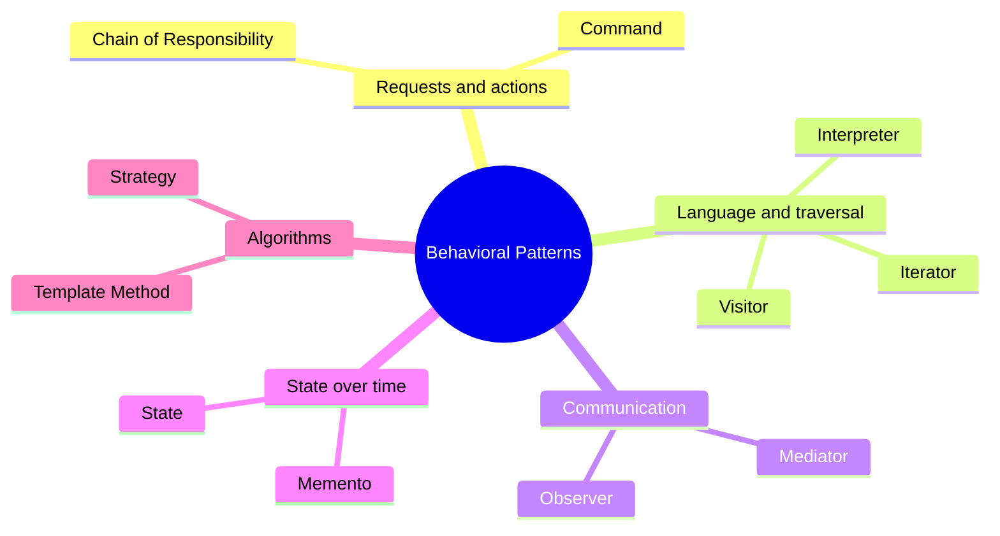

### 🧭 What Behavioral Patterns Solve

#### 🧠 Concept

Most behavioural patterns move a **responsibility** out of one object and into a separate, swappable object:

```text
  What gets pulled out into its own object or mechanism?
  ───────────────────────────────────────────────────────
  Chain of Responsibility → WHO handles a request (a chain of handlers)
  Command                 → the REQUEST itself (an operation object)
  Interpreter             → the MEANING of text (tokens → AST)
  Iterator                → HOW to traverse (an iterator object or generator)
  Mediator                → HOW peers communicate (a central hub)
  Memento                 → a STATE SNAPSHOT (a restore token)
  Observer                → WHO to notify (a subscriber list)
  State                   → BEHAVIOUR per state (states and transitions)
  Strategy                → an ALGORITHM DETAIL (composition)
  Template Method         → an ALGORITHM DETAIL (inheritance)
  Visitor                 → an OPERATION over a hierarchy (an external visitor)
```

#### 🔗 How the Course's Patterns Reuse Each Other

The lectures reuse ideas across patterns:
- The **`Event(list)`** class from **Observer** powers the **Chain of Responsibility** event broker, the **Mediator** game and the Observer exercises.
- **Command** relates to **Memento** (both support undo) and to **Composite** (macro commands).
- **Interpreter** builds a tree that a **Visitor** can then print or evaluate.
- **Strategy** (composition) and **Template Method** (inheritance) solve the same problem in two ways.

> 💡 **Memory Trick:** *"**C**hain **C**ommands, **I**nterpret **I**teratively, **M**ediate **M**emories, **O**bserve **S**tates, **S**trategise **T**emplates, **V**isit."*

#### 🎯 Key Takeaways

- Behavioural patterns are about **responsibilities and communication**, not about creation or structure.
- Many of them **reify** something, turning it into an object: a request (Command), a state (State, Memento), an algorithm (Strategy) or an operation (Visitor).
- The `Event` (observer) construct comes up again and again in the course. Learn it well.

> 📌 **About the course code.** Running all 33 provided Python files and the 11 exercises (all pass) exposed several bugs:
> - The interpreter's **lexer drops a number at the end of the input**, so `'1+2'` crashes.
> - **Undo/redo keeps a stale redo branch** after a new deposit.
> - The event broker's `defense` **starts from the attack value**.
> - The traffic-authority observer **unsubscribes while the event is iterating**, so the next subscriber is skipped.
> - The visitor's error message **raises `ValueError`**.
> - The in-order iterator **isn't itself iterable**.
>
> Each part shows the **original course code** first, then a **📎 Beyond the transcript** fix.

---

## 🎯 Learning Objectives

By the end of this guide you should be able to:

- [ ] Build a **method chain** and an **event-broker** chain of responsibility, and explain **command–query separation (CQS)**.
- [ ] Implement **commands with undo**, and **composite (macro) commands** with all-or-nothing semantics.
- [ ] Write a **lexer** and a **recursive parser** for simple arithmetic, and explain where they break.
- [ ] Implement Python's **iterator protocol** (`__iter__` / `__next__` / `StopIteration`), and replace stateful iterators with **generators**.
- [ ] Use a **mediator** (chat room, event hub) to decouple components that come and go.
- [ ] Implement **memento-based undo/redo**, including the redo-branch truncation the course misses.
- [ ] Build **observers** with an `Event` list, **property observers**, and **dependent-property** notifications.
- [ ] Model **finite state machines** three ways: the classic GoF style, a rules dictionary, and a `switch`/`if` loop.
- [ ] Contrast **Strategy (composition)** with **Template Method (inheritance)**.
- [ ] Explain **intrusive, reflective and dispatch-based visitors**, and why classic double dispatch matters less in Python.

---

## 📘 Detailed Notes

The notes have one Part per behavioural pattern, in course order.

### ⛓ Part 1: Chain of Responsibility

In Chain of Responsibility, several components each **get a chance to process** a command or query. Any of them can apply **default processing**, or **stop the chain**.

#### 📖 Definition

> **Chain of Responsibility**: a chain of components that all get a chance to process a command or a query. Each one can optionally do something, pass the request along, or **terminate** the processing.

#### ❓ Why It Exists: Examples from the Lecture

| Scenario | Who handles it |
|----------|----------------|
| Unethical behaviour at a company | Minor: the **employee**. An institutional practice: the **manager**. Company policy: the **CEO** |
| A click in a GUI | The **button**, otherwise its **group box**, otherwise the **window** |
| A collectible card game | A creature's attack and defense are **boosted by other cards** in play |

```text
 request ──► [Handler A] ──► [Handler B] ──► [Handler C] ──► (end)
               │ handle?        │ handle?        │ handle?
               └─ may STOP ─────┴─ may STOP ─────┘
```

#### 💻 Approach 1: The Method Chain, a Linked List of Modifiers (course code)

```python
class Creature:
    def __init__(self, name, attack, defense):
        self.defense = defense
        self.attack = attack
        self.name = name

    def __str__(self):
        return f'{self.name} ({self.attack}/{self.defense})'


class CreatureModifier:
    def __init__(self, creature):
        self.creature = creature
        self.next_modifier = None                 # linked list

    def add_modifier(self, modifier):
        if self.next_modifier:
            self.next_modifier.add_modifier(modifier)   # append at the tail
        else:
            self.next_modifier = modifier

    def handle(self):
        if self.next_modifier:
            self.next_modifier.handle()           # pass along


class NoBonusesModifier(CreatureModifier):
    def handle(self):
        print('No bonuses for you!')              # does NOT call super(), so the chain STOPS


class DoubleAttackModifier(CreatureModifier):
    def handle(self):
        print(f'Doubling {self.creature.name}''s attack')   # ⚠️ prints "Goblins"
        self.creature.attack *= 2
        super().handle()                          # continue the chain


class IncreaseDefenseModifier(CreatureModifier):
    def handle(self):
        if self.creature.attack <= 2:
            print(f'Increasing {self.creature.name}''s defense')
            self.creature.defense += 1
        super().handle()


goblin = Creature('Goblin', 1, 1)
print(goblin)
root = CreatureModifier(goblin)
root.add_modifier(NoBonusesModifier(goblin))
root.add_modifier(DoubleAttackModifier(goblin))
root.add_modifier(DoubleAttackModifier(goblin))
root.add_modifier(IncreaseDefenseModifier(goblin))   # no effect: attack would be 4 by then
root.handle()
print(goblin)
```

**Output (verified):**

```text
Goblin (1/1)
No bonuses for you!
Goblin (1/1)
```

📝 **What it shows:** `NoBonusesModifier` is first in the chain and **doesn't call `super().handle()`**, so nothing after it runs. Without it, the chain doubles the attack twice (1 → 4), and the defense bonus is then skipped because the attack is no longer ≤ 2.

🔑 **Key lines:**
- `add_modifier` walks to the **end of the linked list**, so the order you add modifiers is the order they run.
- **Calling `super().handle()` continues the chain. Not calling it terminates the chain.**

> ⚠️ **Gotcha:** `f'{self.creature.name}''s attack'` is **two adjacent string literals**, which Python joins together, so the apostrophe disappears: *"Doubling Goblins attack"* (verified). Use `f"{self.creature.name}'s attack"`.

> ⚠️ **Design limit (beyond the transcript):** This chain **mutates the creature permanently**. Running `handle()` twice doubles the attack again, and you can't remove a modifier later. The broker approach below fixes both problems.

#### 🧠 Command–Query Separation (CQS)

> 💬 From the lecture: separate operations into **commands** (*"set attack to 2"*, which change something) and **queries** (*"what's your attack?"*, which only ask for information). With separate channels for each, modifiers can **intercept queries** and adjust the answer **without changing stored state**.

#### 💻 Approach 2: The Broker Chain, Event Broker + CQS + Observer (course code)

```python
from abc import ABC
from enum import Enum


class Event(list):                               # the observer construct, see Part 7
    def __call__(self, *args, **kwargs):
        for item in self:
            item(*args, **kwargs)


class WhatToQuery(Enum):
    ATTACK = 1
    DEFENSE = 2


class Query:
    def __init__(self, creature_name, what_to_query, default_value):
        self.value = default_value  # bidirectional: handlers modify it in place
        self.what_to_query = what_to_query
        self.creature_name = creature_name


class Game:                                      # the event broker
    def __init__(self):
        self.queries = Event()

    def perform_query(self, sender, query):
        self.queries(sender, query)


class Creature:
    def __init__(self, game, name, attack, defense):
        self.initial_defense = defense
        self.initial_attack = attack
        self.name = name
        self.game = game

    @property
    def attack(self):
        q = Query(self.name, WhatToQuery.ATTACK, self.initial_attack)
        self.game.perform_query(self, q)
        return q.value

    @property
    def defense(self):
        q = Query(self.name, WhatToQuery.DEFENSE, self.initial_attack)   # 🐞 should be initial_defense
        self.game.perform_query(self, q)
        return q.value

    def __str__(self):
        return f'{self.name} ({self.attack}/{self.defense})'


class CreatureModifier(ABC):
    def __init__(self, game, creature):
        self.creature = creature
        self.game = game
        self.game.queries.append(self.handle)    # subscribe

    def handle(self, sender, query):
        pass

    def __enter__(self):
        return self

    def __exit__(self, exc_type, exc_val, exc_tb):
        self.game.queries.remove(self.handle)    # unsubscribe automatically


class DoubleAttackModifier(CreatureModifier):
    def handle(self, sender, query):
        if (sender.name == self.creature.name and
                query.what_to_query == WhatToQuery.ATTACK):
            query.value *= 2


class IncreaseDefenseModifier(CreatureModifier):
    def handle(self, sender, query):
        if (sender.name == self.creature.name and
                query.what_to_query == WhatToQuery.DEFENSE):
            query.value += 3


game = Game()
goblin = Creature(game, 'Strong Goblin', 2, 2)
print(goblin)
with DoubleAttackModifier(game, goblin):
    print(goblin)
    with IncreaseDefenseModifier(game, goblin):
        print(goblin)
print(goblin)
```

**Output (verified):**

```text
Strong Goblin (2/2)
Strong Goblin (4/2)
Strong Goblin (4/5)
Strong Goblin (2/2)
```

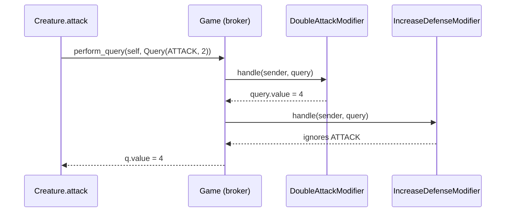

🔑 **Why it's better:**
- **Nothing is mutated.** `initial_attack` stays 2. Every read **recomputes** the value through the chain.
- **Automatic removal:** the `with` block's `__exit__` unsubscribes the modifier, so effects end when the scope ends.
- **The `Query` object is bidirectional:** it carries the request in and the answer back out.

> 🐞 **Bug in the provided file:** The `defense` property seeds the query with `self.initial_attack`. It goes unnoticed because the goblin is 2/2. `Creature(game, 'Orc', 2, 5)` prints **`Orc (2/2)`** (verified). Fix: `Query(self.name, WhatToQuery.DEFENSE, self.initial_defense)`.

> ⚠️ **Edge case:** Modifiers match on `sender.name`, so two creatures with the **same name** share each other's buffs. Compare identity instead (`sender is self.creature`).

#### 🧪 Course Exercise: Goblins and the Goblin King

```python
from abc import ABC
from enum import Enum


class WhatToQuery(Enum):
    ATTACK = 1
    DEFENSE = 2


class Query:                                       # simpler than the broker's Query
    def __init__(self, initial_value, what_to_query):
        self.what_to_query = what_to_query
        self.value = initial_value


class Game:
    def __init__(self):
        self.creatures = []                        # the chain = every creature in play


class Creature(ABC):
    def __init__(self, game, attack, defense):
        self.initial_defense = defense
        self.initial_attack = attack
        self.game = game


class Goblin(Creature):
    def __init__(self, game, attack=1, defense=1):
        super().__init__(game, attack, defense)

    @property
    def attack(self):
        q = Query(self.initial_attack, WhatToQuery.ATTACK)
        for c in self.game.creatures:
            c.query(self, q)                       # every creature in play gets a say
        return q.value

    @property
    def defense(self):
        q = Query(self.initial_defense, WhatToQuery.DEFENSE)
        for c in self.game.creatures:
            c.query(self, q)
        return q.value

    def query(self, source, query):
        if self != source and query.what_to_query == WhatToQuery.DEFENSE:
            query.value += 1                       # each OTHER goblin: +1 defense


class GoblinKing(Goblin):
    def __init__(self, game):
        super().__init__(game, 3, 3)

    def query(self, source, query):
        if self != source and query.what_to_query == WhatToQuery.ATTACK:
            query.value += 1                       # the king: +1 attack to others
        else:
            super().query(source, query)


game = Game()
goblin = Goblin(game); game.creatures.append(goblin)
game.creatures.append(Goblin(game))
game.creatures.append(GoblinKing(game))
print(goblin.attack, goblin.defense)               # 2 3
```

📝 With a goblin, a second goblin and a king in play, the first goblin is **2/3**. The test confirms it. Here the creatures in `game.creatures` **are** the chain.

#### 🌍 Real-World Usage

- **GUI event bubbling** (DOM events: target → parent → document), and `stopPropagation()` as termination.
- **Web middleware** (Django and ASGI middleware, Express): each layer may short-circuit the response.
- **Logging:** `logging.Logger` passes records up to parent loggers (`propagate=False` stops it).
- **Approval workflows** and **exception handling** (`try`/`except` up the call stack).

#### 🎯 Key Takeaways

- A chain can be a **linked list of handlers** or a **broker with an event list**.
- Handlers can **process, pass on, or stop** the request. Order matters.
- The broker approach uses **CQS**: modifiers adjust **query results** instead of mutating state, and `__exit__` removes them automatically.
- Course file bugs: `defense` is seeded from `attack`, and the adjacent string literals drop the apostrophe.

---

### 📨 Part 2: Command

A command is an **object that represents an operation**. Because the operation is an object, it can be **recorded, replayed, audited and undone**.

#### 📖 Definition

> **Command**: an object that represents an instruction to perform a particular action. It contains **all the information needed** for the action to be taken.

#### ❓ Why It Exists

> 💬 **Lecture insight:** An ordinary statement like `x.age = 22` is **perishable**. You can't undo it, serialise it, save it to a file or record it in an audit database. A command object makes the operation **first-class**: it can be processed, logged, replayed and rolled back. It also records *who* asked, which is useful when *"you're trying to find someone to blame for all the wreckage."*

Uses: **GUI commands** (undo/redo), **multi-level undo**, **macro recording**, **transaction logs**, **job queues**.

#### 💻 Code Example: Bank Account Commands with Undo (course code)

```python
from abc import ABC
from enum import Enum


class BankAccount:
    OVERDRAFT_LIMIT = -500

    def __init__(self, balance=0):
        self.balance = balance

    def deposit(self, amount):
        self.balance += amount
        print(f'Deposited {amount}, balance = {self.balance}')

    def withdraw(self, amount):
        if self.balance - amount >= BankAccount.OVERDRAFT_LIMIT:
            self.balance -= amount
            print(f'Withdrew {amount}, balance = {self.balance}')
            return True
        return False

    def __str__(self):
        return f'Balance = {self.balance}'


class Command(ABC):                    # "optional"
    def invoke(self):
        pass

    def undo(self):
        pass


class BankAccountCommand(Command):
    def __init__(self, account, action, amount):
        self.amount = amount
        self.action = action
        self.account = account
        self.success = None

    class Action(Enum):
        DEPOSIT = 0
        WITHDRAW = 1

    def invoke(self):
        if self.action == self.Action.DEPOSIT:
            self.account.deposit(self.amount)
            self.success = True
        elif self.action == self.Action.WITHDRAW:
            self.success = self.account.withdraw(self.amount)

    def undo(self):
        if not self.success:           # never undo something that didn't happen
            return
        # strictly speaking this is not correct
        # (you don't undo a deposit by withdrawing)
        if self.action == self.Action.DEPOSIT:
            self.account.withdraw(self.amount)
        elif self.action == self.Action.WITHDRAW:
            self.account.deposit(self.amount)


ba = BankAccount()
cmd = BankAccountCommand(ba, BankAccountCommand.Action.DEPOSIT, 100)
cmd.invoke()
print('After $100 deposit:', ba)
cmd.undo()
print('$100 deposit undone:', ba)

illegal_cmd = BankAccountCommand(ba, BankAccountCommand.Action.WITHDRAW, 1000)
illegal_cmd.invoke()
print('After impossible withdrawal:', ba)
illegal_cmd.undo()
print('After undo:', ba)
```

**Output (verified):**

```text
Deposited 100, balance = 100
After $100 deposit: Balance = 100
Withdrew 100, balance = 0
$100 deposit undone: Balance = 0
After impossible withdrawal: Balance = 0
After undo: Balance = 0
```

🔑 **Key lines:**
- `success` records **whether the command actually took effect**. Without it, undoing the failed $1,000 withdrawal would **deposit $1,000 out of thin air**.
- Undoing a deposit with `withdraw` is **semantically wrong** (the comment says so). It's subject to the overdraft check and it logs a "withdrawal". Real systems record a compensating transaction or restore a snapshot instead.

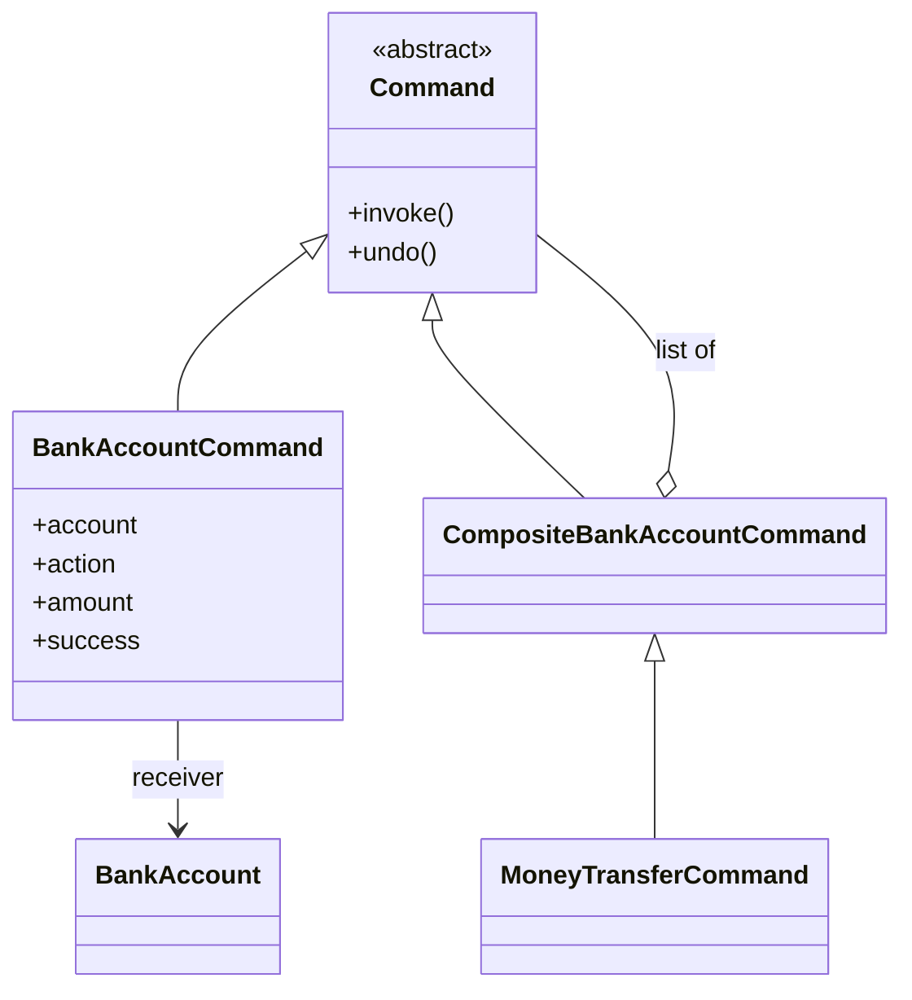

#### 💻 Composite Commands (Macros) and Money Transfer (course code)

```python
class CompositeBankAccountCommand(Command, list):     # Command + Composite pattern
    def __init__(self, items=[]):
        super().__init__()
        for i in items:
            self.append(i)

    def invoke(self):
        for x in self:
            x.invoke()

    def undo(self):
        for x in reversed(self):                      # undo in REVERSE order
            x.undo()


class MoneyTransferCommand(CompositeBankAccountCommand):
    def __init__(self, from_acct, to_acct, amount):
        super().__init__([
            BankAccountCommand(from_acct, BankAccountCommand.Action.WITHDRAW, amount),
            BankAccountCommand(to_acct, BankAccountCommand.Action.DEPOSIT, amount)])

    def invoke(self):
        ok = True
        for cmd in self:
            if ok:
                cmd.invoke()
                ok = cmd.success
            else:
                cmd.success = False                   # skipped commands won't be undone
        self.success = ok
```

**Verified behaviour with ba1 = 100, ba2 = 0, transfer of 1,000:**

| Approach | After invoke | After undo |
|----------|--------------|------------|
| Plain `CompositeBankAccountCommand([withdraw, deposit])` | ba1 = 100, **ba2 = 1000** ❌ (the deposit ran even though the withdrawal failed) | ba1 = 100, ba2 = 0 |
| `MoneyTransferCommand` | ba1 = 100, ba2 = 0 ✅, `success = False` | unchanged ✅ |

📝 **The lecture's point:** A naive macro runs every step **independently**. A money transfer needs **all-or-nothing** semantics, so `MoneyTransferCommand` stops after the first failure and marks the remaining steps as unsuccessful, so `undo` skips them too. The lecture also caught a bug live: it forgot `self.success = ok`, and the transfer reported `False` even when it succeeded.

> ⚠️ **Gotcha:** `items=[]` is a **mutable default argument**. It's harmless here because it's only read, but prefer `items=None`.

#### 🧪 Course Exercise: The Account Processes the Command

```python
from enum import Enum


class Command:
    class Action(Enum):
        DEPOSIT = 0
        WITHDRAW = 1

    def __init__(self, action, amount):
        self.action = action
        self.amount = amount
        self.success = False


class Account:
    def __init__(self, balance=0):
        self.balance = balance

    def process(self, command):                       # an external "command processor"
        if command.action == Command.Action.DEPOSIT:
            self.balance += command.amount
            command.success = True
        elif command.action == Command.Action.WITHDRAW:
            command.success = self.balance >= command.amount
            if command.success:
                self.balance -= command.amount
```

📝 This illustrates the lecture's summary point: the instructions for applying a command can live **in the command** (`invoke`) or **externally** in a processor (`Account.process`).

#### 📎 Beyond the transcript: A Command Manager with Undo/Redo Stacks

```python
class CommandManager:
    def __init__(self):
        self._undo, self._redo = [], []

    def execute(self, cmd):
        cmd.invoke()
        if getattr(cmd, 'success', True):
            self._undo.append(cmd)
            self._redo.clear()             # a new action invalidates the redo history

    def undo(self):
        if self._undo:
            cmd = self._undo.pop()
            cmd.undo()
            self._redo.append(cmd)

    def redo(self):
        if self._redo:
            cmd = self._redo.pop()
            cmd.invoke()
            self._undo.append(cmd)
```

#### 🌍 Real-World Usage

- **Editors:** every keystroke or edit is a command on an undo stack.
- **Task queues** (Celery, RQ): serialised command objects executed by workers.
- **Event sourcing / CQRS:** state is rebuilt by replaying a log of commands and events.
- **Database migrations:** each one has `upgrade()` and `downgrade()`, which are invoke and undo.

#### 🎯 Key Takeaways

- Command = **an operation as an object**, which makes it recordable, replayable, auditable and undoable.
- Track **`success`**, so undo never reverses something that didn't happen.
- **Composite commands (macros)** undo in reverse order. Transfers need **all-or-nothing** logic.
- Commands can apply themselves (`invoke`), or be applied by a **processor**.

---

### 🗣 Part 3: Interpreter

The Interpreter pattern processes **structured text**, turning it into object-oriented structures in **two stages**: **lexing**, then **parsing**.

#### 📖 Definition

> An **interpreter** is a component that processes structured text data. It turns the text into **lexical tokens** (lexing), then turns the tokens into **object-oriented structures** (parsing) that can be evaluated, printed or analysed.

#### ❓ Why It Exists

Lecture examples: **compilers and interpreters**, **IDE static analysis**, **HTML/XML** turned into DOM objects, **numeric expressions** such as `3 + 4 / 5`, and **regular expressions**. *"Compiler theory"* is the full academic version. The course looks at small examples.

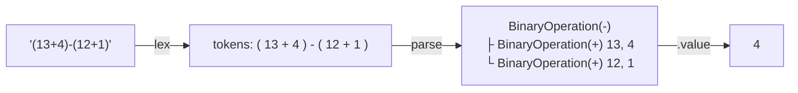

#### 💻 Stage 1: Lexing (course code)

```python
from enum import Enum


class Token:
    class Type(Enum):
        INTEGER = 0
        PLUS = 1
        MINUS = 2
        LPAREN = 3
        RPAREN = 4

    def __init__(self, type, text):
        self.type = type
        self.text = text

    def __str__(self):
        return f'`{self.text}`'


def lex(input):
    result = []
    i = 0
    while i < len(input):
        if input[i] == '+':
            result.append(Token(Token.Type.PLUS, '+'))
        elif input[i] == '-':
            result.append(Token(Token.Type.MINUS, '-'))
        elif input[i] == '(':
            result.append(Token(Token.Type.LPAREN, '('))
        elif input[i] == ')':
            result.append(Token(Token.Type.RPAREN, ')'))
        else:  # must be a number
            digits = [input[i]]
            for j in range(i + 1, len(input)):
                if input[j].isdigit():
                    digits.append(input[j])
                    i += 1
                else:
                    result.append(Token(Token.Type.INTEGER, ''.join(digits)))
                    break                     # 🐞 never reached for a number at the END
        i += 1
    return result
```

> 🐞 **Bug in the provided file (verified):** The integer token is only appended when a **non-digit follows it**. A number at the **end of the input is silently dropped**: `lex('1+2')` → `['1', '+']`, and `lex('12')` → `[]`. Parsing `'1+2'` then crashes with `AttributeError: 'NoneType' object has no attribute 'value'`. The course demos all end with `)`, which hides the bug. The fix is below.

#### 💻 Stage 2: Parsing into an Object Tree (course code)

```python
class Integer:
    def __init__(self, value):
        self.value = value


class BinaryOperation:
    class Type(Enum):
        ADDITION = 0
        SUBTRACTION = 1

    def __init__(self):
        self.type = None
        self.left = None
        self.right = None

    @property
    def value(self):                                  # evaluation, added "intrusively"
        if self.type == self.Type.ADDITION:
            return self.left.value + self.right.value
        elif self.type == self.Type.SUBTRACTION:
            return self.left.value - self.right.value


def parse(tokens):
    result = BinaryOperation()
    have_lhs = False
    i = 0
    while i < len(tokens):
        token = tokens[i]
        if token.type == Token.Type.INTEGER:
            integer = Integer(int(token.text))
            if not have_lhs:
                result.left = integer
                have_lhs = True
            else:
                result.right = integer
        elif token.type == Token.Type.PLUS:
            result.type = BinaryOperation.Type.ADDITION
        elif token.type == Token.Type.MINUS:
            result.type = BinaryOperation.Type.SUBTRACTION
        elif token.type == Token.Type.LPAREN:  # note: no if for RPAREN
            j = i
            while j < len(tokens):
                if tokens[j].type == Token.Type.RPAREN:
                    break
                j += 1
            subexpression = tokens[i + 1:j]
            element = parse(subexpression)          # recursion for ( ... )
            if not have_lhs:
                result.left = element
                have_lhs = True
            else:
                result.right = element
            i = j  # advance
        i += 1
    return result


def eval(input):                                     # ⚠️ shadows the built-in eval
    tokens = lex(input)
    print(' '.join(map(str, tokens)))
    parsed = parse(tokens)
    print(f'{input} = {parsed.value}')


eval('(13+4)-(12+1)')
eval('1+(3-4)')
eval('1+2+(3-4)')        # "this won't work"
```

**Output (verified):**

```text
`(` `13` `+` `4` `)` `-` `(` `12` `+` `1` `)`
(13+4)-(12+1) = 4
`1` `+` `(` `3` `-` `4` `)`
1+(3-4) = 0
`1` `+` `2` `+` `(` `3` `-` `4` `)`
1+2+(3-4) = 0          ← wrong: should be 2
```

📝 **Limits of this parser (known from the lecture, plus extras):**
1. One `BinaryOperation` per level, so `1+2+(3-4)` **overwrites** `right` and gives 0.
2. Parentheses match the **first** `)`, so nested parentheses like `((1+2)+3)` break.
3. No operator precedence, no `*` or `/`, no whitespace handling.

#### 📎 Beyond the transcript: A Fixed Lexer and a Left-Associative Parser

```python
import re

TOKEN_RE = re.compile(r'\s*(?:(\d+)|(.))')


def lex2(text):
    tokens = []
    for number, op in TOKEN_RE.findall(text):
        if number:
            tokens.append(('INT', int(number)))         # ✅ trailing numbers kept
        elif op in '+-()':
            tokens.append((op, op))
        else:
            raise SyntaxError(f'unexpected {op!r}')
    return tokens


def parse2(tokens):
    """expr := term (('+'|'-') term)*   term := INT | '(' expr ')'"""
    pos = 0

    def term():
        nonlocal pos
        kind, val = tokens[pos]
        pos += 1
        if kind == 'INT':
            return val
        if kind == '(':
            v = expr()
            pos += 1          # skip ')'
            return v
        raise SyntaxError(kind)

    def expr():
        nonlocal pos
        v = term()
        while pos < len(tokens) and tokens[pos][0] in '+-':
            op = tokens[pos][0]
            pos += 1
            v = v + term() if op == '+' else v - term()   # left-associative
        return v

    return expr()


for s in ['1+2', '1+2+(3-4)', '((1+2)+3)-(4)', '(13+4)-(12+1)']:
    print(s, '=', parse2(lex2(s)))
# 1+2 = 3 · 1+2+(3-4) = 2 · ((1+2)+3)-(4) = 2 · (13+4)-(12+1) = 4
```

📝 This is a **recursive-descent parser**: one function per grammar rule. A loop gives left associativity, and recursion handles nested parentheses correctly.

#### 🧪 Course Exercise: ExpressionProcessor with Variables

```python
import re
from enum import Enum


def megasplit(pattern, string):
    splits = list((m.start(), m.end()) for m in re.finditer(pattern, string))
    starts = [0] + [i[1] for i in splits]
    ends = [i[0] for i in splits] + [len(string)]
    return [string[start:end] for start, end in zip(starts, ends)]


class ExpressionProcessor:
    class NextOp(Enum):
        PLUS = 1
        MINUS = 2

    def __init__(self):
        self.variables = {}

    def calculate(self, expression):
        current = 0
        next_op = None
        parts = megasplit('(?<=[+-])', expression)      # split AFTER each + or -
        for part in parts:
            noop = re.split(r'[\+\-]', part)
            first = noop[0]
            try:
                value = int(first)
            except ValueError:
                if len(first) == 1 and first[0] in self.variables:
                    value = self.variables[first[0]]
                else:
                    return 0                            # unknown or multi-letter variable
            if not next_op:
                current = value
            elif next_op == self.NextOp.PLUS:
                current += value
            elif next_op == self.NextOp.MINUS:
                current -= value
            if part.endswith('+'):
                next_op = self.NextOp.PLUS
            elif part.endswith('-'):
                next_op = self.NextOp.MINUS
        return current


ep = ExpressionProcessor()
ep.variables['x'] = 5
print(ep.calculate('1'), ep.calculate('1+2'), ep.calculate('1+x'), ep.calculate('1+xy'))   # 1 3 6 0
```

📝 `megasplit` exists because `re.split` on a **zero-width lookbehind** didn't work in Python 3.5 (it does since 3.7). The course file writes `'[\+\-]'` without the `r` prefix, which triggers a `SyntaxWarning: invalid escape sequence` on Python 3.12+. The raw string above fixes that.

#### 🌍 Real-World Usage

- Python's own `tokenize` and `ast` modules (`ast.parse("1+2")`).
- Template engines (Jinja2), query languages (SQL parsers), config DSLs, and spreadsheet formulas.
- Tools: **PLY**, **Lark**, **ANTLR**, and **pyparsing** generate lexers and parsers from grammars.

#### 🎯 Key Takeaways

- An interpreter works in **two stages**: **lexing** (text → tokens) and **parsing** (tokens → object tree).
- Recursion handles **subexpressions** in parentheses.
- The course parser has known limits (no chaining, no nesting), and a **real lexer bug** that drops a trailing number.
- For real languages, use **recursive descent** or a parser generator. Evaluate the tree with a **Visitor** (Part 11).

---

### 🔁 Part 4: Iterator

An iterator is an object that **facilitates traversal** of a data structure. It applies **separation of concerns** to *how you walk* the structure.

#### 📖 Definition

> An **iterator** keeps a reference to the **current element** and knows how to **move to the next element**, eventually covering every element of the structure.

#### ⚙️ How It Works: Python's Iterator Protocol

| Role | Must implement | Notes |
|------|----------------|-------|
| **Iterable** | `__iter__()` → returns an iterator | Lists, dicts, your `Node` |
| **Iterator** | `__next__()` → the next element, or raise **`StopIteration`** | Should also implement `__iter__` returning `self` |
| Both in one class | `__iter__` + `__next__` | "Nothing particularly wrong with it" |

```text
for x in obj:            ≡     it = iter(obj)          # obj.__iter__()
    body                       while True:
                                   try: x = next(it)   # it.__next__()
                                   except StopIteration: break
                                   body
```

#### 💻 Code Example: A Stateful In-Order Tree Iterator (course code)

```python
class Node:
    def __init__(self, value, left=None, right=None):
        self.right = right
        self.left = left
        self.value = value
        self.parent = None
        if left:
            self.left.parent = self       # parent links let the iterator climb back up
        if right:
            self.right.parent = self

    def __iter__(self):
        return InOrderIterator(self)


class InOrderIterator:
    def __init__(self, root):
        self.root = self.current = root
        self.yielded_start = False
        while self.current.left:          # start at the left-most node
            self.current = self.current.left

    def __next__(self):
        if not self.yielded_start:
            self.yielded_start = True
            return self.current

        if self.current.right:            # go right, then all the way left
            self.current = self.current.right
            while self.current.left:
                self.current = self.current.left
            return self.current
        else:                             # climb until we come from a left child
            p = self.current.parent
            while p and self.current == p.right:
                self.current = p
                p = p.parent
            self.current = p
            if self.current:
                return self.current
            else:
                raise StopIteration


#   1
#  / \
# 2   3        in-order: 2 1 3 · preorder: 1 2 3 · postorder: 2 3 1
root = Node(1, Node(2), Node(3))
it = iter(root)
print([next(it).value for x in range(3)])     # [2, 1, 3]
for x in root:
    print(x.value)                            # 2 1 3
```

> 💬 **Lecture insight:** Stateful iterators **can't be recursive**. You have to be able to step from the current state to the next one, and you can't pause in the middle of a recursive call and resume later. That's why `InOrderIterator` needs parent pointers and fiddly climbing logic.

> ⚠️ **Gotcha (verified):** `InOrderIterator` defines `__next__` but **not `__iter__`**, so `iter(iter(root))` raises `TypeError: 'InOrderIterator' object is not iterable`. That breaks `zip(it, it)` and passing the iterator itself to `for`. Add `def __iter__(self): return self`.

#### 💻 The Generator Alternative with `yield` (course code)

```python
def traverse_in_order(root):
    def traverse(current):
        if current.left:
            for left in traverse(current.left):
                yield left
        yield current
        if current.right:
            for right in traverse(current.right):
                yield right
    for node in traverse(root):
        yield node


for y in traverse_in_order(root):
    print(y.value)                            # 2 1 3
```

📝 *"An entirely different mechanism using the `yield` keyword… much more succinct and much more understandable."* The generator **pauses at each `yield`** and keeps its whole call stack, which is exactly what the stateful iterator couldn't do. `yield from traverse(...)` shortens it further.

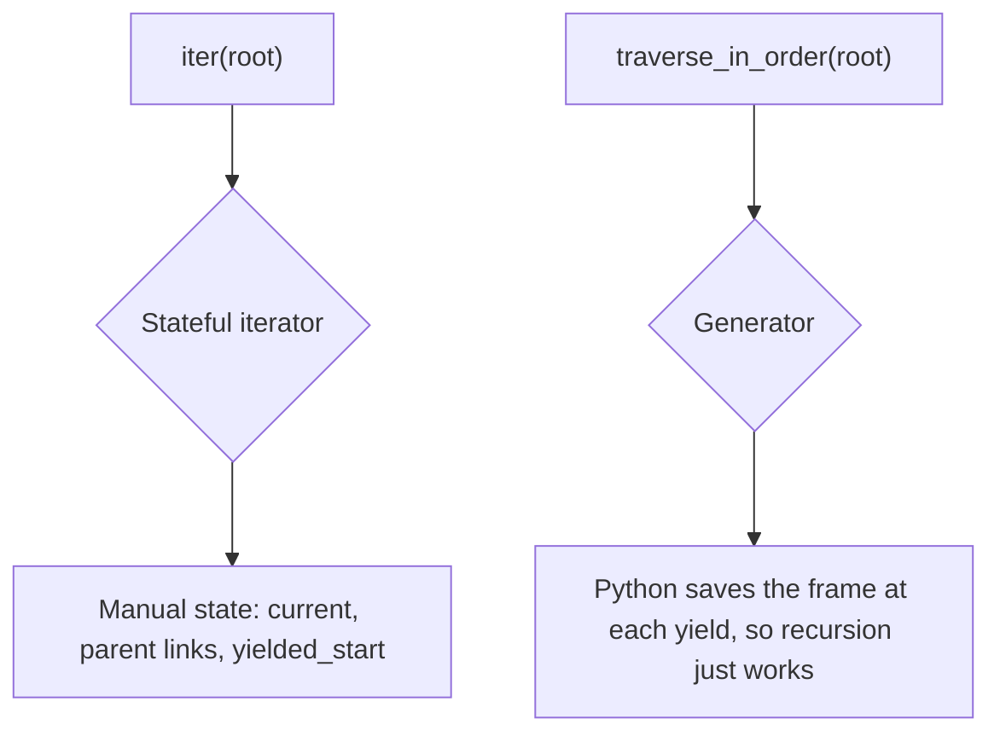

#### 🧪 Course Exercise: Preorder Traversal with `yield from`

```python
class Node:
    def __init__(self, value, left=None, right=None):
        self.right, self.left, self.value = right, left, value

    def traverse_preorder(self):
        yield self.value
        if self.left:
            yield from self.left.traverse_preorder()
        if self.right:
            yield from self.right.traverse_preorder()


node = Node('a', Node('b', Node('c'), Node('d')), Node('e'))
print(''.join(node.traverse_preorder()))      # abcde
```

#### 💻 List-Backed Properties: Iterating Over Attributes (reconstructed from the lecture)

> 📎 This example was **demonstrated in the lecture but isn't in the provided files**, so the code is reconstructed from the transcript.

**Problem:** A creature with `strength`, `agility` and `intelligence` attributes needs `sum_of_stats`, `max_stat` and `average_stat`. Each one lists every attribute by hand, and `average` divides by a **magic number** (`3.0`). Add `dexterity` and every aggregate breaks.

**Fix:** Store the stats in **one list**, expose named **properties** over its indices, and aggregate over the list.

```python
class Creature:
    _strength, _agility, _intelligence = 0, 1, 2      # named indices instead of magic numbers

    def __init__(self):
        self.stats = [10, 10, 10]

    @property
    def strength(self): return self.stats[Creature._strength]
    @strength.setter
    def strength(self, v): self.stats[Creature._strength] = v

    @property
    def agility(self): return self.stats[Creature._agility]
    @agility.setter
    def agility(self, v): self.stats[Creature._agility] = v

    @property
    def intelligence(self): return self.stats[Creature._intelligence]
    @intelligence.setter
    def intelligence(self, v): self.stats[Creature._intelligence] = v

    @property
    def sum_of_stats(self): return sum(self.stats)
    @property
    def max_stat(self): return max(self.stats)
    @property
    def average_stat(self): return float(sum(self.stats) / len(self.stats))   # no magic 3.0


c = Creature()
c.strength = 16
print(c.sum_of_stats, c.max_stat, c.average_stat)      # 36 16 12.0
```

📝 The lecture calls these **array-backed (list-backed) properties**. There's "a bit of ceremony", but the attributes become **iterable**, and aggregates stay correct when stats are added.

#### 🌍 Real-World Usage

- Every `for` loop. Files, `dict.items()`, `range` and database cursors are all iterators.
- **Lazy pipelines** with generators and `itertools` (`islice`, `chain`, `groupby`) process huge data without loading it all.
- **Pagination iterators** for APIs (boto3 paginators), and tree and graph walkers (`os.walk`, `ast.walk`).

#### 🎯 Key Takeaways

- Python's protocol: **`__iter__`** returns an iterator, and **`__next__`** returns items until it raises **`StopIteration`**.
- Stateful iterators **can't recurse**. **Generators (`yield`, `yield from`)** make tree traversal simple.
- Iterators should also define `__iter__` returning `self`. The course's `InOrderIterator` doesn't.
- **List-backed properties** let you iterate and aggregate over attributes, with no magic numbers.

---

### 🤝 Part 5: Mediator

A mediator **facilitates communication between components** that don't hold references to each other, or even know about each other.

#### 📖 Definition

> **Mediator**: a central component that facilitates communication between other components, **without them necessarily being aware of each other or holding references to one another**.

#### ❓ Why It Exists

In a **chat room** or a **multiplayer game**, participants join, leave or disconnect at any time. If every participant held references to every other one, you'd have an *n²* web of references that can **go dead unpredictably**. Instead, everyone refers to **one central component**.

```text
 Without a mediator (n² links)          With a mediator (n links)
   A ─── B                                 A     B
   │ ╲ ╱ │                                  ╲   ╱
   │  ╳  │                                  [ROOM]
   │ ╱ ╲ │                                  ╱   ╲
   C ─── D                                 C     D
```

#### 💻 Code Example 1: Chat Room (course code)

```python
class Person:
    def __init__(self, name):
        self.name = name
        self.chat_log = []
        self.room = None                       # set when joining

    def receive(self, sender, message):
        s = f'{sender}: {message}'
        print(f'[{self.name}\'s chat session] {s}')
        self.chat_log.append(s)

    def say(self, message):
        self.room.broadcast(self.name, message)

    def private_message(self, who, message):
        self.room.message(self.name, who, message)


class ChatRoom:
    def __init__(self):
        self.people = []

    def broadcast(self, source, message):
        for p in self.people:
            if p.name != source:
                p.receive(source, message)

    def join(self, person):
        join_msg = f'{person.name} joins the chat'
        self.broadcast('room', join_msg)
        person.room = self
        self.people.append(person)

    def message(self, source, destination, message):
        for p in self.people:
            if p.name == destination:
                p.receive(source, message)


room = ChatRoom()
john = Person('John')
jane = Person('Jane')
room.join(john)
room.join(jane)
john.say('hi room')
jane.say('oh, hey john')
simon = Person('Simon')
room.join(simon)
simon.say('hi everyone!')
jane.private_message('Simon', 'glad you could join us!')
```

**Output (verified):**

```text
[John's chat session] room: Jane joins the chat
[Jane's chat session] John: hi room
[John's chat session] Jane: oh, hey john
[John's chat session] room: Simon joins the chat
[Jane's chat session] room: Simon joins the chat
[John's chat session] Simon: hi everyone!
[Jane's chat session] Simon: hi everyone!
[Simon's chat session] Jane: glad you could join us!
```

🔑 **Key points:**
- **Communication goes both ways:** people call the room (`broadcast`, `message`), and the room calls people (`receive`).
- People **never reference each other**. Even a private message goes through the room, using a **name**.
- The join message is broadcast **before** the newcomer is added, so the newcomer doesn't see their own announcement.

> ⚠️ **Edge cases (beyond the transcript):** A private message to a **nonexistent or duplicate name** is silently dropped or delivered twice. There's no `leave()`. Calling `say()` before `join()` raises `AttributeError` on `None`. Production code would add `leave`, unique IDs and delivery feedback.

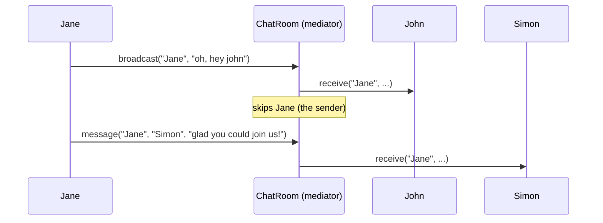

#### 💻 Code Example 2: A Mediator with Events (course code)

```python
class Event(list):
    def __call__(self, *args, **kwargs):
        for item in self:
            item(*args, **kwargs)


class Game:                                    # the mediator
    def __init__(self):
        self.events = Event()

    def fire(self, args):
        self.events(args)


class GoalScoredInfo:                          # event arguments
    def __init__(self, who_scored, goals_scored):
        self.goals_scored = goals_scored
        self.who_scored = who_scored


class Player:
    def __init__(self, name, game):
        self.name = name
        self.game = game
        self.goals_scored = 0

    def score(self):
        self.goals_scored += 1
        args = GoalScoredInfo(self.name, self.goals_scored)
        self.game.fire(args)


class Coach:
    def __init__(self, game):
        game.events.append(self.celebrate_goal)    # subscribe through the mediator

    def celebrate_goal(self, args):
        if isinstance(args, GoalScoredInfo) and args.goals_scored < 3:
            print(f'Coach says: well done, {args.who_scored}!')


game = Game()
player = Player('Sam', game)
coach = Coach(game)
player.score()  # Coach says: well done, Sam!
player.score()  # Coach says: well done, Sam!
player.score()  # ignored by coach
```

📝 The **player and coach never meet**. Both are given the `game` mediator, which is the lecture's advice: *"stick the mediator right inside the initializer so nobody forgets."* The `isinstance` check lets one event channel carry **many kinds of event**.

#### 🧪 Course Exercise: Participants Adding Values

```python
class Participant:
    def __init__(self, mediator):
        self.value = 0
        self.mediator = mediator
        mediator.alert.append(self.mediator_alert)

    def mediator_alert(self, sender, value):
        if sender != self:
            self.value += value

    def say(self, value):
        self.mediator.broadcast(self, value)


class Mediator:
    def __init__(self):
        self.alert = Event()

    def broadcast(self, sender, value):
        self.alert(sender, value)
```

📝 `p1.say(2)` → p2 = 2. `p2.say(4)` → p1 = 4. Each participant ignores its own broadcast.

#### 🌍 Real-World Usage

- **Chat and pub/sub servers**, and message brokers such as Redis Pub/Sub, RabbitMQ and Kafka (at the system level).
- **GUI dialogs**, where a form controller coordinates widgets that don't know about each other.
- **Air-traffic control**, the textbook analogy. **Reactive Extensions (RxPY)**, which the lecture recommends for event streams.

#### 🎯 Key Takeaways

- Mediator = **a central hub**. Components hold one reference, to the mediator, instead of n² references to each other.
- Communication is **bidirectional**: components call the mediator, and the mediator calls the components.
- **Inject the mediator in `__init__`.** Events and reactive libraries make mediators easy to build.
- Mediator vs Observer: an Observer subject broadcasts **its own** changes. A Mediator **routes between peers**.

---

### 💾 Part 6: Memento

A memento is a **token representing the system's state at a point in time**, which lets you **roll back** to that state.

#### 📖 Definition

> **Memento**: a token or handle class that represents the system state, so you can **roll back** to the state at the moment the token was created. It usually **doesn't expose** the state directly, but may if the state is immutable.

#### ❓ Why It Exists

Ways to handle changes:

| Approach | How |
|----------|-----|
| Store only the final value | No history at all |
| **Command** (Part 2) | Record every change, and teach each command to **undo itself** |
| **Memento** | Simpler: **snapshot the state** at each step, and restore a snapshot |

#### 💻 Code Example 1: A Basic Memento (course code)

```python
class Memento:
    def __init__(self, balance):
        self.balance = balance


class BankAccount:
    def __init__(self, balance=0):
        self.balance = balance

    def deposit(self, amount):
        self.balance += amount
        return Memento(self.balance)         # every change returns a snapshot token

    def restore(self, memento):
        self.balance = memento.balance

    def __str__(self):
        return f'Balance = {self.balance}'


ba = BankAccount(100)
m1 = ba.deposit(50)
m2 = ba.deposit(25)
print(ba)            # Balance = 175
ba.restore(m1)
print(ba)            # Balance = 150
ba.restore(m2)
print(ba)            # Balance = 175
```

📝 **The limitation the lecture points out:** there's **no memento for the initial state** (100), so you can never get back to it. The next version fixes that.

#### 💻 Code Example 2: Undo and Redo (course code)

```python
class BankAccount:
    def __init__(self, balance=0):
        self.balance = balance
        self.changes = [Memento(self.balance)]   # ✅ initial state is recorded
        self.current = 0

    def deposit(self, amount):
        self.balance += amount
        m = Memento(self.balance)
        self.changes.append(m)                   # 🐞 doesn't truncate the redo branch
        self.current += 1
        return m

    def restore(self, memento):
        if memento:                              # guard: undo/redo may return None
            self.balance = memento.balance
            self.changes.append(memento)
            self.current = len(self.changes)-1

    def undo(self):
        if self.current > 0:
            self.current -= 1
            m = self.changes[self.current]
            self.balance = m.balance
            return m
        return None

    def redo(self):
        if self.current + 1 < len(self.changes):
            self.current += 1
            m = self.changes[self.current]
            self.balance = m.balance
            return m
        return None

    def __str__(self):
        return f'Balance = {self.balance}'


ba = BankAccount(100)
ba.deposit(50)
ba.deposit(25)
print(ba)                     # Balance = 175
ba.undo(); print(f'Undo 1: {ba}')   # 150
ba.undo(); print(f'Undo 2: {ba}')   # 100
ba.redo(); print(f'Redo 1: {ba}')   # 150
```

```text
changes:  [M(100)]  [M(150)]  [M(175)]
              ▲         ▲         ▲
           undo×2    undo×1    current
```

> 🐞 **Bug in the provided file (verified):** Deposit **after an undo**, and the stale redo branch survives while `current` points at the wrong entry. From 175, undo to 150, then `deposit(10)`. The balance is 160, but `changes` = `[100, 150, 175, 160]` and **`current = 2`** (pointing at 175). Then `undo()` goes to 150, and `redo()` goes to **175**, a state that should no longer exist. Fix: **truncate the future** before appending, as below.

#### 📎 Beyond the transcript: Correct Undo/Redo History

```python
class BankAccount:
    def __init__(self, balance=0):
        self.balance = balance
        self.changes = [Memento(balance)]
        self.current = 0

    def _record(self):
        del self.changes[self.current + 1:]          # ✅ drop the redo branch
        self.changes.append(Memento(self.balance))
        self.current = len(self.changes) - 1
        return self.changes[-1]

    def deposit(self, amount):
        self.balance += amount
        return self._record()

    def undo(self):
        if self.current > 0:
            self.current -= 1
            self.balance = self.changes[self.current].balance

    def redo(self):
        if self.current + 1 < len(self.changes):
            self.current += 1
            self.balance = self.changes[self.current].balance


ba = BankAccount(100)
ba.deposit(50); ba.deposit(25); ba.undo(); ba.deposit(10)
ba.undo(); print(ba.balance)    # 150
ba.redo(); print(ba.balance)    # 160 ✅ (not 175)
```

#### 🧪 Course Exercise: TokenMachine, Mementos by Value

```python
from copy import deepcopy


class Token:
    def __init__(self, value=0):
        self.value = value


class Memento(list):
    pass


class TokenMachine:
    def __init__(self):
        self.tokens = []

    def add_token_value(self, value):
        return self.add_token(Token(value))

    def add_token(self, token):
        self.tokens.append(token)
        return Memento(deepcopy(self.tokens))        # ✅ snapshot BY VALUE

    def revert(self, memento):
        self.tokens = [Token(x.value) for x in memento]   # fresh copies on restore too


tm = TokenMachine()
token = Token(111)
tm.add_token(token)
m = tm.add_token_value(222)
token.value = 333                # caller mutates an object it kept a reference to
tm.revert(m)
print([t.value for t in tm.tokens])   # [111, 222] ✅
```

📝 **The "deliberately tricky" test:** if the memento stored **references** (a shallow copy), changing the caller's token to 333 would corrupt the snapshot. Mementos must **copy state by value** (this is Prototype's `deepcopy` from the creational section). Restoring **copies again**, so later edits can't corrupt the memento either.

#### ⚖ Memento vs Command for Undo

| | Memento | Command |
|---|---------|---------|
| Stores | **Snapshots of state** | **Operations** (and how to reverse them) |
| Undo by | Restoring a snapshot | Running the inverse operation |
| Memory | Can be large (full state each time) | Small (just the deltas) |
| Complexity | Simple | Every command needs correct `undo` logic |
| Best for | Small state, complex operations | Large state, simple reversible operations |

#### 🌍 Real-World Usage

- Editor undo stacks (often a hybrid of commands and snapshots), **game save points**, and **database savepoints** / `ROLLBACK TO SAVEPOINT`.
- **Redux / time-travel debugging** keeps snapshots of immutable state.
- Form "discard changes", configuration rollback, VM and container snapshots.

#### 🎯 Key Takeaways

- Memento = **a snapshot token**. Restoring it rolls the system back.
- Record the **initial state** too, or you can't undo back to the start.
- **Truncate the redo history** when a new change happens after an undo. The course file doesn't.
- Snapshot **by value** (`deepcopy`), so outside mutations can't corrupt history.

---

### 👀 Part 7: Observer

The observer pattern lets objects **subscribe to be notified** when something happens. The lecture calls it *"probably the most common design pattern out there."*

#### 📖 Definition

> **Observer**: an object that wishes to be **informed about events** happening in the system. The entity generating the events is the **observable**. Observers should also be able to **unsubscribe**.

#### ❓ Why It Exists

You might need to know when:
- a **property changes**, because the change may be disallowed or may trigger something else
- an object **does something**
- an **external event** happens

Notifications should include useful information: *who* raised the event, and *what values* it carries.

#### 💻 Code Example 1: An Event Is a List of Callables (course code)

```python
class Event(list):
    def __call__(self, *args, **kwargs):
        for item in self:                    # call every subscriber
            item(*args, **kwargs)


class Person:
    def __init__(self, name, address):
        self.name = name
        self.address = address
        self.falls_ill = Event()

    def catch_a_cold(self):
        self.falls_ill(self.name, self.address)


def call_doctor(name, address):
    print(f'A doctor has been called to {address}')


person = Person('Sherlock', '221B Baker St')
person.falls_ill.append(lambda name, addr: print(f'{name} is ill'))
person.falls_ill.append(call_doctor)
person.catch_a_cold()

person.falls_ill.remove(call_doctor)         # unsubscribe
person.catch_a_cold()
```

**Output (verified):**

```text
Sherlock is ill
A doctor has been called to 221B Baker St
Sherlock is ill
```

🔑 **The whole mechanism:** subscribe = `append`, unsubscribe = `remove`, and raising the event = **calling the list**. This same `Event` class powers the Chain of Responsibility and Mediator demos.

> ⚠️ **Gotcha:** **Lambdas can't easily be unsubscribed**, because you need the same object to `remove` it. Keep a reference if you'll need to unsubscribe later.

#### 💻 Code Example 2: Property Observers (course code)

```python
class PropertyObservable:
    def __init__(self):
        self.property_changed = Event()


class Person(PropertyObservable):
    def __init__(self, age=0):
        super().__init__()
        self._age = age

    @property
    def age(self):
        return self._age

    @age.setter
    def age(self, value):
        if self._age == value:
            return                                   # no change, no notification
        self._age = value
        self.property_changed('age', value)


class TrafficAuthority:
    def __init__(self, person):
        self.person = person
        person.property_changed.append(self.person_changed)

    def person_changed(self, name, value):
        if name == 'age':
            if value < 16:
                print('Sorry, you still cannot drive')
            else:
                print('Okay, you can drive now')
                self.person.property_changed.remove(self.person_changed)   # ⚠️ during iteration


p = Person()
ta = TrafficAuthority(p)
for age in range(14, 20):
    print(f'Setting age to {age}')
    p.age = age
```

**Output (verified):** "Sorry…" at 14 and 15, then "Okay, you can drive now" at 16, then nothing more, because the authority unsubscribed.

> 🐞 **Gotcha (verified):** The handler **removes itself from the list while `Event.__call__` is iterating over it**. Removing an item from a list during iteration shifts the other items, so the **next subscriber is skipped**. With a second subscriber (a logger) added after `TrafficAuthority`, setting `age = 16` **never calls the logger**. Fix: iterate over a **copy**, `for item in list(self): ...`.

```python
class SafeEvent(list):
    def __call__(self, *args, **kwargs):
        for item in list(self):          # ✅ snapshot: subscribers may unsubscribe safely
            item(*args, **kwargs)
```

#### 💻 Code Example 3: Property Dependencies (course code)

```python
class Person(PropertyObservable):
    def __init__(self, age=0):
        super().__init__()
        self._age = age

    @property
    def can_vote(self):                      # DEPENDS on age
        return self._age >= 18

    @property
    def age(self):
        return self._age

    @age.setter
    def age(self, value):
        if self._age == value:
            return
        old_can_vote = self.can_vote         # cache the dependent value BEFORE the change
        self._age = value
        self.property_changed('age', value)
        if old_can_vote != self.can_vote:    # notify only if it actually changed
            self.property_changed('can_vote', self.can_vote)


def person_changed(name, value):
    if name == 'can_vote':
        print(f'Voting status changed to {value}')


p = Person()
p.property_changed.append(person_changed)
for age in range(16, 21):
    print(f'Changing age to {age}')
    p.age = age
```

**Output (verified):** "Voting status changed to True" appears only at 18.

> 💬 **Lecture insight:** Caching old values and comparing them **doesn't scale**. Think of Excel, where cells depend on cells that depend on other cells. For complex dependency graphs you need a dependency-tracking framework, such as reactive libraries or computed-property systems.

#### 🧪 Course Exercise: Rats Gaining Attack (course code)

```python
class Game:
    def __init__(self):
        self.rat_enters = Event()
        self.rat_dies = Event()
        self.notify_rat = Event()


class Rat:
    def __init__(self, game):
        self.game = game
        self.attack = 1
        game.rat_enters.append(self.rat_enters)
        game.notify_rat.append(self.notify_rat)
        game.rat_dies.append(self.rat_dies)
        self.game.rat_enters(self)                # announce arrival

    def __enter__(self):
        return self

    def __exit__(self, exc_type, exc_val, exc_tb):
        self.game.rat_dies(self)

    def rat_enters(self, which_rat):
        if which_rat != self:
            self.attack += 1                      # existing rat gets stronger...
            self.game.notify_rat(which_rat)       # ...and tells the newcomer

    def notify_rat(self, which_rat):
        if which_rat == self:
            self.attack += 1                      # newcomer counts each existing rat

    def rat_dies(self, which_rat):
        self.attack -= 1
```

📝 Each rat's attack equals the number of rats alive. ⚠️ The dying rat is **never unsubscribed**, so it keeps receiving events after its `with` block ends. The exercise accepts this, but real code should remove its handlers in `__exit__`.

#### 🌍 Real-World Usage

- GUI callbacks and DOM `addEventListener`, Django **signals** (`post_save`), and blinker.
- **Reactive programming** (RxPY), webhooks, and the pub/sub side of message brokers.
- Data binding in UI frameworks, and spreadsheet recalculation.

#### 🎯 Key Takeaways

- Observer = **subscribe and get notified**. In Python, `Event(list)` with `__call__` is all you need.
- Observer is **intrusive**: the observable class has to expose events, either through a base class or directly.
- **Property observers** are easy. **Dependent properties** get hard quickly, and caching and comparing doesn't scale.
- **Never mutate the subscriber list while iterating it.** Iterate over a copy.

---

### 🚦 Part 8: State

In the State pattern, an object's **behaviour is determined by its state**. Something has to **trigger** each transition from one state to another.

#### 📖 Definition

> **State**: a pattern where an object's behaviour depends on its state, and the object transitions between states in response to **triggers** (events). A formalised version is a **(finite) state machine**.

> 💡 **Lecture analogy:** A phone has to be off the hook before you can dial. If you're groggy from lack of sleep, a coffee (the trigger) moves you to the "awake" state.

#### 💻 Approach 1: The Classic GoF State, "Interesting but Not Practical" (course code)

```python
from abc import ABC


class Switch:
    def __init__(self):
        self.state = OffState()

    def on(self):
        self.state.on(self)

    def off(self):
        self.state.off(self)


class State(ABC):
    def on(self, switch):
        print('Light is already on')

    def off(self, switch):
        print('Light is already off')


class OnState(State):
    def __init__(self):
        print('Light turned on')

    def off(self, switch):
        print('Turning light off...')
        switch.state = OffState()               # the STATE replaces itself


class OffState(State):
    def __init__(self):
        print('Light turned off')

    def on(self, switch):
        print('Turning light on...')
        switch.state = OnState()


sw = Switch()
sw.on()
sw.off()
sw.off()
```

**Output (verified):**

```text
Light turned off
Turning light on...
Light turned on
Turning light off...
Light turned off
Light is already off
```

📝 **How it works:** Each state is a class. The **current state object** decides what `on()` and `off()` do, and **swaps itself out** by assigning `switch.state`. The base class gives the "already on/off" default.

> 💬 **Lecture verdict:** *"You're going to find this example… completely ridiculous."* A new object is created on every transition, and states have to know about their successors. It's a good illustration of OOP, but rarely what you'd write in real code.

#### 💻 Approach 2: A Handmade State Machine with a Rules Dictionary (course code)

```python
from enum import Enum, auto


class State(Enum):
    OFF_HOOK = auto()
    CONNECTING = auto()
    CONNECTED = auto()
    ON_HOLD = auto()
    ON_HOOK = auto()


class Trigger(Enum):
    CALL_DIALED = auto()
    HUNG_UP = auto()
    CALL_CONNECTED = auto()
    PLACED_ON_HOLD = auto()
    TAKEN_OFF_HOLD = auto()
    LEFT_MESSAGE = auto()


rules = {
    State.OFF_HOOK: [(Trigger.CALL_DIALED, State.CONNECTING)],
    State.CONNECTING: [(Trigger.HUNG_UP, State.ON_HOOK),
                       (Trigger.CALL_CONNECTED, State.CONNECTED)],
    State.CONNECTED: [(Trigger.LEFT_MESSAGE, State.ON_HOOK),
                      (Trigger.HUNG_UP, State.ON_HOOK),
                      (Trigger.PLACED_ON_HOLD, State.ON_HOLD)],
    State.ON_HOLD: [(Trigger.TAKEN_OFF_HOLD, State.CONNECTED),
                    (Trigger.HUNG_UP, State.ON_HOOK)],
}

state = State.OFF_HOOK
exit_state = State.ON_HOOK

while state != exit_state:
    print(f'The phone is currently {state}')
    for i in range(len(rules[state])):
        t = rules[state][i][0]
        print(f'{i}: {t}')
    idx = int(input('Select a trigger:'))       # ⚠️ no validation
    state = rules[state][idx][1]

print('We are done using the phone.')
```

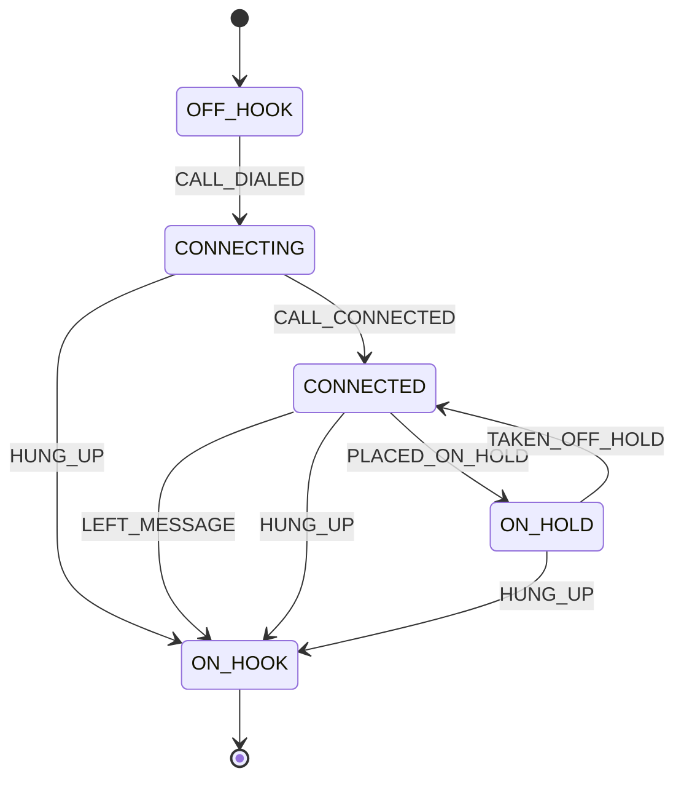

📝 **Why it's better:** States and triggers are **enums**, and transitions are **data** (`state → [(trigger, next_state)]`), so the whole machine is visible and easy to change. ⚠️ A non-numeric or out-of-range input crashes the loop, so validate it.

#### 💻 Approach 3: A Switch-Based (if/elif) State Machine (course code)

```python
from enum import Enum, auto


class State(Enum):
    LOCKED = auto()
    FAILED = auto()
    UNLOCKED = auto()


code = '1234'
state = State.LOCKED
entry = ''

while True:
    if state == State.LOCKED:
        entry += input(entry)
        if entry == code:
            state = State.UNLOCKED
        if not code.startswith(entry):
            state = State.FAILED              # the code is wrong
    elif state == State.FAILED:
        print('\nFAILED')
        entry = ''
        state = State.LOCKED
    elif state == State.UNLOCKED:
        print('\nUNLOCKED')
        break
```

**Verified run** (typing 1, 2, 5, then 1, 2, 3, 4): `FAILED`, then `UNLOCKED`.

📝 There are **no transition tables**. The logic lives inside a big loop of `if` blocks (a `switch` in other languages, or `match` in Python 3.10+). It's fine for tiny machines, but *"not as organized and a lot more difficult to understand."*

#### 🧪 Course Exercise: CombinationLock

```python
class CombinationLock:
    def __init__(self, combination):
        self.combination = combination
        self.reset()

    def reset(self):
        self.status = 'LOCKED'
        self.digits_entered = 0
        self.failed = False

    def enter_digit(self, digit):
        if self.status == 'LOCKED':
            self.status = ''
        self.status += str(digit)
        if self.combination[self.digits_entered] != digit:
            self.failed = True
        self.digits_entered += 1
        if self.digits_entered == len(self.combination):
            self.status = 'ERROR' if self.failed else 'OPEN'


cl = CombinationLock([1, 2, 3])
for d in (1, 2, 5):
    cl.enter_digit(d)
print(cl.status)       # ERROR
```

⚠️ Entering a digit **after** `OPEN` or `ERROR` keeps appending to the status and can raise `IndexError`. A real lock would ignore input in its terminal states, or reset.

#### ⚖ Comparing the Three Approaches

| Approach | States are | Transitions are | Good for |
|----------|------------|-----------------|----------|
| Classic GoF | Classes | Code inside the state classes | Teaching OOP. Per-state behaviour |
| Rules dictionary | Enums | **Data** (a dict of lists) | Most real FSMs, easy to visualise |
| Switch / `if` | Enums | Inline code in the loop | Tiny machines |

> 💬 **Lecture summary:** Richer state machines also have **entry and exit actions**, **actions on transitions**, **guard conditions** that enable or disable transitions, and **default actions** when no transition matches. Libraries such as `transitions` (Python) provide all of these.

#### 🌍 Real-World Usage

- **Order lifecycles** (`PENDING → PAID → SHIPPED → DELIVERED`), TCP connection states, and workflow engines.
- **Game AI** (idle, chase, attack), UI wizards, and parsers and lexers (which are state machines internally).
- Libraries: **`transitions`**, **`python-statemachine`**, and AWS Step Functions at the system level.

#### 🎯 Key Takeaways

- State = **behaviour depends on state**, and **triggers cause transitions**.
- The classic GoF version (state classes that replace themselves) is *"interesting but not practical."*
- Prefer **enums plus a transition table** for clarity. `if`/`match` is fine for very small machines.
- Real FSMs add **guards, entry and exit actions, and defaults**. Validate triggers.

---

### ♟ Part 9: Strategy

The Strategy pattern lets you choose a system's exact behaviour **at runtime** by **composing** a high-level algorithm with a pluggable low-level **strategy**.

#### 📖 Definition

> **Strategy**: separate an algorithm into its **high-level** part, which is reusable, and its **low-level details**, which vary. The details are supplied as a **strategy object** that follows an expected interface, and can be swapped at runtime.

> 💡 **Lecture analogy:** For any hot drink you *boil water and pour it into a cup* (high level). Steeping a tea bag vs grinding coffee is the **strategy** (low level). You can have a tea strategy, a coffee strategy or a hot-chocolate strategy.

#### 💻 Code Example: Text Processor with List Strategies (course code)

```python
from abc import ABC
from enum import Enum, auto


class OutputFormat(Enum):
    MARKDOWN = auto()
    HTML = auto()


# not required but a good idea
class ListStrategy(ABC):
    def start(self, buffer): pass

    def end(self, buffer): pass

    def add_list_item(self, buffer, item): pass


class MarkdownListStrategy(ListStrategy):
    def add_list_item(self, buffer, item):
        buffer.append(f' * {item}\n')          # start/end not needed for Markdown


class HtmlListStrategy(ListStrategy):
    def start(self, buffer):
        buffer.append('<ul>\n')

    def end(self, buffer):
        buffer.append('</ul>\n')

    def add_list_item(self, buffer, item):
        buffer.append(f'  <li>{item}</li>\n')


class TextProcessor:
    def __init__(self, list_strategy=HtmlListStrategy()):   # ⚠️ default instance is shared
        self.buffer = []
        self.list_strategy = list_strategy

    def append_list(self, items):                           # the HIGH-LEVEL algorithm
        self.list_strategy.start(self.buffer)
        for item in items:
            self.list_strategy.add_list_item(self.buffer, item)
        self.list_strategy.end(self.buffer)

    def set_output_format(self, format):                    # swap the strategy at runtime
        if format == OutputFormat.MARKDOWN:
            self.list_strategy = MarkdownListStrategy()
        elif format == OutputFormat.HTML:
            self.list_strategy = HtmlListStrategy()

    def clear(self):
        self.buffer.clear()

    def __str__(self):
        return ''.join(self.buffer)


items = ['foo', 'bar', 'baz']
tp = TextProcessor()
tp.set_output_format(OutputFormat.MARKDOWN)
tp.append_list(items)
print(tp)
tp.set_output_format(OutputFormat.HTML)
tp.clear()
tp.append_list(items)
print(tp)
```

**Output (verified):**

```text
 * foo
 * bar
 * baz

<ul>
  <li>foo</li>
  <li>bar</li>
  <li>baz</li>
</ul>
```

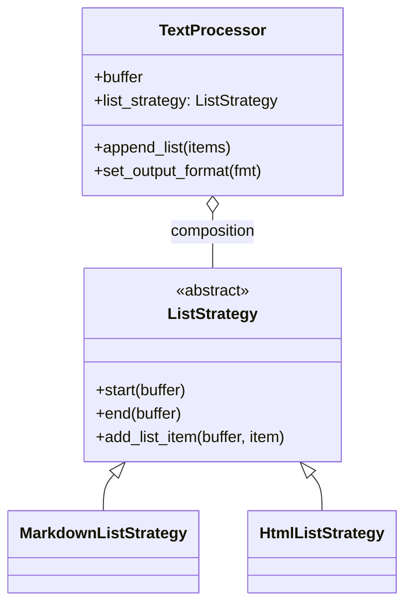

🔑 **Points from the lecture:**
- The strategy is supplied through **composition** (constructor or setter), so it can be swapped **at runtime**.
- It's **great for testing**: inject a **dummy strategy** to unit-test `TextProcessor` in isolation.
- **On ISP:** Markdown doesn't need `start` and `end`, but a list format genuinely has three phases, so keeping them in one interface (with no-op defaults) is the *judicious* choice here.

> ⚠️ **Gotcha:** `list_strategy=HtmlListStrategy()` is evaluated **once**, so every `TextProcessor` shares one instance. It's harmless while strategies are stateless, but use `None` plus a fresh default if a strategy ever holds state. `set_output_format` with an `if/elif` chain also breaks OCP. A dict `{OutputFormat.HTML: HtmlListStrategy, ...}` is cleaner.

#### 🐍 Python Twist: Functions as Strategies (beyond the transcript)

In Python, any **callable** can be a strategy. `sorted(items, key=len)` and `max(xs, key=abs)` take strategy functions. A one-method strategy class can usually be a function:

```python
def markdown_item(item): return f' * {item}'
def html_item(item): return f'  <li>{item}</li>'

def render(items, item_fmt=markdown_item):
    return '\n'.join(item_fmt(i) for i in items)

print(render(['a', 'b'], html_item))
```

#### 🧪 Course Exercise: Discriminant Strategies

```python
import cmath
from abc import ABC


class DiscriminantStrategy(ABC):
    def calculate_discriminant(self, a, b, c):
        pass


class OrdinaryDiscriminantStrategy(DiscriminantStrategy):
    def calculate_discriminant(self, a, b, c):
        return b*b - 4*a*c                                   # may be negative → complex roots


class RealDiscriminantStrategy(DiscriminantStrategy):
    def calculate_discriminant(self, a, b, c):
        result = b*b - 4*a*c
        return result if result >= 0 else float('nan')      # no complex roots


class QuadraticEquationSolver:
    def __init__(self, strategy):
        self.strategy = strategy

    def solve(self, a, b, c):
        """ Returns a pair of complex (!) values """
        disc = complex(self.strategy.calculate_discriminant(a, b, c), 0)
        root_disc = cmath.sqrt(disc)
        return ((-b + root_disc) / (2 * a), (-b - root_disc) / (2 * a))


print(QuadraticEquationSolver(OrdinaryDiscriminantStrategy()).solve(1, 4, 5))   # ((-2+1j), (-2-1j))
print(QuadraticEquationSolver(RealDiscriminantStrategy()).solve(1, 4, 5))       # (nan+nanj, nan+nanj)
```

📝 The same solver gives **different behaviour** depending on the injected strategy. ⚠️ `a = 0` (a linear equation) raises `ZeroDivisionError`.

#### 🌍 Real-World Usage

- `sorted(key=...)`, Django authentication backends, and pluggable password hashers.
- Payment providers, compression algorithms, retry and backoff policies, and routing algorithms.
- ML: interchangeable optimisers and loss functions passed into a training loop.

#### 🎯 Key Takeaways

- Strategy = **high-level algorithm + pluggable low-level details**, through **composition**.
- Swap strategies **at runtime**, and inject **dummies** for testing.
- In Python, a strategy is often just a **function**.
- Beware shared default instances, and `if/elif` strategy selection (OCP).

---

### 📋 Part 10: Template Method

The Template Method pattern defines an algorithm's **skeleton in a base class**, and lets **subclasses fill in the steps**. It's the same idea as Strategy, but through **inheritance**.

#### 📖 Definition

> **Template Method**: a base-class method (the *template method*) defines an algorithm in terms of **abstract steps**. Subclasses **override those steps** to supply the specifics.

#### ⚖ Strategy vs Template Method

| | Strategy | Template Method |
|---|----------|-----------------|
| Mechanism | **Composition**: pass in a strategy object | **Inheritance**: override methods |
| Varies | At **runtime** (swap the object) | At **class definition** (choose a subclass) |
| Skeleton lives in | The consumer class | The base class |
| Lecture phrasing | "conform to an interface and feed it in" | "fill in the blanks" |

#### 💻 Code Example: Game Skeleton and Chess (course code)

```python
from abc import ABC


class Game(ABC):
    def __init__(self, number_of_players):
        self.number_of_players = number_of_players
        self.current_player = 0

    def run(self):                                   # ← THE TEMPLATE METHOD
        self.start()
        while not self.have_winner:
            self.take_turn()
        print(f'Player {self.winning_player} wins!')

    def start(self): pass                            # blanks to fill in

    @property
    def have_winner(self): pass

    def take_turn(self): pass

    @property
    def winning_player(self): pass


class Chess(Game):
    def __init__(self):
        super().__init__(2)
        self.max_turns = 10
        self.turn = 1

    def start(self):
        print(f'Starting a game of chess with {self.number_of_players} players.')

    @property
    def have_winner(self):
        return self.turn == self.max_turns

    def take_turn(self):
        print(f'Turn {self.turn} taken by player {self.current_player}')
        self.turn += 1
        self.current_player = 1 - self.current_player    # alternate 0 ↔ 1

    @property
    def winning_player(self):
        return self.current_player


chess = Chess()
chess.run()
```

**Output (verified, abridged):**

```text
Starting a game of chess with 2 players.
Turn 1 taken by player 0
Turn 2 taken by player 1
...
Turn 9 taken by player 0
Player 1 wins!
```

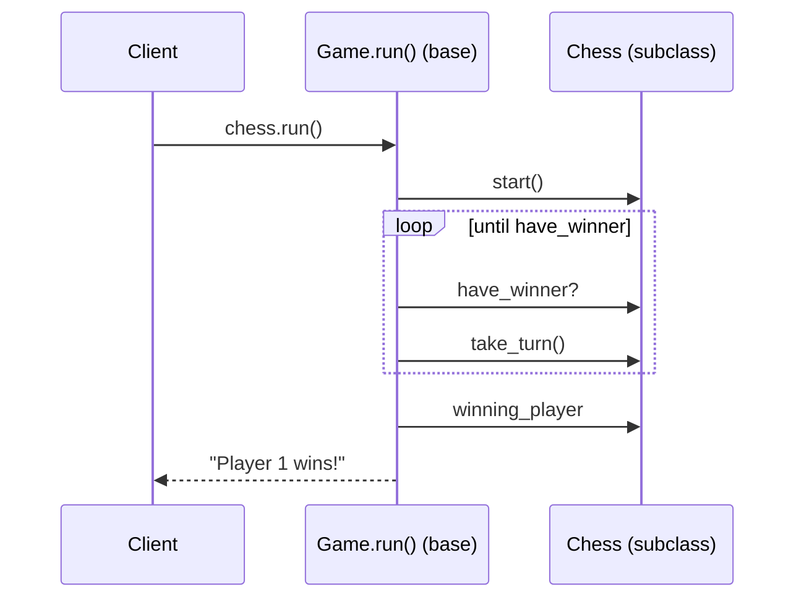

🔑 **Key lines:** `run()` is defined **once** in `Game` and calls the overridable hooks. The client calls `chess.run()` **through the derived object**, so Chess's overrides are used.

> ⚠️ **Gotcha:** The hooks are plain `pass` methods, so a subclass that forgets `have_winner` inherits `None`, `not None` is `True`, and **`run()` loops forever**. Mark the hooks `@abstractmethod`, so incomplete subclasses can't be instantiated.

#### 🧪 Course Exercise: Card Game Damage Rules

```python
from abc import ABC


class Creature:
    def __init__(self, attack, health):
        self.health = health
        self.attack = attack


class CardGame(ABC):
    def __init__(self, creatures):
        self.creatures = creatures

    def combat(self, c1_index, c2_index):            # template method
        first = self.creatures[c1_index]
        second = self.creatures[c2_index]
        self.hit(first, second)
        self.hit(second, first)
        first_alive = first.health > 0
        second_alive = second.health > 0
        if first_alive == second_alive: return -1
        return c1_index if first_alive else c2_index

    def hit(self, attacker, defender):
        pass  # implement this in derived classes


class TemporaryDamageCardGame(CardGame):
    def hit(self, attacker, defender):
        old_health = defender.health
        defender.health -= attacker.attack
        if defender.health > 0:
            defender.health = old_health             # damage heals if not fatal


class PermanentDamageCardGame(CardGame):
    def hit(self, attacker, defender):
        defender.health -= attacker.attack


c1, c2 = Creature(1, 2), Creature(1, 3)
game = PermanentDamageCardGame([c1, c2])
print(game.combat(0, 1), game.combat(0, 1))          # -1 1
```

📝 The **same `combat` skeleton**, with **different `hit` rules** per subclass.

#### 🌍 Real-World Usage

- `unittest.TestCase`: `setUp`, the test, then `tearDown`, called by the framework's template.
- `threading.Thread.run`, `socketserver.BaseRequestHandler.handle`, and Django class-based views (`get_queryset`, `get_context_data`).
- Data pipelines: `extract → transform → load`, with the steps overridden per source.

#### 🎯 Key Takeaways

- Template Method = **a skeleton in the base class, with steps overridden in subclasses**.
- It's Strategy's **inheritance-based twin**: variation is chosen when you define the class, not at runtime.
- Make the hooks **abstract**, to avoid silent defaults (like the infinite loop above).
- Frameworks use it widely: *"don't call us, we'll call you"* (inversion of control).

---

### 🧳 Part 11: Visitor

The Visitor pattern **adds new operations to a whole class hierarchy without modifying** each class. An external component traverses the structure and does the work.

#### 📖 Definition

> **Visitor**: an external component that knows how to **traverse a hierarchy of types** and perform an operation on each one, so new operations (printing, evaluating, rendering) don't require changes to every class.

#### ❓ Why It Exists

> 💬 **Lecture example:** A document made of paragraphs, images and lists has to render to HTML **and** Markdown. With 100 element types, you don't want to open every class to add `to_markdown()`. You want an external component that navigates the structure, **without explicit type checks** if possible.

> 💬 The question to ask, from the course code: ***"What is more likely: a new type or a new operation?"*** Visitor optimises for **new operations**.

#### 💻 Approach 1: Intrusive (course code)

```python
class DoubleExpression:
    def __init__(self, value):
        self.value = value

    def print(self, buffer):
        buffer.append(str(self.value))

    def eval(self): return self.value


class AdditionExpression:
    def __init__(self, left, right):
        self.right = right
        self.left = left

    def print(self, buffer):
        buffer.append('(')
        self.left.print(buffer)
        buffer.append('+')
        self.right.print(buffer)
        buffer.append(')')

    def eval(self):
        return self.left.eval() + self.right.eval()


# represents 1+(2+3)
e = AdditionExpression(DoubleExpression(1),
                       AdditionExpression(DoubleExpression(2), DoubleExpression(3)))
buffer = []
e.print(buffer)
print(''.join(buffer), '=', e.eval())        # (1+(2+3)) = 6
```

📝 Every new operation (`print`, `eval`, `to_latex`…) **modifies every class**, which breaks **OCP** and **SRP**.

#### 💻 Approach 2: Reflective, with `isinstance` Checks (course code)

```python
from abc import ABC


class Expression(ABC):
    pass


class DoubleExpression(Expression):
    def __init__(self, value):
        self.value = value


class AdditionExpression(Expression):
    def __init__(self, left, right):
        self.right = right
        self.left = left


class ExpressionPrinter:
    @staticmethod
    def print(e, buffer):
        """ Will fail silently on a missing case. """
        if isinstance(e, DoubleExpression):
            buffer.append(str(e.value))
        elif isinstance(e, AdditionExpression):
            buffer.append('(')
            ExpressionPrinter.print(e.left, buffer)
            buffer.append('+')
            ExpressionPrinter.print(e.right, buffer)
            buffer.append(')')

    Expression.print = lambda self, b: ExpressionPrinter.print(self, b)   # monkey-patch convenience


e = AdditionExpression(DoubleExpression(1),
                       AdditionExpression(DoubleExpression(2), DoubleExpression(3)))
buffer = []
e.print(buffer)
print(''.join(buffer))                       # (1+(2+3))
```

📝 The operation now lives in **one external class** ✅. But: it **fails silently** on an unhandled type, and *"still breaks OCP because new types require M×N modifications"*. Every visitor needs a new `elif`.

#### 💻 Approach 3: Dispatch with a `@visitor` Decorator (course code)

The course uses a small library ([tavianator.com](https://tavianator.com/the-visitor-pattern-in-python/)) that **registers a method per argument type**, which simulates overloading:

```python
def _qualname(obj):
    """Get the fully-qualified name of an object (including module)."""
    return obj.__module__ + '.' + obj.__qualname__


def _declaring_class(obj):
    """Get the name of the class that declared an object."""
    name = _qualname(obj)
    return name[:name.rfind('.')]


_methods = {}                                # (visitor class name, arg type) → function


def _visitor_impl(self, arg):
    """Actual visitor method implementation."""
    method = _methods[(_qualname(type(self)), type(arg))]
    return method(self, arg)


def visitor(arg_type):
    """Decorator that creates a visitor method."""
    def decorator(fn):
        declaring_class = _declaring_class(fn)
        _methods[(declaring_class, arg_type)] = fn
        return _visitor_impl                 # every decorated `visit` becomes the dispatcher
    return decorator

# ↑↑↑ LIBRARY CODE ↑↑↑


class DoubleExpression:
    def __init__(self, value):
        self.value = value

    def accept(self, visitor):
        visitor.visit(self)


class AdditionExpression:
    def __init__(self, left, right):
        self.left = left
        self.right = right

    def accept(self, visitor):
        visitor.visit(self)


class ExpressionPrinter:
    def __init__(self):
        self.buffer = []

    @visitor(DoubleExpression)
    def visit(self, de):
        self.buffer.append(str(de.value))

    @visitor(AdditionExpression)
    def visit(self, ae):
        self.buffer.append('(')
        ae.left.accept(self)                 # classic double dispatch...
        self.buffer.append('+')
        ae.right.accept(self)
        self.buffer.append(')')

    def __str__(self):
        return ''.join(self.buffer)


class ExpressionEvaluator:
    def __init__(self):
        self.value = None

    @visitor(DoubleExpression)
    def visit(self, de):
        self.value = de.value

    @visitor(AdditionExpression)
    def visit(self, ae):
        self.visit(ae.left)                  # ...or just call visit directly (Python way)
        temp = self.value                    # cache state of a STATEFUL visitor
        self.visit(ae.right)
        self.value += temp


e = AdditionExpression(DoubleExpression(1),
                       AdditionExpression(DoubleExpression(2), DoubleExpression(3)))
printer = ExpressionPrinter()
printer.visit(e)
evaluator = ExpressionEvaluator()
evaluator.visit(e)
print(f'{printer} = {evaluator.value}')     # (1+(2+3)) = 6
```

🔑 **The lecture's two takeaways:**
1. **Double dispatch** (`visit → accept → visit`) is the classic approach in statically typed languages, but **isn't needed in Python**. The decorator dispatches on the argument's runtime type, so `self.visit(ae.left)` works directly. The expression classes don't even need `accept`.
2. **Stateful visitors** may need to **cache intermediate state**, as `temp` does in the evaluator.

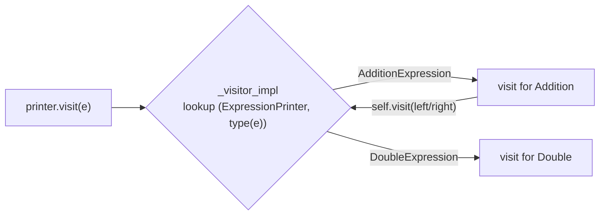

> ⚠️ **Limits of the decorator library (beyond the transcript):**
> - The lookup uses the **exact type** (`type(arg)`), so a **subclass** of `Value` isn't dispatched.
> - Keys are built from `__qualname__`, so visitors defined inside functions, or **subclasses of a visitor**, fail to find their methods.
> - `_methods` is a **global** registry.

> 🐞 **Bug in `Visitor/exercise.py` (verified):** The error path `raise Exception('Key % not found' % key)` itself **crashes** with `ValueError: unsupported format character 'n'`. `'% n'` isn't a valid format, and `key` is a tuple anyway. Use `raise KeyError(f'No visit method for {key}')`.

#### 📎 Beyond the transcript: The Standard-Library Way, `functools.singledispatchmethod`

```python
from functools import singledispatchmethod


class Value:
    def __init__(self, v): self.value = v


class Add:
    def __init__(self, l, r): self.left, self.right = l, r


class Mul:
    def __init__(self, l, r): self.left, self.right = l, r


class Printer:
    @singledispatchmethod
    def visit(self, e):
        raise TypeError(f'no visit for {type(e).__name__}')   # ✅ loud failure

    @visit.register
    def _(self, e: Value): return str(e.value)

    @visit.register
    def _(self, e: Add): return f'({self.visit(e.left)}+{self.visit(e.right)})'

    @visit.register
    def _(self, e: Mul): return f'{self.visit(e.left)}*{self.visit(e.right)}'


print(Printer().visit(Mul(Add(Value(2), Value(3)), Value(4))))   # (2+3)*4
```

📝 `singledispatchmethod` dispatches on the first argument's type **including subclasses (MRO)**, is built in, and doesn't need a global registry. Python 3.10+ structural pattern matching (`match e: case Add(left=l, right=r): ...`) is another option.

#### 🧪 Course Exercise: Printing Addition and Multiplication

```python
# uses the @visitor library code shown above
class Value:
    def __init__(self, value):
        self.value = value


class AdditionExpression:
    def __init__(self, left, right):
        self.right = right
        self.left = left


class MultiplicationExpression:
    def __init__(self, left, right):
        self.right = right
        self.left = left


class ExpressionPrinter:
    def __init__(self):
        self.buffer = []

    @visitor(Value)
    def visit(self, e):
        self.buffer.append(str(e.value))

    @visitor(AdditionExpression)
    def visit(self, e):
        self.buffer.append('(')
        self.visit(e.left)
        self.buffer.append('+')
        self.visit(e.right)
        self.buffer.append(')')

    @visitor(MultiplicationExpression)
    def visit(self, e):
        self.visit(e.left)
        self.buffer.append('*')
        self.visit(e.right)

    def __str__(self):
        return ''.join(self.buffer)


ep = ExpressionPrinter()
ep.visit(MultiplicationExpression(AdditionExpression(Value(2), Value(3)), Value(4)))
print(ep)          # (2+3)*4
```

📝 `(2+3)*4` prints correctly because **addition always adds parentheses**. Note that `2*(3*4)` would print as `2*3*4`, which is fine for multiplication but would be wrong for subtraction or division.

#### ⚖ The Three Approaches

| Approach | Adding an operation | Adding a type | Failure mode |
|----------|---------------------|---------------|--------------|
| Intrusive | ❌ edit every class | ✅ one class | n/a |
| Reflective (`isinstance`) | ✅ one visitor class | ❌ edit every visitor | **Silent** for missing cases |
| Dispatch (`@visitor`, `singledispatch`) | ✅ one visitor class | ❌ add a method to each visitor | Loud (with a fixed error path) |

#### 🌍 Real-World Usage

- **`ast.NodeVisitor` / `ast.NodeTransformer`** in Python's standard library (`visit_BinOp`, `visit_Name`…).
- Compilers and linters (pylint, flake8 plugins), and code formatters walking syntax trees.
- Document exporters (to HTML, PDF, Markdown) and serialisers over object graphs.

#### 🎯 Key Takeaways

- Visitor = **add operations to a hierarchy without modifying it**. It's best when **new operations** are more likely than **new types**.
- Intrusive breaks OCP. Reflective fails silently. **Dispatch-based** visitors are the cleanest.
- Classic **double dispatch isn't needed in Python**. Dispatch on the runtime type with a decorator or **`functools.singledispatchmethod`**.
- Stateful visitors may need to **cache intermediate values**.

---

## 📚 Glossary

| Term | Definition | Why It Matters |
|------|------------|----------------|
| **Behavioral pattern** | A pattern about communication and the assignment of responsibility between objects | Organises "who does what, when" |
| **Chain of Responsibility** | A sequence of handlers that each may process, pass on or stop a request | Flexible, ordered processing |
| **Method chain** | A chain built as a linked list of handler objects | The simplest CoR implementation |
| **Event broker** | A central object holding an event that handlers subscribe to | Dynamic chains, with automatic removal |
| **CQS** | Command–Query Separation: commands change state, queries only read it | Lets modifiers adjust query results safely |
| **Command** | An object representing an operation and its parameters | Undo, logging, replay, queues |
| **Composite command / macro** | A command made of several commands | Batch operations. Undo in reverse order |
| **Receiver** | The object the command acts on (`BankAccount`) | Separates "what" from "who executes" |
| **Interpreter** | Turns structured text into objects (lexing + parsing) | DSLs, expressions, compilers |
| **Lexing** | Splitting text into tokens | The first stage of interpretation |
| **Parsing** | Building a tree (AST) from tokens | The second stage. Enables evaluation |
| **AST** | Abstract Syntax Tree | The structure that visitors traverse |
| **Iterator** | An object that facilitates traversal (`__iter__`, `__next__`) | Uniform access to any collection |
| **`StopIteration`** | The exception that signals an iterator is exhausted | Ends `for` loops |
| **Generator** | A function using `yield`. Its frame pauses and resumes | Recursive traversal made easy |
| **List-backed properties** | Named properties stored in one list | Iterate and aggregate over attributes |
| **Mediator** | A central hub through which components communicate | Removes n² coupling |
| **Memento** | A token snapshotting state for later restoration | Undo/redo, save points |
| **Redo branch** | Future states after an undo | Must be discarded on a new change |
| **Observer / observable** | A subscriber, and the event source it watches | Decoupled notifications |
| **Event (list)** | A list of callables that is invoked like a function | The course's observer primitive |
| **Property observer** | Notifies when a property value changes | Data binding, validation |
| **Dependent property** | A property computed from another (`can_vote` from `age`) | Needs careful change propagation |
| **State / state machine** | Behaviour depends on state. Triggers cause transitions | Lifecycles, protocols, UIs |
| **Trigger** | An event causing a state transition | The input to an FSM |
| **Guard condition** | A condition enabling or disabling a transition | Richer FSMs |
| **Strategy** | A pluggable algorithm detail, supplied by composition | Runtime flexibility, testability |
| **Template Method** | A base-class skeleton with abstract steps filled in by subclasses | Reuse through inheritance |
| **Hook method** | An overridable step called by a template method | The extension point |
| **Visitor** | An external operation over a type hierarchy | New operations without modifying classes |
| **Double dispatch** | Choosing the method by the types of two objects (`accept` → `visit`) | The classic visitor mechanism. Optional in Python |
| **`singledispatchmethod`** | A stdlib decorator dispatching a method on its argument's type | The Pythonic visitor |

---

## 📝 One-Minute Revision

- **Chain of Responsibility:** handlers in a chain. Each one processes, passes on (`super().handle()`) or **stops**. The **broker + CQS** version adjusts **query results** without mutation, and `__exit__` unsubscribes.
- **Command:** an operation as an object, with `invoke()` and `undo()`. Track **`success`**. **Macros** undo in reverse. A transfer needs **all-or-nothing** logic.
- **Interpreter:** **lex** (text → tokens), then **parse** (tokens → tree), then evaluate. The course lexer **drops a trailing number**.
- **Iterator:** `__iter__` plus `__next__` with `StopIteration`. Stateful iterators can't recurse. **Generators** can.
- **Mediator:** everyone talks through a hub (`ChatRoom`, `Game` with events). Inject it in `__init__`.
- **Memento:** snapshot tokens. Record the **initial** state, **truncate redo** on a new change, and **copy by value**.
- **Observer:** `Event(list)` with `__call__`. Subscribe = `append`, unsubscribe = `remove`. **Don't remove while iterating.** Dependent properties are hard.
- **State:** triggers drive transitions. Classic GoF state classes ("not practical"), an enum **rules table**, or `if`/`match`.
- **Strategy vs Template Method:** same idea. **Composition** (runtime swap) vs **inheritance** (subclass hooks).
- **Visitor:** add operations without touching classes. Intrusive → reflective → **dispatch** (`@visitor` / `singledispatchmethod`). Double dispatch isn't needed in Python.

---

## 📄 Cheat Sheet

### 🧾 Pattern Quick Reference

| Pattern | Minimal Python shape |
|---------|----------------------|
| CoR (method chain) | `def handle(self): ...; super().handle()` (omit `super()` to stop) |
| CoR (broker) | `game.queries.append(self.handle)` · `__exit__`: `remove(self.handle)` |
| Command | `class Cmd: def invoke(self): ...; def undo(self): if self.success: ...` |
| Macro | `class Macro(Command, list): undo → for c in reversed(self): c.undo()` |
| Interpreter | `tokens = lex(text); tree = parse(tokens); tree.value` |
| Iterator | `def __iter__(self): return self` / `def __next__(self): ... raise StopIteration` |
| Generator | `def walk(n): yield from walk(n.left); yield n; yield from walk(n.right)` |
| Mediator | `room.broadcast(sender, msg)` → `p.receive(...)` |
| Memento | `m = obj.save()` / `obj.restore(m)`, with `deepcopy` for value snapshots |
| Observer | `class Event(list): def __call__(s, *a, **k): [f(*a, **k) for f in list(s)]` |
| State (table) | `rules = {State.A: [(Trigger.X, State.B)]}` |
| Strategy | `TextProcessor(strategy)`, or pass a function `key=...` |
| Template Method | `def run(self): self.start(); while not self.done: self.step()` |
| Visitor | `@singledispatchmethod def visit(self, e): ...` / `@visit.register` |

### ⚖ Telling Similar Patterns Apart

| Pair | Difference |
|------|------------|
| **Strategy vs Template Method** | Composition (runtime) vs inheritance (class-time) |
| **Strategy vs State** | Strategy is chosen by the **client**. A State object **changes itself** in response to triggers |
| **Command vs Memento** | Store **operations** (undo by inverse) vs store **snapshots** (undo by restore) |
| **Observer vs Mediator** | A subject broadcasts **its own** events vs a hub **routes between peers** |
| **Chain of Responsibility vs Observer** | Handlers in **order**, any may **stop** it vs **all** subscribers notified |
| **Iterator vs Visitor** | **How to walk** a structure vs **what to do** at each node |
| **Interpreter vs Visitor** | **Builds** the tree from text vs **operates on** the tree |

### ⚠️ Pitfalls Found in the Course Files

| File | Issue | Fix |
|------|-------|-----|
| `method_chain.py` | `f'{name}''s attack'` gives "Goblins attack". Modifiers mutate permanently | `f"{name}'s attack"`. Use the broker design |
| `broker_chain.py` | `defense` query seeded with `initial_attack`. Matching by name | `initial_defense`. `sender is self.creature` |
| `composite_command.py` | `items=[]` mutable default. Undo-by-withdraw is semantically wrong | `items=None`. Compensating transactions or snapshots |
| `Interpreter/handmade.py` | **A trailing number is dropped** (`'1+2'` crashes). No chaining or nesting. `eval` shadows a built-in | Fixed lexer. Recursive-descent parser |
| `Interpreter/exercise.py` | `'[\+\-]'` gives a `SyntaxWarning` in 3.12+ | `r'[+\-]'` |
| `tree_traversal.py` | `InOrderIterator` has no `__iter__` | `def __iter__(self): return self` |
| `chat_room.py` | No `leave`. Name-based routing. `say()` before `join()` crashes | Add `leave`, IDs, guards |
| `undo_redo.py` | **The redo branch isn't truncated** after a new deposit | `del changes[current+1:]` before appending |
| `property_observers.py` | **Unsubscribes during iteration**, so the next handler is skipped | Iterate `list(self)` |
| `Observer/exercise.py` | A dead rat is never unsubscribed | Remove its handlers in `__exit__` |
| `State/handmade.py` | No input validation | Validate the index, or handle errors |
| `State/exercise.py` | Digits after OPEN or ERROR → `IndexError` | Ignore input in terminal states |
| `strategy.py` | Shared default strategy instance. `if/elif` format selection | `None` default. A dict registry |
| `template_method.py` | `pass` hooks → a missing `have_winner` loops forever | `@abstractmethod` |
| `Visitor/exercise.py` | **The error message itself raises `ValueError`**. Exact-type dispatch | f-string `KeyError`. `singledispatchmethod` |

---

## 🎤 Interview Questions and Answers

### 🟢 Beginner

**❓ Q1. What are behavioural design patterns?**

✅ **Answer:** Patterns concerned with how objects interact, communicate and divide responsibilities.

💡 **Explanation:** Chain of Responsibility, Command, Interpreter, Iterator, Mediator, Memento, Observer, State, Strategy, Template Method and Visitor.

🎯 **Why Interviewers Ask This:** A baseline check of the GoF categories.

➡️ **Possible Follow-up:** Which behavioural pattern do you use most often?

---

**❓ Q2. What is the Chain of Responsibility pattern?**

✅ **Answer:** A sequence of handlers where each one can process a request, pass it on, or stop the chain.

💡 **Explanation:** GUI click bubbling (button → group box → window). Creature modifiers in a card game.

🎯 **Why Interviewers Ask This:** It's common in middleware and event systems.

➡️ **Possible Follow-up:** How does a handler stop the chain?

---

**❓ Q3. What is the Command pattern used for?**

✅ **Answer:** It represents an operation as an object, so it can be recorded, queued, audited, replayed or undone.

💡 **Explanation:** `BankAccountCommand(account, DEPOSIT, 100)` with `invoke()` and `undo()`.

🎯 **Why Interviewers Ask This:** Undo/redo and job queues are everywhere.

➡️ **Possible Follow-up:** How do you avoid undoing a failed command?

---

**❓ Q4. What are the two stages of an interpreter?**

✅ **Answer:** Lexing (text → tokens) and parsing (tokens → object tree).

💡 **Explanation:** `'(13+4)-(12+1)'` becomes tokens, then a `BinaryOperation` tree, then `.value` gives 4.

🎯 **Why Interviewers Ask This:** A core concept behind compilers and DSLs.

➡️ **Possible Follow-up:** What does an AST look like for `1+2*3`?

---

**❓ Q5. What does Python's iterator protocol require?**

✅ **Answer:** The iterable implements `__iter__()`, which returns an iterator. The iterator implements `__next__()` and raises `StopIteration` when it's exhausted. Iterators should also return `self` from `__iter__`.

💡 **Explanation:** That's what `for` loops call under the hood.

🎯 **Why Interviewers Ask This:** Fundamental Python.

➡️ **Possible Follow-up:** How do generators implement this automatically?

---

**❓ Q6. What is a Mediator?**

✅ **Answer:** A central component through which other components communicate, without referencing each other.

💡 **Explanation:** `ChatRoom` routes broadcasts and private messages, and people only know the room.

🎯 **Why Interviewers Ask This:** Tests understanding of decoupling.

➡️ **Possible Follow-up:** How does it differ from Observer?

---

**❓ Q7. What is a Memento?**

✅ **Answer:** A token capturing an object's state, so it can be restored later.

💡 **Explanation:** `deposit()` returns `Memento(balance)`, and `restore(m)` rolls back to it.

🎯 **Why Interviewers Ask This:** Undo, savepoints and snapshots.

➡️ **Possible Follow-up:** Memento vs Command for undo?

---

**❓ Q8. How does the course implement Observer in Python?**

✅ **Answer:** `class Event(list)` with `__call__` that calls every item. Subscribe with `append`, unsubscribe with `remove`, and raise the event by calling `event(args)`.

💡 **Explanation:** `person.falls_ill(name, address)` notifies every handler.

🎯 **Why Interviewers Ask This:** Tests a minimal, Pythonic implementation.

➡️ **Possible Follow-up:** What happens if a handler unsubscribes during the call?

---

**❓ Q9. What is the State pattern?**

✅ **Answer:** An object's behaviour depends on its current state, and triggers cause transitions between states. When formalised, it's a finite state machine.

💡 **Explanation:** A phone moves `OFF_HOOK → CONNECTING → CONNECTED → ON_HOLD…`.

🎯 **Why Interviewers Ask This:** State machines model lifecycles and protocols.

➡️ **Possible Follow-up:** How would you represent transitions as data?

---

**❓ Q10. What is the difference between Strategy and Template Method?**

✅ **Answer:** Both separate an algorithm's skeleton from its details. Strategy uses composition (inject an object, swap it at runtime). Template Method uses inheritance (override hooks in a subclass).

💡 **Explanation:** `TextProcessor(MarkdownListStrategy())` vs `class Chess(Game)` overriding `take_turn`.

🎯 **Why Interviewers Ask This:** A classic comparison.

➡️ **Possible Follow-up:** When would you prefer each?

---

### 🟡 Intermediate

**❓ Q11. Why is the broker-based chain better than the method chain?**

✅ **Answer:** The method chain permanently mutates the creature and can't remove modifiers. The broker applies modifiers to query results on every read (CQS), and unsubscribes them automatically in `__exit__`.

💡 **Explanation:** A goblin is 2/2, becomes 4/2 inside the `with` block, and is 2/2 again after it.

🎯 **Why Interviewers Ask This:** Shows understanding of state vs derived values.

➡️ **Possible Follow-up:** What is Command–Query Separation?

---

**❓ Q12. Why does `BankAccountCommand` track `success`?**

✅ **Answer:** So `undo()` only reverses operations that actually happened. Undoing a failed withdrawal would otherwise deposit money that was never taken.

💡 **Explanation:** The impossible $1,000 withdrawal followed by undo leaves the balance at 0.

🎯 **Why Interviewers Ask This:** Correctness in undo design.

➡️ **Possible Follow-up:** Why is undoing a deposit with `withdraw()` semantically wrong?

---

**❓ Q13. Why does a naive composite money transfer fail, and how does `MoneyTransferCommand` fix it?**

✅ **Answer:** A naive macro runs every step independently. If the withdrawal fails, the deposit still happens. `MoneyTransferCommand` stops after the first failure, marks the later steps unsuccessful, and records the overall `success`.

💡 **Explanation:** That gives all-or-nothing semantics. Undo then skips the commands that never ran.

🎯 **Why Interviewers Ask This:** Transactions and atomicity.

➡️ **Possible Follow-up:** How do real systems guarantee atomicity? (Database transactions, the saga pattern.)

---

**❓ Q14. What are the limitations of the course's handmade parser?**

✅ **Answer:**
- One binary operation per level, so `1+2+(3-4)` gives 0.
- It matches the first `)`, so nested parentheses break.
- No precedence or `*`/`/`.
- The lexer drops a number at the end of the input.

💡 **Explanation:** A recursive-descent parser with a loop for left associativity fixes the first three.

🎯 **Why Interviewers Ask This:** Tests careful analysis of parsing.

➡️ **Possible Follow-up:** Write the grammar for `+`, `-`, `*`, `/` with precedence.

---

**❓ Q15. Why can't stateful iterators easily traverse trees recursively?**

✅ **Answer:** `__next__` has to return one item and then resume later from saved state. You can't pause inside a recursive call stack, so you need parent pointers and manual climbing logic.

💡 **Explanation:** Generators keep their whole frame across `yield`s, so recursive traversal becomes trivial.

🎯 **Why Interviewers Ask This:** Tests understanding of generators.

➡️ **Possible Follow-up:** What does `yield from` do?

---

**❓ Q16. Mediator vs Observer?**

✅ **Answer:** With Observer, a subject notifies its subscribers of its own events, one-to-many. With Mediator, peers communicate through a hub that routes messages, many-to-many through one.

💡 **Explanation:** Mediators are often built with events (the course's `Game`), so the two overlap.

🎯 **Why Interviewers Ask This:** Precision about intent.

➡️ **Possible Follow-up:** Is a message broker a mediator?

---

**❓ Q17. Why must mementos capture state by value?**

✅ **Answer:** If a memento stores references, later mutations of those objects corrupt the snapshot.

💡 **Explanation:** In the TokenMachine exercise, changing a token from 111 to 333 must not affect the reverted state. Use `deepcopy`.

🎯 **Why Interviewers Ask This:** Tests understanding of aliasing.

➡️ **Possible Follow-up:** How would you reduce memory for large snapshots?

---

**❓ Q18. What's tricky about dependent-property notifications?**

✅ **Answer:** A change to `age` may or may not change `can_vote`. You have to cache the old dependent value, compare it after the change, and only notify if it differs. This doesn't scale to complex dependency graphs.

💡 **Explanation:** The lecture compares this to Excel's cascading recalculation.

🎯 **Why Interviewers Ask This:** Reactive design complexity.

➡️ **Possible Follow-up:** How do reactive frameworks track dependencies?

---

**❓ Q19. Why is the classic GoF State implementation "not practical"?**

✅ **Answer:** States are classes that create and replace each other on every transition, so states are coupled to their successors and the transition logic is scattered across classes.

💡 **Explanation:** An enum plus a transition table makes the machine explicit and easy to change.

🎯 **Why Interviewers Ask This:** Judgement over textbook dogma.

➡️ **Possible Follow-up:** When would per-state classes be justified?

---

**❓ Q20. Why is double dispatch unnecessary for Visitor in Python?**

✅ **Answer:** Python can dispatch on the runtime type directly, with `@visitor`, `functools.singledispatchmethod` or `match`. You don't need the `accept()` hop that statically typed languages use to recover the concrete type.

💡 **Explanation:** `self.visit(ae.left)` picks the right overload at runtime.

🎯 **Why Interviewers Ask This:** Cross-language understanding.

➡️ **Possible Follow-up:** Explain double dispatch as it works in Java or C#.

---

### 🔴 Advanced

**❓ Q21. Find the bug in the course's undo/redo memento and fix it.**

✅ **Answer:** `deposit()` after `undo()` appends without discarding the redo branch, and `current` ends up pointing at a stale state. Fix: `del self.changes[self.current+1:]` before appending, then set `current = len(changes) - 1`.

💡 **Explanation:** From 175, undo to 150, deposit 10: redo wrongly goes to 175 instead of staying at 160.

🎯 **Why Interviewers Ask This:** Tests careful reasoning about history.

➡️ **Possible Follow-up:** How do editors implement branching undo trees?

---

**❓ Q22. Why does unsubscribing inside an event handler skip other handlers?**

✅ **Answer:** `Event.__call__` iterates the list directly. Removing the current item shifts the later items left, so the iterator skips the next one.

💡 **Explanation:** In `TrafficAuthority`, a logger subscribed after it never runs at age 16. Fix: iterate a snapshot with `for f in list(self)`.

🎯 **Why Interviewers Ask This:** A subtle concurrency-like bug in single-threaded code.

➡️ **Possible Follow-up:** What if a handler subscribes a new handler during the call?

---

**❓ Q23. How would you build a production-grade event system?**

✅ **Answer:**
- Iterate over a copy of the subscribers.
- Use `weakref.WeakMethod` to avoid keeping subscribers alive.
- Isolate exceptions per handler.
- Make it thread-safe with a lock.
- Return a subscription token for easy unsubscribe.
- Optionally dispatch asynchronously.

💡 **Explanation:** The course's `Event(list)` is minimal and has none of these safeguards.

🎯 **Why Interviewers Ask This:** Moving from a toy to real systems.

➡️ **Possible Follow-up:** How do Django signals use weak references?

---

**❓ Q24. Compare three ways to undo: commands, mementos and event sourcing.**

✅ **Answer:**
- **Commands** store operations and run their inverses. They're cheap, but every inverse must be correct.
- **Mementos** store snapshots. They're simple, but memory-heavy.
- **Event sourcing** stores an append-only event log and rebuilds state by replay, optionally with periodic snapshots.

💡 **Explanation:** Real editors often combine commands with occasional snapshots.

🎯 **Why Interviewers Ask This:** System-design depth.

➡️ **Possible Follow-up:** How do you undo a non-invertible operation?

---

**❓ Q25. Design a richer state machine with guards and entry and exit actions.**

✅ **Answer:** Map `(state, trigger)` to `(next_state, guard, action)`. On a trigger, look up the transition, check the guard, run the current state's `on_exit`, then the action, set the new state, and run its `on_enter`. Provide a default action for unmatched triggers.

💡 **Explanation:** The lecture's summary lists entry and exit actions, transition actions, guards and defaults. Libraries like `transitions` implement them.

🎯 **Why Interviewers Ask This:** Applying the pattern to real workflows.

➡️ **Possible Follow-up:** How would you persist and resume a state machine?

---

**❓ Q26. What are the limitations of the `@visitor` decorator library?**

✅ **Answer:**
- It dispatches on the exact type, so subclasses are ignored.
- Keys come from `__qualname__`, so nested and subclassed visitors break.
- It uses a global registry.
- The exercise's error message itself raises `ValueError`.

💡 **Explanation:** `functools.singledispatchmethod` follows the MRO and is part of the standard library.

🎯 **Why Interviewers Ask This:** Critical evaluation of library code.

➡️ **Possible Follow-up:** How does `singledispatch` resolve ambiguous multiple inheritance?

---

**❓ Q27. When should you choose Visitor over adding methods to classes?**

✅ **Answer:** When the type hierarchy is **stable** and **new operations** are frequent. If new types are frequent, Visitor forces you to edit every visitor (the expression problem).

💡 **Explanation:** The course's guiding question: "what is more likely: a new type or a new operation?"

🎯 **Why Interviewers Ask This:** Tests knowledge of the expression problem.

➡️ **Possible Follow-up:** How do functional languages handle this?

---

**❓ Q28. How does Template Method relate to inversion of control?**

✅ **Answer:** The base class (the framework) controls the flow and calls your overridden hooks. That's the "Hollywood principle": *don't call us, we'll call you*.

💡 **Explanation:** Examples include `unittest.TestCase.setUp`/`tearDown` and Django class-based views.

🎯 **Why Interviewers Ask This:** Connects patterns to frameworks.

➡️ **Possible Follow-up:** What are the downsides of deep template hierarchies?

---

**❓ Q29. How would you make chain modifiers robust to creatures with identical names?**

✅ **Answer:** Match on identity (`sender is self.creature`) or on a unique ID, never on the display name.

💡 **Explanation:** The course's broker matches `sender.name`, so two "Goblin"s would share each other's buffs.

🎯 **Why Interviewers Ask This:** Identity vs equality in event routing.

➡️ **Possible Follow-up:** How would you scope modifiers to teams or areas?

---

**❓ Q30. Combine patterns: design an editor with undo, live preview and export formats.**

✅ **Answer:**
- Edits are **Commands** on a stack (with occasional **Memento** snapshots).
- The document raises **Observer** events, so the preview re-renders.
- Exporters are **Visitors** over the document tree.
- The export format is a **Strategy**.
- A **State** machine handles modes (edit, preview, readonly).

💡 **Explanation:** Real systems combine behavioural patterns. Each one owns one responsibility.

🎯 **Why Interviewers Ask This:** Senior-level synthesis.

➡️ **Possible Follow-up:** Where would Mediator fit? (Coordinating panels.)

---

## 🎬 Scenario-Based Questions

### 🎬 Scenario 1: Redo resurrects a deleted state

> **Scenario:** Users report that after undo, a new edit, then redo, an old discarded value reappears.

1. 🔎 **Initial investigation:** Reproduce the sequence: undo, new change, redo.
2. 📊 **Metrics/logs:** Log `current` and the length of the history list on every operation.
3. 🧩 **Possible causes:** The redo branch isn't truncated on a new change, as in the course's `undo_redo.py`.
4. 🛠 **Debugging approach:** Unit test: `deposit 50, 25; undo; deposit 10; undo; redo` should give 160.
5. ✅ **Resolution:** `del changes[current+1:]` before appending, then recompute `current`.
6. 🛡 **Prevention:** Property-based tests over random undo/redo/edit sequences.

### 🎬 Scenario 2: A notification handler stops firing

> **Scenario:** An audit logger subscribed to `property_changed` misses exactly the events where another handler unsubscribes itself.

1. 🔎 **Initial investigation:** List the subscribers and their order. Check which handlers call `remove`.
2. 📊 **Metrics/logs:** Count handler invocations per event. The logger's count drops when the other handler leaves.
3. 🧩 **Possible causes:** The subscriber list is mutated during iteration.
4. 🛠 **Debugging approach:** Reproduce with two subscribers, where the first unsubscribes inside its handler.
5. ✅ **Resolution:** Iterate a copy (`list(self)`), or defer removals until after dispatch.
6. 🛡 **Prevention:** Use a hardened `Event` class with tests for subscribing and unsubscribing during dispatch.

### 🎬 Scenario 3: A calculator fails on simple input

> **Scenario:** The expression service handles `(13+4)-(12+1)` but crashes on `1+2` with `'NoneType' object has no attribute 'value'`.

1. 🔎 **Initial investigation:** Print the tokens. `lex('1+2')` returns `['1', '+']`.
2. 📊 **Metrics/logs:** Failures correlate with expressions ending in a digit.
3. 🧩 **Possible causes:** The lexer only emits an integer when a non-digit follows it.
4. 🛠 **Debugging approach:** Unit-test the lexer on `'12'`, `'1+2'` and `'(1)'`.
5. ✅ **Resolution:** Emit the pending number after the loop, or use a regex tokenizer. Replace the parser with recursive descent.
6. 🛡 **Prevention:** Grammar-based fuzzing, and comparing results against Python's `ast` for valid inputs.

### 🎬 Scenario 4: A failed transfer creates money

> **Scenario:** An audit finds accounts credited even though the source withdrawal was rejected.

1. 🔎 **Initial investigation:** Check how the transfer is composed. Is it a plain macro?
2. 📊 **Metrics/logs:** Transaction logs show a deposit without a matching withdrawal.
3. 🧩 **Possible causes:** The composite command runs every step regardless of earlier failures.
4. 🛠 **Debugging approach:** Reproduce with an insufficient balance and the naive `CompositeBankAccountCommand`.
5. ✅ **Resolution:** All-or-nothing semantics (`MoneyTransferCommand`), and ideally a real database transaction.
6. 🛡 **Prevention:** Invariant checks (total money is conserved) in tests and monitoring.

### 🎬 Scenario 5: A game loop never ends

> **Scenario:** A new `Checkers(Game)` subclass hangs forever when `run()` is called.

1. 🔎 **Initial investigation:** Check which template hooks the subclass overrides.
2. 📊 **Metrics/logs:** CPU at 100%, and the turn counter never increases.
3. 🧩 **Possible causes:** `have_winner` isn't overridden. The base returns `None`, so `not None` is `True` forever.
4. 🛠 **Debugging approach:** Instantiate it and print `have_winner`. Inspect the MRO.
5. ✅ **Resolution:** Implement the hook, and make all hooks `@abstractmethod` so incomplete subclasses can't be created.
6. 🛡 **Prevention:** A contract test that runs every `Game` subclass with a turn limit.

---

## 🧪 Hands-on Exercises

### 🟢 Easy

1. Fix the apostrophe in `method_chain.py`, remove `NoBonusesModifier`, and predict the goblin's final stats before running it.
2. Fix the broker's `defense` seed, and verify `Orc(2/5)` prints correctly.
3. Add `__iter__` to `InOrderIterator`, and write preorder and postorder generators.
4. Make `Template Method` hooks abstract, and show that an incomplete subclass can't be instantiated.

### 🟡 Medium

1. Fix the interpreter lexer, and extend the parser to handle `1+2+(3-4)` and nested parentheses.
2. Implement a `CommandManager` with undo and redo stacks for `BankAccountCommand`.
3. Write a `SafeEvent` (iterate a copy, isolate exceptions) and rerun `property_observers.py` with an extra logger.
4. Rewrite the phone state machine with guard conditions and `on_enter` / `on_exit` actions.

### 🔴 Advanced

1. Build a Visitor with `functools.singledispatchmethod` that prints and evaluates `+`, `-`, `*`, `/`, with correct parentheses based on precedence.
2. Implement memento undo/redo with **branching history** (an undo tree).
3. Create an event-broker card game where modifiers are scoped by `with` blocks, match by identity, and are thread-safe.
4. Add a `leave()` method and user IDs to the chat-room mediator, with message history replay for late joiners.

---

## 📦 Practice Assignment

### 🎯 Objective

Build a **"Mini Spreadsheet Calculator"** that combines several behavioural patterns.

### 📋 Requirements

- **Interpreter:** parse cell formulas such as `A1+B1-(C1+2)` into an AST.
- **Visitor:** an `Evaluator` and a `Printer` over the AST.
- **Observer:** cells raise `changed` events. Dependent cells recompute.
- **Command:** `SetCellCommand` with undo and redo.
- **Memento:** a full-sheet snapshot for "revert to saved".
- **Strategy:** export as CSV or Markdown.
- **State:** the sheet mode, `EDITING ↔ READONLY`, where set commands are rejected in `READONLY`.

### 🏛 Architecture

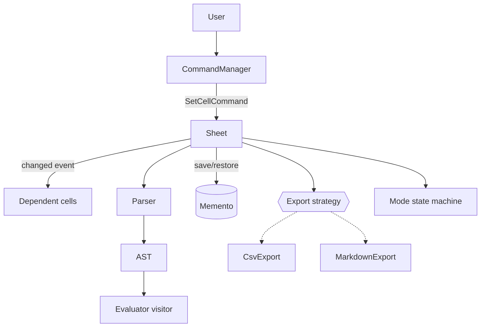

### ⚙️ Expected Functionality

| Feature | Pattern |
|---------|---------|
| `=A1+B1` parsed and evaluated | Interpreter + Visitor |
| Changing A1 updates C1 | Observer |
| Undo or redo a cell edit | Command |
| Revert to the last saved sheet | Memento |
| CSV or Markdown output | Strategy |
| Read-only mode | State |

### 💻 Suggested Implementation

```python
import re
from copy import deepcopy
from functools import singledispatchmethod


class Num:
    def __init__(self, v): self.v = v


class Ref:
    def __init__(self, name): self.name = name


class BinOp:
    def __init__(self, op, l, r): self.op, self.l, self.r = op, l, r


def parse(text):                                     # interpreter: recursive descent
    toks = re.findall(r'[A-Z]\d+|\d+|[+\-()]', text)
    pos = 0

    def term():
        nonlocal pos
        t = toks[pos]; pos += 1
        if t == '(':
            e = expr(); pos += 1
            return e
        return Num(int(t)) if t.isdigit() else Ref(t)

    def expr():
        nonlocal pos
        e = term()
        while pos < len(toks) and toks[pos] in '+-':
            op = toks[pos]; pos += 1
            e = BinOp(op, e, term())
        return e

    return expr()


class Evaluator:                                     # visitor
    def __init__(self, sheet): self.sheet = sheet

    @singledispatchmethod
    def visit(self, n): raise TypeError(n)

    @visit.register
    def _(self, n: Num): return n.v

    @visit.register
    def _(self, n: Ref): return self.sheet.value(n.name)

    @visit.register
    def _(self, n: BinOp):
        a, b = self.visit(n.l), self.visit(n.r)
        return a + b if n.op == '+' else a - b


class Sheet:
    def __init__(self):
        self.cells = {}

    def set(self, name, formula):
        old = self.cells.get(name)
        self.cells[name] = formula
        return old

    def value(self, name):
        f = self.cells.get(name, '0')
        return Evaluator(self).visit(parse(f.lstrip('=')))

    def save(self): return deepcopy(self.cells)      # memento
    def restore(self, m): self.cells = deepcopy(m)


class SetCellCommand:                                # command
    def __init__(self, sheet, name, formula):
        self.sheet, self.name, self.formula, self.old = sheet, name, formula, None

    def invoke(self): self.old = self.sheet.set(self.name, self.formula)

    def undo(self):
        if self.old is None:
            self.sheet.cells.pop(self.name, None)
        else:
            self.sheet.set(self.name, self.old)


s = Sheet()
for n, f in [('A1', '5'), ('B1', '7'), ('C1', '=A1+B1-(2+1)')]:
    SetCellCommand(s, n, f).invoke()
print(s.value('C1'))                     # 9
cmd = SetCellCommand(s, 'A1', '10'); cmd.invoke()
print(s.value('C1'))                     # 14
cmd.undo()
print(s.value('C1'))                     # 9
```

### 📤 Expected Output

```text
9
14
9
```

### 🧗 Challenges

- Detect circular references (`A1=B1`, `B1=A1`).
- Raise `changed` events, and recompute only the cells that depend on a changed cell (Observer + dependency graph).
- Reject edits in `READONLY` mode (State).

### ⭐ Bonus Improvements

- `*` and `/` with precedence. Function calls such as `SUM(A1, B1)`.
- A Markdown or CSV export strategy.
- A memento-based "revert to saved", plus command-based fine-grained undo.

---

## 🔗 Additional Resources

| Resource | Type | Why |
|----------|------|-----|
| Gamma, Helm, Johnson & Vlissides, *Design Patterns* (GoF) | Book | The original behavioural catalogue |
| Dmitri Nesteruk, *Design Patterns in Python* (course and book) | Course / Book | The source of these examples |
| [Python docs: iterator types and generators](https://docs.python.org/3/library/stdtypes.html#iterator-types) | Docs | The iterator protocol |
| [functools.singledispatchmethod](https://docs.python.org/3/library/functools.html#functools.singledispatchmethod) | Docs | The Pythonic visitor |
| [ast module: NodeVisitor](https://docs.python.org/3/library/ast.html#ast.NodeVisitor) | Docs | A real visitor and interpreter in the standard library |
| [The Visitor Pattern in Python (tavianator)](https://tavianator.com/the-visitor-pattern-in-python/) | Blog | The decorator used in the course |
| [transitions (pytransitions)](https://github.com/pytransitions/transitions) | GitHub | State machines with guards and callbacks |
| [Lark parser](https://github.com/lark-parser/lark) | GitHub | Grammar-based lexing and parsing |
| [RxPY (ReactiveX)](https://github.com/ReactiveX/RxPY) | GitHub | Reactive streams for observer and mediator |
| [Refactoring.Guru: Behavioral Patterns](https://refactoring.guru/design-patterns/behavioral-patterns) | Website | Diagrams and comparisons |
| Robert Nystrom, *Crafting Interpreters* | Book (free online) | A deep dive into lexing, parsing and evaluation |

---

## 🏁 Final Revision Sheet

### 🧠 Core Concepts

| Pattern | One-liner | Course example | Remember |
|---------|-----------|----------------|----------|
| **Chain of Responsibility** | Handlers in sequence. Any may stop it | Goblin modifiers, event broker | `super().handle()` continues. CQS. `__exit__` unsubscribes |
| **Command** | An operation as an object | `BankAccountCommand`, transfer | Track `success`. Macros undo in reverse |
| **Interpreter** | Lex → parse → evaluate | `(13+4)-(12+1) = 4` | The trailing-number lexer bug |
| **Iterator** | An object that traverses | `InOrderIterator`, `yield` | Generators make recursion easy |
| **Mediator** | A central communication hub | `ChatRoom`, `Game` | Inject it in `__init__`. Bidirectional |
| **Memento** | A state snapshot token | Bank undo/redo | Initial state, truncate redo, copy by value |
| **Observer** | Subscribe and get notified | `Event(list)` | Don't mutate during iteration |
| **State** | Behaviour by state + triggers | Switch, phone, lock | Enum rules table > GoF classes |
| **Strategy** | Pluggable details (composition) | `ListStrategy` | Swap at runtime. Functions work too |
| **Template Method** | A skeleton with subclass hooks | `Game.run()` → `Chess` | Abstract hooks. Inversion of control |
| **Visitor** | External operations on a hierarchy | Printer and evaluator | Python doesn't need double dispatch |

### 💻 Must-Know Code

```text
class Event(list): __call__ → for f in list(self): f(*a, **k)    # observer
def handle(self): ...; super().handle()                          # chain
if self.success: <inverse>                                       # command undo
del self.changes[self.current+1:]                                # memento redo fix
def __next__(self): ... raise StopIteration                       # iterator
rules = {State.A: [(Trigger.X, State.B)]}                        # state machine
def run(self): self.start(); while not self.have_winner: ...     # template method
@singledispatchmethod def visit(self, e): ...                    # visitor
```

### ❌ Common Mistakes

- Undoing commands that failed. Naive macros without all-or-nothing logic.
- Lexers that drop the last token. Parsers without associativity or nesting.
- Iterators without `__iter__`. Trying to recurse inside a stateful iterator.
- Removing subscribers while an event iterates. Lambdas you can't unsubscribe.
- Not truncating redo history. Shallow-copied mementos.
- Non-abstract template hooks. Shared default strategy instances.
- Exact-type visitor dispatch. Silent `isinstance` fall-through.

### 🎤 Interview Points

- **Strategy = composition. Template Method = inheritance.**
- **Command stores operations. Memento stores snapshots.**
- **Observer broadcasts its own events. Mediator routes between peers.**
- **Chain: ordered, and stoppable. Observer: everyone is notified.**
- **Visitor wins when operations change more often than types.**

### 📌 Things to Remember

- **C**hain passes · 
- **C**ommand records · 
- **I**nterpreter parses · 
- **I**terator walks · 
- **M**ediator routes · 
- **M**emento remembers · 
- **O**bserver listens · 
- **S**tate switches · 
- **S**trategy plugs in · 
- **T**emplate fills in · 
- **V**isitor operates.