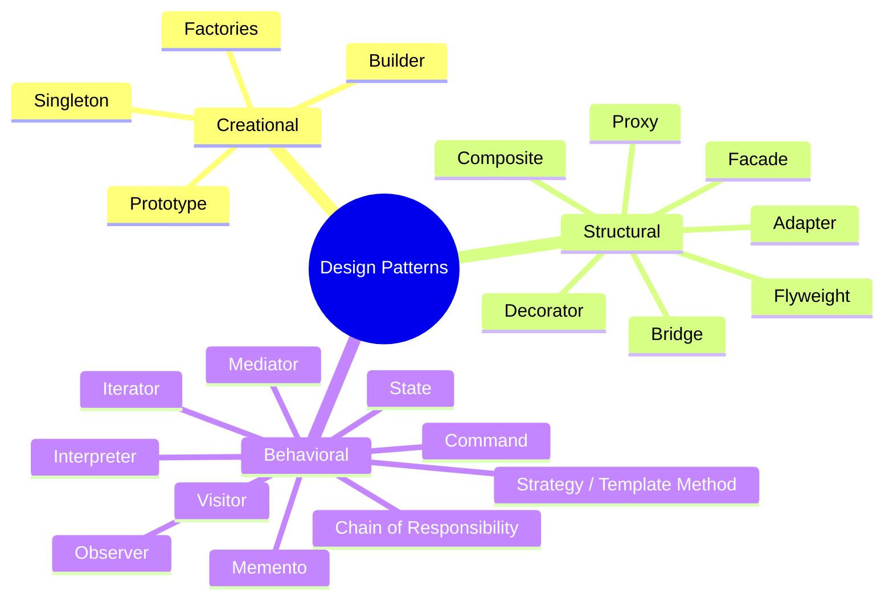
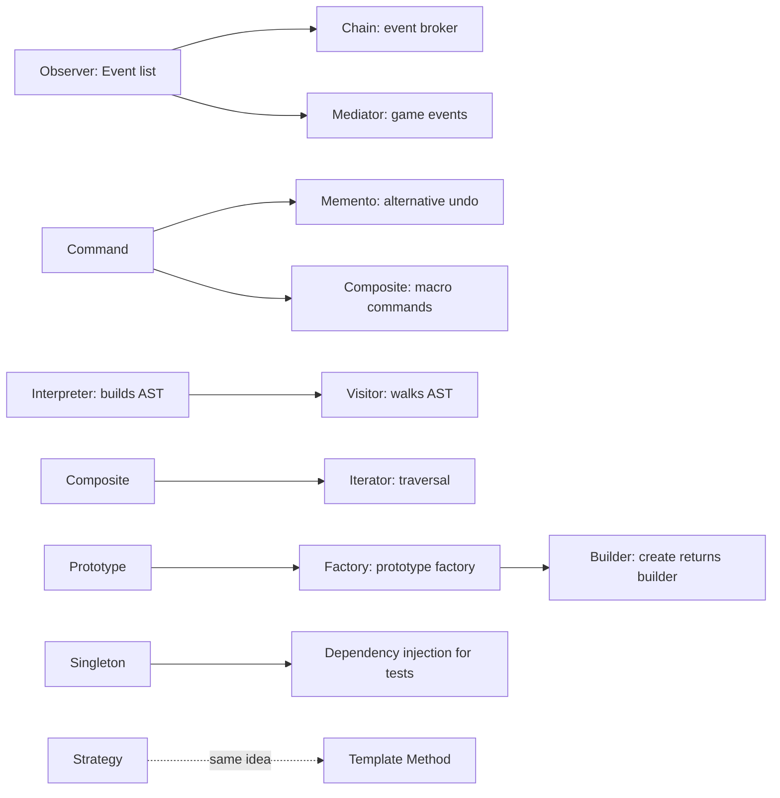
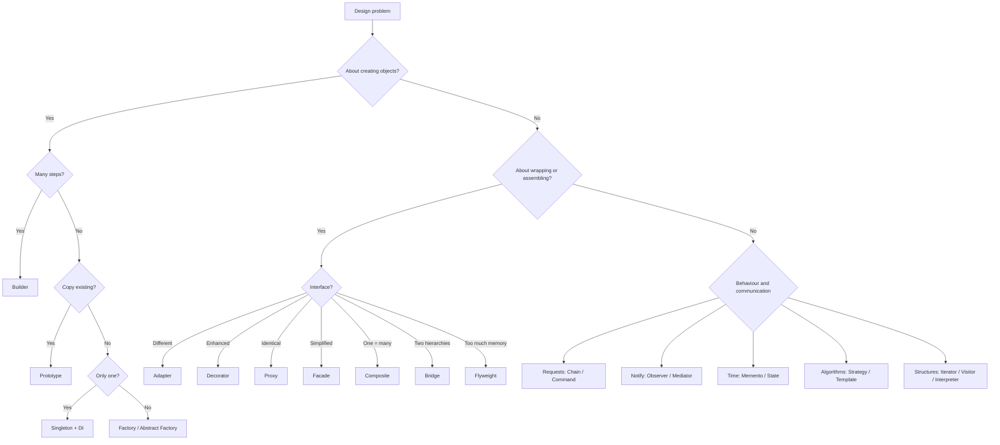
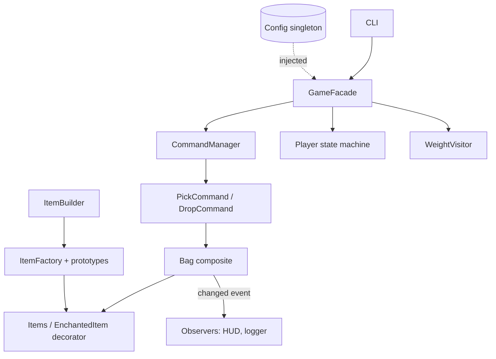

# 🧭 Design Patterns in Python: Course Summary and Capstone Revision Guide

> A one-document revision guide to **all 23 Gang of Four design patterns** covered in the course: 5 creational, 7 structural and 11 behavioural. Each pattern gets a definition, the course's key insight, a minimal Python sketch, and the pitfalls found in the course code. Use it to revise before an interview, and go back to the three detailed guides for depth.

---

## 📑 Table of Contents

1. [Session Overview](#-session-overview)
2. [Learning Objectives](#-learning-objectives)
3. [Detailed Notes](#-detailed-notes)
    1. [Part 1: Creational Patterns](#-part-1-creational-patterns)
    2. [Part 2: Structural Patterns](#-part-2-structural-patterns)
    3. [Part 3: Behavioral Patterns](#-part-3-behavioral-patterns)
    4. [Part 4: Connecting the Patterns](#-part-4-connecting-the-patterns)
4. [Glossary](#-glossary)
5. [One-Minute Revision](#-one-minute-revision)
6. [Cheat Sheet](#-cheat-sheet)
7. [Interview Questions and Answers](#-interview-questions-and-answers)
8. [Scenario-Based Questions](#-scenario-based-questions)
9. [Hands-on Exercises](#-hands-on-exercises)
10. [Practice Assignment](#-practice-assignment)
11. [Additional Resources](#-additional-resources)
12. [Final Revision Sheet](#-final-revision-sheet)

---

## 🗺 Session Overview

The summary lecture walks through every pattern in the course in one sitting, in three families:

| Family | Question it answers | Patterns |
|--------|---------------------|----------|
| **Creational** | *How is an object made?* | Builder · Factories (Factory Method, Factory, Abstract Factory) · Prototype · Singleton |
| **Structural** | *How are objects assembled and wrapped?* | Adapter · Bridge · Composite · Decorator · Facade · Flyweight · Proxy |
| **Behavioral** | *Who does what, and when?* | Chain of Responsibility · Command · Interpreter · Iterator · Mediator · Memento · Observer · State · Strategy & Template Method · Visitor |

> 📌 **Counting:** The summary groups Factory Method and Abstract Factory (plus the non-GoF "factory class") as **Factories**, and pairs Strategy with Template Method. Counted individually, that's **5 creational + 7 structural + 11 behavioural = 23**, the full Gang of Four catalogue. Counted the way the lecture groups them, it's 4 + 7 + 10.



### 💡 Themes That Recur Through the Course

The summary keeps coming back to a few ideas:

| Theme | Where it shows up |
|-------|-------------------|
| **Open–Closed Principle** (extend, don't modify) | Decorator, Proxy, Visitor, builder inheritance, Bridge's trade-off |
| **Composition over inheritance** | Bridge, Decorator, Strategy (vs Template Method), Mediator |
| **Python makes some patterns trivial** | Decorators, iterators and `yield`, duck typing (optional ABCs), dynamic dispatch (no double dispatch needed) |
| **Testability through injection** | Singleton fixed by dependency injection, Strategy dummies, DIP |
| **Use frameworks for heavy lifting** | State machines, reactive streams for observer and mediator, parser generators |

> 📎 **Related guides:** This summary is the capstone to the four detailed guides already delivered: *SOLID Design Principles*, *Creational Design Patterns*, *Structural Design Patterns* and *Behavioral Design Patterns*. Each pattern here lists the **course-code pitfalls** found in those guides, so you can revise them in one place.

---

## 🎯 Learning Objectives

By the end of this guide you should be able to:

- [ ] Name all 23 patterns, put each in its family, and state its intent in one sentence.
- [ ] Recall the **key Python idiom** for each pattern (return `self`, `deepcopy`, metaclass `__call__`, `yield self`, `Event(list)`, `singledispatchmethod`…).
- [ ] Distinguish look-alike patterns: Adapter / Decorator / Proxy / Facade, Strategy / Template Method / State, Command / Memento, Observer / Mediator / Chain.
- [ ] Explain why some patterns are **built into Python** (functional decorators, iterators) and why Python makes others optional (abstract bases, double dispatch).
- [ ] Explain **CQS vs CQRS**, and why the lecture links Command to eventual consistency.
- [ ] Choose a pattern for a given design problem, and justify the trade-offs in an interview.

---

## 📘 Detailed Notes

The notes follow the summary lecture's order: one Part per pattern family, each pattern as its own section, then a final Part on how the patterns relate to each other.

### 🏭 Part 1: Creational Patterns

Creational patterns control **how objects come into existence**: step by step, through a named creator, by copying, or exactly once.

```text
How is the object created?
  ├── in several steps ............... BUILDER
  ├── in one step, but needs a name .. FACTORY METHOD / FACTORY
  ├── as a family of related types ... ABSTRACT FACTORY
  ├── by copying an existing one ..... PROTOTYPE
  └── only ever once ................. SINGLETON
```

#### 🧱 Builder

> 📖 A **separate component** for when construction is too complicated for a single statement, and the object has to be initialised over **several calls**.

**From the summary:**
- For very complex objects, use **several cooperating sub-builders** (facets), one per aspect of the object.
- Builders usually have a **fluent interface**, made *"simply by returning self"*.

```python
class HtmlBuilder:
    def __init__(self, root):
        self.root, self.children = root, []

    def add_child(self, tag, text):
        self.children.append(f'  <{tag}>{text}</{tag}>')
        return self                                   # fluent

    def __str__(self):
        return '\n'.join([f'<{self.root}>', *self.children, f'</{self.root}>'])


print(HtmlBuilder('ul').add_child('li', 'hello').add_child('li', 'world'))
```

⚠️ **Course-code pitfalls:** `HtmlBuilder.__root` was a **class attribute shared by every builder**, and the facets demo printed the postcode as the job title. Facets break OCP; **builder inheritance** fixes that.

🎯 **Remember:** piecewise construction · `return self` · facets vs inheritance.

#### 🏗 Factories: Factory Method, Factory Class, Abstract Factory

> 📖 **Factory method:** any method that creates an object. It's more expressive than an initialiser because it has a **unique name**. **Factory:** a standalone or **inner** class grouping such methods. **Abstract factory:** a **hierarchy of factories** matching a hierarchy of products.

**From the summary:**
- You can have **several factory methods with the same argument types but different names**. Python can't overload `__init__`, so this is how you get `new_cartesian(x, y)` and `new_polar(rho, theta)`.
- An **inner factory class** adds coupling, but the factory and its product *"are tightly coupled anyway."*

```python
from math import cos, sin


class Point:
    def __init__(self, x=0.0, y=0.0):
        self.x, self.y = x, y

    @classmethod
    def new_cartesian(cls, x, y):
        return cls(x, y)

    @classmethod
    def new_polar(cls, rho, theta):                # same arg types, different name
        return cls(rho * cos(theta), rho * sin(theta))
```

⚠️ **Course-code pitfalls:** The polar formula **swapped sin and cos**. `HotDrinkMachine` set `self.initialized` on the instance, so its factory list **duplicated** on every new machine. It also used `eval` to find factory classes.

🎯 **Remember:** named creators · standalone vs inner factory · factory hierarchy ↔ product hierarchy.

#### 🧬 Prototype

> 📖 Make an object **from an existing object** rather than from scratch, then customise it.

**From the summary:**
- Correct replication needs a **deep copy**, *"recursively, including all of its members and their members to infinity."* Python's `copy.deepcopy` provides this.
- A **prototype factory** makes it convenient: keep a few predefined prototypes, then deep-copy and customise them on request.

```python
import copy


class Employee:
    def __init__(self, name, office):
        self.name, self.office = name, office


MAIN = Employee('', {'street': '123 East Dr', 'suite': 0})


def new_main_office_employee(name, suite):
    e = copy.deepcopy(MAIN)            # never share nested state with the prototype
    e.name, e.office['suite'] = name, suite
    return e


john = new_main_office_employee('John', 101)
print(john.office, MAIN.office)        # suite 101 vs suite 0
```

⚠️ **Pitfalls:** `copy.copy` is **shallow**, so nested objects are shared. Mutable default arguments (`Line(start=Point())`) share one object across every call.

🎯 **Remember:** `=` is a reference · `copy` is shallow · **`deepcopy` is the prototype**.

#### 🔒 Singleton

> 📖 Ensures **only one instance** of a class exists. The summary calls it *"probably the most controversial design pattern."*

**From the summary:**
- It's easy to make a **reusable** singleton with a **decorator** or a **metaclass**.
- Its testability problems are solved by **dependency injection**, and the lecture means the simple kind: *"inject the class to be used as the singleton into the constructor… by hand… as a parameter"*, not a heavyweight DI framework.

```python
class Singleton(type):
    _instances = {}

    def __call__(cls, *args, **kwargs):
        if cls not in cls._instances:
            cls._instances[cls] = super().__call__(*args, **kwargs)
        return cls._instances[cls]


class Database(metaclass=Singleton):
    def __init__(self):
        self.population = {'Seoul': 17_500_000}


class RecordFinder:
    def __init__(self, db=None):                  # hand-rolled DI
        self.db = db if db is not None else Database()


class DummyDb:
    population = {'alpha': 1}


assert Database() is Database()
assert RecordFinder(DummyDb()).db.population['alpha'] == 1   # test without the real DB
```

⚠️ **Course-code pitfalls:** The `__new__`-only singleton **re-runs `__init__`** on every call. Monostate shared one dictionary across **all subclasses**. Add a lock for thread safety.

🎯 **Remember:** metaclass is the nicest · `is`, not `==`, to check · **inject it** for tests.

---

### 🧩 Part 2: Structural Patterns

Structural patterns are about **wrapping, connecting, grouping, simplifying and sharing** objects. They differ mainly in the **interface the client ends up seeing**.

```text
Interface the client sees after wrapping:
  ADAPTER   → a DIFFERENT interface (the one you need)
  DECORATOR → the SAME interface plus extra behaviour
  PROXY     → the IDENTICAL interface, with controlled behaviour
  FACADE    → a NEW, SIMPLER interface over many objects
  COMPOSITE → ONE interface for a single object and a group
  BRIDGE    → abstraction ↔ implementation, linked by a reference
  FLYWEIGHT → unchanged interface, with data SHARED underneath
```

#### 🔌 Adapter

> 📖 Converts the interface you're **given** into the interface you **need**.

**From the summary:** another developer hands you an interface and says *"this is the only interface you're going to have"*, while your own data structures look different, so you adapt between them.

```python
class SquareToRectangleAdapter:                 # Square has .side; callers expect .width/.height
    def __init__(self, square):
        self.square = square

    @property
    def width(self): return self.square.side

    @property
    def height(self): return self.square.side
```

⚠️ **Pitfalls:** Adapters create **temporary objects**, so cache them, keyed by **value**, not identity, and bounded. The course's line-to-points adapter used `min` where it needed `max`, so **vertical lines produced no points**.

#### 🌉 Bridge

> 📖 **Decouples abstraction from implementation**, avoiding the **Cartesian-product explosion** of subclasses.

**From the summary:** it works by *"introducing dependencies… in our case it was initializer dependencies"*. In other words, you pass the implementation into `__init__`.

```python
class Circle:
    def __init__(self, renderer, radius):     # the bridge: an injected dependency
        self.renderer, self.radius = renderer, radius

    def draw(self):
        return self.renderer.render_circle(self.radius)
```

📝 n shapes × m renderers → **n + m** classes instead of **n·m**. The trade-off: every renderer still has to support every shape.

#### 🌳 Composite

> 📖 Lets clients treat **individual objects and compositions of objects uniformly**.

```python
class Neuron:
    def __init__(self):
        self.outputs, self.inputs = [], []

    def __iter__(self):
        yield self                             # a scalar masquerading as a collection


class Layer(list):
    pass


def connect(a, b):                             # one function handles every combination
    for s in a:
        for o in b:
            s.outputs.append(o)
            o.inputs.append(s)
```

⚠️ **Pitfall:** use `is` for self-checks. `==` on list subclasses compares their **contents**.

#### 🎁 Decorator

> 📖 **Attaches additional responsibilities** to objects without modifying them or inheriting from them.

**From the summary:**
- Python's **functional decorator** (`@something`) wraps a function with another function, for example to measure execution time. It's *"not directly related"* to the GoF decorator.
- Decorators were used *all over the course*: `@property`, `@staticmethod`, `@abstractmethod`, and the **singleton decorator**.

```python
import functools
import time


def time_it(func):
    @functools.wraps(func)
    def wrapper(*args, **kwargs):
        start = time.perf_counter()
        try:
            return func(*args, **kwargs)
        finally:
            print(f'{func.__name__} took {(time.perf_counter() - start) * 1000:.0f}ms')
    return wrapper


class ColoredShape:                            # GoF decorator: wraps an object
    def __init__(self, shape, color):
        self.shape, self.color = shape, color

    def __str__(self):
        return f'{self.shape} has the color {self.color}'
```

⚠️ **Course-code pitfalls:** `time_it` **dropped the return value** and accepted no arguments. The dynamic decorator's `setattr` was **missing its value argument**.

#### 🏠 Facade

> 📖 A **single, unified, friendly interface** over a set of interfaces and types, which hides *"all the gory implementation details"*.

**From the summary:** you can still **expose the low-level features** to power users. *"If they understand exactly how the system works, then why not let them?"*

```python
class Console:                                  # facade
    def __init__(self):
        self.buffer = []                        # low-level parts stay reachable

    def write(self, text):                      # one friendly call
        self.buffer.extend(text)
```

⚠️ **Course-code pitfalls:** `Buffer.write` appended **after the 600 blank cells**, so `get_char_at(0)` returned a space. `Viewport.append` raised a `TypeError`.

#### 🪶 Flyweight

> 📖 An **efficiency technique** that supports a *large number of similar objects* without spending huge amounts of memory, by **sharing** the common data.

```python
class User:
    _strings: list[str] = []
    _index: dict[str, int] = {}

    def __init__(self, full_name):
        self.names = [self._intern(p) for p in full_name.split(' ')]

    @classmethod
    def _intern(cls, s):
        if s not in cls._index:
            cls._index[s] = len(cls._strings)
            cls._strings.append(s)
        return cls._index[s]

    def __str__(self):
        return ' '.join(self._strings[i] for i in self.names)
```

📝 10,000 users made from 100 first names × 100 last names store only **200 strings**. Text formatting uses **ranges** instead of a flag per character. ⚠️ The course used O(n) list lookups for the string pool. A dict is O(1).

#### 🛡 Proxy

> 📖 A **surrogate object** that forwards calls to the real object while performing additional functions, such as **access control**.

```python
class CarProxy:
    def __init__(self, driver):
        self.driver, self._car = driver, Car(driver)

    def drive(self):                           # same interface, guarded
        if self.driver.age >= 16:
            self._car.drive()
        else:
            print('Driver too young')
```

📝 Kinds of proxy: **protection** (access control), **virtual** (lazy creation, like `LazyBitmap`), **communication** (remote), and **logging**. A proxy **keeps** the interface. A decorator **enhances** it.

---

### 🎭 Part 3: Behavioral Patterns

Behavioural patterns divide up **responsibility and communication**. Most of them turn something into an object: a request, a state, an algorithm or an operation.

#### ⛓ Chain of Responsibility

> 📖 Components **process information or events in a chain**, one after another.

**From the summary:** there are two implementations:
1. A **method chain**, where each element refers to the next one (a linked list).
2. An **event broker**, a list you go through to notify each element in turn, because *"an event is essentially just a list of functions that you can call one after another."*

```python
class Event(list):
    def __call__(self, *args, **kwargs):
        for handler in list(self):              # copy, so handlers may unsubscribe safely
            handler(*args, **kwargs)
```

⚠️ **Course-code pitfall:** the broker's `defense` query started from the **attack** value.

#### 📨 Command

> 📖 **Encapsulates a request in a separate object.** Instead of calling something directly, you package the request and send it to be processed.

**From the summary:** it's good for **audit**, **replaying** a sequence of events, and **undo/redo**. It's also part of **CQS/CQRS**.

```python
class DepositCommand:
    def __init__(self, account, amount):
        self.account, self.amount, self.success = account, amount, False

    def invoke(self):
        self.account.balance += self.amount
        self.success = True

    def undo(self):
        if self.success:                        # never undo what didn't happen
            self.account.balance -= self.amount
```

> 🔍 **CQS vs CQRS (clarifying the lecture):** The summary blends two related ideas.
> - **CQS (Command–Query Separation):** a *method-level* principle. A method either **changes state** (a command) or **returns data** (a query), never both.
> - **CQRS (Command Query Responsibility Segregation):** an *architecture-level* pattern. **Separate write and read models or systems**, often synchronised asynchronously, which is where the lecture's **eventual consistency** (vs immediate consistency) comes in.
>
> The lecture notes CQRS belongs in an *enterprise patterns* course rather than this one.

⚠️ **Pitfalls:** A naive **composite (macro) transfer** deposited money even after the withdrawal failed. Transfers need all-or-nothing logic.

#### 🗣 Interpreter

> 📖 **Transforms textual input into object-oriented structures**, which can then be traversed, for example with a **Visitor**, to produce output.

**From the summary:** *"it's everywhere"*: interpreters, compilers, static analysis tools. The academic version is **compiler theory**, which is *"a bit niche"* at universities, but *"worth knowing"* if you work on tools such as static analysers.

```text
"1+(2-3)"  ──lex──►  [1] [+] [(] [2] [-] [3] [)]  ──parse──►  Add(1, Sub(2, 3))  ──visit──►  0
```

⚠️ **Course-code pitfall:** the handmade lexer **dropped a number at the end of the input**, so `'1+2'` crashed. The parser couldn't chain operations (`1+2+(3-4)` gave 0).

#### 🔁 Iterator

> 📖 An interface for **accessing the elements of an aggregate object** one after another.

**From the summary:** `__iter__` and `__next__` work, but they're **stateful** and often lead to *"really ugly implementations"*. **`yield`** makes iteration read *"more like… an algorithm description in Wikipedia"*. *"I prefer the yield approach."*

```python
def in_order(node):
    if node.left:
        yield from in_order(node.left)
    yield node.value
    if node.right:
        yield from in_order(node.right)
```

⚠️ **Pitfall:** a hand-written iterator should also define `__iter__` returning `self`. The course's `InOrderIterator` didn't.

#### 🤝 Mediator

> 📖 Provides **mediation services between two or more objects**, so objects can **enter and leave the system without knowing about each other**. A chat room is the typical example.

```python
class ChatRoom:
    def __init__(self):
        self.people = []

    def broadcast(self, source, message):
        for p in self.people:
            if p.name != source:
                p.receive(source, message)
```

#### 💾 Memento

> 📖 A **token representing the system state**, used to **roll the system back** to that state.

**From the summary:** *"The memento itself doesn't have any API for manipulating the system."* You feed it into some API (`restore`), and that API rolls the system back.

```python
class Memento:
    def __init__(self, balance):
        self.balance = balance                 # an opaque snapshot


class Account:
    def __init__(self, balance=0):
        self.balance = balance

    def deposit(self, amount):
        self.balance += amount
        return Memento(self.balance)

    def restore(self, m):
        self.balance = m.balance
```

⚠️ **Course-code pitfall:** the undo/redo history **didn't truncate the redo branch** after a new change. Snapshot **by value** (`deepcopy`).

#### 👀 Observer

> 📖 Allows **notification of changes** or other happenings in one component. Other components **subscribe** and get notified.

```python
class Person:
    def __init__(self):
        self.falls_ill = Event()              # the Event(list) from the Chain section

    def catch_a_cold(self):
        self.falls_ill('Sherlock')
```

⚠️ **Pitfalls:** **Unsubscribing during notification** skipped the next subscriber in the course code, so iterate a copy. Dependent properties (`can_vote` from `age`) need old/new comparison, and that doesn't scale.

#### 🚦 State

> 📖 Model a system as a **set of states** and the **transitions** between them: a **(finite) state machine**.

**From the summary:** the course hand-rolled several state machines, which is fine when they're simple. But *"you do typically work with frameworks rather than hand-rolling"* them, because frameworks offer much more: guards, entry and exit actions, and so on.

```python
from enum import Enum, auto


class S(Enum):
    LOCKED = auto()
    OPEN = auto()


rules = {S.LOCKED: {'coin': S.OPEN}, S.OPEN: {'push': S.LOCKED}}
state = S.LOCKED
for trigger in ['coin', 'push']:
    state = rules[state].get(trigger, state)
print(state)        # S.LOCKED
```

📎 Python frameworks to look at: **`transitions`** and **`python-statemachine`**.

#### ♟📋 Strategy and Template Method

> 📖 Both define a **skeleton** (a high-level description of an algorithm) whose **details are filled in by the implementer**. They differ in mechanism.

**From the summary:** *"Strategy is boring, it just uses ordinary composition"*: you take the parts as initialiser parameters. *"The template method is a bit smarter because it uses inheritance"*: a base class with abstract members plus the algorithm that uses them, and subclasses supply the implementations.

```python
from abc import ABC, abstractmethod


class Processor:                                  # STRATEGY: composition
    def __init__(self, fmt):
        self.fmt = fmt

    def render(self, items):
        return ''.join(self.fmt(i) for i in items)


class Game(ABC):                                  # TEMPLATE METHOD: inheritance
    def run(self):
        self.start()
        while not self.have_winner():
            self.take_turn()
        return self.winner()

    @abstractmethod
    def start(self): ...

    @abstractmethod
    def have_winner(self): ...

    @abstractmethod
    def take_turn(self): ...

    @abstractmethod
    def winner(self): ...
```

📝 "Boring" and "smarter" are the instructor's tongue-in-cheek labels, not a ranking. Composition is usually **more flexible** (swap at runtime, easy to test). Inheritance fixes the variation when you define the class.

#### 🧳 Visitor

> 📖 Allows **non-intrusive addition of functionality to hierarchies**, and traversal of complicated data structures that may reference each other.

```python
from functools import singledispatchmethod


class Num:
    def __init__(self, v): self.v = v


class Add:
    def __init__(self, l, r): self.l, self.r = l, r


class Evaluator:
    @singledispatchmethod
    def visit(self, e):
        raise TypeError(type(e).__name__)

    @visit.register
    def _(self, e: Num): return e.v

    @visit.register
    def _(self, e: Add): return self.visit(e.l) + self.visit(e.r)


print(Evaluator().visit(Add(Num(1), Add(Num(2), Num(3)))))   # 6
```

📝 Python doesn't need classic **double dispatch** (`accept` → `visit`). It can dispatch on the runtime type directly.

---

### 🔗 Part 4: Connecting the Patterns

The summary presents the patterns one at a time, but the course examples **built on each other**. Seeing those links is what turns a list of patterns into design skill.

#### 🧠 How the Patterns Relate



| Link in the course | What it teaches |
|--------------------|-----------------|
| `Event(list)` powers **Observer**, the **Chain** broker and the **Mediator** game | One small primitive supports three patterns |
| **Command** undo vs **Memento** snapshots | Two ways to go back in time |
| **Composite** + **Command** = a macro | Patterns combine |
| **Interpreter** → **Visitor** | Build a tree, then operate on it |
| **Prototype factory**, **`HtmlElement.create()`** returning a builder | Creational patterns cooperate |
| **Singleton** + **DI** | Fixing a pattern's weakness with a principle |
| **Strategy** vs **Template Method** | Composition vs inheritance for the same goal |

#### ⚖ Look-Alike Patterns, Side by Side

| Group | How to tell them apart |
|-------|------------------------|
| Adapter / Decorator / Proxy / Facade | Different / enhanced / identical / simplified interface |
| Strategy / Template Method / State | Composition / inheritance / self-changing behaviour driven by triggers |
| Command / Memento | Stores **operations** / stores **snapshots** |
| Observer / Mediator / Chain | One-to-many broadcast / routed through a hub / **ordered** and stoppable |
| Iterator / Visitor | **How to walk** / **what to do** at each node |
| Builder / Factory | **Piecewise** / **wholesale** |
| Flyweight / Singleton | Many objects **share data** / **one object** total |

#### 🐍 What Python Changes

| Pattern | Python-specific twist from the course |
|---------|----------------------------------------|
| Decorator | Built into the language as `@decorator` (functional) |
| Iterator | Built-in protocol, and `yield` generators |
| Singleton | The metaclass `__call__` is the cleanest. A module-level instance is also Pythonic |
| Abstract Factory / Strategy / Observer | ABCs are **optional** thanks to duck typing, but still document the API |
| Visitor | No double dispatch needed. Use `singledispatchmethod` |
| Builder inheritance | Works without recursive generics, because `self` is the runtime object |
| Prototype | `copy.deepcopy` |

#### 🎯 Key Takeaways

- **Patterns compose.** Real designs combine several of them, each owning one responsibility.
- Learn the **distinguishing question** for each look-alike group.
- Python **absorbs** some patterns into the language. Use the idiom, not a Java translation.
- Use **frameworks** where the summary suggests them (state machines, reactive streams, parsers).

---

## 📚 Glossary

| Term | Definition | Why It Matters |
|------|------------|----------------|
| **Design pattern** | A reusable solution to a recurring design problem | A shared vocabulary for design |
| **Gang of Four (GoF)** | Gamma, Helm, Johnson and Vlissides, authors of *Design Patterns* (1994) | The source of the 23 classic patterns |
| **Creational / Structural / Behavioral** | The three GoF families: creation, composition, communication | Organises the catalogue |
| **Fluent interface** | Methods return `self` so calls can be chained | Readable builders |
| **Sub-builder (facet)** | A builder for one aspect of a complex object | Splits construction |
| **Factory method** | A named method that creates an object | Explicit, overload-free construction |
| **Inner factory** | A factory class nested in the product class | Discoverability, at the cost of coupling |
| **Abstract factory** | A hierarchy of factories for a hierarchy of products | Families of related objects |
| **Deep copy** | A recursive copy of an object and all its members | Correct prototypes |
| **Prototype factory** | Predefined prototypes plus methods that clone and customise them | Convenient cloning |
| **Metaclass** | The class of a class. Its `__call__` controls instantiation | The cleanest singleton |
| **Dependency injection** | Passing dependencies in (for example to the constructor) rather than creating them | Fixes singleton testability |
| **Cartesian-product explosion** | One class per combination of two dimensions | Solved by Bridge |
| **Functional decorator** | A Python function that wraps another function (`@time_it`) | Built into the language. Not the GoF decorator |
| **Surrogate** | A stand-in object (a proxy) | Access control, laziness, remoting |
| **Event** | A list of callables invoked one after another | Powers observer, chain and mediator |
| **Event broker** | A central event that handlers subscribe to | A dynamic chain of responsibility |
| **CQS** | Command–Query Separation: methods either change state or return data | Clean APIs |
| **CQRS** | Command Query Responsibility Segregation: separate read and write models | Scalability, eventual consistency |
| **Eventual consistency** | Replicas or models converge over time, not immediately | The CQRS trade-off |
| **Compiler theory** | The study of lexing, parsing and code generation | The full version of Interpreter |
| **`yield`** | Pauses a generator function and produces a value | Clean iterators |
| **Token / snapshot** | An opaque memento holding state | Rollback |
| **Finite state machine** | A set of states with defined transitions | Models lifecycles. Use frameworks for complex ones |
| **Composition vs inheritance** | Has-a (Strategy) vs is-a (Template Method) | A core design trade-off |
| **Double dispatch** | Choosing a method by two runtime types (`accept` → `visit`) | Optional in Python |
| **Non-intrusive** | Adds behaviour without modifying the existing classes | The goal of Visitor and Decorator |

---

## 📝 One-Minute Revision

- **Builder:** multi-call construction · **sub-builders** for complex objects · **fluent** by returning `self`.
- **Factories:** named factory methods (same arguments, different names) · standalone or **inner** factory · 
- **abstract factory** hierarchy.
- **Prototype:** copy an existing object with **deep copy** · a **prototype factory** for convenience.
- **Singleton:** "the most controversial" · **decorator or metaclass** · testability fixed by **hand-rolled DI**.
- **Adapter:** your interface → the one you're given · 
- **Bridge:** decouple abstraction and implementation through injected dependencies · 
- **Composite:** one and many treated uniformly.
- **Decorator:** add responsibilities without modifying or inheriting · Python's `@` is a *functional* decorator.
- **Facade:** a friendly API, with low-level access kept for power users · 
- **Flyweight:** share data, save memory · 
- **Proxy:** a surrogate that forwards calls and adds functions.
- **Chain:** method chain or event broker · 
- **Command:** a request as an object (audit, replay, undo, CQRS).
- **Interpreter:** text → objects, then visit · 
- **Iterator:** prefer **`yield`** · 
- **Mediator:** a chat room hub · 
- **Memento:** a state token.
- **Observer:** subscribe and get notified · 
- **State:** an FSM, so **use frameworks** · 
- **Strategy** (composition) vs **Template Method** (inheritance) · 
- **Visitor:** non-intrusive operations over hierarchies.

---

## 📄 Cheat Sheet

### 🧾 All 23 Patterns at a Glance

| # | Pattern | Family | Intent in one line | Python idiom |
|---|---------|--------|--------------------|--------------|
| 1 | Builder | C | Build in steps | `return self` |
| 2 | Factory Method | C | Named creation | `@classmethod def new_x(cls, ...)` |
| 3 | Abstract Factory | C | Families of products | `class XFactory(ABC)` + subclasses |
| 4 | Prototype | C | Clone and customise | `copy.deepcopy(proto)` |
| 5 | Singleton | C | One instance | Metaclass `__call__` cache |
| 6 | Adapter | S | Convert an interface | Properties delegating to the adaptee |
| 7 | Bridge | S | Two hierarchies through a reference | `self.renderer = renderer` |
| 8 | Composite | S | One and many alike | `def __iter__(self): yield self` |
| 9 | Decorator | S | Add behaviour | `@functools.wraps` wrapper / wrapping class |
| 10 | Facade | S | Simplify a subsystem | One class with high-level methods |
| 11 | Flyweight | S | Share data | Index into a shared pool |
| 12 | Proxy | S | Control access | Same methods, guarded or lazy |
| 13 | Chain of Responsibility | B | Pass along a chain | `super().handle()` / `Event` |
| 14 | Command | B | A request as an object | `invoke()` / `undo()` |
| 15 | Interpreter | B | Text → objects | `lex` → `parse` → evaluate |
| 16 | Iterator | B | Traverse | `yield` / `yield from` |
| 17 | Mediator | B | A central hub | `room.broadcast(...)` |
| 18 | Memento | B | A snapshot token | `m = obj.save(); obj.restore(m)` |
| 19 | Observer | B | Subscribe and notify | `class Event(list): __call__` |
| 20 | State | B | Behaviour by state | `rules[state][trigger]` |
| 21 | Strategy | B | Pluggable algorithm (composition) | Pass an object or function |
| 22 | Template Method | B | Skeleton with hooks (inheritance) | Base `run()` with abstract steps |
| 23 | Visitor | B | Operations over a hierarchy | `@singledispatchmethod` |

### 🧭 Choosing a Pattern



### ⚠️ Course-Code Pitfalls: The Complete List

| Family | File / pattern | Pitfall |
|--------|----------------|---------|
| SOLID | SRP / LSP / DIP files | Missing `@staticmethod` · no-op `Square` setters · class-level shared list · wrong inverse relationship · `@abstractmethod` without `ABC` |
| Creational | Builder | Shared class-level root · postcode printed as the position |
| Creational | Factories | sin and cos swapped · `self.initialized` duplicates factories · `eval` |
| Creational | Singleton | `__new__` re-runs `__init__` · Monostate dictionary shared across subclasses · missing `id` attribute crash |
| Structural | Adapter | `bottom = min` (vertical lines lost) · identity-keyed, unbounded cache |
| Structural | Decorator | `time_it` drops the result and takes no arguments · `setattr` missing its value |
| Structural | Facade | `write` appends after the buffer · `Viewport.append` `TypeError` · mutable default |
| Behavioral | Chain | `defense` seeded from attack · adjacent string literals drop an apostrophe |
| Behavioral | Interpreter | **A trailing number is dropped** · no chaining or nesting |
| Behavioral | Memento | **The redo branch isn't truncated** |
| Behavioral | Observer | **Unsubscribe during iteration skips a handler** |
| Behavioral | Iterator / Visitor | Iterator without `__iter__` · the visitor's error message raises `ValueError` |

---

## 🎤 Interview Questions and Answers

### 🟢 Beginner

**❓ Q1. What are the three families of design patterns?**

✅ **Answer:** Creational (object creation), structural (object composition) and behavioural (communication and responsibility).

💡 **Explanation:** The GoF catalogue has 5 creational, 7 structural and 11 behavioural patterns.

🎯 **Why Interviewers Ask This:** Baseline vocabulary.

➡️ **Possible Follow-up:** Name two patterns from each family.

---

**❓ Q2. When do you need a Builder?**

✅ **Answer:** When an object can't be created in one statement and has to be initialised over several calls.

💡 **Explanation:** You can split it into cooperating sub-builders, and make it fluent by returning `self`.

🎯 **Why Interviewers Ask This:** Tests whether you can tell it apart from a factory.

➡️ **Possible Follow-up:** How do you make a builder fluent?

---

**❓ Q3. Why is a factory method more expressive than an initialiser?**

✅ **Answer:** It has a unique, descriptive name, and you can have several with the same argument types but different meanings.

💡 **Explanation:** `Point.new_cartesian(x, y)` vs `Point.new_polar(rho, theta)`. Python can't overload `__init__`.

🎯 **Why Interviewers Ask This:** Practical API design.

➡️ **Possible Follow-up:** `@staticmethod` or `@classmethod` for a factory?

---

**❓ Q4. What does Prototype require to work correctly?**

✅ **Answer:** A deep copy, which recursively copies all members, so the clone shares no mutable state with the prototype.

💡 **Explanation:** In Python that's `copy.deepcopy`. A prototype factory wraps clone-and-customise in one call.

🎯 **Why Interviewers Ask This:** Tests understanding of copy semantics.

➡️ **Possible Follow-up:** What goes wrong with `copy.copy`?

---

**❓ Q5. Why is Singleton controversial, and how do you mitigate that?**

✅ **Answer:** It introduces hidden global state and hard-wired dependencies, which hurt testing. Mitigate it by injecting the instance through the constructor.

💡 **Explanation:** The lecture means simple, hand-rolled DI ("provide it as a parameter"), not a framework.

🎯 **Why Interviewers Ask This:** Tests design judgement.

➡️ **Possible Follow-up:** Implement a singleton with a metaclass.

---

**❓ Q6. What does an Adapter do?**

✅ **Answer:** It converts the interface you have into the interface you've been given or need, without changing either side.

💡 **Explanation:** For example, a square adapted to `.width` and `.height`, or lines adapted to points.

🎯 **Why Interviewers Ask This:** One of the most commonly used patterns.

➡️ **Possible Follow-up:** How does it differ from a facade?

---

**❓ Q7. What is the Composite pattern?**

✅ **Answer:** It treats individual objects and groups of objects uniformly, through the same interface.

💡 **Explanation:** In Python, give a scalar `__iter__` that yields `self`, so the same code handles one item or many.

🎯 **Why Interviewers Ask This:** Trees are everywhere.

➡️ **Possible Follow-up:** Give a real-world composite.

---

**❓ Q8. Is Python's `@decorator` the GoF Decorator?**

✅ **Answer:** Not exactly. Python's is a functional decorator that wraps functions. The GoF Decorator wraps objects to add responsibilities.

💡 **Explanation:** The course uses both: `@time_it`, `@property` and the singleton decorator, as well as `ColoredShape`.

🎯 **Why Interviewers Ask This:** A common confusion.

➡️ **Possible Follow-up:** Write a timing decorator that preserves the return value.

---

**❓ Q9. What does the Command pattern enable?**

✅ **Answer:** Requests as objects, which gives you audit trails, replay, queuing, and undo/redo.

💡 **Explanation:** `invoke()` and `undo()`, with a `success` flag to guard the undo.

🎯 **Why Interviewers Ask This:** Undo/redo and job queues.

➡️ **Possible Follow-up:** How do composite commands undo?

---

**❓ Q10. Strategy vs Template Method in one sentence?**

✅ **Answer:** Both separate an algorithm's skeleton from its details. Strategy injects the details through composition, and Template Method overrides them through inheritance.

💡 **Explanation:** The instructor jokes that Strategy is "boring" and Template Method "smarter". In practice composition is usually more flexible.

🎯 **Why Interviewers Ask This:** A classic comparison.

➡️ **Possible Follow-up:** Which is easier to unit test?

---

### 🟡 Intermediate

**❓ Q11. Inner factory vs standalone factory: what's the trade-off?**

✅ **Answer:** An inner factory (`Point.Factory`) improves discoverability but adds coupling. A standalone `PointFactory` separates concerns but is harder to discover.

💡 **Explanation:** The lecture notes the factory and its product are tightly coupled anyway.

🎯 **Why Interviewers Ask This:** Tests API design judgement.

➡️ **Possible Follow-up:** When does a factory need instance (non-static) methods?

---

**❓ Q12. How does Bridge avoid the Cartesian-product explosion?**

✅ **Answer:** Instead of one subclass per combination (VectorCircle, RasterCircle…), the abstraction holds an injected implementation (`Shape(renderer)`), so the class count is n + m rather than n × m.

💡 **Explanation:** The summary describes this as "introducing dependencies" through the initialiser.

🎯 **Why Interviewers Ask This:** Composition over inheritance.

➡️ **Possible Follow-up:** What does the implementation side still have to do?

---

**❓ Q13. Adapter vs Decorator vs Proxy vs Facade?**

✅ **Answer:** They give a different, an enhanced, an identical and a simplified interface, respectively.

💡 **Explanation:** All four wrap something. Their intent and the interface they expose differ.

🎯 **Why Interviewers Ask This:** Precision about intent.

➡️ **Possible Follow-up:** Can one class be several of these at once?

---

**❓ Q14. Why should a facade expose its low-level features?**

✅ **Answer:** So power users who understand the system can fine-tune it, while everyone else uses the simple API.

💡 **Explanation:** The lecture: "If they understand exactly how the system works, then why not let them?"

🎯 **Why Interviewers Ask This:** Layered API design.

➡️ **Possible Follow-up:** Name a library with both high- and low-level APIs.

---

**❓ Q15. What are the two Chain of Responsibility implementations in the course?**

✅ **Answer:** A method chain (each handler references the next, like a linked list) and an event broker (a list of handlers called in turn).

💡 **Explanation:** "An event is essentially just a list of functions that you can call one after another."

🎯 **Why Interviewers Ask This:** Implementation variety.

➡️ **Possible Follow-up:** How does the broker remove handlers automatically?

---

**❓ Q16. CQS vs CQRS?**

✅ **Answer:** CQS is a method-level rule: a method either changes state or returns data. CQRS is an architecture with separate write and read models, often eventually consistent.

💡 **Explanation:** The summary links both to Command, and defers CQRS to an enterprise-patterns course.

🎯 **Why Interviewers Ask This:** Tests architecture literacy.

➡️ **Possible Follow-up:** What is eventual consistency, and when is it acceptable?

---

**❓ Q17. Why does the instructor prefer `yield` over `__iter__`/`__next__`?**

✅ **Answer:** Hand-written iterators are stateful and lead to ugly code (especially for trees). Generators keep their own state and read like the algorithm's description.

💡 **Explanation:** A three-line recursive in-order traversal with `yield from`.

🎯 **Why Interviewers Ask This:** Pythonic thinking.

➡️ **Possible Follow-up:** When do you still need a class-based iterator?

---

**❓ Q18. How does the Interpreter relate to the Visitor?**

✅ **Answer:** The interpreter turns text into an object tree, and a visitor traverses that tree to print, evaluate or analyse it.

💡 **Explanation:** The summary links them explicitly, and so does Python's `ast.parse` plus `ast.NodeVisitor`.

🎯 **Why Interviewers Ask This:** Tests how patterns compose.

➡️ **Possible Follow-up:** What are lexing and parsing?

---

**❓ Q19. Why does the summary recommend frameworks for state machines?**

✅ **Answer:** Simple hand-rolled FSMs are fine, but frameworks add guards, entry and exit actions, transition callbacks, visualisation and persistence, which take a lot of effort to rebuild yourself.

💡 **Explanation:** In Python, look at `transitions` and `python-statemachine`.

🎯 **Why Interviewers Ask This:** Build vs buy judgement.

➡️ **Possible Follow-up:** Design an order-lifecycle FSM.

---

**❓ Q20. Why doesn't a memento expose an API for changing the system?**

✅ **Answer:** It's an opaque token. Only the originator's API (`restore`) uses it to roll back, which keeps the internals encapsulated.

💡 **Explanation:** The summary: the memento "doesn't have any API for manipulating the system."

🎯 **Why Interviewers Ask This:** Encapsulation.

➡️ **Possible Follow-up:** How do you implement redo?

---

### 🔴 Advanced

**❓ Q21. Which patterns does Python effectively build into the language?**

✅ **Answer:**
- Iterator (the protocol and generators).
- Decorator, in functional form.
- Prototype support (`copy.deepcopy`).
- Visitor-style dispatch (`singledispatch`).
- Observer-like signals in frameworks.
- Singleton-like modules (imported once).

💡 **Explanation:** Duck typing also makes abstract base classes optional.

🎯 **Why Interviewers Ask This:** Separates Pythonic engineers from people translating Java.

➡️ **Possible Follow-up:** Which GoF patterns feel unnecessary in Python?

---

**❓ Q22. Compare three undo strategies.**

✅ **Answer:**
- **Command** (store operations and their inverses): compact, but every inverse must be correct.
- **Memento** (store snapshots): simple, but memory-heavy.
- **Event sourcing** (an append-only log plus replay): auditable, and it scales with CQRS.

💡 **Explanation:** Editors often combine commands with periodic snapshots.

🎯 **Why Interviewers Ask This:** System design.

➡️ **Possible Follow-up:** How do you undo a non-invertible action?

---

**❓ Q23. Design a testable service that needs a shared configuration.**

✅ **Answer:** Make the configuration a metaclass singleton for production, but have the service accept it as a constructor parameter that defaults to the singleton. Tests pass a fake.

💡 **Explanation:** This is exactly the summary's "inject the class… by hand" advice.

🎯 **Why Interviewers Ask This:** Practical DI.

➡️ **Possible Follow-up:** How do you reset singletons between tests?

---

**❓ Q24. When should you choose Visitor over adding methods to classes?**

✅ **Answer:** When the type hierarchy is stable and new operations are frequent. If new types are frequent, Visitor forces you to edit every visitor (the expression problem).

💡 **Explanation:** The summary describes Visitor as "non-intrusive addition of functionality to hierarchies."

🎯 **Why Interviewers Ask This:** Deep trade-off reasoning.

➡️ **Possible Follow-up:** How does pattern matching (`match`) compare?

---

**❓ Q25. How do Observer, Mediator and Chain of Responsibility differ when all three can use an event list?**

✅ **Answer:**
- **Observer:** a subject notifies all of its subscribers.
- **Mediator:** a hub routes messages between peers who don't know each other.
- **Chain:** handlers process in order and may modify or stop the request.

💡 **Explanation:** The course's `Event(list)` underlies all three demos.

🎯 **Why Interviewers Ask This:** Precision about intent.

➡️ **Possible Follow-up:** Which one fits GUI event bubbling?

---

**❓ Q26. What's the risk in the course's minimal `Event(list)` implementation?**

✅ **Answer:**
- Mutating the list during dispatch skips handlers.
- There's no exception isolation.
- Strong references keep subscribers alive.
- It isn't thread-safe.

💡 **Explanation:** Fix it by iterating a copy, using `weakref.WeakMethod`, try/except per handler, and a lock.

🎯 **Why Interviewers Ask This:** Moving from a toy to production.

➡️ **Possible Follow-up:** How do Django signals handle this?

---

**❓ Q27. Explain Flyweight's memory savings with numbers.**

✅ **Answer:** 100 first names × 100 last names gives 10,000 users. Without a flyweight you store 10,000 full-name strings. With one, you store 200 strings plus two indices per user.

💡 **Explanation:** Use a dict for O(1) interning, or `sys.intern`.

🎯 **Why Interviewers Ask This:** Quantitative reasoning.

➡️ **Possible Follow-up:** What are intrinsic and extrinsic state?

---

**❓ Q28. Why is double dispatch unnecessary in Python?**

✅ **Answer:** Python can select a method by the argument's runtime type (`singledispatchmethod`, a dispatch decorator, or `match`), so it doesn't need the `accept()` hop that statically typed languages use.

💡 **Explanation:** That's the course's visitor-decorator approach.

🎯 **Why Interviewers Ask This:** Cross-language understanding.

➡️ **Possible Follow-up:** Show double dispatch in Java.

---

**❓ Q29. Which SOLID principles do the patterns serve?**

✅ **Answer:**
- **OCP:** Decorator, Proxy, Visitor, Strategy, builder inheritance.
- **SRP:** Factory, Facade, Command.
- **DIP:** Bridge, Strategy, singleton plus DI.
- **ISP:** small role interfaces for strategies and visitors.
- **LSP:** proper substitutability in Composite and Proxy.

💡 **Explanation:** Patterns are SOLID applied to recurring problems.

🎯 **Why Interviewers Ask This:** Shows integrated understanding.

➡️ **Possible Follow-up:** Which pattern most often breaks LSP?

---

**❓ Q30. Design an e-commerce checkout using at least six patterns.**

✅ **Answer:**
- A **Builder** for the order.
- A **Strategy** for payment providers.
- **Chain of Responsibility** for validation (stock, fraud, address).
- **Command** for order actions, with compensation as the undo.
- A **State** machine for the order lifecycle.
- **Observer** for notifications (email, analytics).
- A **Facade** `CheckoutService` over all of it.
- A **Proxy** for the rate-limited payment API.

💡 **Explanation:** Each pattern owns one responsibility, and together they form a clean architecture.

🎯 **Why Interviewers Ask This:** A senior-level synthesis question.

➡️ **Possible Follow-up:** Where would Memento or Visitor fit?

---

## 🎬 Scenario-Based Questions

### 🎬 Scenario 1: Tests hit production data

> **Scenario:** Unit tests for a reporting service read from the live database because the service calls `Database()` (a singleton) internally.

1. 🔎 **Initial investigation:** Find where the singleton is constructed inside business logic.
2. 📊 **Metrics/logs:** Test runtime, flakiness when data changes, and DB connections opened by CI.
3. 🧩 **Possible causes:** A hard-wired singleton dependency.
4. 🛠 **Debugging approach:** Add a constructor parameter, `ReportService(db=None)`, defaulting to the singleton.
5. ✅ **Resolution:** Tests inject a dummy database with fixed data.
6. 🛡 **Prevention:** A review rule that business code never calls singletons directly.

### 🎬 Scenario 2: Choosing between Strategy and Template Method

> **Scenario:** A reporting engine needs PDF, CSV and HTML output, and product wants the format switchable per request.

1. 🔎 **Initial investigation:** Does the variation change at **runtime** (per request), or at **design time**?
2. 📊 **Metrics/logs:** How many formats exist and are planned, and how often they change.
3. 🧩 **Possible causes of trouble:** A Template Method hierarchy would need a new subclass and instance per format.
4. 🛠 **Debugging approach:** Prototype a `Renderer` strategy interface, and inject it per request.
5. ✅ **Resolution:** Strategy, using composition and a registry of format names to strategies.
6. 🛡 **Prevention:** Default to composition for runtime variation, and reserve inheritance for fixed skeletons.

### 🎬 Scenario 3: An undo feature corrupts history

> **Scenario:** After undo, a new edit, then redo, users see values they had discarded.

1. 🔎 **Initial investigation:** Inspect the history list and its pointer after each operation.
2. 📊 **Metrics/logs:** The history length vs the pointer.
3. 🧩 **Possible causes:** The redo branch isn't truncated (the memento bug), or commands are re-applied out of order.
4. 🛠 **Debugging approach:** Unit test the sequence `edit, edit, undo, edit, undo, redo`.
5. ✅ **Resolution:** Truncate the future history on any new change. Clear the redo stack in the command manager.
6. 🛡 **Prevention:** Property-based tests over random operation sequences.

### 🎬 Scenario 4: Memory blow-up in a game server

> **Scenario:** A game server with a million player objects runs out of memory, and profiling shows millions of duplicate strings and textures.

1. 🔎 **Initial investigation:** `tracemalloc` snapshots grouped by type.
2. 📊 **Metrics/logs:** The ratio of unique to total values for names, textures and configs.
3. 🧩 **Possible causes:** The same immutable data is stored per object.
4. 🛠 **Debugging approach:** Prototype a **Flyweight** pool (interned strings, shared textures) and measure.
5. ✅ **Resolution:** Store shared intrinsic data once, and keep only indices or extrinsic state per object. Add `__slots__`.
6. 🛡 **Prevention:** Memory budgets in CI, and design reviews for high-cardinality objects.

### 🎬 Scenario 5: An adapter layer drowns in temporary objects

> **Scenario:** An adapter converting vector shapes into pixel points regenerates millions of points on every frame.

1. 🔎 **Initial investigation:** Count the adapter instantiations and generated points per frame.
2. 📊 **Metrics/logs:** CPU profile hotspots and garbage-collection pauses.
3. 🧩 **Possible causes:** No caching of the conversions, or a cache keyed by object identity.
4. 🛠 **Debugging approach:** Add a value-keyed `lru_cache` over immutable shapes.
5. ✅ **Resolution:** A bounded, value-based cache returning immutable tuples.
6. 🛡 **Prevention:** A performance test per frame, and a cache-design checklist.

---

## 🧪 Hands-on Exercises

### 🟢 Easy

1. From memory, write one-line intents for all 23 patterns, then check them against the cheat sheet.
2. Write a fluent builder, a `@classmethod` factory pair, and a `deepcopy` prototype factory.
3. Implement a metaclass singleton and a `RecordFinder` that takes the database as an optional parameter.
4. Write a `@time_it` decorator that preserves the function's arguments, return value and metadata.

### 🟡 Medium

1. Implement an `Event` class that's safe to unsubscribe from during dispatch, and use it for Observer, Mediator and Chain demos.
2. Write a lexer and recursive-descent parser for `+ - ( )`, then add a `singledispatchmethod` visitor that prints and evaluates.
3. Build a phone state machine as a rules table, then port it to the `transitions` library and compare.
4. Implement a Strategy-based and a Template-Method-based text renderer, and compare how each is tested.

### 🔴 Advanced

1. Implement undo three ways (Command, Memento and event sourcing) for one bank account, and compare the memory and complexity.
2. Build a drawing app combining Composite (groups), Bridge (renderers), Decorator (colours), Flyweight (palette) and Proxy (lazy images).
3. Prototype a small CQRS service: a write model of commands and a read model of projections, with eventual consistency simulated by a queue.
4. Audit one of your own projects for patterns, and for missing patterns where `if/elif` chains or God objects show up.

---

## 📦 Practice Assignment

### 🎯 Objective

Build a **"Pattern Zoo" CLI**: a small text-adventure inventory system that uses at least one pattern from each family, and documents why each one was chosen.

### 📋 Requirements

- **Creational:** a `ItemBuilder` (fluent), an `ItemFactory` with prototype cloning, and a `Config` singleton that is injected.
- **Structural:** a `Bag` composite holding items and sub-bags, an `EnchantedItem` decorator, and a `GameFacade` exposing `pick()`, `drop()`, `look()` and `undo()`.
- **Behavioral:** **Command** for pick and drop with undo, **Observer** events for "inventory changed", a **State** machine for the player (`EXPLORING ↔ FIGHTING`), and a **Visitor** for the total weight.

### 🏛 Architecture



### ⚙️ Expected Functionality

| Feature | Pattern |
|---------|---------|
| Build complex items fluently | Builder |
| Clone common items from templates | Prototype factory |
| Nested bags weighed uniformly | Composite + Visitor |
| Enchanted items add bonuses | Decorator |
| Pick and drop with undo | Command |
| HUD updates on changes | Observer |
| Can't pick up items while fighting | State |
| One simple API for the CLI | Facade |

### 💻 Suggested Implementation (core)

```python
import copy
from functools import singledispatchmethod


class Event(list):
    def __call__(self, *a, **k):
        for f in list(self):
            f(*a, **k)


class Item:
    def __init__(self, name, weight):
        self.name, self.weight = name, weight


class Bag(list):
    def __init__(self, name):
        super().__init__()
        self.name = name


class WeightVisitor:
    @singledispatchmethod
    def visit(self, x):
        raise TypeError(x)

    @visit.register
    def _(self, x: Item): return x.weight

    @visit.register
    def _(self, x: Bag): return sum(self.visit(i) for i in x)


class ItemFactory:
    _protos = {'potion': Item('potion', 1), 'sword': Item('sword', 5)}

    @classmethod
    def new(cls, kind, name=None):
        item = copy.deepcopy(cls._protos[kind])
        item.name = name or item.name
        return item


class PickCommand:
    def __init__(self, bag, item):
        self.bag, self.item = bag, item

    def invoke(self): self.bag.append(self.item)
    def undo(self): self.bag.remove(self.item)


class GameFacade:
    def __init__(self):
        self.bag, self.history, self.changed = Bag('backpack'), [], Event()

    def pick(self, kind, name=None):
        cmd = PickCommand(self.bag, ItemFactory.new(kind, name))
        cmd.invoke()
        self.history.append(cmd)
        self.changed(self.weight())

    def undo(self):
        if self.history:
            self.history.pop().undo()
            self.changed(self.weight())

    def weight(self):
        return WeightVisitor().visit(self.bag)


g = GameFacade()
g.changed.append(lambda w: print(f'HUD: weight={w}'))
g.pick('sword', 'Excalibur')
g.pick('potion')
g.undo()
```

### 📤 Expected Output

```text
HUD: weight=5
HUD: weight=6
HUD: weight=5
```

### 🧗 Challenges

- Add nested bags, and make sure the visitor weighs them recursively.
- Add a player state machine that rejects `pick` while `FIGHTING`.
- Add an `EnchantedItem` decorator that changes the effective weight.

### ⭐ Bonus Improvements

- A memento-based "save game".
- A chain of responsibility for pick-up validation (weight limit, cursed items).
- Inject the `Config` singleton into the facade, and test with a fake config.

---

## 🔗 Additional Resources

| Resource | Type | Why |
|----------|------|-----|
| Gamma, Helm, Johnson & Vlissides, *Design Patterns* (1994) | Book | The original 23 patterns |
| Dmitri Nesteruk, *Design Patterns in Python* (course and book) | Course / Book | The source course |
| Eric Freeman & Elisabeth Robson, *Head First Design Patterns* (2nd ed.) | Book | An approachable explanation of the same patterns |
| Martin Fowler, *Patterns of Enterprise Application Architecture* | Book | The "enterprise patterns" the course refers to (Specification, Repository…) |
| [Martin Fowler: CQRS](https://martinfowler.com/bliki/CQRS.html) | Article | CQRS vs CQS, explained |
| [python-patterns.guide (Brandon Rhodes)](https://python-patterns.guide/) | Website | Pythonic takes on the GoF patterns |
| [Refactoring.Guru: Design Patterns](https://refactoring.guru/design-patterns) | Website | Diagrams for all 23 patterns |
| [faif/python-patterns](https://github.com/faif/python-patterns) | GitHub | Python implementations |
| [pytransitions/transitions](https://github.com/pytransitions/transitions) | GitHub | The state machine framework the summary recommends |
| Robert Nystrom, *Crafting Interpreters* | Book (free online) | Compiler theory, made practical |
| [Python docs: functools, copy, abc, ast](https://docs.python.org/3/library/) | Docs | The standard-library tools behind many patterns |

---

## 🏁 Final Revision Sheet

### 🧠 Core Concepts by Family

| Creational | Structural | Behavioral |
|------------|------------|------------|
| **Builder:** steps, sub-builders, `return self` | **Adapter:** given → needed interface | **Chain:** method chain / event broker |
| **Factory Method:** named creators | **Bridge:** decouple through injected dependencies | **Command:** a request as an object (audit, undo, CQRS) |
| **Factory:** standalone or inner class | **Composite:** one = many | **Interpreter:** text → objects, then visit |
| **Abstract Factory:** factory hierarchy | **Decorator:** add responsibilities. `@` is functional | **Iterator:** prefer `yield` |
| **Prototype:** `deepcopy` + factory | **Facade:** simple API plus a low-level escape hatch | **Mediator:** a chat-room hub |
| **Singleton:** metaclass + DI | **Flyweight:** share data, save memory | **Memento:** an opaque state token |
| | **Proxy:** a surrogate with the same interface | **Observer:** subscribe and notify |
| | | **State:** FSM. Use frameworks |
| | | **Strategy / Template Method:** composition / inheritance |
| | | **Visitor:** non-intrusive operations |

### 💻 Must-Know Idioms

```text
return self                                   # Builder
@classmethod def new_polar(cls, rho, theta)   # Factory Method
copy.deepcopy(proto)                          # Prototype
class S(type): def __call__(cls, ...)         # Singleton
def __iter__(self): yield self                # Composite
@functools.wraps(f)                           # Decorator
class Event(list): __call__                   # Observer / Chain / Mediator
def undo(self): if self.success: ...          # Command
yield from walk(node.left)                    # Iterator
rules[state][trigger]                         # State
@singledispatchmethod def visit(self, e)      # Visitor
```

### ❌ Common Mistakes

- Shared class-level mutable state (builders, machines, monostates, caches).
- Shallow copies where a prototype or memento needs a deep copy.
- Hard-wired singletons inside business logic.
- Decorators that drop return values. Mutating the subscriber list during dispatch.
- Undo without success tracking or redo truncation.
- Hand-rolling complex state machines or parsers when frameworks exist.

### 🎤 Interview Points

- **23 GoF patterns: 5 creational, 7 structural, 11 behavioural.**
- Adapter **changes**, Decorator **adds**, Proxy **keeps**, Facade **simplifies** the interface.
- Strategy = **composition**. Template Method = **inheritance**.
- Command = **operations**. Memento = **snapshots**.
- CQS = **method-level**. CQRS = **architecture-level**, with eventual consistency.
- Python **builds in** Iterator and functional decorators, and makes ABCs and double dispatch **optional**.

### 📌 Things to Remember

- **Create** wisely (Builder, Factory, Prototype, Singleton + DI) · 
- **Compose** cleanly (Adapter, Bridge, Composite, Decorator, Facade, Flyweight, Proxy) · 
- **Collaborate** clearly (Chain, Command, Interpreter, Iterator, Mediator, Memento, Observer, State, Strategy, Template, Visitor).