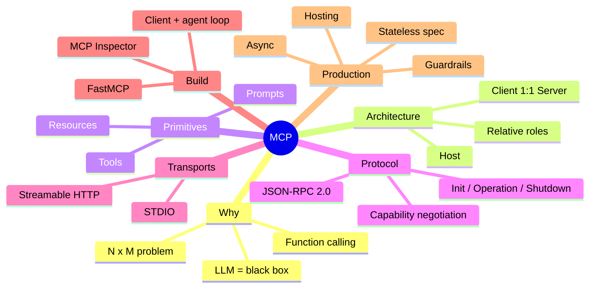
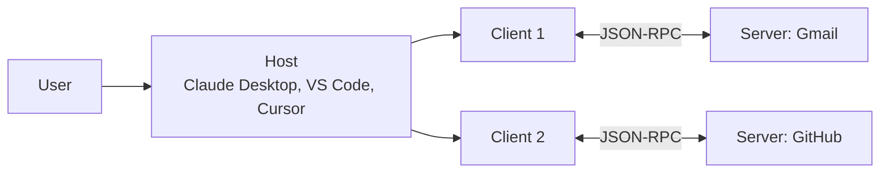
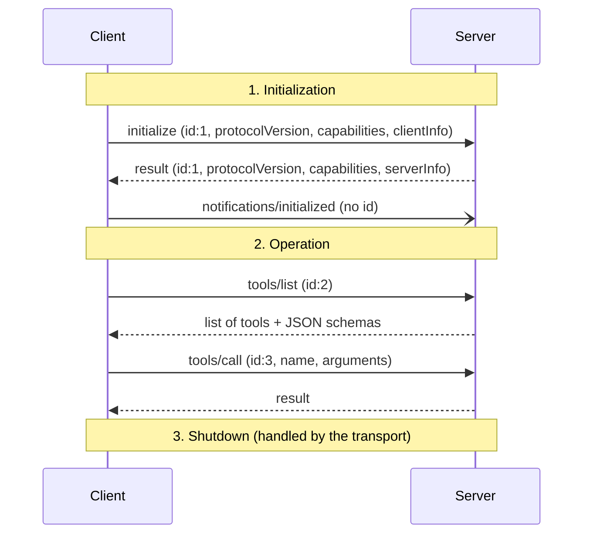

# 🧭 MCP (Model Context Protocol): Summary Notes for Revision & Interview Prep

> One document that condenses the whole 7-part MCP series: why MCP exists, its architecture, primitives, JSON-RPC lifecycle, transports, building servers and clients, hosting, the modern (stateless) spec, advanced capabilities, and design and security judgment. Use it the night before an interview, and go back to the detailed notes (01–07) for depth.

---

## 📑 Table of Contents

1. [Series Map](#-series-map)
2. [Core Concepts, Topic by Topic](#-core-concepts-topic-by-topic)
    1. [Why MCP Exists](#1-why-mcp-exists)
    2. [Architecture: Host, Client, Server](#2-architecture-host-client-server)
    3. [The Three Primitives](#3-the-three-primitives)
    4. [JSON-RPC 2.0](#4-json-rpc-20)
    5. [The Lifecycle: Initialization, Operation, Shutdown](#5-the-lifecycle-initialization-operation-shutdown)
    6. [Transports: STDIO vs Streamable HTTP](#6-transports-stdio-vs-streamable-http)
    7. [Building Servers with FastMCP](#7-building-servers-with-fastmcp)
    8. [Connecting, Integrating & Hosting](#8-connecting-integrating--hosting)
    9. [Building an MCP Client & the Agentic Loop](#9-building-an-mcp-client--the-agentic-loop)
    10. [Legacy vs Modern MCP](#10-legacy-vs-modern-mcp)
    11. [Advanced Capabilities](#11-advanced-capabilities)
    12. [Design Judgment & Security](#12-design-judgment--security)
3. [Glossary](#-glossary)
4. [Cheat Sheet](#-cheat-sheet)
5. [Interview Questions & Answers](#-interview-questions--answers)
6. [Scenario-Based Questions](#-scenario-based-questions)
7. [Common Mistakes](#-common-mistakes)
8. [Final One-Page Revision Sheet](#-final-one-page-revision-sheet)

---

## 🗺 Series Map

| # | Note | What it adds |
|:-:|---|---|
| 1 | [Why MCP Exists & Core Architecture](<01. Why MCP Exists & Core Architecture.md>) | LLM as black box → function calling → N×M problem → MCP; host/client/server |
| 2 | [Client, Primitives, Lifecycle & JSON-RPC](<02. MCP Client, Primitives, Lifecycle & JSON-RPC.md>) | 1:1 client–server, tools/resources/prompts, 3-phase lifecycle, handshake, version negotiation |
| 3 | [Capability Negotiation & Operation](<03. Capability Negotiation & Operation.md>) | Capabilities, elicitation, discovery vs calling, information leakage, no-code project |
| 4 | [Transport, Shutdown & Building Servers](<04. Transport Layer, Shutdown Phase & Building Real Servers.md>) | STDIO vs Streamable HTTP, shutdown per transport, FastMCP, MCP Inspector |
| 5 | [Real Integrations & System Design](<05. Real Integrations, a Complete Real-World Project & System Design.md>) | Connectors vs config file, Time Tracker (FastAPI + MCP), sampling, async, guardrails |
| 6 | [Hosting, Productionizing & Clients](<06. Hosting, Productionizing & Clients.md>) | HTTP transport, curl handshake, Horizon/Vercel, client from scratch, "AI never calls the tool" |
| 7 | [Modern Architecture & Advanced Capabilities](<07. Modern Architecture, the MCP Client & Advanced Capabilities.md>) | Stateless spec, routing/caching/tracing, agentic loop, LangChain, elicitation, ping/timeouts/progress |



---

## 📚 Core Concepts, Topic by Topic

### 1. Why MCP Exists

The story the course tells, in five steps:

```text
LLM (Nov 2022)       -> a "black box": next-token predictor, can ANSWER but not ACT ("a brain with no hands")
Context              -> everything the model can SEE when it answers; more context = better answers
Function calling     -> (mid-2023) model picks a tool + arguments; YOUR code executes it
Scaling nightmare    -> every AI app x every tool = its own integration, auth, errors, maintenance (N x M)
MCP (Anthropic)      -> one open standard; the server owner maintains tools ONCE; every app just connects
```

- **Official definition:** *"An open-source standard for connecting AI applications to external systems."*
- **Instructor's framing (instead of the "USB-C" analogy):** a collection of tools/actions with a **standardized way for AI to discover and call them**.
- **The name:** *Model* (the LLM) + *Context* (what it can see) + *Protocol* (the standard rules).

**N×M → N+M** (the core argument):

| | Integrations for 5 apps × 5 services |
|---|---|
| Without MCP | 5 × 5 = **25** custom integrations |
| With MCP | 5 clients + 5 servers = **10** |

> 💡 The model **never executes anything itself**, in function calling or in MCP. It only *asks*; a client executes.

---

### 2. Architecture: Host, Client, Server



| Role | What it is | SIM-card analogy |
|---|---|---|
| **Host** | The AI application the user interacts with | 📱 Phone |
| **Client** | Created *inside* the host; speaks MCP to one server | 💳 SIM card |
| **Server** | Exposes tools, resources and prompts | 📡 Network |

- **The host never talks to a server directly.** It always starts a client.
- **One client ↔ one server, always** (never one-to-many). Benefits: **scalability, parallelism, security** (a compromised connection stays isolated).
- **Client and server are relative roles.** Whoever makes the request is the client. An MCP server can itself call another MCP server.

---

### 3. The Three Primitives

| Primitive | What it is | Who controls it | Methods | Example |
|---|---|---|---|---|
| **Tools** | Actions (≈99% of real usage) | Model decides when to call | `tools/list`, `tools/call` | send an email, log time |
| **Resources** | Read-only data / context | Application | `resources/list`, `resources/read`, templates, `subscribe` | README, DB schema |
| **Prompts** | Reusable, parameterised templates | User | `prompts/list`, `prompts/get` | "generate weekly report" |

- **List first, then call/read/get.** List is the catalogue; call actually does the work.
- Not every server needs all three. Many (e.g. GitHub) expose only tools.

---

### 4. JSON-RPC 2.0

**JSON** (data format) + **RPC** (call a function on another machine as if it were local). MCP adopted it; it didn't invent it.

**Why JSON-RPC instead of REST (4 reasons):**
1. **Lightweight:** one small message shape, no resource/verb design.
2. **Transport-agnostic:** the same messages run over STDIO or HTTP.
3. **Bidirectional:** the *server* can also send requests (elicitation, sampling, progress). REST is client → server only.
4. **Built-in notifications:** fire-and-forget messages with **no `id`** and no reply.

| Message | Has `id`? | Expects reply? |
|---|:-:|:-:|
| Request | ✅ | ✅ |
| Response (`result` or `error`) | ✅ (same id) | — |
| Notification | ❌ | ❌ |

> 📌 MCP is a protocol **layered on top of** a transport. "MCP vs HTTP" compares two different layers.

---

### 5. The Lifecycle: Initialization, Operation, Shutdown

Analogy: meet someone → talk → say goodbye. You can't skip the introduction.



**Version negotiation:** the client sends its latest version → the server agrees, **or makes exactly one counter-offer** (its own latest) → if the client can't accept it, **disconnect**. It is not a retry loop.

**Capability negotiation** (the "honest menu", exchanged in the handshake):

| Client can offer | Server can offer |
|---|---|
| `roots`, `sampling`, `elicitation`, experimental | `tools`, `resources`, `prompts`, `logging`, `completions` |

**Operation phase = two steps:**
1. **Discovery** (`tools/list`): automatic, right after the handshake, costs no LLM tokens.
2. **Calling** (`tools/call`): triggered by a user request; needs `name` + `arguments`.

In a live trace, one question using two tools took **three LLM calls** with fast tool calls in between, and every request had a unique, incrementing `id`.

---

### 6. Transports: STDIO vs Streamable HTTP

| | **STDIO** | **Streamable HTTP** |
|---|---|---|
| Where | Local machine | Remote, over the network |
| How | Client launches the server as a **sub-process**; JSON-RPC over stdin/stdout | Client **POSTs** JSON-RPC to one endpoint (e.g. `/mcp`); server replies with JSON or upgrades to **SSE** for streaming |
| Auth | None needed (process boundary) | Needed (OAuth, tokens, etc.) |
| Pros | Fast, secure, simple | Shareable, scalable, team/enterprise use |
| Cons | Single machine, single user | Network latency, more to secure |
| Use for | Dev tools, local files | Customer-facing / shared servers |

> ⚠️ The older **HTTP + SSE** transport was **deprecated in March 2025**, replaced by Streamable HTTP.

**Shutdown depends on the transport. No JSON-RPC shutdown message is sent.**

| STDIO, client-initiated (≈99%) | STDIO, server-initiated (rare) | Streamable HTTP |
|---|---|---|
| 1. Close stdin → 2. `SIGTERM` → 3. `SIGKILL` (last resort) | Server closes its output stream and exits | Client closes the HTTP connection (or sends `DELETE` with the session id). An **unexpected** server close means something is wrong, so reconnect gracefully |

---

### 7. Building Servers with FastMCP

- **Official (legacy) SDK** = verbose, low-level (like **TensorFlow**).
- **FastMCP** = decorator-based wrapper (like **Keras**). Created by **Jeremiah Lowin (Prefect)**, *not* the FastAPI team. FastMCP 1.0 was folded into the official Python SDK.

```python
from fastmcp import FastMCP

mcp = FastMCP("Time Track")

@mcp.tool()
def log_time(employee: str, project: str, hours: float) -> dict:
    """Log hours for an employee. The docstring IS the description the LLM reads."""
    return db.log_time(employee, project, hours)

@mcp.resource("schema://db")
def db_schema() -> str:
    """Database schema, as read-only context."""
    return SCHEMA

@mcp.prompt()
def weekly_report(employee: str, week_start: str) -> str:
    return f"Use get_timesheet and get_project_summary to report on {employee} for week {week_start}..."

if __name__ == "__main__":
    mcp.run()                      # STDIO by default
    # mcp.run(transport="http", host="127.0.0.1", port=8001)
```

- Type hints → JSON Schema for arguments. Docstring → tool description. **Description quality directly drives the LLM's tool selection.**
- **MCP Inspector** = official, framework-agnostic tester (checks protocol correctness only):
  `npx @modelcontextprotocol/inspector python my_server.py`
- **Auto-conversion:** `FastMCP.from_fastapi(app=app)` wraps every endpoint. It's fast, but the course prefers **hand-built tools** because they give control over names and descriptions, let one tool combine several APIs, and avoid touching working production code.
- **Tools don't have to map 1:1 to endpoints.** Design them around **user actions**, not tables.
- **Mount MCP onto an existing FastAPI app** so one server serves web, REST and MCP:
  ```python
  mcp_app = mcp.http_app()          # streamable_http_app() in the official SDK
  app.mount("/mcp", mcp_app)
  ```
- **Build the real application first; MCP sits on top of it.**

---

### 8. Connecting, Integrating & Hosting

**Two ways to connect a server to Claude Desktop:**

| Connectors (UI) | Config file (`claude_desktop_config.json`) |
|---|---|
| Hosted, remote servers (URL) | Local, developer-built servers |
| Updates the same config file internally | Use **absolute paths** (`which uv`), because the host's process doesn't inherit your shell `PATH` |

Shortcut: `uv run fastmcp install claude-desktop my_server.py`

- **Third-party servers aren't always HTTP.** Many run locally via `npx`, `uvx` or Docker, and a "local" server can still call remote APIs.
- **Raw handshake via curl** (what a client does for you):
  1. `POST /mcp` with `initialize` → the response header carries **`Mcp-Session-Id`**
  2. `POST /mcp` with `tools/list` + header `Mcp-Session-Id: <id>`
  Both need `Accept: application/json, text/event-stream`.
- **Hosting lessons:**
  - Prefect Horizon is MCP-native, but on the free tier external clients must sign in to the org.
  - Vercel works for the whole app, but you must disable **Deployment Protection**. Removing a login wall is **not** the same as securing your tools.
  - **Design flaw found live:** `init_db()` ran unconditionally on startup, so the DB was wiped on every deploy. Use a real, persistent database.
- **Docker** packages the server + dependencies into one deployable unit.
- **MCP Gateway** puts many servers behind one entry point (auth, routing, observability).

---

### 9. Building an MCP Client & the Agentic Loop

> ⭐ **The most repeated point of the series: the AI model never calls a tool directly. It only *asks*; the MCP client calls it.**

**Harness engineering** means wiring a model to tools through a client and an agent loop. Claude Desktop and Claude Code do it for you; outside them, you build it.

**Five-step client lifecycle (same for every library and transport):**
`Start → Handshake → Call → Use response → Clean up`

FastMCP client transports: **STDIO** (path to a script), **in-memory** (pass the server object, good for tests), **HTTP** (URL), **multi-server** (an `mcpServers` config dict, with tools namespaced per server).

**The agentic loop in plain Python (what LangChain, CrewAI and AutoGen do underneath):**

```python
async with Client("server.py") as mcp:
    tools = [to_llm_schema(t) for t in await mcp.list_tools()]   # MCP schema -> model's tool format
    messages = [{"role": "user", "content": question}]
    while True:
        resp = llm.messages.create(model=MODEL, tools=tools, messages=messages)
        if resp.stop_reason != "tool_use":
            return resp.content[0].text                           # final answer
        messages.append({"role": "assistant", "content": resp.content})
        for call in [b for b in resp.content if b.type == "tool_use"]:
            result = await mcp.call_tool(call.name, call.input)   # the CLIENT executes it
            messages.append({"role": "user", "content": [
                {"type": "tool_result", "tool_use_id": call.id, "content": str(result)}]})
```

- **LangChain's MCP adapter** (`langchain-mcp-adapters`, `MultiServerMCPClient`) is a **client-side** wrapper that turns MCP tools into LangChain tools. LangChain does not create servers.
- The protocol matters, not the language: a Python client can drive a TypeScript server.

---

### 10. Legacy vs Modern MCP

| | **Legacy (stateful)** | **Modern (stateless)** |
|---|---|---|
| Session | One handshake → one session, pinned to one server instance | Every request is self-contained; any instance can answer |
| Scaling | Needs sticky sessions | Plain horizontal scaling behind a load balancer |
| Server → client back channel | Available (elicitation, sampling) | Limited |
| In production today | **Still the majority** | Emerging |

Modern-spec additions covered in the course:
- **Routing headers** (`MCP-Method`, `MCP-Name`): infrastructure can route without parsing the JSON body.
- **Caching fields** (TTL in ms, cache scope): how long and how widely a response can be reused.
- **W3C trace context:** distributed tracing across client → gateway → server.
- **Per-request versioning** and **reverse-domain-namespaced extensions** (avoid vendor name clashes); **MCP Apps** (UI extensions).
- **Deprecation policy:** only a few things were removed outright (old handshake, `logging/setLevel`, old session header). Most deprecations get **≥12 months** of support. *Deprecated ≠ removed ≠ unused.*

> ⚠️ The spec is moving fast. Check names, dates and status against the current spec at modelcontextprotocol.io before quoting them in an interview.

---

### 11. Advanced Capabilities

| Capability | Direction | What it does | Status / key point |
|---|---|---|---|
| **Sampling** | Server → Client | Server "borrows" the client's LLM (`ctx.sample`) so it doesn't need its own model key | **Deprecated** in the course's modern spec; call an LLM provider API directly from inside the tool |
| **Elicitation** | Server → Client → User | Server pauses mid-tool-call to ask for missing info or confirmation (`ctx.elicit`) | Works only *during* a request; relies on the stateful back channel; **not the same as HITL** |
| **Roots** | Client → Server | Tells the server which filesystem/URI boundaries it may work in | Client capability |
| **Ping** | Either way | Liveness check | Supported |
| **Timeouts & cancellation** | Client | Every request needs a timeout; on expiry, send a cancellation, never hang | `notifications/cancelled` |
| **Progress notifications** | Server → Client | Incremental progress on long calls; separates "slow" from "stuck" and can reset the timeout | `notifications/progress` |
| **Logging** | Server → Client | Structured log messages | Server capability |

```python
# Elicitation inside a tool
result = await ctx.elicit(message="Delete 42 entries?", response_type=bool)
if result.action == "accept" and result.data:
    delete_entries()
else:
    return "Cancelled"
```

**Elicitation vs HITL:** elicitation is a *protocol mechanism* (the server asks a question mid-task). HITL is a broader *design principle*, e.g. the host's "Allow once" approval before any tool runs.

**Async matters:** one slow, blocking tool would stall every other concurrent request. Use async I/O for DB and API calls.

---

### 12. Design Judgment & Security

**When MCP is (and isn't) the right choice**

| ✅ Use MCP | ❌ Don't use MCP |
|---|---|
| Many AI apps or agents need the same capability | One app, one fixed integration (a plain API is simpler) |
| The model should *choose* which tool to use | A step that **must always happen**, deterministically (e.g. a per-transaction compliance check). Put it behind plain code |
| Internal company systems no vendor will build for you | |

**Why MCP beats "just wrapped REST APIs":** (1) maintained once, centrally; (2) two-way, real-time communication (progress, elicitation); (3) LLM-native discovery and tool selection from descriptions; (4) N+M instead of N×M.

**Security checklist**
- **Information leakage:** data returned by tools is sent to the model provider. Mitigate with app-level locks and **middleware guardrails** before the model call.
- **Guardrails via env vars:** e.g. `ALLOW_WRITE_TOOLS=false` → register read-only tools only; filter by tenant for **multi-tenancy**.
- **Dangerous tools** (dynamic SQL, deletes): add an allow-list, read-only DB user, parameterisation, row limits, and elicitation or approval before running.
- **Trust:** connect only to verified servers. Watch for prompt injection through tool output and malicious tool descriptions ("tool poisoning").
- **Least privilege & auth:** per-tool / role-based auth is the server owner's job (OAuth for HTTP, rate limits).
- **Agent isolation lesson:** the course discussed a case where "sandboxed" agents reached the internet through an internal component that had network access. **Audit every network path**, not just the agent process.
- **Test across multiple LLM clients** with a ground-truth test set, because tool selection quality depends on the model.

---

## 📝 Glossary

| Term | One-line meaning |
|---|---|
| **MCP** | Open standard (Anthropic, Nov 2024) for connecting AI apps to external tools and data |
| **Host** | The AI app (Claude Desktop, Cursor, VS Code) that contains clients |
| **Client** | Component in the host with a 1:1 connection to one server; executes tool calls |
| **Server** | Exposes tools, resources and prompts |
| **Tool / Resource / Prompt** | Action / read-only data / reusable template |
| **JSON-RPC 2.0** | Message format: requests (with `id`), responses (same `id`), notifications (no `id`) |
| **Capability negotiation** | Client and server declare supported features during `initialize` |
| **Discovery / Calling** | `tools/list` (automatic) / `tools/call` (`name` + `arguments`) |
| **STDIO** | Local transport: server as sub-process, stdin/stdout |
| **Streamable HTTP** | Remote transport: POST to `/mcp`, optional SSE streaming; replaced HTTP+SSE |
| **Mcp-Session-Id** | Session header returned by `initialize` on stateful HTTP servers |
| **FastMCP** | Decorator-based Python framework for MCP servers and clients |
| **MCP Inspector** | Official GUI for testing any MCP server |
| **Sampling** | Server asks the client's LLM to generate text (deprecated, per the course) |
| **Elicitation** | Server asks the user for input mid-task, via the client |
| **Roots** | Client-declared boundaries the server may operate within |
| **Harness engineering** | Wiring a model to tools via a client + agent loop |
| **MCP Gateway** | Single entry point aggregating many MCP servers |
| **N×M vs N+M** | Integration count without vs with a shared protocol |

---

## 📋 Cheat Sheet

```text
WHY        LLM can't act -> function calling -> N x M chaos -> MCP (N + M)
WHO        Host (phone) -> Client (SIM, 1:1) -> Server (network)
WHAT       Tools (model-controlled) | Resources (app-controlled) | Prompts (user-controlled)
LANGUAGE   JSON-RPC 2.0: request(id) / response(same id) / notification(no id)
LIFECYCLE  initialize -> result -> notifications/initialized -> tools/list -> tools/call -> shutdown
VERSION    client proposes latest -> server agrees OR one counter-offer -> else disconnect
TRANSPORT  STDIO (local, subprocess) | Streamable HTTP (remote, POST /mcp, SSE optional)
SHUTDOWN   STDIO: close stdin -> SIGTERM -> SIGKILL | HTTP: close connection / DELETE session
CLIENT     start -> handshake -> call -> use response -> clean up
LOOP       list_tools -> send to LLM -> stop_reason == tool_use ? call_tool, append, repeat : answer
GOLDEN     The model NEVER calls a tool. The CLIENT does.
```

```bash
npx @modelcontextprotocol/inspector python server.py           # test a server
uv run fastmcp run server.py --transport http --port 8001       # run over HTTP
uv run fastmcp install claude-desktop server.py                 # register with Claude Desktop
which uv                                                         # absolute path for config files
```

```json
{"jsonrpc":"2.0","id":1,"method":"initialize","params":{"protocolVersion":"...","capabilities":{},"clientInfo":{"name":"c","version":"1"}}}
{"jsonrpc":"2.0","method":"notifications/initialized"}
{"jsonrpc":"2.0","id":2,"method":"tools/list"}
{"jsonrpc":"2.0","id":3,"method":"tools/call","params":{"name":"log_time","arguments":{"employee":"Asha","project":"X","hours":2}}}
```

---

## 🔥 Interview Questions & Answers

### 🟢 Fundamentals

**Q1. What is MCP, in one sentence?**
An open standard from Anthropic that gives AI applications one uniform way to discover and call external tools, data and prompts, so each integration is built once (as a server) and reused by every MCP-compatible app.

**Q2. What problem does it solve that function calling didn't?**
Function calling gave models "hands", but each app still had to write and maintain its own integration per tool, with its own schema, auth and error handling. That's N×M effort. MCP standardises the interface, so it becomes N+M, and the tool owner maintains the server once.

**Q3. Explain host, client and server.**
The host is the AI app. It creates one client per server. Each client keeps a 1:1 JSON-RPC session with its server, which exposes primitives. Phone / SIM / network. The roles are relative: whoever sends the request is acting as the client.

**Q4. Why one client per server?**
Isolation (a failure or compromise stays in one connection), independent lifecycles and capabilities per server, parallelism, and simpler scaling.

**Q5. Tools vs resources vs prompts?**
Tools are actions the *model* chooses to invoke (side effects allowed). Resources are read-only context the *application* attaches. Prompts are templates the *user* picks. Tools dominate real usage.

**Q6. Does the LLM execute the tool?**
No. The model emits a structured request (name + arguments). The client executes `tools/call` against the server and feeds the result back as context.

**Q7. What are the transports and when do you use each?**
STDIO for local, single-user, low-latency use (the server runs as a sub-process, no network auth). Streamable HTTP for remote, shared or enterprise servers (POST to one endpoint, SSE for streaming, needs real auth). HTTP+SSE is deprecated.

### 🟡 Protocol depth

**Q8. Walk through the initialization handshake.**
The client sends `initialize` (id, protocol version, capabilities, client info). The server replies with the same id and its version, capabilities and info. The client sends the `notifications/initialized` notification (no id, no reply). Only then does operation start.

**Q9. How does version negotiation work?**
The client offers its latest version. The server accepts it or replies with its own latest supported version, and that's the only counter-offer. If the client can't support that, it disconnects. There's no retry loop.

**Q10. What is capability negotiation, with examples?**
Both sides declare optional features during `initialize`, so neither uses something the other lacks. Client: roots, sampling, elicitation. Server: tools, resources, prompts, logging, completions (plus sub-flags like `listChanged` / `subscribe`).

**Q11. Why JSON-RPC rather than REST?**
It's lightweight, transport-agnostic (the same messages over STDIO or HTTP), bidirectional (servers can send requests such as elicitation), and has native notifications. REST assumes the client initiates every exchange over HTTP.

**Q12. Request vs notification?**
A request has an `id` and must get a response with that same `id`. A notification has no `id` and gets no response (e.g. `initialized`, `progress`, `cancelled`).

**Q13. How does shutdown work?**
No dedicated JSON-RPC message. STDIO: the client closes stdin, waits, sends SIGTERM, then SIGKILL as a last resort. Server-initiated shutdown is rare. HTTP: close the connection or terminate the session. An unexpected drop is an error, so reconnect with backoff.

**Q14. What is `Mcp-Session-Id`?**
A header the server returns on `initialize` over stateful Streamable HTTP. The client must send it on every later request so the server can link them to the same session.

### 🔴 Building & production

**Q15. How do you build and test a server quickly?**
FastMCP: create `FastMCP("name")` and decorate functions with `@mcp.tool()`, `@mcp.resource(uri)` and `@mcp.prompt()`. Type hints become the schema and docstrings become descriptions. Test with MCP Inspector, then with real clients.

**Q16. `FastMCP.from_fastapi()` or hand-built tools?**
Auto-conversion is fine for prototypes. For production, hand-build: you control names and descriptions (which drive LLM selection), can combine several endpoints into one task-level tool, can hide dangerous endpoints, and don't touch working API code.

**Q17. How should tools be designed?**
Around user intents ("log time", "weekly summary"), not around tables or CRUD endpoints. Keep the set small and the descriptions precise. Return structured, concise output. Make operations idempotent where possible and separate read tools from write tools.

**Q18. Build an agent with MCP but without a framework.**
Connect the client, `list_tools`, convert the schemas to the model's tool format, call the model, and if `stop_reason == "tool_use"` run `call_tool`, append the `tool_result`, and loop. Otherwise return the text. Add a max-iteration cap and timeouts.

**Q19. What does LangChain add?**
A client-side adapter (`MultiServerMCPClient`) that loads MCP tools as LangChain tools for its agents. It doesn't build servers; you still use FastMCP or the SDK for that.

**Q20. Sampling vs elicitation?**
Sampling: the server asks the *client's model* to generate text (no server-side API key needed). The course treats it as deprecated; call an LLM API inside the tool instead. Elicitation: the server asks the *user* for input or confirmation mid-call.

**Q21. Legacy vs modern MCP: why does it matter?**
Stateful sessions pin a client to one server instance, so you need sticky load balancing and lose the session on failover. Stateless requests let any replica answer, which enables horizontal scaling, caching (TTL/scope) and header-based routing. Most production servers are still stateful, so supporting both is pragmatic.

**Q22. How do you handle long-running tools?**
Make them async. Emit progress notifications. Set client-side timeouts that progress can reset. Support cancellation. For very long jobs, return a job id plus a status tool.

**Q23. How do you secure an MCP server?**
OAuth/token auth on HTTP, least-privilege credentials, per-tool authorisation, env-gated write tools, input validation and allow-lists (especially for SQL and shell), rate limits, audit logs, tenant isolation, approval or elicitation for destructive actions, and treating tool output as untrusted (prompt injection). Data sent to the model also leaves your boundary.

**Q24. When would you *not* use MCP?**
When a step must run every time, deterministically (compliance, billing). The model might not choose to call it, so keep it in plain code. Also when there's a single consumer and a single fixed integration, where a direct API is simpler.

**Q25. How do you scale an MCP server?**
Prefer the stateless/HTTP mode behind a load balancer (or sticky sessions if stateful), async I/O, a shared persistent database (never a local SQLite reset on startup), containerise with Docker, put a gateway in front for auth, routing and observability, and use tracing with graceful shutdown that drains in-flight requests.

---

## 🧪 Scenario-Based Questions

| Scenario | Strong answer |
|---|---|
| Claude Desktop can't start your local server, but it runs fine in the terminal | The host doesn't inherit your shell `PATH`. Use absolute paths (`which uv`) in `claude_desktop_config.json` and check the MCP logs |
| Your hosted server's data vanishes after each deploy | Startup code (`init_db()`) recreates the DB. Make migrations idempotent and use an external persistent DB |
| Interns should only read data; managers may write | Env-var or role-gated tool registration (`ALLOW_WRITE_TOOLS`), plus per-request auth checks inside tools |
| A SaaS with many customers shares one MCP server | Multi-tenancy: derive the tenant from the auth token, filter every query by tenant, never trust a tenant id sent by the model |
| An agent must run a compliance check on every transaction | Don't leave it to tool selection. Enforce it in code or middleware before or after the call |
| A tool sometimes takes 3 minutes and the client times out | Async + progress notifications to reset the timeout, cancellation support, or a job-id/status pattern |
| You need to scale to 20 replicas | Stateless mode, or stateful with sticky routing; shared state store; gateway; tracing |
| A natural-language-to-SQL tool is requested | Read-only DB user, schema as a resource, allow-listed statements, row limits, query timeouts, elicitation before writes |
| Your company has 10 AI apps all integrating Jira separately | Build one internal Jira MCP server: N×M becomes N+M, maintained in one place |
| An "isolated" agent sandbox leaked data | Audit every reachable component (repos, proxies, package mirrors), not just the agent's own network access |

---

## ⚠️ Common Mistakes

- ❌ "The LLM calls the tool." ✅ The client does.
- ❌ "A host connects straight to servers" / "one client, many servers." ✅ Host → one client per server.
- ❌ "MCP is just a REST wrapper." ✅ It's a bidirectional JSON-RPC protocol with discovery, capabilities and lifecycle, independent of transport.
- ❌ "Version negotiation retries until it finds a match." ✅ Exactly one counter-offer, then disconnect.
- ❌ "Discovery happens when the user asks something." ✅ `tools/list` runs right after the handshake.
- ❌ "Shutdown is a JSON-RPC message." ✅ The transport handles it.
- ❌ "Deprecated means nobody uses it." ✅ Most deployed servers still use legacy (stateful) patterns.
- ❌ "FastMCP is made by the FastAPI team." ✅ Jeremiah Lowin / Prefect.
- ❌ "Tools must mirror API endpoints." ✅ Design them around user actions.
- ❌ "Elicitation = human-in-the-loop." ✅ Elicitation is a protocol mechanism; HITL is a design principle.
- ❌ Shipping a dynamic SQL or delete tool without guardrails, or a tool call without a timeout.
- ❌ Disabling a platform's login wall and calling the server "secured".

---

## 📌 Final One-Page Revision Sheet

### ⭐ The 10 things you must be able to say without notes
1. **MCP** = open standard for AI apps ↔ external systems; turns **N×M into N+M**.
2. **Host → Client (1:1) → Server**; the roles are relative; the host never talks to a server directly.
3. **Primitives:** tools (model), resources (app), prompts (user); list, then call/read/get.
4. **JSON-RPC 2.0:** lightweight, transport-agnostic, bidirectional, notifications.
5. **Lifecycle:** `initialize` → result → `notifications/initialized` → operation → shutdown.
6. **Negotiation:** version (one counter-offer) + capabilities (honest menu).
7. **Transports:** STDIO (local subprocess) vs Streamable HTTP (remote POST + SSE); HTTP+SSE is deprecated.
8. **The model never calls tools.** The client does, inside an agent loop (`stop_reason == tool_use`).
9. **Server → client features:** elicitation (ask the user), sampling (borrow the LLM, deprecated per the course), progress, logging.
10. **Production:** async, timeouts/cancellation, persistent DB, auth + guardrails, multi-tenancy, stateless scaling, gateway, tracing.

### ⭐ Analogies to use in interviews
- **Phone / SIM / network** → host / client / server
- **Meet → talk → goodbye** → lifecycle
- **TensorFlow / Keras** → official SDK / FastMCP
- **Running GTA V on Windows XP** → version incompatibility, so disconnect
- **WhatsApp vs phone call** → shutdown depends on how you connected

### ⭐ Code you should be able to write from memory
```python
# Server
mcp = FastMCP("demo")
@mcp.tool()
def add(a: int, b: int) -> int:
    """Add two numbers."""
    return a + b
mcp.run()

# Client
async with Client("server.py") as c:
    print(await c.list_tools())
    print(await c.call_tool("add", {"a": 2, "b": 3}))
```

> 🎯 **Interview tip from the course:** interviewers reject candidates who can't explain the full architecture and lifecycle. Practise drawing the sequence diagram in Section 5 and narrating one `tools/call` end to end.
